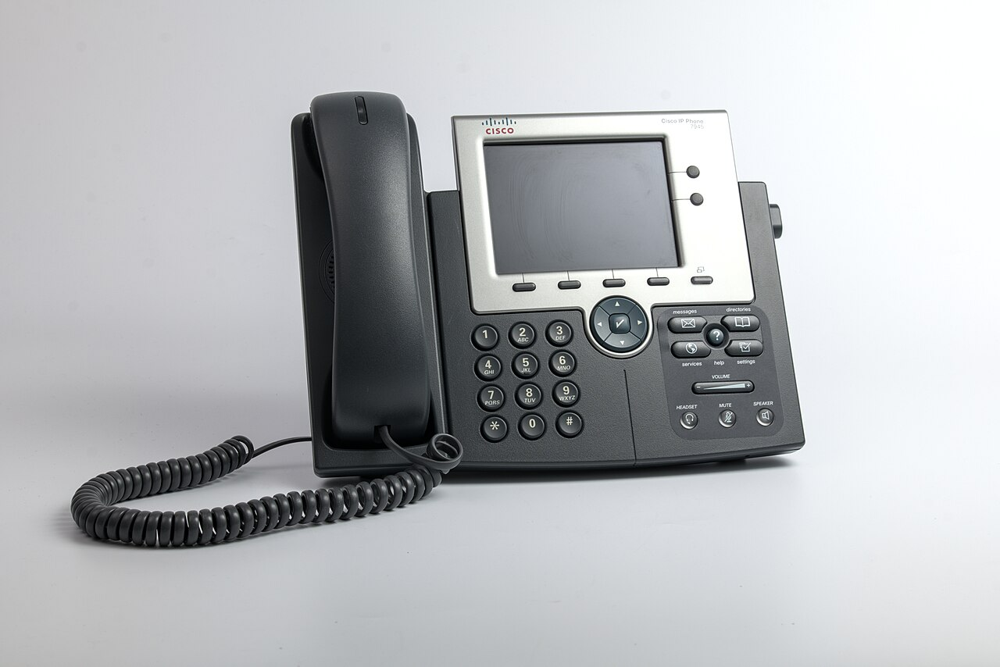
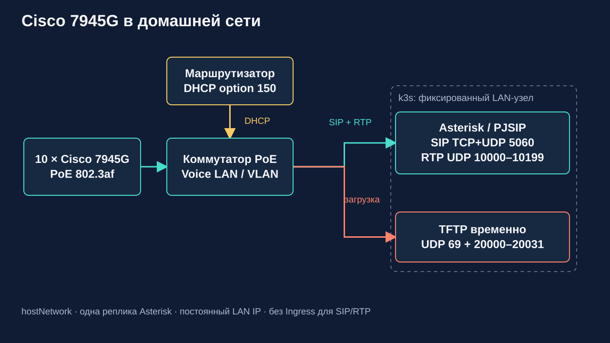
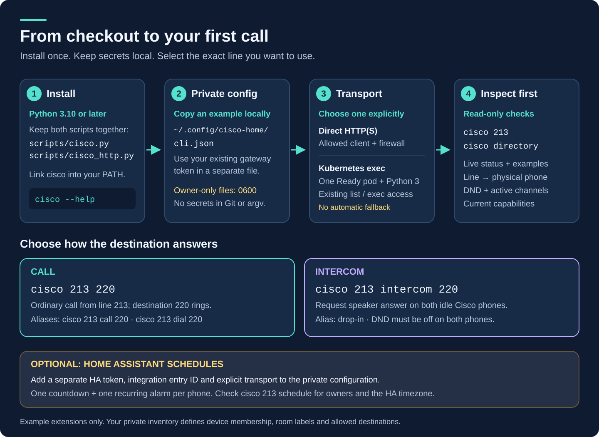

# Cisco 7945G: home telephony with Asterisk and k3s

For an already configured hands-free phone, use the [daily-use guide](docs/voice-daily-use.md).
For setup and opt-in voice operation, start with the [phone and CLI voice quickstart](docs/voice-quickstart.md).
To install [Beta 18](https://github.com/4alvit/cisco-home-telephony/releases/tag/v0.1.0-beta.18),
use its matching source and wake-capable archive with the [gateway installation guide](docs/voice-gateway-deployment.md)
and [CLI installation guide](docs/cli-installation.md).

A practical guide to converting **Cisco 7945G** phones to SIP and running them
with Asterisk on k3s, integrated with Home Assistant.



*Cisco 7945G model reference photo by
[-stk](https://commons.wikimedia.org/wiki/User:-stk),
[Wikimedia Commons](https://commons.wikimedia.org/wiki/File:Cisco_IP_Phone_7945_P1110468.jpg),
[CC BY-SA 4.0](https://creativecommons.org/licenses/by-sa/4.0/).
This illustrates the model, not an individual phone in our installation.
See [photo attribution](assets/photos/README.md).*

**These phones already support IEEE 802.3af PoE.** No hardware modification is
needed. Use a PoE switch or a compatible active injector, connected to the
**SW** port. Asterisk uses the native **7945/7965 SIP firmware (SIP45)**;
conversion to MPP is not required.



## Start here

- **Use an existing PBX:** [install and configure the Cisco CLI](docs/cli-installation.md),
  check the directory, then place an ordinary call or an intercom call.
- **Set up the server:** [Asterisk installation, connections and operations](docs/asterisk-operations.md)
  walks through private configuration, k3s deployment, phone registration and acceptance checks.
- **Diagnose a problem:** follow the [Asterisk operations guide](docs/asterisk-operations.md)
  to separate power/provisioning, SIP registration, call routing, RTP audio and remote control.
- **Improve call and radio sound:** [wideband audio](docs/audio-quality.md) explains
  G.722, the 16 kHz radio path, codec checks and safe fallback to G.711.
- **Look up a command:** the [CLI reference](docs/cli.md) covers calls, one-time speaker
  intercom, DND, timers, weekday alarms, text and images.
- **Find a number:** the [combined directory](docs/phone-directory.md) includes
  phones, enabled radio stations and service shortcuts, with a private contacts export.
- **Control a saved alarm by calling:** [641 and incoming group 621](docs/phone-services.md)
  cover spoken confirmations, missing-alarm behavior and private recipient selection.
- **Use free external SIP services:** the [provider and practice directory](docs/free-voip-directory.md)
  lists published test menus, account restrictions and the difference between a SIP identity and an incoming telephone number.
- **Try the stock-phone voice pilot:** [implementation and measured acceptance](docs/voice-rollout.md),
  [CLI installation](docs/voice-cli-install.md), and [one-shot k3s execution](docs/voice-k3s.md).
- **Try the optional wake pilot:** [build the CPU wake runtime](docs/voice-wake-runtime.md)
  and [prepare a suspended one-shot k3s Job](docs/voice-wake-k3s.md).
  Private models remain outside the image; activation is explicit and bounded.
- **Control voice sessions and hands-free mode:** [gateway, CLI and phone menu setup](docs/voice-control.md).
  These optional controls require the matching voice runtime and private registry;
  `voice enable` grants automatic sessions and `voice disable` stops that intent.
  Each media session remains bounded; renewal includes cleanup and preparation gaps.
  Updating a client alone does not enable capture.
- **Deploy the voice gateway:** [installation, upgrade and rollback](docs/voice-gateway-deployment.md)
  preserve the existing gateway configuration and persistent state.
- **Check the selected voice services:** [read-only pipeline preflight](docs/voice-pipeline-preflight.md)
  verifies the configured STT/TTS and optional exact voice pins before a session.
- **Measure voice quality:** [wake detection evaluation](docs/wake-qualification.md)
  separates labeled accuracy from unlabeled activations;
  [latency analysis](docs/local-voice-performance.md) measures each response stage.
- **Test the integrated voice path:** the [offline acceptance harness](docs/voice-integration-test.md)
  exercises synthetic sessions without contacting a real phone or Home Assistant.
  The [voice pipeline check](docs/voice-pipeline-acceptance.md) adds private
  positive wake recordings, production telephone codecs, audio-byte comparisons
  and explicit cleanup checks against a scripted HA peer.
  The [entrypoint check](docs/voice-entrypoint-acceptance.md) also exercises the
  normal configuration loaders and command startup with simulated device I/O.
  The [reserved-wrapper check](docs/voice-reserved-acceptance.md) covers the
  durable attempt marker, child process, replay rejection and cleanup.
- **Preview a configured camera:** [bounded camera preview](docs/camera-preview.md)
  adds an optional, automatically refreshed view to the phone applications.
  Ordinary calls and voice sessions retain priority; pictures are not live video.
- **Show motion alerts on free phones:** [motion snapshots](docs/motion-notifications.md)
  sends the first received frame from a Home Assistant notification camera to
  online, idle Cisco handsets. All configured phones can participate, including
  voice-profile phones with hands-free disabled and voice ownership quiescent.
  Busy phones, enabled hands-free and active or uncertain voice ownership are
  skipped. Offline phones remain configured for new events after reconnecting.
- **Experiment with incoming video:** the [SIP video lab](docs/sip-video-bridge.md)
  receives a synthetic loopback SIP/H.264 call and decodes phone-sized pictures.
  This isolated prototype decodes after capture; it does not bridge phone audio
  or deliver pictures to the handset.
- **Understand the code and infrastructure:** the [maintainer map](docs/code-and-infrastructure-map.md)
  connects entry points, control and audio paths, persistent state, recovery,
  test coverage, failure-handling repairs and remaining limits.
- **Evaluate a voice assistant or video:** the [7945G software feasibility study](docs/native-app-feasibility.md)
  compares stock XML/RTP, signed Java applications and firmware work, with
  effort estimates and explicit limits on native video.



## What is included

- Per-phone `SEP<MAC>.cnf.xml`, dialplan and Asterisk PJSIP configuration generator.
- A ten-phone inventory template with required model and MAC verification.
- Separate Asterisk and temporary TFTP containers, with declarative k3s deployment.
- Dry-run defaults, explicit Kubernetes context/node selection, and image digests.
- Local firmware integrity checks, acceptance procedures, backup and rollback.
- [Printable English phone reference](output/pdf/cisco-phone-reference.pdf): the dial table, alarms and HA controls.
- [SVG diagrams](docs/diagrams/) and [color slides](docs/slides/), all in English.
- [Home Assistant](docs/home-assistant.md): phone states, DTMF, call control and
  Assist on extension **630**.
- [Internet radio, timers and weekday alarms](docs/radio-and-alarms.md), including
  ten station extensions with toddler music and lullabies, and alerts
  that ring until manually stopped.
- [Cisco command line](docs/cli.md): `cisco 212` shows status; `cisco 212 220`
  calls from line 212 to 220. `cisco 212 intercom 220` connects two Cisco phones
  with one-time speaker answer. Includes pickup, speaker toggle, DND, auto-answer,
  timers, weekday alarms, messages and photos, with private local configuration.
- [Room directory](docs/phone-directory.md): a fictional ten-room demonstration
  plus an example Mac client, with stable numbers, room caller ID and read-only
  `cisco directory` lookup. Actual room assignments stay in private inventory.
- [Mac SIP client](docs/macos-softphone.md): compact Zoiper5 with independent extension
  **209**, its own credentials and a single-host access rule.
- [Telegram, WhatsApp and Viber](docs/messaging-bridges.md): researched voice-bridge
  designs, account requirements and limitations.
- [Persistent HA phone control](docs/phone-gateway.md): opt-in auto-answer,
  PBX DND, numeric dialing, text and photo delivery.
- [HA radio media players](https://github.com/ha-homelab/asterisk-telephony/blob/main/docs/media-player.md)
  with Beta 18 and **Cisco phone controls 0.7.0b1**: one player per physical
  handset, numeric catalog stations and Stop for the exact verified radio call.
  Both the matching gateway and active generated PBX radio routes are required.
  Follow the linked state and playback checks to validate your installation.
- [Phone applications](docs/phone-applications.md): native English menus for
  the directory, radio, timers, alarms, phone settings and selected HA devices.
- [External SIP research](docs/extended-services-research.md), with disabled-by-default
  provider adapters and clear limits on free PSTN/Google Voice integration.
- [Remote phone management](docs/phone-control.md): authenticated screenshots
  and keypad control, separate SSH credentials, and renewable access windows.

**The server is deployed in the home k3s cluster:** Asterisk 22.11.0, Home
Assistant AMI and VoIP integrations, and a telephony dashboard are installed.
See [live deployment validation](docs/server-validation.md).
Ten physical 7945G phones have been converted to **SIP45.9-4-2SR4-3S**,
with two numeric line labels, LakeDawn wallpaper, authenticated CGI and verified
SSH access. Their 20 configured lines are **201–208 and 210–221**. Online
availability depends on which phones are plugged in; disconnected devices
retain their own profiles, credentials and numbers. **209** remains reserved
for the Mac.

The first phone passed human-audible echo and Russian Assist. The validation
log records the separate automated echo, RTP and HA call-control results.
Enabled native phone voice profiles use the existing **Silero Baya** backend. Automated
media checks do not establish human-audible quality or complete speakerphone,
DTMF, hold/transfer and inter-phone acceptance.

The Mac's **Zoiper5** client registers independently as **209**. Children's
radio is deployed on **708 — Toddler music**, **709 — Lullabies** and
**710 — Children's songs**. All three passed decoding checks on the installed
server; the operator confirmed audible music on 708. Home Assistant includes
the named destinations and **290 phone controls**, with timers and weekday
alarms that are dismissed manually. See the [printable reference](output/pdf/cisco-phone-reference.pdf)
for numbers and controls, and the validation record for test coverage.

Cisco firmware is not included: obtain an authorized copy and verify the upgrade path.
The [second-line and wallpaper guide](docs/second-line-and-wallpaper.md) covers
the independent 202 line and original generated background now installed on the
pilot. Authenticated screenshots, remote keys and SSH diagnostics were verified;
see [remote management](docs/phone-control.md) for legacy client compatibility.
For use outside the home, see the [remote phone VPN investigation](docs/remote-phones-vpn.md):
routed VPN routers are the proposed path; native VPN support is not verified for
the installed SIP firmware.
The [firmware archive guide](docs/firmware-archive.md) records a working preserved
SR4-3 copy, byte-level checks, extraction steps and provenance limitations.

## Workflow

1. [Check power and PoE](docs/poe.md).
2. [Inventory the phones and select the SCCP → SIP upgrade path](docs/sip-conversion.md).
3. [Generate private configuration](docs/provisioning.md).
4. [Build images and deploy Asterisk/TFTP to k3s](docs/k3s-deployment.md).
5. [Test calls, close TFTP and save a backup](docs/operations.md).
6. [Add further phones in a controlled batch](docs/adding-phones.md) —
   [Cisco fleet and Mac architecture](docs/diagrams/fleet-and-mac.svg).

Before a handset reboot or PoE power cycle, follow the
[daily boot and TFTP runbook](docs/daily-phone-boot.md). The current maintenance
server expires after one hour; working calls before a restart do not prove that
the phone can reload its configuration while TFTP is closed.

Before physical inventory is complete, [bootstrap the PBX and AMI](docs/pbx-bootstrap.md)
with `provision.py --pbx-only`. This does not create placeholder phones, Cisco XML
or TFTP configuration.

**Before any reset or flash:** 7945G hardware revision **13.0 and later must not
run firmware below 9.3(1)SR3**. The common instruction to install 8.5(2) on every
phone is unsafe for these revisions. Check each phone's hardware and current load.

## Local preparation

```bash
git clone https://github.com/4alvit/cisco-home-telephony.git
cd cisco-home-telephony
umask 077
mkdir -p .local/firmware
cp deploy/site.example.json .local/site.json
cp examples/phones.example.json .local/phones.json
cp examples/firmware-manifest.example.json .local/firmware-manifest.json
```

Fill in IP/NTP settings, verified MACs, hardware revisions and firmware load IDs.
The templates intentionally fail validation until completed. Set `verified` to
`true` only after checking the physical phone.

```bash
python3 scripts/provision.py --site .local/site.json --inventory .local/phones.json
python3 scripts/verify_firmware.py --directory .local/firmware --manifest .local/firmware-manifest.json
python3 -m unittest discover -s tests -v
# After building the images and adding their digests to site.json:
bash scripts/deploy.sh --with-tftp
```

The last command **does not contact the cluster**. Read the [full runbook](docs/k3s-deployment.md)
before applying changes: it covers firewall rules, DHCP option 150, firmware
staging on the node and acceptance checks.

## Extensions and networking

The starter template uses example extensions **201–210**; the installed two-line
fleet uses the allocation above. **600** is echo, **601** is a test tone, and
**620** rings the group. With HA integration enabled, **630** reaches Home
Assistant Assist. Optional **640** plays bounded alarm audio, and **701-710**
select internet radio when enabled. External SIP profiles are disabled by
default; there are no unrestricted PSTN routes, voicemail or emergency calls. Use a working external phone service for emergency calls.

Default profile: **SIP TCP 5060**, G.722 preferred with G.711 fallback, and RTP through Asterisk. The server also
listens on UDP 5060 for explicitly configured UDP phones. Asterisk RTP uses UDP
**10000–10199**; phone RTP uses **16384–16482**. Temporary TFTP uses UDP
**69 + 20000–20031**, with a provisioning window of up to one hour. Use a trusted
LAN/VLAN without Internet exposure. SIP and TFTP are unencrypted in this setup.

Public examples use placeholders: `voice-node`, `192.168.50.10`, and context
`home-k3s`. Replace them in `.local/site.json`. Verify node identity and port
availability. Internal calls pass through the local PBX. Assist audio also
travels to HA; a remote HA node uses the existing trusted VPN for this leg.

## Private data

Git ignores `.local/`, which holds passwords, MACs and rendered Kubernetes
Secrets. Rerunning the generator preserves passwords in `.local/secrets.json`.
If this file is lost, restore a backup or reconfigure both phones and PBX with
matching credentials. Do not commit vendor firmware, kubeconfig files, call
captures or raw emails. Real network settings and personal data stay local.

[Verified technical sources](docs/cisco-research.md) explain Cisco limitations
and the scope of Asterisk compatibility.

## Free CI

[GitHub Actions](https://github.com/4alvit/cisco-home-telephony/actions) checks
Python, shell, Asterisk/TFTP builds and container startup on standard
`ubuntu-24.04` runners. Runner minutes are free for this public repository.
The workflow uses no paid larger runners, paid external services or increased
cache quotas. Normal push/PR runs build and test without uploading artifacts.
For deployment, manually run the workflow on `main` with `export_images: true`
(default: `false`). Select `export_target=pbx` (default) or `export_target=voice`
to export only the required image family after successful smoke tests. Each run
is limited to 400 MiB and one day of retention. Delete that deployment
artifact after verified download and import. Artifact storage has a separate
quota; free runner minutes do not include unlimited storage.
See [GitHub Actions billing](https://docs.github.com/en/billing/concepts/product-billing/github-actions).

## Home Assistant

The [integration guide](docs/home-assistant.md) covers a dedicated AMI account,
a single-IP ACL and an internal Assist route. HA packages, dashboard, pinned
installation of the existing integration and diagrams live in the public
[ha-homelab/asterisk-telephony](https://github.com/ha-homelab/asterisk-telephony)
repository. It is managed through the existing
[organization Terraform](https://github.com/4alvit/terraform-github-ha-homelab/blob/main/asterisk-telephony.tf).

For Assist, the image includes an Opus transcoder built from source: Cisco uses
G.711 while native Home Assistant VoIP uses Opus. AMI is disabled by default;
`deploy/site.ha.example.json` shows how to enable it explicitly.

## Print the quick reference

Print the [English reference](output/pdf/cisco-phone-reference.pdf)
on US Letter paper at actual size. It lists phone lines, service numbers and
radio stations, and explains Home Assistant calls, messages, timers and alarms.
The [radio catalog](containers/asterisk/radio-catalog.json) supplies the station names.

To regenerate it after changing the catalog, install `reportlab` in a local
virtual environment and run `python3 scripts/build-phone-reference.py`.
Review all rendered pages before printing. The guide describes configured
features; the [deployment record](docs/server-validation.md) records what has
actually passed live acceptance.
