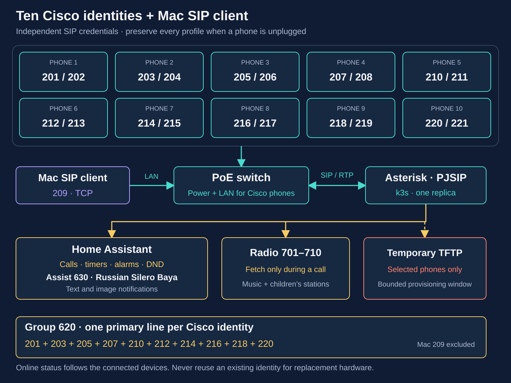

# Add more Cisco 7945G phones

This runbook uses the first four physical phones and their eight independent
lines as its example. Repeat the same checks for every later phone. A phone's
successful conversion does not prove another unit's firmware compatibility,
registration, audio or remote-management behavior.

The first four-phone deployment registered **201–208** on
**SIP45.9-4-2SR4-3S**, with saved LakeDawn backgrounds and verified two-stage SSH
access. Each added line **203–208** passed an Echo 600 call, bidirectional RTP
checks and exact-channel HA Hangup. All four primary identities
**201/203/205/207** have native VoIP permissions and select **Local Russian Home**
with **Silero Baya**. The [validation record](server-validation.md) distinguishes
these results from remaining human-audible Assist and feature tests. Use an
authorized maintenance window for the procedure below.

All addresses below are synthetic examples. Real MAC addresses, switch ports,
hardware observations, credentials and deployment receipts belong in private
`.local/` files, never in this document or Git.



The fleet schematic includes ten verified physical identities and the Mac.
Commissioning status is recorded in the [validation log](server-validation.md);
a configured identity does not by itself prove a completed conversion. The
four-phone worked example below remains useful for a smaller deployment;
[its original diagram](diagrams/four-phones.svg) is retained.

## 1. Keep one complete inventory and preserve the working credentials

For this example, assign:

- Phone A, the existing pilot: button 1 **201**, button 2 **202**.
- Phone B: button 1 **203**, button 2 **204**.
- Phone C: button 1 **205**, button 2 **206**.
- Phone D: button 1 **207**, button 2 **208**.

Start from the [two-line example](../examples/phones.two-lines.example.json)
and [inventory guide](provisioning.md). Keep all four physical phones in the
same private `phones.json`. Each entry has its own verified MAC and an ordered
`lines` list; for Phone D that list is:

```json
"lines": [
  {"extension": "207", "label": "207"},
  {"extension": "208", "label": "208"}
]
```

Do not also include the legacy `extension` field. MACs must be unique per
physical phone, and extensions must be unique across all eight lines. The first
array item maps to button 1 and the second to button 2. Group **620** calls only
**201, 203, 205 and 207**, avoiding two simultaneous group-call legs to one
handset.
The generator deliberately omits `lineIndex` for independent registrations;
see the [two-line explanation](second-line-and-wallpaper.md).

Back up the existing private deployment directory before editing it. Generate
into that same directory, preserving `secrets.json`, `ha-ami-secret.json` and,
when present, `phone-management-secrets.json`. The generator retains existing
SIP passwords and creates a separate password for each new extension. Starting
in an empty directory would create new credentials for the existing pilot too.
A partial inventory can also remove its endpoint and generated SEP profile;
add the new entries without dropping the working ones.

SSH credentials are separate per physical device. Authenticated CGI uses a
separate private `control.json` for each phone, with its exact source IP, SEP
identity, random credentials and nonce path. Do not reuse the pilot's callback
identity or SIP password. The callback server supports one configured phone;
manage devices sequentially or use separate listeners/configurations and
matching per-phone URLs. Follow the [remote-management guide](phone-control.md)
for enable flags, renewal, access restrictions and observed limitations.

### Keep disconnected devices and generic clients in the inventory

A disconnected phone still owns its extensions and credentials. Adding a new
physical unit is not permission to overwrite that device's MAC or reuse its
numbers. Retain its complete record so it can reconnect later. Record an
expected offline device explicitly when checking rollout health; do not waive
registration checks for unrelated phones.

In this installation **209** belongs to the Mac's
[Linphone client](macos-softphone.md). The next physical unit therefore receives
**210/211**, while the unplugged **205/206** stays configured. Append the new
phone to the existing inventory, add its exact source address to every relevant
firewall layer, and use a distinct gateway callback listener. The gateway's
API listener also consumes a port, so do not assume callback ports are consecutive.
Include 210, its first line, in group 620; exclude 211 and the Mac from that
physical-phone group.

For the next four verified devices, allocate **212/213, 214/215, 216/217 and
218/219**, followed by **220/221** for the tenth independently identified
device. Disconnected pairs remain reserved. If there are fewer free PoE ports
than phones, finish a device's firmware update and verification before
unplugging it to free a port. Identify each newly connected phone before
generating its profile; do not invent placeholder MACs or reuse the previous
occupant's credentials. Never free a port by interrupting an upgrade.

If the external SIP guard is installed, also update its saved local-source
baseline and inherited RTP INPUT rule. Keep the existing external
`ESTABLISHED`/`REPLY` overlay when opening or closing TFTP. Replacing the raw
chain with an earlier phone-only example can break an existing provider or
Mac audio path. Compare complete rules, hook positions and persistent files
before and after the change.

## 2. Verify each physical device and firmware path

For each new phone, privately record the label/model, SW-port MAC, hardware
revision, current App Load, current IP, switch/physical port and trust-list
state. Correlate the phone identity with DHCP and the switch forwarding table,
using LLDP where available. A lease, power draw or port number alone is insufficient. Set
`verified: true` only after checking the actual **CP-7945G** model and MAC.

Review the [firmware conversion path](sip-conversion.md) and the
[archive provenance notes](firmware-archive.md) for the observed hardware and
current load. Verify the complete signed-component bundle, not just a `.loads`
file. Record every file's SHA-256 in the private manifest and use its exact
load ID in the inventory. A matching checksum records bytes; it does not by
itself prove Cisco provenance, compatibility or permission to use the package.
Do not rename firmware or mix release components to make a check pass.

The current deployment preflight requires every inventory entry's target
`firmware_load` to match the one reviewed manifest. Do not place phones needing
a different intermediate stage into the final SIP rollout unchanged; follow
the conversion guide's isolated intermediate-stage procedure first. Reusing a
known SIP release for a matching new device does not require downgrading or
reflashing the already working pilot.

Verify an existing reachable NTP server, the configured timezone and the
phone's actual clock. This project does not install an NTP server.

## 3. Admit exact phone addresses and scope DHCP option 150

For permanent addressing, use the site's reserved phone block outside its
dynamic pool. The [OpenWrt/dnsmasq address runbook](static-phone-addresses.md)
covers coordinated DHCP, DNS, Asterisk and gateway changes when a provisional
address needs to move.

Reserve each new phone's current verified address when safe, after checking
leases and static configuration for duplicate MACs or IPs. For an illustrative
PBX at `192.168.50.10`, the complete endpoint allowlist might be:

```json
"phone_cidrs": [
  "192.168.50.21/32",
  "192.168.50.22/32",
  "192.168.50.23/32",
  "192.168.50.24/32"
]
```

An explicit `phone_cidrs` list replaces the generator's default phone ACL;
retain all three existing phone addresses when adding the fourth. Do not widen
`lan_cidr` to accommodate one new phone. Update the independent host firewall to admit
SIP TCP/UDP5060 and PBX RTP UDP10000–10199 from the intended phone sources,
while retaining the existing HA permissions. Preserve existing routes, other
firewall chains and IPv6 restrictions. Do not expose SIP, AMI or TFTP publicly.

Allow TFTP **UDP69 and UDP20000–20031** only from phones being provisioned in
this window. When adding only D, A–C do not need temporary TFTP access or a
restart. Keep the persistent/boot firewall policy closed to TFTP; the Job
timeout cannot remove host firewall rules. The generic firewall
examples are starting points, not a command to flush a live shared ruleset.

Use the existing DHCP server. Add reservations and option 150 only for the new
MACs, using individual rules or a tag assigned only by those reservations.
For dnsmasq, the intended effective rules look like this **template**, with
real verified MACs substituted privately:

```text
dhcp-host=<PHONE_D_MAC>,set:cisco_new,192.168.50.24,phone-d
dhcp-option-force=tag:cisco_new,150,192.168.50.10
```

The option value is the TFTP node's IPv4 address, not a URL, Pod IP or ClusterIP.
Keep the three existing reservations/tags unchanged. On routers that generate
dnsmasq configuration, modify their supported persistent configuration rather
than editing a generated runtime file.

Before applying, back up persistent and effective configuration, ensure no
unrelated edits are pending, validate the proposed dnsmasq configuration, and
prepare rollback for just the new owned reservations/tag. Check the reviewed
baseline again before committing. Reload only the DHCP/DNS service, then
verify it is running and the effective rules contain exactly the intended
additions. Preserve the previous phone and all unrelated DHCP blocks. If
post-commit validation fails, use the prepared scoped rollback; do not restore
an entire old configuration over someone else's changes.

## 4. Prepare the PBX and a bounded TFTP window

Use the existing deployment directory in these commands; change `deployment`
if the working installation lives elsewhere. Firmware and its manifest must
also be available at the locations expected by preflight in that directory.

```bash
umask 077
deployment=.local
python3 scripts/provision.py --site "$deployment/site.json" \
  --inventory "$deployment/phones.json" --out "$deployment"
python3 scripts/preflight.py --site "$deployment/site.json" --with-tftp
bash scripts/deploy.sh --site "$deployment/site.json" --with-tftp
bash scripts/deploy.sh --site "$deployment/site.json" --with-tftp --server-dry-run
```

These steps generate private files, check the complete bundle, perform a local
render, and finally validate against the cluster without applying. The existing
namespace is required for the server dry run. Review every expected endpoint, source
ACLs, actual firmware load, image digests and node placement. Compare the old
phones' credentials and configuration without printing them. Follow the
[k3s deployment guide](k3s-deployment.md) for host firmware staging, permissions
and firewall/socket checks.

A changed core configuration replaces the Asterisk Pod and interrupts calls.
Use an authorized maintenance window. Normally confirm **zero active calls**;
if the operator explicitly authorizes interruption, record that authorization
and the actual call count before the restart. Do not request it repeatedly. Ensure the verified firmware is staged and the temporary host firewall
policy permits exactly this batch, then:

```bash
bash scripts/deploy.sh --site "$deployment/site.json" \
  --with-tftp --apply --firewall-reviewed
```

The generated TFTP Job has a one-hour deadline. Confirm its Pod is ready before
restarting any phone. A finished Job must be explicitly removed before a new window;
never run two servers on the same address/UDP69. Cancel any cleanup timer tied
to an older Job before creating a later window, and record how this window
will be closed. Do not copy an old one-phone cleanup policy blindly into a
multi-phone deployment.

If applying the common wallpaper, follow the
[wallpaper staging procedure](second-line-and-wallpaper.md). Its Secret is
mounted only by the init container, which copies assets into the temporary
read-only served tree. Changing the source assets does not update a running
Job: finish the current transfers, close that window and create a new Job.
Selecting and saving a wallpaper is a separate per-phone acceptance step.

## 5. Restart only when needed, one identified phone at a time

Observe current DHCP/TFTP activity first. A phone already retrying after an
ITL erase may request the new profile without another power cycle; this was
observed on the fourth phone. Continue monitoring the resulting load and
registration instead of interrupting an update to force another restart.

Before treating an unreachable phone as stuck, compare the switch's uptime
with the port's last link-change time. A recently restarted phone can respond
to ping while refusing HTTP and temporarily disappearing from LLDP. Recheck
for a bounded period and inspect the final application load before cycling it
again. A device status page may retain a starred old Version value while the
App Load already identifies the SIP application; corroborate with actual SIP
registration instead of using that one field to trigger another flash.

Prefer a normal supported restart when available. When remote management is
not yet provisioned, a controlled PoE cycle can load the new profile. A PoE
cycle is a power interruption, not a graceful shutdown: never do it during
firmware transfer or flash writes.

Immediately before a cycle, recheck the phone MAC/SEP identity against LLDP,
the forwarding table, bridge/interface mapping and the exact physical switch
port. Check the active call count and any authorization to interrupt calls.
Confirm there is no firmware operation and that the management connection
does not depend on the target port. Preserve all other
ports and the target's existing priority, power limit, timer and detection
settings. Follow the [verified single-port procedure](phone-control.md#recover-through-a-verified-poe-port),
which documents the tested switch behavior without assuming every model or
firmware exposes the same API.

Any automation must restore power in a `finally`/cleanup path once a disable
request has been attempted, including when the response times out. Verify
admin enabled, power delivery and unchanged other ports afterward. Stop for
an unexplained identity mismatch or failed restoration. Do not reboot the
switch, change VLANs, or cycle all phones to recover one unit.

Restore and verify power before cycling the next identified port. Devices
may then boot concurrently if each is monitored and has a complete staged
profile/bundle. Watch each phone's actual TFTP requests, resulting App Load and
registrations. Multiple automatic phone restarts may occur during an update;
maintain power and TFTP until every active update finishes. A successful switch HTTP
response or delivering-power status does not prove phone provisioning worked.

## 6. Handle old trust only when the evidence calls for it

If the phone requests only CTL/ITL and signed `.cnf.xml.sgn` files, first verify
its actual TFTP target and a bidirectional request/response exchange. Missing
files and working networking do not alone establish an ITL fault. Inspect the
phone's existing trust state using the
[targeted ITL/CTL procedure](sip-conversion.md#old-cucm-trust-blocks-the-new-configuration).

When a stale ITL is confirmed, an operator at that handset can unlock and erase
that specific old trust list as documented. Plan for that physical step if
authenticated management is not available; this runbook does not promise a
remote trust-erasure API. Inspect CTL separately if present. Do not clear trust
on the working pilot just because another phone is blocked. Never substitute
unsigned XML with a `.sgn` suffix, fabricate trust files, bypass firmware
signature checks, or apply a factory reset as a routine batch step.

Afterward, require requests for the intended profile/load/components and
verify the final App Load. If settings remain locked or conversion fails,
record the result and stop that phone's rollout instead of repeatedly cycling
power. Keep its status pending and leave working devices alone.

## 7. Accept each new line and add HA controls

For each physical phone, require independent contacts for both assigned
extensions in `pjsip show contacts`. Generated endpoints, visible button labels
or an HA registered entity alone are insufficient. Select each line, dial
**600** explicitly, and confirm the correct calling identity and Echo route.
Check handset and speakerphone audio with a person listening. Use **601** for
the test tone at a moderate volume. Test incoming calls to each line and a
real two-way call between two physical phones; two lines on one handset do
not satisfy that cross-device test.

Before an automated dial test, inspect the target phone's screen as well as
its PBX channels. An on-hook number-entry buffer can exist with zero active
channels. Confirm a clean idle screen, identify any actual Cancel softkey from
its displayed position, and avoid interfering with a person's call or typing.
An accepted CGI command does not prove that a call started. Verify the exact
source line and destination at the PBX before counting the test as passed.

Test **620** after the intended devices are ready: each phone rings once through
its primary line, and answering stops the other legs. Record failures and
untested features separately; firmware support, a successful SIP transaction
and actual human-audible speech are different evidence.

Follow the [HA integration guide](home-assistant.md) and the
[companion toolkit](https://github.com/ha-homelab/asterisk-telephony) to discover
new endpoints through the existing Asterisk integration. Read the actual HA
entity registry and map all five entities per line; do not invent IDs by
copying 201's names. Preserve existing scripts, dashboard controls and Recorder
exclusions. Keep DTMF automations disabled unless a separate harmless test is
explicitly intended. A confirmed second physical phone can become `call_to`;
retain `call_to: null` until that destination really exists and is accepted.

If those real registry entries already exist while a phone waits for its ITL
erase, endpoint cards, guarded Hangup scripts and Recorder exclusions can be
prepared before registration. Verify exact entity ownership, preserve existing
configuration, and label those endpoints **pending**. This is configuration
readiness only; it does not pass the call or phone acceptance checks. Native
Assist still requires a first call from each intended SIP identity.

The persistent **Cisco phone controls** entry needs a scoped reload after the
gateway inventory grows. Its periodic update refreshes existing entities but
does not create the new phone's controls. Reload the Asterisk entry separately
to discover the new endpoint entities. Use those actual discovered IDs when
adding guarded Hangup/Assist scripts, dashboard cards and Recorder exclusions.
The current control schema creates 29 entities per physical phone: ten phones
therefore require 290. Preserve all existing IDs and user settings; group any
necessary configuration changes into one validated HA restart.

For Assist, use each physical phone's first line. This fleet assigns the
primaries **201, 203, 205, 207, 210, 212, 214, 216, 218 and 220**.
Dial **630** from that specific line to discover its native VoIP identity, then
enable **Allow calls** and choose the intended language/pipeline for that device.
The installed home setup uses **Local Russian Home** with **Silero Baya**.
Preserve unrelated Echo/device selections and global pipeline definitions. Native
VoIP identity follows the SIP From extension: approval for one line does not
approve another. Secondary lines need their own discovery if Assist is wanted
there too.
Call again and confirm a spoken request, an audible answer and clean hangup.
Schedule any necessary HA restart between calls, unless the operator has
authorized interruptions. Validate new package configuration before any necessary
reload/restart, and verify existing entities afterward.

Verify guarded HA Hangup against the actual active channel for each new line.
The integration can retain stale channel metadata; see the companion guide's
state safeguards and lost-AMI limitation. Do not treat a button press with no
channel change as a successful hangup.

## 8. Close and record the batch

Only after every transfer and flash write finishes, delete the temporary TFTP
Job and restore the host firewall's normal **closed-TFTP** policy using
[the cleanup procedure](operations.md#close-a-tftp-maintenance-window). Job
expiry/TTL cleanup does not remove host firewall permissions for UDP69 or
UDP20000–20031. Verify both ranges
are closed, no TFTP listener/Job remains, and the ordinary SIP/RTP and HA rules
remain intact. Check that unrelated firewall state was preserved.

A one-shot fallback may close this specific window after the Job deadline.
It must check for remaining TFTP sockets and preserve another session's
resources. Cancel the old timer before recreating TFTP or renewing callbacks;
a scheduled fallback is not evidence that cleanup has actually completed.

Stop temporary CGI callback listeners and remove only their owned temporary
rules. If the persistent [HA gateway](phone-gateway.md) is explicitly enabled,
hand those ports over to its exact-source listeners instead of closing them. Preserve each configured authentication URL and its private credentials
for an explicit future renewal. Confirm all expected SIP contacts, no remaining
test calls, and the original pilot's unchanged operation. A later cold boot
may require a fresh reviewed TFTP window; test that behavior for the actual
load rather than assuming persistent access is unnecessary.

Keep a private receipt per device: verified identity, final load, two registered
extensions, call/audio/HA/Assist results, wallpaper/management results when
requested, cleanup verification, and any unresolved limitation. Record skipped
checks as pending. A generated configuration becomes a completed rollout only
when those device-level checks have passed.
