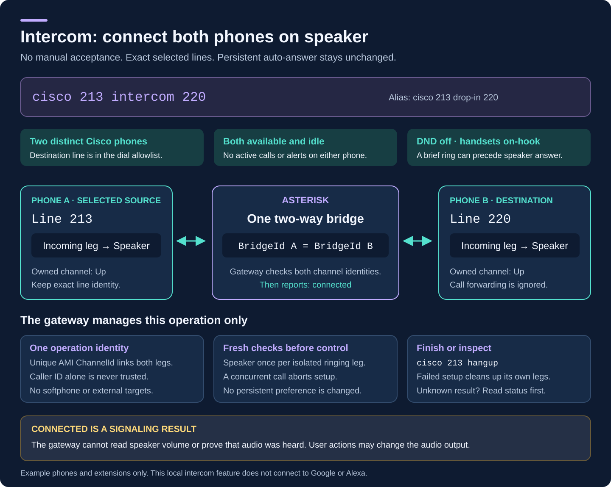

# Install, connect and troubleshoot the PBX

This is the operator's path from a fresh checkout to registered phones, working
audio and the `cisco` CLI. The project runs Asterisk on an **existing k3s cluster**;
it does not install a cluster, replace your router or configure DHCP for you.
All addresses, node names and extension assignments below are examples. Keep
your actual inventory, room names and credentials in private local files.

For the workstation side, follow [CLI installation and configuration](cli-installation.md).
For every available command, see the [CLI reference](cli.md).


## 1. Choose the components you need

**Ordinary calls** need Asterisk, a reachable LAN address, generated SIP accounts
and registered devices. Cisco firmware/configuration delivery also needs a
temporary TFTP window. A software phone needs no TFTP, Cisco firmware or invented
MAC address.

**Remote phone control** additionally needs the persistent phone gateway and
working Cisco authentication callbacks. Its API provides `cisco` commands such
as dial, hangup, DND and intercom. Installing the CLI alone does not enable those
server features. The Asterisk AMI password, gateway bearer token, Cisco callback
credentials and each line's SIP password are separate credentials.

**Scheduled timers and alarms** additionally need Home Assistant and the companion
`cisco_phone_control` integration. **Voice Assist** uses HA's separate VoIP
integration and an STT/conversation/TTS pipeline. The AMI connection itself does
not carry audio or provide speech recognition.

## 2. Prepare a private configuration

Install Git, Python 3.10 or later and `kubectl` on the management workstation. You
also need an authenticated kubeconfig, administrative access to the selected
Linux node, and either a compatible Docker/BuildKit builder or the documented
[native CI image export](ci-images.md). Use a stable wired node address. Check
the node's architecture before choosing an image.

```bash
git clone https://github.com/4alvit/cisco-home-telephony.git
cd cisco-home-telephony
umask 077
mkdir -p .local
chmod 700 .local
cp deploy/site.example.json .local/site.json
cp examples/phones.two-lines.example.json .local/phones.json
chmod 600 .local/site.json .local/phones.json
```

Edit those files before generating anything:

- Set `kube_context`, `namespace`, `node_name`, `node_ipv4` and `lan_cidr` to your
  verified cluster and network. `node_ipv4` must actually belong to that node
  and be inside `lan_cidr`.
- Set `phone_cidrs` to the permitted phone sources. An explicit list replaces
  the default LAN allowance. For gateway control, use reserved phone addresses
  and their exact `/32` entries as required by the gateway configuration tool.
- Set `ntp_ipv4` to an existing reachable NTP server. The project does not create
  one. Check the generated phone timezone; the current generator uses Pacific
  Standard/Daylight Time.
- Replace the inventory placeholder with the physical phone's verified model
  and SW-port MAC, then set `verified: true`. Remove absent phones. Add one or
  two ordered `lines` per physical phone, with unique extension strings. Do not
  combine `lines` with the legacy single `extension` field.
- Use a `firmware_load` that matches the verified bundle, without `.loads`.
  `verified: true` asserts a physical inventory check, not firmware provenance.
- Optionally set a private `room` for caller ID and the central directory.
  [Directory configuration](phone-directory.md) explains the separate numeric
  handset labels and room names.

The example intentionally contains invalid placeholders. Do not manufacture
values to make validation pass. If no Cisco phone has been verified yet, use
the [PBX-only bootstrap](pbx-bootstrap.md) with `--pbx-only` instead of an
inventory. It can include software-phone accounts and does not require firmware.

Keep this directory outside public commits and shared logs. `.gitignore`
excludes `.local/`, but cannot protect files copied elsewhere or screenshots.
Kubernetes Secret manifests contain recoverable credentials; base64 is not
encryption. For an existing installation, preserve the canonical private files
and all secret stores rather than copying the public examples over them.

## 3. Build a matching image and generate the PBX

Follow [image build, registry and architecture preparation](k3s-deployment.md#3-build-test-and-publish-images).
The current Dockerfile builds Asterisk 22.11.0. The build script defaults to
`linux/amd64`; choose `BUILD_PLATFORM=linux/arm64` only for an ARM target. A
workstation's Docker registry settings and the node's containerd registry
settings are independent.

```bash
bash scripts/build-images.sh 192.168.50.20:5050/cisco-home
bash scripts/smoke-containers.sh 192.168.50.20:5050/cisco-home
docker push 192.168.50.20:5050/cisco-home/asterisk:22.11.0
docker push 192.168.50.20:5050/cisco-home/tftp:bookworm
docker image inspect --format '{{join .RepoDigests "\n"}}' \
  192.168.50.20:5050/cisco-home/asterisk:22.11.0
docker image inspect --format '{{join .RepoDigests "\n"}}' \
  192.168.50.20:5050/cisco-home/tftp:bookworm
```

Substitute your registry. Put the resulting `repository@sha256:...` references
in the private site's `asterisk_image` and `tftp_image`, not mutable tags or
Docker image IDs. PBX-only operation does not need the TFTP image. The isolated
smoke tests use synthetic identities; they do not prove your LAN audio path.

```bash
python3 scripts/provision.py --site .local/site.json \
  --inventory .local/phones.json --out .local
python3 scripts/preflight.py --site .local/site.json
bash scripts/deploy.sh --site .local/site.json
```

The final command is a **local render**, not a deployment. Inspect
`.local/rendered/core.yaml` privately. Provisioning writes `asterisk/*.conf`,
per-extension secrets and Cisco XML beneath the output directory. It reuses
saved passwords. Optional features have separate saved credentials. Keep
`--out` aligned with the directory containing `site.json`: the preflight and
render tools look for generated input beside that site file.

`pjsip.conf` contains each endpoint, authentication object and AOR. Each AOR has
one active contact; a new registration replaces the previous one. The generated
`home` dialplan includes declared local extensions, **600** for Echo, **601** for
Milliwatt and **620** for the primary line of each physical Cisco. The latter
does not exist in a Cisco-free bootstrap. Optional Assist/radio/external routes
appear only when configured. Unconfigured numbers are rejected.

## 4. Review networking, then deploy

Asterisk uses `hostNetwork`, the selected node IP, one replica and a `Recreate`
strategy. There is no SIP Service, Ingress or LoadBalancer to configure. A second
replica on that node would compete for the same sockets. Changing the node/IP
requires a planned client reconfiguration.

Check [node, socket, firewall and DHCP preparation](k3s-deployment.md#4-check-the-node-firewall-and-dhcp).
The actual host firewall must permit the selected sources; preflight does not
install rules. Required paths are:

- Phone/client to PBX: SIP on the configured TCP or UDP **5060** transport, and
  RTP to UDP **10000–10199**. The PBX must reach the client's advertised media
  ports. Cisco deployment rules account for both provided SIP transports.
- Provisioning phones to TFTP: UDP **69** and server transfer ports
  **20000–20031**, only during the maintenance window.
- HA to AMI, when enabled: TCP **5038** from its actual observed source `/32`.
  The local gateway has its own separately permitted AMI source.
- CLI/HA to the gateway: the configured private API port, default TCP **18084**,
  from an allowed source. Each phone also needs its own configured callback
  port. These are not SIP ports.

Preserve existing k3s/firewall rules. Do not flush the host ruleset or publish
SIP, AMI, callbacks or TFTP through a public tunnel. If an external SIP guard
is installed, inspect its inherited INPUT rules as well as any raw-table guard:
allowing registration in one layer can still leave RTP blocked in another.

For a **new dedicated namespace**, create and label it as described below.
The privileged namespace exception is needed for host networking; the Asterisk
container still runs as UID 10001 with dropped capabilities and a read-only
root filesystem. Do not change an unrelated shared namespace's policy.

```bash
python3 scripts/preflight.py --site .local/site.json --cluster
kubectl --context home-k3s create namespace telephony
kubectl --context home-k3s label namespace telephony \
  pod-security.kubernetes.io/enforce=privileged \
  pod-security.kubernetes.io/audit=restricted \
  pod-security.kubernetes.io/warn=restricted --overwrite
bash scripts/deploy.sh --site .local/site.json --server-dry-run
# After reviewing the generated configuration, firewall and maintenance timing:
bash scripts/deploy.sh --site .local/site.json --apply --firewall-reviewed
```

Use your context and namespace consistently. Skip namespace creation when it
already exists and inspect its policy instead. A server dry run needs an
existing namespace. The script uses server-side apply with field manager
`cisco-home-telephony`; an ownership conflict requires inspection, not an
automatic `--force-conflicts`. See the
[existing-field-owner update procedure](k3s-deployment.md#updating-an-installation-with-an-existing-field-owner).

To deliver Cisco profiles, separately complete
[firmware verification and delivery](provisioning.md#4-prepare-firmware) and the
[TFTP deployment window](k3s-deployment.md#5-deliver-firmware-to-the-selected-node).
Only then add `--with-tftp` to validation/render/apply. The TFTP Job has a
one-hour deadline. Never interrupt a phone while it is writing firmware.
Close the Job and its temporary firewall allowances after provisioning; Job
expiry does not remove firewall rules.

## 5. Register phones and verify a call

For Cisco, supply option 150 through the existing DHCP scope or use the phone's
Alternate TFTP setting. Confirm that the phone fetches its own `SEP<MAC>.cnf.xml`
and boots the intended SIP load. Use [adding phones](adding-phones.md) and
[SCCP-to-SIP conversion](sip-conversion.md) for the complete sequence.

For a Mac or other software client, add a `softphones` entry to private
`site.json` with its unique extension, label, reserved `source_ipv4` and transport.
Regenerate and deploy before registering the client. The generator saves its
password in `softphone-secrets.json`. Configure the client with that extension
as username, PBX private IP as domain/server, port 5060, the matching transport
and its saved password. For direct LAN operation, leave public STUN/ICE and
outbound proxies disabled. Use compatible unencrypted SIP/media and PCMU/PCMA
with this baseline; SIP/TCP alone is not encryption. Run only one client per
extension. See the [Mac setup and exact source firewall rules](macos-softphone.md).

Inspect the server before making a test call:

```bash
kubectl --context home-k3s -n telephony get pods -o wide
kubectl --context home-k3s -n telephony exec deployment/asterisk -- \
  asterisk -rx 'pjsip show transports'
kubectl --context home-k3s -n telephony exec deployment/asterisk -- \
  asterisk -rx 'pjsip show contacts'
kubectl --context home-k3s -n telephony exec deployment/asterisk -- \
  asterisk -rx 'pjsip show endpoint 201'
kubectl --context home-k3s -n telephony exec deployment/asterisk -- \
  asterisk -rx 'dialplan show 600@home'
```

Use an extension from your own inventory. Both configured transports should
bind the node's address. Each connected line should have a reachable contact;
an endpoint definition alone is not a registration. Check `600@home` reaches
`Answer()` and `Echo()`.

When people are ready for audible testing, dial **600**, speak and confirm the
returned voice. End the call, then call another physical device in both
directions. Confirm clean hangup, correct caller ID and both lines where used.
Registration, ringing, RTP packet counts and human-confirmed audio are distinct
acceptance results. Record which one was actually observed.

## 6. Add the gateway, CLI and Home Assistant

Follow [remote management](phone-control.md) to provision web access and each
phone's private authentication URL, then verify a bounded callback. Cisco's
web status page is not a complete settings editor; SSH is diagnostic access.
Persistent phone configuration still comes from generated XML.

Follow [persistent gateway setup](phone-gateway.md) to enable the dedicated
gateway AMI account, provide exactly one callback per phone, generate the
private gateway input and render its separate manifest. `deploy.sh` deploys
the PBX/TFTP, **not** this separate gateway manifest. Preserve the gateway
token, callback credentials and `/var/lib/cisco-phone-gateway` state when
upgrading. The latter must exist on the selected node, owned by `10001:10001`,
mode `0700`.

Then install the CLI using [the workstation guide](cli-installation.md). Start
with read-only `cisco directory`, `cisco 201` and `cisco 201 destinations`.
These verify authenticated API access, directory mapping and the allowed
targets. A gateway TCP readiness probe proves only that its listener is open;
an authenticated inventory request also exercises its AMI connection.

For HA, follow [AMI and Assist configuration](home-assistant.md) and install
the companion [HA integrations](https://github.com/ha-homelab/asterisk-telephony).
The CLI's optional HA configuration needs its own token and loaded Cisco Phone
Control entry ID for scheduling. See [timers and alarms](cli.md#countdown-timers-and-recurring-alarms).
An HA dashboard state is useful evidence but does not replace contact or audio
checks.

### Ordinary calls versus intercom

`cisco 201 call 203` and `cisco 201 203` retain normal calling behavior.
`cisco 201 intercom 203` (alias `drop-in`) requests a one-time speaker connection
between two distinct managed Cisco phones without either person accepting it.
Both phones must be idle, available, free of alerts and DND-off; both selected
lines must be configured, with the destination allowed for dialing. Place the
handsets on-hook. A brief ring can occur during setup.

Deploy the updated gateway together with the generated private
`cisco-intercom` dialplan context. This helper prevents source-side forwarding;
the destination leg also disables forwarding. Do not include the helper in
the public `home` context. Updating the CLI alone cannot add this feature.
The [gateway upgrade procedure](phone-gateway.md#intercom-deployment-and-call-ownership)
explains the coordinated change.

Intercom does not change persistent auto-answer. It is not available for
software phones, radio, groups or external numbers. The gateway reports
`connected` only after observing both exact call legs Up in one bridge;
`speaker_requested` means it issued the Speaker commands, not that it measured
audible volume. End the call with `cisco 201 hangup` or the physical phone. On
failure or timeout, inspect status before trying again. See the
[complete intercom contract](cli.md#intercom--drop-in).



## 7. Troubleshoot by layer


Keep diagnostics private: logs can contain directory labels, numbers and
addresses; SIP/TFTP captures can expose authentication data and audio. Start
with a short interval and the exact failing endpoint, rather than publishing
an unrestricted debug dump.

### Pod unavailable or restarting

```bash
kubectl --context home-k3s -n telephony describe deployment asterisk
kubectl --context home-k3s -n telephony get events --sort-by=.lastTimestamp
kubectl --context home-k3s -n telephony logs deployment/asterisk --since=10m
```

For Pending, check the selected node's Ready status, cordon/taints and resources.
For ImagePullBackOff, verify the registry digest, credentials and target
architecture from the node. For a bind error, verify the node owns the address
and another process does not occupy 5060. Do not solve permissions by running
the container privileged. Readiness verifies expected SIP transports and enabled
feature prerequisites, not every phone or a working speaker.

### Cisco stays Registering or never fetches its profile

Check link/PoE, DHCP address, voice VLAN, route and TFTP target first. A running
TFTP Job and successful RRQ are not proof of a complete firmware transfer. Match
the exact MAC filename and every load component. If only old trust or signed
XML files are requested, inspect the old CUCM ITL/CTL and use the
[targeted trust-list procedure](sip-conversion.md#old-cucm-trust-blocks-the-new-configuration).
Do not disguise unsigned XML by renaming it `.sgn`.

Once SIP firmware is loaded, compare transport, server address, username,
extension and the saved SIP secret in the actual loaded profile. Check the
phone's current source IP against both generated endpoint ACLs and host rules.
A DHCP change can invalidate an exact `/32` allowance. Regenerate stale output
after correcting the private input; editing a sample file does not update the
running PBX.

### SIP 401/403 or repeated registration failures

One initial 401 digest challenge can be normal. Repeated challenges without a
successful registration call for an identity/password check. A 403 is not proof
of a wrong password alone: inspect endpoint selection, source ACL, transport
and the corresponding server log. Do not confuse SIP authentication with an
HTTP gateway 401/403. Keep another client from replacing the same AOR's single
contact. After a PBX outage, allow the client's registration retry or reconnect
the existing account rather than creating a duplicate account.

### Registered, but the destination does not ring

Check the destination's current contact and actual dialplan entry:

```bash
kubectl --context home-k3s -n telephony exec deployment/asterisk -- \
  asterisk -rx 'dialplan show 203@home'
kubectl --context home-k3s -n telephony exec deployment/asterisk -- \
  asterisk -rx 'core show channels concise'
cisco 203
```

Check PBX DND, any `dnd_pending` reconciliation, the physical phone's native DND,
active calls and disconnected power. PBX DND and the handset's native DND icon
are separate states. Group 620 targets each Cisco's primary line only. Gateway
dialing also requires the destination in its explicit allowlist. External
provider registrations and routes need their own
[external SIP configuration](external-sip.md); the base PBX is not a general
PSTN or emergency-calling service.

### Call connects, but audio is silent or one-way

First prove that the intended application ran. Calling your own extension is
not an echo test; `600@home` must execute `Echo()`. Inspect the live media channel:

```bash
kubectl --context home-k3s -n telephony exec deployment/asterisk -- \
  asterisk -rx 'pjsip show channelstats'
```

SIP signaling and RTP use different paths. Verify UDP 10000–10199 toward the PBX
and replies to the client's media ports in every firewall layer. The generator
sets `direct_media=no`, binds RTP to the node's LAN address and enables symmetric
RTP/contact rewriting. `local_net` classifies trusted routed phone networks;
it does not install routes or firewall permissions. Do not change these to
overlay addresses as a workaround.

If needed, collect a brief private SIP trace with `pjsip set logger on`, reproduce
one call, then immediately run `pjsip set logger off` through the same Asterisk
CLI. Inspect SDP for reachable addresses and compatible PCMU/PCMA media. Remove
public STUN/proxy settings from a direct LAN softphone; inspect SIP ALG only if
that router actually handles this traffic. Also check the Mac microphone
permission, selected microphone/speaker, mute and phone volume. Packet exchange
does not prove that the intended microphone contains speech.

### Calls work, but the CLI, intercom or HA does not

Start with `cisco 201` and the [CLI transport/error guide](cli.md). HTTP refusal
usually belongs to the gateway source allowlist/token boundary, not SIP.
With the kubectl CLI transport, exactly one matching Running, Ready pod must
exist, contain Python 3 and have an allowed source address. RBAC for pod discovery
and exec is separate from the gateway token.

If the gateway listens but inventory fails, verify its dedicated AMI account,
actual node source `/32` and both raw/INPUT host rules. If inventory works but
phone actions fail, verify the phone loaded its authentication URL, web access
is enabled and the matching callback port admits that exact phone. HTTP 200
from a Cisco CGI alone is not success; a `CiscoIPPhoneError` body can still report
authentication failure. See [callback troubleshooting](phone-control.md).

Intercom additionally requires two distinct idle Cisco devices. A busy sibling
line, alert, DND, unavailable contact or missing capability is a valid refusal.
Check status instead of repeatedly sending Speaker commands. Scheduled commands
add a separate HA dependency: verify the integration version, entry ID, token,
timezone and the timer/alarm's owning line. For Assist, independently check
native VoIP discovery and Allow calls for the exact calling extension, then its
selected voice pipeline.

## 8. Upgrade and recover without losing configuration

Before changing a working deployment, record the Git revision and image digest,
back up the canonical private input and generated files, and retain the previous
immutable Secrets/images. Use [encrypted backup and recovery](operations.md#encrypted-backup-and-recovery).
The supplied `backup.sh` encrypts the checkout's `.local/` directory only. It
does **not** collect remote gateway state, the HA configuration or external
firewall/DHCP configuration; back those up separately. Use a consistent SQLite
backup or stop the gateway briefly when backing up its live database.

Generate updates in a fresh private candidate directory containing copies of
the current site, inventory and secret stores. Verify any relative paths and
preserve callback URLs/tokens, then run preflight and render with that candidate's
`site.json`. Review changes before applying. A new configuration Secret changes
the Pod template and recreates Asterisk, interrupting active calls. A successful
apply is not proof that all devices have registered again.

For a failed PBX update, inspect rollout history and select the known good
revision; keep its Secret and image available:

```bash
kubectl --context home-k3s -n telephony rollout history deployment/asterisk
# Substitute a reviewed revision number from that history:
kubectl --context home-k3s -n telephony rollout undo deployment/asterisk --to-revision=REVISION
kubectl --context home-k3s -n telephony rollout status deployment/asterisk --timeout=180s
```

Restore matching canonical local files too, or the next render/apply will undo
the rollback. If SIP passwords changed, restore the matching phone XML and PBX
credentials together. This Kubernetes rollback does not downgrade firmware.
The gateway has a separate Deployment and persistent state; preserve both when
following its [rollback procedure](phone-gateway.md#deploy-and-hand-over-the-listeners).

The baseline Asterisk database, spool and logs are ephemeral. Gateway preferences
and operation identities persist in its host state directory; HA owns schedules.
After a host restart, check node/pod readiness, private firewall rules, all
expected contacts, gateway directory/preferences and HA schedules. Gateway DND
is reconciled back into Asterisk after a restart, so inspect `dnd_pending` before
declaring it restored. Finally repeat an audible test when appropriate. The
[validation record](server-validation.md) distinguishes software checks from
human-confirmed behavior.
