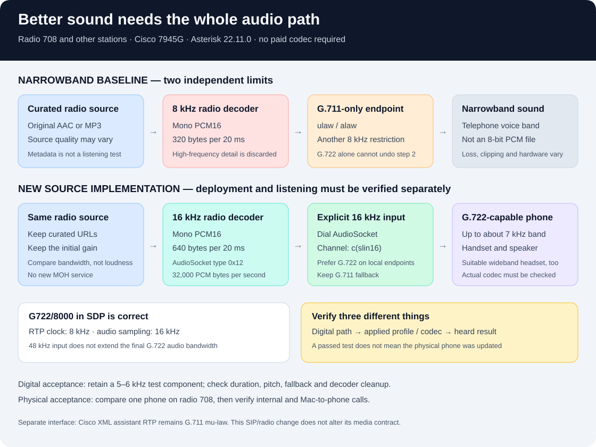

# Wideband audio on Cisco 7945G



The Cisco 7945G can sound better than a narrowband telephone. This revision
enables G.722 in generated local-phone configuration and preserves 16 kHz
audio through the radio worker. Both changes are necessary: a wideband SIP
codec cannot restore frequencies already removed by an 8 kHz decoder.

**Deployment and listening acceptance are separate.** These source changes
do not establish that a phone has downloaded its new profile, negotiated
G.722 or produced an audible improvement. A read-only installation check on
2026-10-20 confirmed Asterisk 22.11.0, loaded G.722/resampling modules, an
8 kHz deployed radio decoder and G.711-only local-phone configuration.
There was no active 708 call to inspect; this was a baseline check, not a
wideband call test. Keep private runtime evidence outside the public repository.

## What was limiting the sound

The previous worker decoded every station, including **708**, into 8 kHz mono
PCM16, sent 320-byte frames every 20 ms, and invoked the `AudioSocket()`
dialplan application. Local PJSIP endpoints allowed only `ulaw,alaw`.

This explains a narrowband sound without proving every audible defect has the
same cause. The intermediate samples were already 16-bit. G.711 uses
logarithmically companded samples; it is not equivalent to an 8-bit linear
recording. Low sample rate, clipping, packet loss, source compression and
speaker condition are different issues. [G.711 RTP format](https://www.rfc-editor.org/rfc/rfc3551.html#section-4.5.14).

The fix retains 708's existing curated station source; it does not require
a new provider. A source's advertised sample rate or codec describes its
format, not its measured frequency content or subjective quality.

## Phone capability and exact settings

Cisco lists the 7945G as supporting G.722 through its speaker, handset and
optional headset. An original wideband handset does not need replacement
just to enable G.722. An external headset must itself support wideband audio;
a narrowband accessory or damaged speaker remains a physical limitation.
[Cisco model comparison, Table 3](https://www.cisco.com/c/en/us/products/collateral/collaboration-endpoints/unified-ip-phone-7971g-ge/end_of_life_notice_c51-452068.html).

The generated phone profile adds this value inside its existing
`vendorConfig`:

```xml
<g722CodecSupport>2</g722CodecSupport>
```

Cisco defines `0` as the manufacturer default, `1` as disabled and `2` as
enabled. G.722-capable SIP phones require firmware 8.3.1 or later. After a
profile change, the phone must download and apply it; generating XML on a
server does not update a cached device profile.
[Cisco service-phone reference](https://www.cisco.com/c/en/us/td/docs/voice_ip_comm/cucme/command/reference/cme_cr/cme_s1ht.html).

The existing `preferredCodec` value, `g711ulaw`, is retained. We have no
authoritative SIP45 enumeration establishing a replacement G.722 token, so
the configuration does not guess `g722`, `g722-64` or `none`. It instead enables
the capability and sets the PBX's effective codec preference.

The patch also leaves handset/headset overrides alone. Their numeric settings
are not interchangeable with `g722CodecSupport`. Cisco's published
configuration capture includes device-level `advertiseG722Codec=1`, but that
capture uses SCCP75 firmware. It does not establish that this additional field
is required for SIP45, so this revision does not add it.
[Cisco configuration example](https://www.cisco.com/c/en/us/support/docs/unified-communications/unified-communications-manager-callmanager/200769-Two-Ways-to-Obtain-a-Phone-s-Configurati.html).

## Asterisk and softphone configuration

Generated Cisco and local softphone endpoints use:

```ini
disallow=all
allow=g722,ulaw,alaw
incoming_call_offer_pref=local
outgoing_call_offer_pref=local_merge
```

For incoming calls, `local` preserves the configured order among mutually
supported codecs. For outgoing offers, `local_merge` offers the configured
local list in its order. G.711 remains available for compatibility.
The remote client must still advertise or accept G.722.
[Asterisk 22 endpoint options](https://docs.asterisk.org/Asterisk_22_Documentation/API_Documentation/Module_Configuration/res_pjsip/#incoming_call_offer_pref),
[exact 22.11.0 codec-selection implementation](https://github.com/asterisk/asterisk/blob/22.11.0/res/res_pjsip_session/pjsip_session_caps.c).

Do not substitute the similarly named `codec_prefs_incoming_offer` or other
`codec_prefs_*` options: the Asterisk 22 reference marks them as reserved for
future functionality. Their documented syntax does not prove they control
this version's codec selection.

These settings are generated by [provision.py](../scripts/provision.py) and
[softphones.py](../scripts/softphones.py). They do not change an external
provider's capabilities, purchase a codec, or update a Mac application's
local preferences. For a Mac-to-Cisco wideband call, both endpoint profiles
and the client must permit G.722; see the
[Mac softphone guide](macos-softphone.md).

## The radio path

[radio.py](../containers/asterisk/radio.py) decodes the original AAC/MP3 to
16 kHz mono signed 16-bit little-endian PCM. It sends **640 bytes every 20 ms**
using AudioSocket type **`0x12`**: 320 samples per frame, 32,000 PCM bytes per
second, excluding framing.

The AGI now invokes an explicit AudioSocket channel:

```text
EXEC Dial AudioSocket/127.0.0.1:PORT/UUID/c(slin16),5,g
```

`PORT` and `UUID` are per-call values created by the worker; this is a shape
example, not a command to paste into a running PBX. `c(slin16)` selects the
16 kHz PCM format on that channel. The call-setup timeout is 5 seconds; `g`
permits dialplan continuation after the destination ends so the existing
AGI cleanup and result handling can run. Asterisk bridges/transcodes from
this channel to the phone's negotiated codec.
[AudioSocket protocol](https://docs.asterisk.org/Configuration/Channel-Drivers/AudioSocket/),
[22.11.0 channel driver](https://github.com/asterisk/asterisk/blob/22.11.0/channels/chan_audiosocket.c).

The older `AudioSocket(uuid,service)` application documents 8 kHz operation
and has no format argument. Although this version's receive/core-write path
can handle typed higher-rate frames, the new implementation uses the explicit
channel interface instead of relying on that application behavior.
[AudioSocket application](https://docs.asterisk.org/Asterisk_22_Documentation/API_Documentation/Dialplan_Applications/AudioSocket/).

The worker also accepts and discards incoming 16 kHz PCM from Asterisk; it
does not record or forward the caller's audio. The curated source policy,
per-call identity, local listener, concurrency limit, duration limit and
decoder cleanup remain part of the implementation. G.711 callers receive
a downsampled compatible stream; G.722 callers can retain the wider band.
This shared worker covers the other configured radio stations as well.

**16 kHz is the appropriate target for this phone.** G.722 carries about
7 kHz audio bandwidth. Passing 48 kHz PCM through a final G.722 leg does not
turn it into full-band stereo reproduction. In SDP, `G722/8000` is correct:
the RTP timestamp clock is historically 8 kHz while the audio sampling rate
is 16 kHz. Do not diagnose narrowband audio from that SDP label alone.
[RFC 3551, G.722](https://www.rfc-editor.org/rfc/rfc3551.html#section-4.5.2).

## File playback and music on hold are different paths

Radio continues to use its bounded AudioSocket worker. No custom music-on-hold
service or file-playback worker is added by this change.

For a separate local prompt, `.sln16` is Asterisk's raw 16 kHz signed-linear
**file extension**, supported by `format_sln`. An AGI command references the
basename without the extension, for example
`STREAM FILE /var/lib/asterisk/sounds/demo-prompt ""`. The source file would
be `demo-prompt.sln16`. A `.sln` file means 8 kHz; merely renaming an 8 kHz
recording to `.sln16` gives the wrong speed and pitch. `STREAM FILE` also stops
existing MOH and does not restart it.
[Asterisk 22 STREAM FILE](https://docs.asterisk.org/Asterisk_22_Documentation/API_Documentation/AGI_Commands/stream_file/),
[exact file-format registration](https://github.com/asterisk/asterisk/blob/22.11.0/formats/format_sln.c#L139).

For an independently designed `mode=custom` MOH source, the matching
**format name** is `slin16`, not `sln16`; its process must actually emit the
corresponding raw PCM. Asterisk's source uses that format to determine sample
rate and read size; the default or an unknown format falls back to 8 kHz
signed linear. Such a custom process also needs its own bounded lifecycle.
These are implementation notes, not deployed configuration.
[MOH sample configuration](https://github.com/asterisk/asterisk/blob/22.11.0/configs/samples/musiconhold.conf.sample#L103),
[MOH format parsing and sample-rate handling](https://github.com/asterisk/asterisk/blob/22.11.0/res/res_musiconhold.c#L1173).

## Verification and rollout

The candidate worker was separately probed with the 708 source on 2026-10-20:
it produced 201 frames at 16 kHz, with a measured PCM peak of 14,306, then
stopped and reaped its decoder. This confirms that this worker probe returned
audio and cleaned up. It does not establish preserved high-frequency content,
G.722 negotiation, deployment to the PBX or audible improvement on a phone.

For a digital bandwidth check, use a local Docker engine with a compatible
Asterisk image already present:

```bash
python3 scripts/test-radio-wideband.py --image IMAGE
```

Replace `IMAGE` with the image reference to test. The fixture creates a
disposable container with external networking disabled and uses only
synthetic local audio and loopback SIP/RTP. It makes no calls to real phones
and fetches no radio stream. It measures 1 kHz and 5 kHz tones through the
real decoder, AudioSocket channel and G.722 leg, checks G.711 fallback,
and checks call cleanup and decoder reaping.

The fixture copies **the current checkout's radio worker** into that
container. A `PASS` result therefore verifies that source against the
chosen Asterisk image; it does not prove that an existing published image
already contains the changed worker. The command is documented here as an
acceptance procedure, not as a reported passing result.

Use the reviewed [image/deployment process](k3s-deployment.md). Record the old
image and private configuration for rollback. Rebuild with the changed
worker and generated configuration; make the TFTP profile available and
apply it to one pilot phone before extending the rollout.

Check the actual image and codec translation paths, not just package names.
These are read-only commands for the Asterisk console:

```text
core show version
module show like chan_audiosocket
module show like res_audiosocket
module show like codec_g722
core show translation paths g722
core show translation paths slin16
```

Then establish three different kinds of evidence:

1. **Digital path:** send synthetic low-frequency reference audio plus a
   5–6 kHz component through the real decoder, AudioSocket channel and G.722
   leg. Measure the received 16 kHz audio, including duration and pitch.
   A 440 Hz-only test or a changed sample-rate label does not establish
   preserved high frequencies.
2. **Compatibility and cleanup:** verify G.711 fallback, caller hangup,
   `#` stop, source failure, bounded call duration, concurrency limits and
   decoder reaping. Check the emitted frames and actual negotiated codec.
3. **Physical acceptance:** compare 708 on a pilot handset and speakerphone,
   then test an ordinary internal call and a Mac-to-phone call. Record which
   codec was used and what was heard. Passing offline tests is not evidence
   of a downloaded phone profile or a successful acoustic comparison.

Keep gain constant for the first comparison. The worker's existing
`volume=0.5` is a level adjustment, not an 8 kHz bandwidth restriction.
Increasing volume can mask a comparison or introduce distortion.

If the call still selects G.711, check the applied phone profile, G.722
advertisement and actual endpoint configuration. If it selects G.722 but
still sounds narrowband, check for an old 8 kHz worker or another narrowband
stage. If pitch or playback speed changes, inspect sample rate, frame length
and pacing together. If sound breaks up, measure packet loss and jitter
rather than assuming a codec change will repair the network.

## The assistant's XML RTP interface is separate

Cisco's stock `RTPRx`/`RTPTx` interface specifies G.711 mu-law with 20 ms
packets. Enabling SIP G.722 does not change that contract. This radio change
does not upgrade, relabel or retrain the separate wake-word/assistant path.
[Cisco XML RTP interface](https://www.cisco.com/c/en/us/td/docs/voice_ip_comm/cuipph/all_models/xsi/9-1-1/CUIP_BK_P82B3B16_00_phones-services-application-development-notes/CUIP_BK_P82B3B16_00_phones-services-application-development-notes1_chapter_0101.html).
