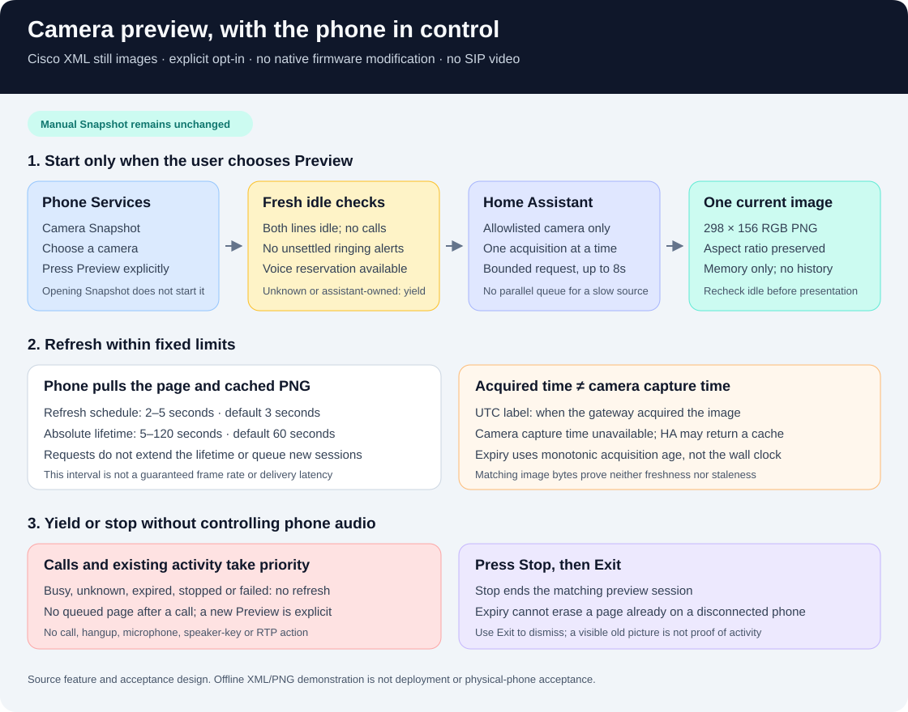

# Camera preview on Cisco 7945G



Camera Preview refreshes a sequence of still images from an allowlisted Home
Assistant camera. It uses the phone's existing Cisco XML Services interface;
it needs no firmware decompilation or native application. It is **not SIP
video**, a continuous video stream, an incoming-call overlay or a source of
camera audio.

Preview is off by default. The existing **Camera Snapshot** page and its
manual **Refresh** action remain available. Enabling Preview adds an explicit
**Preview** softkey to the snapshot; opening a snapshot does not start an
automatic refresh session.

This guide describes the source feature and its acceptance procedure.
It does not establish a deployment or physical-phone acceptance. Package the
updated gateway and preview module together before enabling the private
configuration. Keep this change separate from an unrelated voice rollout.

## Private configuration

First configure the existing [phone applications](phone-applications.md) and
their Home Assistant backend. Use only the cameras listed in
`applications.home_assistant.cameras`; the phone cannot supply an arbitrary
camera URL or entity ID. The
[HA example](../examples/phone-apps-ha.example.json) shows the backend shape.
The gateway's [voice-control ownership manager](voice-control.md) must also be
configured for that physical phone so the preview can check its durable
reservation. Inventory phones do not each need a manual voice-start profile:
the shared control reservation covers the physical inventory. If that check
is unavailable, Preview yields. This prerequisite
does not start a voice session or enable a microphone; Snapshot remains a
separate manual feature.

Merge this fragment into the existing private gateway configuration, preserving
its `applications.home_assistant` object and every other setting:

```json
{
  "applications": {
    "enabled": true,
    "camera_preview": {
      "enabled": true,
      "refresh_seconds": 3,
      "ttl_seconds": 60,
      "stale_seconds": 10
    }
  }
}
```

Do not replace the entire configuration with this fragment. Preview requires
the configured HA backend. Keep the full configuration, tokens, camera entity
IDs, phone addresses and actual labels in a gitignored private file.

The settings are:

- `enabled`: boolean; defaults to `false`.
- `refresh_seconds`: integer from 2 to 5; defaults to 3.
- `ttl_seconds`: integer from 5 to 120; defaults to 60. This is the absolute
  session lifetime; page requests do not extend it.
- `stale_seconds`: integer from 2 to 30; defaults to 10. It must be at least
  `refresh_seconds` and bounds the age of an acquired image.

For a synthetic example, a camera allowlist entry can be
`{"id":"demo","label":"Demo camera","entity_id":"camera.demo"}`. Configure
your real entry privately. The short ID `demo`, not the HA entity ID, appears
in the phone's application route.

An updated source tree or configuration file alone does not update a running
container. Use the reviewed [gateway deployment](phone-gateway.md) and
[k3s process](k3s-deployment.md), with an image containing
[`phone_camera_preview.py`](../containers/asterisk/phone_camera_preview.py).
Validate configuration before replacing the running service. Do not enable
the new option against an older image that lacks its validator or module.

## Use on the phone

1. Open **Services → Camera Snapshot**, then select a configured camera.
2. Choose **Preview** explicitly. If the phone is unavailable or busy, finish
   the existing activity and start a new preview yourself.
3. The phone fetches an XML page and its current PNG image. Automatic page
   refresh is scheduled every 2–5 seconds while the session remains valid.
   **Details** shows the explanatory text; **Image** returns to the picture.
4. Press **Stop** to end that preview session, then **Exit** to dismiss the
   page. Start a new preview explicitly when needed.

The default lifetime is one minute. The preview does not automatically resume
after a call, a failed acquisition, expiry or Stop. The 298 × 156 RGB PNG
preserves aspect ratio with padding; it occupies the Services image area,
not the full physical panel.

**The interval is not a frame-rate or latency promise.** HA image requests
can take up to their 8-second request budget. Only one acquisition per physical
phone runs at a time; slow requests do not create a parallel frame queue.
The phone's image fetch uses the current cached frame rather than starting
another HA request. Fresh PBX/ownership checks also take time; the HA request
budget is not an end-to-end deadline for the whole page request.

## Calls and voice sessions take priority

Preview requires authoritative, fresh idle state for the **whole physical
phone**, including both configured lines. No line may be in use; no related
call or unsettled ringing alert may remain. The durable voice state and shared
reservation must also permit the operation. Unknown or unavailable state is
not permission to display a preview.

Ringing, dialing, an active or held call, SIP radio playback, a voice session,
or unresolved voice cleanup prevents presentation. An assistant-owned phone
does not count as idle. The integration checks focus around acquisition and
before serving the preview; when focus is lost it yields instead of queuing
a page for later.

Preview has no right to answer or end a call, activate a microphone, switch
the speaker, or start RTP. **Stop affects only the matching preview.** It is
not the voice assistant's Stop action or a generic hangup.

Native call-screen behavior still needs a physical test on the installed
firmware. Server-side refusal and an HTTP response alone cannot prove which
page the device currently shows.

## Read the timestamp correctly

The screen labels time as **Acquired** in UTC and states **Camera capture
time unavailable**. This is when the gateway acquired the image from HA,
not when the camera exposed that frame. The HA proxy used here supplies no
trusted camera capture timestamp.

An HA integration may return a cached picture. A recent acquisition therefore
does not prove a recent camera frame. Unchanged image bytes also do not prove
either freshness or staleness: the scene may simply be still. Preview makes
neither inference.

Image expiry uses monotonic elapsed time since acquisition and
`stale_seconds`; changing the wall clock does not renew the image. A failed
refresh or an expired acquisition must not keep presenting the old image as
current. Repeated phone requests for the cached PNG do not reset its
acquisition age. A new successful HA fetch establishes a new acquisition
time even if its bytes match, while camera capture time remains unknown.

**Expiry does not erase an image already on the phone.** A disconnected phone,
an expired session or a stopped refresh loop can leave the last page visible.
Press **Exit**. Do not interpret the visible timestamp as a clock that keeps
updating after refresh stops. Prefer **Stop**, then **Exit**, when deliberately
ending a session; Exit alone is navigation, not confirmation of server cleanup.

## Requests and stored data

Routes are relative to the phone's existing private Apps base:

- Explicit start: `/camera-preview?line=201&id=demo`.
- Session page: `/camera-preview/session/<session-id>`.
- Current image: `/camera-preview/session/<session-id>/image?v=<revision>`.
- Details and Stop: the same session path with `/text` or `/stop`.

The listener supplies physical-phone identity and checks the source address.
The line must belong to that phone and the camera short ID must be allowlisted.
Session and image revisions prevent an old URL from selecting a replacement
preview. Keep these routes on the existing trusted private network; source
address checks are not TLS or cryptographic device authentication.

The cache holds only the current image per session, in memory, within the
absolute lifetime. It does not create a recording or frame history. Preview
does not allocate a fresh shared notification resource for every frame.
Its page responses preserve the `Refresh` header and no-cache headers.
A yielded response has no display body and no automatic refresh; it must
not be converted into a generic error page that takes the call screen.

HA may have its own camera, logging or recording behavior. This preview
does not change those settings. Do not publish photographs, private
configuration or captures of actual household screens as test fixtures.

## Offline demonstration

From the repository root, with Python and Pillow installed:

```sh
python3 containers/asterisk/phone_camera_preview.py \
  --demo-directory /tmp/camera-preview-demo
```

Choose an output directory that does not already exist. The command writes
`preview.xml`, `still.png` and `result.json` into that new directory. It opens
no listener, connects to no camera or HA instance, and sends no phone command.
Inspect the generated PNG and XML together; the JSON records the synthetic
demonstration data. This does not prove device
rendering, refresh timing, call-screen priority or a live HA connection.

The lower-level display API and its lifecycle limitations are documented in
[Voice status and camera stills](voice-display.md). Its general ability to
display an assistant state does not relax Preview's stricter idle-only rule.

## Acceptance and troubleshooting

After the image and configuration are reviewed, use one explicitly selected
phone for a bounded pilot:

- Confirm Snapshot remains manual and Preview starts only when chosen.
- Check aspect ratio, small-text readability, UTC acquisition labeling,
  Details, Stop and Exit. Begin with 5-second refresh before trying 3 or 2.
- Interrupt the source and network. Confirm failures and old image revisions
  do not cause a retry storm or appear as fresh frames.
- Test expiry and Stop while a slow HA request is pending. The completed
  request must not revive the session or replace a newer preview.
- Test ringing, outgoing, active and held calls on both lines, a ringing
  alarm, SIP radio and voice ownership. Check the native screen and verify
  there is no delayed preview after those activities end.
- Inspect resource behavior before extending to more phones. A one-phone
  demonstration does not establish a multi-phone refresh rate.

If **Preview** is absent, check the opt-in configuration, HA backend and
running image revision. If it yields immediately, check both phone lines,
pending alerts, voice ownership and the availability of fresh PBX status;
do not bypass the idle guard. If an image looks old despite a recent
**Acquired** time, inspect the HA camera integration's caching behavior.
If the last image remains after Stop or expiry, use **Exit**; this alone is
not evidence that acquisition is still running.
