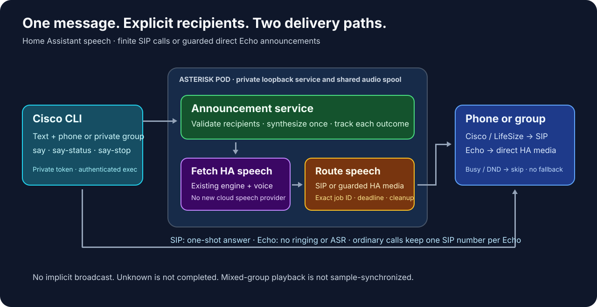

# Spoken announcements from the CLI

`say` turns text into a bounded announcement using the configured Home
Assistant voice. Each recipient has an explicit delivery route:

- **Cisco and LifeSize:** Asterisk calls the selected line, the CLI requests one
  answer for that owned incoming call, audio plays once, and Asterisk ends it.
- **Converted Echo Dot and Echo Show:** a guarded Home Assistant adapter sends
  the prepared speech directly to the speaker. There is no SIP announcement
  call, ringing, remote answer or new Assist conversation.

The command does not turn on persistent auto-answer. Echo devices keep their
ordinary SIP numbers for person-to-person calls. An announcement is another
operation on the same device, not a second telephone line.

`message` remains a screen command:

```sh
cisco 222 message "Dinner is ready"   # Display text
cisco 222 say "Dinner is ready"       # Speak through an announcement call
```



## Commands

```sh
cisco 222 say "Dinner is ready"
cisco 222 voicemsg Dinner is ready
cisco 210,212,222 say "Please come downstairs"
cisco 223 voicemsg "Your delivery has arrived"
cisco 212,222,223,225 voicemsg "Dinner is ready"
cisco @downstairs say --text-file "$HOME/announcement.txt"
cisco @downstairs say "This is a rehearsal" --dry-run
```

`announce` and `voicemsg` are aliases for `say`. Quote text that contains shell
punctuation. The selected numbers are **recipients** of the
announcement; unlike `cisco 212 220`, this command does not connect two people.
A comma list is explicit. An `@name` is expanded only from the private local
`announcements.groups` configuration. There is no implicit broadcast to every
registered phone.

Run `say` in the foreground until it returns. The CLI performs one-shot
answer requests only for the SIP recipients; it never answers an Echo call
when that recipient uses direct HA delivery. The server owns the job and its
cleanup. A closed terminal is not a reliable Stop command. Use the returned job ID:

```sh
cisco @downstairs say-status JOB_ID
cisco @downstairs say-stop JOB_ID
```

Status and Stop address that exact announcement job. Use the same resolved
recipient set as the original command. Stop may return `stopping` while cleanup
finishes; inspect status again to observe completion. Stop does not target an
unrelated call by phone number or issue a general Echo media-stop action.
For a direct recipient, the adapter must cancel the matching request ID. A
lost acknowledgement produces an uncertain result rather than a claim that
playback was stopped. After a network error, inspect the known job
before deciding whether to send a new announcement. A new job can produce a
second audible announcement; do not retry blindly.

For an operation whose key you need to retain explicitly:

```sh
cisco 222 say "Dinner is ready" --idempotency-key dinner-notice-001
```

Reusing that key with identical recipients and text refers to the same job while
its journal remains available. Different content with the same key is rejected.
The service retains bounded journals for 24 hours; a key is not a permanent
deduplication guarantee after its journal expires.

Journals survive a service process restart only while the shared spool remains
available. The renderer reuses the existing spool volume: with `emptyDir`, a
replacement pod loses that history. Use a persistent spool if history must
survive pod replacement. An unknown job after such a replacement is not proof
that its message was never played; do not automatically submit it again.

## Recipients and call behavior

Supported recipients are configured Cisco phones, explicitly configured
LifeSize phones with a working native SSH driver, and explicitly configured
Echo satellites with the guarded HA adapter described below. SIP registration
alone does not make a softphone remotely answerable. A stock
`assist_satellite` entity alone does not satisfy the guarded adapter contract.

### One number per Echo

Give each physical Echo exactly one extension. For example, four different
speakers may use `223`, `224`, `225` and `226`; these are four devices, not two
pairs of primary and secondary lines. Keep the same extension in the Asterisk
endpoint, private directory, CLI target and announcement runtime mapping.
Do not add another SIP account for direct announcements.

```sh
cisco 212 223                    # Ordinary call to the Echo's SIP extension
cisco 223 voicemsg "Dinner time" # Direct HA speech on the same Echo
```

The CLI target's `phone_id` equals its one extension. The runtime rejects a
satellite mapping if that physical ID has another line alias. Cisco phones may
retain their existing two-line mapping; one group must still select only one
of those sibling lines.

The SIP route checks availability and existing call state before calling.
The Echo route first checks the extension's Asterisk DND flag. A missing AMI
state is a skip, not permission to ignore that flag. It then requires an
adapter that atomically claims an idle device and applies the device's own
busy/quiet policy before playback. The PBX DND preflight and native audio claim
are separate checks; they are not a transaction across both systems. Busy, offline or
DND-protected recipients are skipped and reported individually.
Unknown targets are rejected. A group must not contain both lines of the same
physical Cisco phone: duplicate physical recipients are rejected instead of
calling that phone twice.

The group shares one synthesized voice asset. SIP recipients use its decoded
16 kHz PCM form; Echo recipients receive the prepared HA media URL and let
their native audio path decode it. An admitted SIP recipient gets a bounded
call; an admitted direct recipient gets a bounded, correlated playback job.
Read the per-recipient result: a partly delivered group is not the same as
delivery to every recipient. Phones may answer at different times; group
playback is not sample-synchronized multiroom audio.

Existing persistent `autoanswer` and `automute` preferences are preserved.
Answering uses the ordinary Cisco or LifeSize control path only for the
announcement's incoming call. SIP playback completion is managed by Asterisk,
not by a timer in the terminal that originally submitted the text. Echo completion is reported by
its guarded adapter. A timeout or missing device receipt is not completion.

For LifeSize, the CLI opens a private authenticated SSH connection and checks
the configured SIP identity before submitting the announcement. It reuses that
connection for the two fresh incoming-call checks and the answer command.
This avoids repeated SSH handshakes while the phone is ringing. The temporary
connection closes when the CLI operation finishes; a lost prepared connection
does not silently reconnect or repeat an answer. Some ringing can still occur
while the exact incoming call is verified. This is not persistent auto-answer
for ordinary incoming calls.

## Private client configuration

Install the complete seven-file CLI bundle from one reviewed revision:

```text
cisco.py
cisco_http.py
cisco_player.py
cisco_library.py
cisco_media_source.py
cisco_lifesize.py
cisco_announce.py
```

The [CLI installation guide](cli-installation.md) covers the command symlink;
the [LifeSize guide](cli-lifesize.md#install-or-update-the-local-cli) includes an
atomic versioned-bundle update procedure. Keep the existing gateway and native
phone configuration. Merge the `announcements` object from
[`cisco-cli.announcements.example.json`](../deploy/cisco-cli.announcements.example.json)
into the private `~/.config/cisco-home/cli.json`; the example is a fragment, not
a replacement configuration.

Put the announcement service's separate bearer token in the file named by
`token_file`. Relative paths are resolved beside the CLI configuration. Keep
both files owned by your user with mode `0600` or stricter. Real group names,
phone assignments, credentials and private deployment details stay outside
Git. The public example contains fictional groups.

The announcement URL is loopback **inside the selected Asterisk pod**, not a
service listening on the Mac. The example therefore uses explicit Kubernetes
transport and the `announcer` container. The configured context, namespace and
selector must resolve to the intended Ready pod. Existing Kubernetes
authentication and pod-exec access are required; this feature does not create
credentials or widen cluster permissions.

### Install from the release packages

Use the release page's exact tag and full source commit. The download contains
`cisco-cli.tar.gz`, `announcement-service.tar.gz`, `SOURCE.json` and
`SHA256SUMS`. The CLI archive contains all seven modules together under
`scripts/`; the service archive contains Python sources, the renderer and
example configuration. It is **not** a new Asterisk container image.

After substituting the reviewed tag and 40-character commit:

```sh
release_tag='REPLACE_WITH_REVIEWED_TAG'
release_commit='REPLACE_WITH_FULL_SOURCE_COMMIT'
release_dir="$HOME/.local/share/cisco-home-cli/bundles/$release_commit"
mkdir -p "$release_dir"
gh release download "$release_tag" --repo 4alvit/cisco-home-telephony \
  --pattern cisco-cli.tar.gz --pattern announcement-service.tar.gz \
  --pattern SOURCE.json --pattern SHA256SUMS --dir "$release_dir"
(cd "$release_dir" && shasum -a 256 -c SHA256SUMS)
mkdir "$release_dir/cli" "$release_dir/service"
tar -xzf "$release_dir/cisco-cli.tar.gz" -C "$release_dir/cli"
tar -xzf "$release_dir/announcement-service.tar.gz" -C "$release_dir/service"
```

Stop if a download, checksum or extraction fails. Each archive has its own
`SOURCE.json`, listing exactly that bundle's files and SHA-256 hashes. The
standalone manifest describes the combined release source set. Check the
source commit against the release notes and verify both extracted bundles:

```sh
python3 - "$release_dir" "$release_commit" <<'VERIFY'
import hashlib, json, re, sys
from pathlib import Path
root, expected = Path(sys.argv[1]), sys.argv[2]
if not re.fullmatch(r"[0-9a-f]{40}", expected):
    raise SystemExit("Use the full source commit from the reviewed release.")
for bundle in (root, root / "cli", root / "service"):
    manifest = json.loads((bundle / "SOURCE.json").read_text())
    if manifest["source_commit"] != expected:
        raise SystemExit("Release source commit mismatch.")
    if bundle == root:
        continue
    for name, checksum in manifest["files"].items():
        path = bundle / name
        if not path.resolve().is_relative_to(bundle.resolve()):
            raise SystemExit("Invalid manifest path.")
        if hashlib.sha256(path.read_bytes()).hexdigest() != checksum:
            raise SystemExit("Bundle file mismatch: " + name)
print("Both bundles match the reviewed source commit and file hashes.")
VERIFY
```

Deploy the service first using the existing
[renderer procedure](#install-the-announcement-service), run from
`"$release_dir/service"`. It retains the saved deployment's Asterisk image.
That image must already provide the required Python, Asterisk and FFmpeg
runtime. The package does not install Echo firmware, the Show Android app or
HA adapters; install their compatible releases separately.

After deployment, let active local CLI commands finish, then atomically select
the extracted CLI. Keep the bundle directory in place while it is installed:

```sh
python3 - "$release_dir/cli/scripts/cisco.py" <<'INSTALL'
import os, secrets, sys
from pathlib import Path
source = Path(sys.argv[1]).resolve(strict=True)
link = Path.home() / ".local/bin/cisco"
link.parent.mkdir(parents=True, exist_ok=True)
if link.exists() and not link.is_symlink():
    raise SystemExit("Refusing to replace a regular file at the CLI path.")
print("Previous target:", os.readlink(link) if link.is_symlink() else "(none)")
temporary = link.with_name(".cisco-" + secrets.token_hex(8))
try:
    temporary.symlink_to(source)
    os.replace(temporary, link)
finally:
    temporary.unlink(missing_ok=True)
print("Installed:", source)
INSTALL
export PATH="$HOME/.local/bin:$PATH"
cisco --help
```

Keep the printed previous target for rollback. This changes only the command
symlink; it does not overwrite private CLI configuration, tokens, SSH keys or
phone settings. Merge only the intended configuration keys afterward and use
the [quiet verification procedure](#quiet-installation-and-acceptance).

## Home Assistant voice

The service uses the configured Home Assistant TTS engine, language and voice.
It prepares speech once before any recipient is dispatched. A synthesis error
therefore does not create silent calls or empty direct announcements.

Direct delivery passes the prepared `media_id`, with `preannounce: false`,
instead of asking each satellite to synthesize `message` through its own
pipeline. This keeps the selected voice consistent across a mixed group.
The server passes a validated HA-local `/api/tts_proxy/...` path. Each adapter
resolves that path using Home Assistant's media address, which may differ from
the private API address used by Asterisk. Credentials and query tokens are
never embedded in that path. Submission deadlines are whole Unix seconds,
rounded down so conversion cannot extend the job's lifetime.
The stock [Home Assistant announcement action](https://www.home-assistant.io/actions/assist_satellite.announce/)
distinguishes `media_id` from `message`; its `message` option uses the
satellite's configured pipeline voice. The guarded adapter adds ownership,
busy protection, deadlines and result tracking around device playback.

For a deployment using the local Russian speech integration, select
`tts.local_russian_speech`, language `ru`, and the explicit `silero-ru-baya`
voice when available. The `silero-ru-default` alias follows the speech backend's
current default; it is not an immutable Baya selection.
The announcement command does not replace the provider, change voice defaults,
or introduce a cloud speech service. Other installations must configure their
own available Home Assistant engine and voice.

The announcement text is data, not an Assist request. It is spoken as supplied;
it does not ask the assistant to execute household commands.

## Configure guarded Echo delivery

There are two independent configuration layers. The CLI declares which
numbers must use direct HA delivery. The server maps those numbers to private
satellite identities. Both layers must agree before a job is accepted; a
mismatch must not turn a direct announcement into a ringing SIP call.

Merge this fragment into the existing client's `announcements` object. These
are four fictional device assignments; use one target per physical Echo:

```json
{
  "targets": {
    "223": {"driver": "ha_satellite", "phone_id": "223"},
    "224": {"driver": "ha_satellite", "phone_id": "224"},
    "225": {"driver": "ha_satellite", "phone_id": "225"},
    "226": {"driver": "ha_satellite", "phone_id": "226"}
  },
  "groups": {
    "speakers": ["223", "224", "225", "226"],
    "mixed": ["201", "222", "223", "225"]
  }
}
```

The matching server fragment is:

```json
{
  "lines": {
    "201": "201",
    "202": "201",
    "222": "222",
    "223": "223",
    "224": "224",
    "225": "225",
    "226": "226"
  },
  "satellites": {
    "223": {"entity_id": "assist_satellite.example_dot_one", "domain": "echomuse_home"},
    "224": {"entity_id": "assist_satellite.example_dot_two", "domain": "echomuse_home"},
    "225": {"entity_id": "assist_satellite.example_show_one", "domain": "vaca"},
    "226": {"entity_id": "assist_satellite.example_show_two", "domain": "vaca"}
  }
}
```

Merge these keys into the complete configuration; they do not replace its AMI,
API token, audio or spool settings. Use the actual entity IDs from your HA
installation, not the example IDs. An Echo-only command does not need to
query the Cisco phone inventory. A mixed command still checks its Cisco
recipients through that inventory.

Install the matching guarded services from the Echo device project before
using these mappings:

- [Converted Echo Dot](https://github.com/ha-homelab/ha-techo5-dot):
  `echomuse_home` adapter and its compatible device runtime.
- [Converted Echo Show](https://github.com/ha-homelab/ha-echo-show-5):
  `vaca` adapter and its compatible Android application.

The required firmware/application
version is the version documented by that adapter's release. Having an
`assist_satellite` entity, an ordinary `announce` service or a SIP registration
is insufficient by itself.

### Adapter contract and truthful results

The runtime calls these HA services in the configured domain, with response
data requested:

- `announcement_capabilities`: inspect support for the selected `entity_id`.
- `announcement_submit`: pass that entity, a unique `request_id`, the prepared
  `media_id`, absolute `expires_at`, `preannounce: false` and
  `busy_policy: "skip"`.
- `announcement_status`: inspect the same entity and request ID.
- `announcement_stop`: stop only that entity's matching request ID.

A compatible capabilities response declares the protocol and all safeguards:

```json
{
  "protocol": "cisco-announcement-v1",
  "atomic_idle_guard": true,
  "dedup": true,
  "owned_cancel": true,
  "honest_completion": true,
  "deadline_enforced": true
}
```

The service response contains this object under HA's `service_response` key.
The adapter must check the real implementation and device capabilities;
it must not advertise a safeguard merely because a client supplied the flag.
Unsupported or incomplete capabilities are rejected before sound starts.

The atomic idle guard serializes announcement admission with the device's
actual audio state, so a preliminary `idle` observation cannot justify mixing
speech into a call that has since begun. Real calls take priority: an incoming
or outgoing call may preempt or cancel the announcement, and the adapter must
report that interruption. The guard must not hold a call back until a message
finishes. A plain HA `idle` state check followed by stock `announce` is not an
equivalent guarantee. The request ID and expiry prevent replay after
reconnect, while owned cancellation avoids stopping unrelated later playback.
A status of `unknown` preserves uncertainty after a lost response or missing
completion evidence. It is not converted to `completed` after waiting for the
expected audio length.

No fallback sends direct Echo jobs through SIP or through the unguarded stock
HA action. This is deliberate: a missing adapter must not unexpectedly ring
the room, inject speech into a call or interrupt an unrelated conversation.
Music ducking and restoration are adapter-specific; this CLI does not promise
uniform pause/resume of arbitrary Android apps or multiroom synchronization.

### Updating an existing installation

Use one reviewed source revision for the seven CLI files, announcement
runtime and renderer. Deploy the updated announcement backend **before**
switching the CLI: current clients include `expected_routes`, which an older
backend rejects. Route disagreement is an error, not a reason to remove that
check. Preserve existing private configuration and tokens during upgrades.

Then install the required Echo HA adapter and device build, verify its
read-only capabilities, add the explicit runtime and CLI mappings, and use a
dry run. Installation does not need a demonstration announcement. Release
notes must distinguish a quiet installation from audible acceptance.

## Install the announcement service

The service runs as the `announcer` sidecar in the Asterisk pod. It binds to
`127.0.0.1:18085` and requires its own bearer token. Access is through authenticated
Kubernetes execution into that pod; no public ingress or LAN listener is needed.
Both containers share the announcement audio spool. Home Assistant credentials
remain in the existing Asterisk configuration rather than in a spoken message
or a public source file.

Use [announcements.example.json](../deploy/announcements.example.json) as the
runtime configuration template. In the private copy, configure:

- `token`: a separate random announcement API token; put the same value in the
  private client `token_file`.
- `ami`: the existing authorized Asterisk management connection. See the
  [phone gateway](phone-gateway.md) for its AMI configuration and permissions.
- `lines`: an explicit mapping from each accepted extension to its physical
  phone ID. Map both lines of one Cisco phone to the same ID. Give each Echo
  only one mapping, such as `"223": "223"`.
- `satellites`: optional direct-delivery mappings keyed by those Echo lines.
  Each has a private HA `entity_id` and adapter service `domain`. See the
  [guarded adapter configuration](#configure-guarded-echo-delivery) above.
- `dial_audio_config` and `voice_service`: the existing dial-audio configuration
  path and its clock/TTS service number, normally `555`.
- `spool` and `agi`: the shared audio directory and mounted announcement AGI
  entry point. Keep the paths from the template unless adapting the deployment.

The service command is:

```sh
python3 /opt/cisco-announcements/phone_announce.py \
  --config /etc/cisco-announcements/config.json
```

The renderer includes `phone_announce.py`, `phone_announce_agi.py` and their
existing `dial_audio.py` / `phone_gateway.py` dependencies from the checked-out
revision. It preserves the saved Asterisk configuration keys and adds the
announcement dialplan include. The sidecar uses the Asterisk deployment's
existing image and audio spool. Container user/group overrides and the pod's
security context are preserved so both processes can use owner-only audio and
journal files. If your Asterisk startup command drops to a different OS user
internally, align the actual Asterisk and sidecar user IDs before deploying.

Save current inputs in an ignored private directory. Replace the example
context and Secret name with the values from your deployment:

```sh
umask 077
mkdir -p private/announcements-input
kubectl --context example-cluster -n telephony get deployment asterisk -o json \
  > private/announcements-input/deployment.json
kubectl --context example-cluster -n telephony get secret CURRENT_ASTERISK_CONFIG_SECRET -o json \
  > private/announcements-input/asterisk-secret.json
cp deploy/announcements.example.json private/announcements-input/config.json
```

Edit the private configuration before rendering. Do not commit the inputs or
rendered resources: they contain credentials and actual endpoint mappings.
Keep the existing token when updating an already installed service.

```sh
python3 scripts/render_announcements.py \
  --deployment private/announcements-input/deployment.json \
  --asterisk-secret private/announcements-input/asterisk-secret.json \
  --config private/announcements-input/config.json \
  --output-directory private/announcements-rendered

kubectl --context example-cluster -n telephony create \
  -f private/announcements-rendered/resources.json
kubectl --context example-cluster -n telephony replace \
  -f private/announcements-rendered/deployment.json
kubectl --context example-cluster -n telephony rollout status deployment/asterisk
```

The output directory must be new. The rendered Deployment retains the saved
`resourceVersion`; if another controller has changed it, fetch fresh inputs and
review/render again rather than forcing a stale replacement. A rollout restarts
the Asterisk pod and can interrupt active calls. Retain the original Deployment
and Secret as private rollback inputs until verification completes.

After rollout, merge the client fragment and check a dry run. If audible
checks are currently prohibited, stop verification there and use the quiet
checks below. When sound is allowed, test a short announcement on one available
recipient of each driver before expanding the group. A dry run
validates the request and configured targets without synthesizing, calling or
checking live availability. Busy, offline and DND checks happen when a real job
is dispatched.

A PBX restart may temporarily leave a phone without an active SIP contact until
its next registration refresh. The phone can still display its previous
registration state. Confirm the contact in Asterisk before diagnosing a skipped
`offline` recipient as an announcement failure.

## Quiet installation and acceptance

A workday installation can be checked without ringing or playing anything:

1. Run the offline unit tests for `cisco_announce`, `phone_announce` and the
   announcement renderer; compile the installed Python files.
2. Verify source revision, release checksums, preserved private file
   permissions and deployment readiness.
3. Read the HA adapter's `announcement_capabilities` response for each
   configured satellite. This is a capability query, not `submit`.
4. Run `say --dry-run` with the intended explicit recipients or group and
   inspect each route. This does not synthesize text, originate calls or start
   direct playback.
5. Check that no announcement job or temporary call was created and that
   ordinary endpoint registrations remain present.

These repository checks use fixtures and do not contact a phone:

```sh
python3 -m unittest discover -s tests -p 'test_*announce*.py'
python3 -m py_compile scripts/cisco.py scripts/cisco_http.py \
  scripts/cisco_player.py scripts/cisco_library.py scripts/cisco_media_source.py \
  scripts/cisco_lifesize.py scripts/cisco_announce.py \
  containers/asterisk/phone_announce.py containers/asterisk/phone_announce_agi.py
```

For example, this configured CLI command is silent:

```sh
cisco @mixed voicemsg "Configuration validation only" --dry-run
```

Do not use `say`, `announcement_submit`, stock `assist_satellite.announce`,
`media_player.play_media` or a test dial command as a health check while sound
is prohibited. Build hooks and installation scripts must not run them either.
A dry run does not test acoustics, device volume, media reachability or live
admission; those remain unverified until a later audible test.

When audible testing is explicitly allowed, check one device of each driver,
then a mixed group. Verify the expected voice, no ringing on Echo, no new
Assist listening session, completed playback, correct termination and no
leftover call. Also verify busy/DND refusal, exact-job stop, expiry, duplicate
submission and unknown-result behavior. Record software versions, per-device
results and any skipped checks. A beta, release candidate or stable tag must
not be described as acoustically tested merely because it was built or
installed successfully.

## Results and troubleshooting

The job progresses through `accepted`, `running` and a terminal result such as
`finished`, `failed` or `stopped`; `stopping` means cleanup is still in progress.
`dry_run` is a planning result. Always inspect recipient statuses and reasons:
`finished` alone does not establish that every configured phone received audio.
The CLI's `answers` entries describe SIP control requests. A recipient's
`driver` distinguishes `sip` from `ha_satellite`. For SIP, `completed` means
Asterisk playback completed; for direct HA, it means the adapter returned a
correlated completion result. Neither proves that a person heard the message.
`submitted` and `playing` are progress, not delivery confirmation. `unknown`
means that an outcome could not be established and must not trigger blind
redelivery. Read the per-recipient reasons even when the overall job is
`finished`; mixed groups can finish with skipped or uncertain recipients.

| Observation | What to check |
| --- | --- |
| Announcement configuration is missing | Merge the private client fragment and install the matching server. |
| Connection refused on the loopback URL | Check the selected pod/container and sidecar readiness. The URL belongs to the pod. |
| Unauthorized | Verify that the service token and the private client token file match. |
| Guarded Echo capability is missing | Install the matching adapter/device version; do not bypass the capability gate. |
| Direct route does not match | Align `announcements.targets` with the server `satellites` mapping and update the backend first. |
| A direct result is `unknown` | Keep its job ID, inspect adapter/device diagnostics, and do not send a replacement automatically. |
| A group is unknown | Group names are local configuration, not room names from the public directory. |
| Duplicate physical recipient | Remove the second line or repeated number for that same physical phone. |
| Busy, offline or DND recipient | Read that recipient's current state; the announcement does not interrupt an unrelated call. |
| Speech preparation failed | Check the existing HA TTS service, engine/voice configuration and credentials before another call. |
| Phone rings but does not answer | Keep the CLI running; check the relevant Cisco gateway or native LifeSize answer control. |
| A network request had an unknown outcome | Use `say-status` for the existing job ID. Do not create a second job just to discover its state. |
| Playback has ended but cleanup is pending | Read job status and use exact-job Stop if needed; do not hang up an unrelated replacement call. |

Server API routes are `POST /v1/announcements`,
`GET /v1/announcements/JOB_ID` and
`POST /v1/announcements/JOB_ID/stop`. They are private implementation interfaces;
use the CLI so normal target validation, idempotency and answer handling apply.

## Operational limits

This feature is a short announcement, not a conversation, alarm, intercom,
streaming radio player or recording. Physical speaker volume remains the
device's setting. For LifeSize, use its separate `volume call` control during a
connected call; `volume ringer` changes the ring, not speech loudness.

The bounded limits are 1,000 text characters, up to 16 distinct physical
recipients, 120 seconds of generated audio, 30 seconds to answer a call and
180 seconds overall for a job. The CLI waits at most 240 seconds. A text file is
limited to 16 KiB. The service admits at most four active jobs and retains at
most 512 journal records. The server removes its local PCM/audio files once
all recipients are terminal; Home Assistant manages its own TTS proxy/cache
lifetime. These bounds are not a promise of simultaneous group start times.

Screen images and the native `message` popup do not become TTS automatically.
Use `say` when audio is intended, and use the ordinary timer/alarm commands
when a phone should keep ringing until someone dismisses it.
