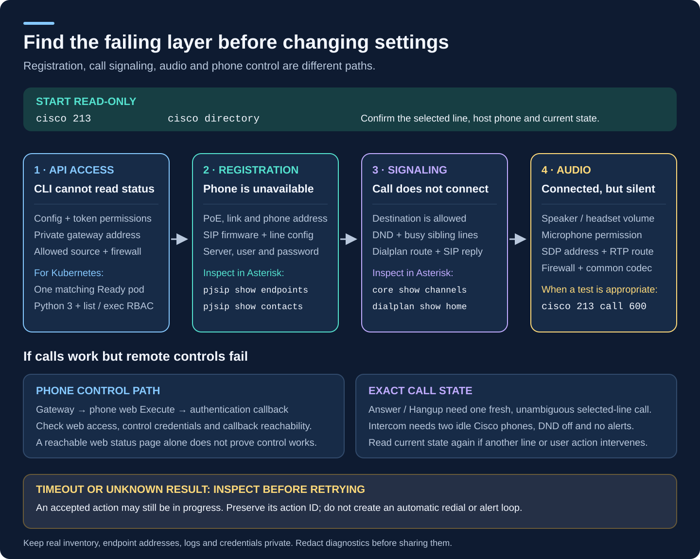

# Install, connect and troubleshoot the Cisco CLI

The `cisco` command controls the physical Cisco phone that owns a selected
extension. It talks to the project's private HTTP gateway. Asterisk handles
the call, and the gateway handles the phone's buttons, display and preferences.
The CLI does not register as a SIP phone and does not need a SIP password.

This guide uses fictional addresses and extensions. Replace them with your
private deployment values; keep real room names, device identities, token files
and command output outside the public repository.


## 1. Check the server prerequisites

Before installing a client, the deployment needs:

- Asterisk with the generated PJSIP endpoints and dialplan; the intended Cisco
  phones must already be registered.
- The persistent phone gateway with a working dedicated AMI connection,
  per-phone authenticated callbacks and a current device inventory.
- The gateway API URL, its existing bearer token and an allowed network path.
  A typical fictional URL is `http://192.168.50.10:18084`.
- For intercom, an updated gateway advertising the `intercom` capability
  **and the matching generated Asterisk `cisco-intercom` helper**, with working
  AMI Originate permission and fresh channel/bridge observations. This private
  helper makes the source phone's call ignore forwarding, just as the
  destination leg does. Updating only the local CLI or only the gateway is
  insufficient.
- Optionally, Home Assistant with the companion **Cisco phone controls 0.3.0
  or later** integration for countdown timers and recurring alarms.
- For the optional [HA radio media player](https://github.com/ha-homelab/asterisk-telephony/blob/main/docs/media-player.md),
  use **Cisco phone controls 0.7.0b2 or later** with the matching media-capable gateway
  and regenerated, active PBX radio routes; see the
  [radio requirements](phone-gateway.md#radio-state-and-home-assistant-media-players).
  Installing only the CLI does not add media-player entities to HA.
- For [physical phone volume](hardware-volume.md), use **Beta 25** or later
  for both the CLI and gateway. The optional HA buttons require **Cisco phone
  controls 0.8.0b2 or later**. Hardware volume does not require HA when used
  from the CLI.

Start with [Asterisk setup and operations](asterisk-operations.md) if the PBX
is not ready. The [persistent gateway guide](phone-gateway.md) explains its
AMI account, callback credentials, firewall and deployment. Basic calls do
not require the optional HA scheduler.

There are three different credentials: a phone's **SIP password**, the
gateway's **API bearer token**, and an optional **HA long-lived access token**.
They are not interchangeable. Reuse the deployed gateway token; generating a
new random token on the client will not authorize it.

## 2. Install on macOS or Linux

The CLI requires **Python 3.10 or later** and Git. Ordinary commands, local
music search and direct audio URLs use the Python standard library. Only
direct Home Assistant media-source resolution additionally needs optional
`aiohttp>=3.12,<4`; see [CLI music](cli-music.md) for its virtual environment
setup. Docker and a running softphone are not needed for the client.

If Python is missing on macOS, use the
[official Python installer instructions](https://docs.python.org/3/using/mac.html).
If Homebrew is already installed, `brew install python git` is another option.
On Debian/Ubuntu, install the available packages with `sudo apt install python3
git`, then check that the resulting Python version meets the requirement. Use
your distribution's supported Python installation if it is older.

```bash
python3 --version
git --version
mkdir -p "$HOME/src"
cd "$HOME/src"
git clone --branch v0.1.0-beta.25 --single-branch \
  https://github.com/4alvit/cisco-home-telephony.git cisco-home-telephony-beta25
cd cisco-home-telephony-beta25
git rev-parse HEAD
```

This example selects [Beta 25](https://github.com/4alvit/cisco-home-telephony/releases/tag/v0.1.0-beta.25).
Confirm that the printed commit is
`213454385b7e75057f6b4d5db5a7b6a79922ccdd` before continuing. For another
release, use its recorded full source commit and matching server image; the
latest default branch is not a release pin.

The Beta 25 pin above does **not** include the newer local-library music
commands, ringer/call volume controls or announcements. Select a reviewed newer
revision instead: Beta 27 carries the five-file CLI with music and volume
commands, and Beta 28 adds the seven-file CLI plus the announcement service.
Each release must be paired with its own assets; neither replaces the gateway or
wake image. See [CLI music](cli-music.md) and
[CLI announcements](cli-announcements.md) for their respective server setup.

For an existing checkout, inspect `git status` and preserve uncommitted work
before changing revisions. Use a clean checkout at the selected release's
commit, or clone into a new directory as above. Do not reset or clean an
existing tree or replace private configuration to follow these instructions.
Install a command symlink as your normal user:

```bash
python3 scripts/cisco.py --help
mkdir -p "$HOME/.local/bin"
ln -s "$PWD/scripts/cisco.py" "$HOME/.local/bin/cisco"
export PATH="$HOME/.local/bin:$PATH"
cisco --help
cisco 212 help
cisco 212 volume --help
```

The link command intentionally refuses to replace an existing `cisco`. If that
happens, inspect `command -v cisco` and `ls -l "$HOME/.local/bin/cisco"` before
choosing which installation to keep. Keep the scripts together in the checkout.
The complete CLI bundle contains seven files: `cisco.py`, `cisco_http.py`,
`cisco_player.py`, `cisco_library.py`, `cisco_media_source.py`,
`cisco_lifesize.py` and `cisco_announce.py`, from the same revision.
Copying only `cisco.py` breaks its imports and workers.

For a LifeSize Phone, follow the optional
[native LifeSize configuration](cli-lifesize.md). SIP registration alone does
not make a non-Cisco phone controllable through the Cisco gateway.

Spoken `say` commands additionally require the bounded announcement service
beside Asterisk and its private CLI configuration; see
[the announcement guide](cli-announcements.md). Direct Echo announcements also
need the matching guarded HA adapter; each Echo keeps only one SIP extension.
Updating the CLI alone does not install either server component.

For other configured SIP clients, follow [generic endpoint setup](existing-endpoints.md).
Both client and gateway must include the endpoint API. No additional CLI module
is needed; generic calls ring the selected endpoint first.

Put the following line in your shell's startup file once: `~/.zshrc` for
interactive zsh, `~/.bashrc` for interactive bash. For a macOS bash login shell,
use `~/.bash_profile` or have it source `~/.bashrc`.

```bash
export PATH="$HOME/.local/bin:$PATH"
```

Open a new terminal and run `cisco --help`. All help commands above work
without private configuration or any network connection.

## 3. Choose one connection method

### Direct from this computer

Choose this when the computer can route to the private gateway and its actual
source IP is already allowed by both the gateway's `api_clients` and the host
firewall. Being able to register Zoiper with Asterisk does not grant gateway
API access.

From the repository root, create a private configuration without overwriting
an existing one:

```bash
umask 077
mkdir -p "$HOME/.config/cisco-home"
chmod 700 "$HOME/.config/cisco-home"
if [ ! -e "$HOME/.config/cisco-home/cli.json" ]; then
  cp deploy/cisco-cli.example.json "$HOME/.config/cisco-home/cli.json"
fi
chmod 600 "$HOME/.config/cisco-home/cli.json"
```

Edit the copied file. Its complete direct-transport shape is:

```json
{
  "gateway_url": "http://192.168.50.10:18084",
  "transport": "direct",
  "token_file": "gateway-token.txt"
}
```

The CLI accepts an explicit **RFC1918 IPv4 literal** as the host. DNS names,
`localhost`, `127.0.0.1`, IPv6, public IP addresses, URL credentials and URL
paths are not supported. Do not append `/v1/phones`; the CLI adds its API path.
HTTP proxies and redirects are disabled. For HTTPS, the certificate must be
trusted and valid for the configured IP address; there is no insecure TLS flag.
Use HTTP only over the deployment's trusted private network path.

### Through an existing Kubernetes pod

Choose this when an existing trusted pod can reach the gateway and its source
is already allowed. The client executes the fixed HTTP worker in that pod;
it does not create a pod, install packages, establish a tunnel or alter network
permissions.

Install `kubectl` using the official
[macOS](https://kubernetes.io/docs/tasks/tools/install-kubectl-macos/) or
[Linux](https://kubernetes.io/docs/tasks/tools/install-kubectl-linux/) instructions
and obtain an authorized kubeconfig from your cluster administrator. The CLI
requires `list` access to pods and `create` access to the `pods/exec`
subresource in the selected namespace. Do not create a new administrator
credential just to run the CLI.

For a fresh configuration, use `deploy/cisco-cli.kubectl.example.json` in the
copy command above instead of `deploy/cisco-cli.example.json`. When changing
an existing configuration, edit the file rather than overwriting its tokens
or optional HA settings. Its shape is:

```json
{
  "gateway_url": "http://192.168.50.10:18084",
  "transport": "kubectl",
  "token_file": "gateway-token.txt",
  "kubectl": {
    "context": "home-k3s",
    "namespace": "home-assistant",
    "selector": "app=homeassistant",
    "container": "homeassistant"
  }
}
```

Replace all four Kubernetes fields with the actual target. The selector
supports exact `key=value` pairs, optionally comma-separated. It must resolve
to exactly one non-terminating **Running, Ready** pod with a Ready container
of the configured name. That container needs `python3`; its standard library
must support the worker. No project files or additional Python packages are
installed in it.

These read-only checks use the fictional target above:

```bash
kubectl config get-contexts
kubectl --context home-k3s --namespace home-assistant auth can-i list pods
kubectl --context home-k3s --namespace home-assistant auth can-i create pods/exec
kubectl --context home-k3s --namespace home-assistant get pods \
  --selector app=homeassistant
```

Do not assume the current `kubectl` context is used: the CLI always passes the
configured context and namespace. A rollout with two matching Ready pods is
refused until the target is unambiguous. Request data and the bearer token
travel on standard input, not in the command line, environment or pod files.
There is no automatic fallback to direct transport.

### Keep the Kubernetes connection usable

The configured `kubectl.context` is resolved from the kubeconfig used by the
calling shell. `kubectl` inherits `KUBECONFIG`; when that variable is unset it
normally reads `~/.kube/config`, following the
[Kubernetes loading rules](https://kubernetes.io/docs/concepts/configuration/organize-cluster-access-kubeconfig/).
Naming a context in `cli.json` does not pin its
API server, create a VPN connection or maintain an SSH tunnel.

Inspect the selected API endpoint without printing kubeconfig credentials:

```bash
kubectl --context home-k3s config view --minify \
  -o jsonpath='{.clusters[0].cluster.server}{"\n"}'
kubectl --context home-k3s --namespace home-assistant get pods \
  --selector app=homeassistant --request-timeout=10s
```

Use the context, namespace and selector from your own configuration. The first
command reads local configuration; the second checks the actual connection and
pod-list permission. A configured VPN route, a restored default context, or a
successful SSH login alone does not establish that Kubernetes requests work.
After pod lookup succeeds, the existing `pods/exec` permission and in-pod route
to the gateway must work too.

A temporary rollout kubeconfig may point at a loopback API port maintained by
a separate forwarding process. Once that process stops, the kubeconfig still
exists but its connection fails. Do not reuse it as a permanent CLI connection.
Use a persistent, reachable API endpoint with valid TLS and the existing
authorized credentials, or deliberately restore the supervised temporary path
before using it. Keep the normal kubeconfig separate from temporary rollout
files, and check which `KUBECONFIG` your shell selects after a rollout.

This concerns the Kubernetes API connection only. The gateway and optional HA
URLs in `cli.json` must still be their permitted private IPv4 origins, reachable
from the selected pod. The CLI does not add an SSH transport or establish
forwarding processes.

## 4. Save the existing gateway token privately

Save the deployed token as
`~/.config/cisco-home/gateway-token.txt`, as a single plain-text value, then run:

```bash
chmod 600 "$HOME/.config/cisco-home/gateway-token.txt"
```

Use a private editor or your secure secret-provisioning tool; do not put the
token in an `echo` command, terminal screenshot or command history. The file
must contain only the token, without JSON quotes or a `Bearer ` prefix. A
trailing newline is accepted. The gateway token is 32–128 characters drawn
from letters, digits, `_` and `-`.

The configuration and token must be regular files owned by your current user
with no group/other permissions. Token mode `0400` is also accepted. Symlinked
configuration/token files are refused. Relative `token_file` paths resolve
beside `cli.json`, not against the current working directory. An inline `token`
is supported, but a configuration must have exactly one of `token` and
`token_file`.

Default configuration: `~/.config/cisco-home/cli.json`. To select another file:

```bash
cisco --config "$HOME/.config/cisco-home/test-cli.json" 212
export CISCO_CONFIG="$HOME/.config/cisco-home/test-cli.json"
```

The explicit `--config` argument overrides `CISCO_CONFIG`. Keep operational
files outside the checkout or under ignored `.local/` or `private/` directories.
Tracked examples contain placeholders only. Never use `git add -f` for these
files.

## 5. Verify without calling anyone

```bash
cisco directory
cisco 212
cisco 212 destinations
cisco --dry-run --json 212 call 220
cisco --dry-run --json 212 intercom 220
```

Use extensions from your directory. A bare line number shows the hosting phone,
room label when configured, live call state, preferences and available commands.
`destinations` shows the live allowlists. Both dry runs validate a proposed
request against live inventory but send no phone-control mutation. They do
not prove that the later call will succeed or that audio works.

Inventory reads can trigger the gateway's existing cleanup of operation-owned
alert/intercom legs that are expired, stopping or incomplete. Thus status and
ordinary action dry runs are not side-effect-free snapshots, although they do
not request the proposed call. See the [CLI scope notes](cli.md).

If `home_assistant` is configured, status also reads the timer/alarm state. A
failed scheduler read produces a partial result instead of hiding the problem.
Confirm the gateway-only connection before adding HA scheduling so failures
are easier to locate.

## 6. Try ordinary calling and intercom

Once the intended people and phones are ready for an audible test:

```bash
cisco 212 220             # Ordinary call from line 212; line 220 rings
cisco 212 call 220        # The same command with an explicit verb
cisco 212 hangup          # End the one current call on line 212

cisco 212 intercom 220    # Request immediate two-way speaker connection
cisco 212 drop-in 220     # Alias; start a separate call only when intended
cisco 212 hangup
```

The examples are alternatives, not a script to run as a batch. An intercom
call requires two distinct idle Cisco phones, DND off, no active alerts,
handsets on-hook and an allowed destination. It requests Speaker on both
ends and leaves persistent auto-answer unchanged. A short ring can occur
during setup. Softphones, radio stations, service numbers and external numbers
are ordinary-call destinations only. Full constraints and the exact connection
confirmation are in the [intercom reference](cli.md#intercom--drop-in).

`cisco 212 autoanswer on` is a different operation: it saves an ongoing
preference for ordinary incoming calls on the whole hosting phone. Use
`autoanswer off` to disable it. Neither setting makes timers/alarms auto-answer.
Use `pickup` for a currently ringing ordinary call; use `speaker toggle` only
for an idle phone. The controller cannot mechanically lift a handset.

That behavior describes Cisco phones. The optional [LifeSize driver](cli-lifesize.md)
reads and writes the phone's native auto-answer preference, which applies to
incoming calls without the Cisco gateway's timer/alarm exception. Its separate
ringer and speaker volume controls support numeric readback and absolute levels;
its microphone control uses `mic`, not the music `mute` command.

## 7. Add optional Home Assistant timers and alarms

First install and configure the companion
[Cisco phone controls integration](https://github.com/ha-homelab/asterisk-telephony/blob/main/docs/phone-controls.md).
Confirm its devices and controls are available in HA. The upstream Asterisk
integration alone does not supply the `cisco_phone_control.schedule` service.

1. Create a long-lived access token for an HA administrator under the user's
   **Profile → Security** page. The scheduling service requires an administrator.
   See [HA authentication](https://developers.home-assistant.io/docs/auth_api/#long-lived-access-token).
2. Save it privately in `home-assistant-token.txt` beside `cli.json`, mode `0600`.
   It must be separate from the gateway token.
3. Find the loaded **Cisco phone controls** entry ID, not the Asterisk or VoIP
   entry. For example, use an actual entity from this integration in HA's
   **Developer tools → Template** editor:
   `{{ config_entry_id('switch.your_actual_cisco_control_entity') }}`.
   This is HA's [config_entry_id function](https://www.home-assistant.io/template-functions/config_entry_id/).
   Replace the example entity; a missing result is not a usable entry ID.
4. Add the `home_assistant` object from
   [cisco-cli.schedule.example.json](../deploy/cisco-cli.schedule.example.json)
   to the existing configuration. Preserve your working gateway fields.

```json
"home_assistant": {
  "url": "http://192.168.50.11:8123",
  "transport": "direct",
  "entry_id": "REPLACE_WITH_LOADED_CISCO_ENTRY_ID",
  "token_file": "home-assistant-token.txt"
}
```

This fragment belongs inside the outer JSON object, with a comma after the
preceding field. The linked example is a complete valid file. HA requires its
own explicit `transport`: `direct`, or `kubectl` with its own complete `kubectl`
object. Gateway and HA transports may differ. The same private IPv4 URL and
file-permission rules apply to both connections.

Verify the schedule and **HA timezone** before creating anything:

```bash
cisco 212 schedule
cisco --dry-run --json 212 timer start 5
cisco --dry-run --json 212 alarm set 07:30 --days weekdays --enable
```

For an intended live alert, remove `--dry-run`. The phone has one countdown
slot and one recurring alarm slot, each owned by an explicit line. To stop a
ringing alert use `stop-alert`; to clear a countdown use `timer cancel`; to
disable future alarm occurrences use `alarm off`. Read the
[complete scheduling rules](cli.md#countdown-timers-and-recurring-alarms)
before replacing an existing schedule.

## 8. Troubleshoot the failing layer



### The command cannot start

- **`cisco: command not found`:** reopen the terminal after adding PATH, or
  run `python3 /path/to/cisco-home-telephony/scripts/cisco.py --help`. Check the
  symlink still points at an existing checkout.
- **`No module named cisco_http`:** restore the scripts from the same revision
  together (all seven for the complete CLI); do not
  install a similarly named package from a package index.
- **Wrong Python or syntax error:** inspect `python3 --version` and
  `command -v python3`; the executable uses `/usr/bin/env python3`.

### Private configuration is refused

- **`file_unavailable_or_symlink`:** check the selected `--config` path and
  the token path relative to it. Replace symlinks with private regular files.
- **`private_file_requires_owner_only_permissions`:** use your normal user
  and mode `0600` on configuration/token files. Running the CLI with `sudo`
  changes the owner check and often selects a different configuration.
- **`invalid_private_config`, `unknown_config_field`, or token errors:**
  compare the structure with the matching tracked example. JSON has no
  comments or trailing commas. Remove the `Bearer ` prefix; use the gateway
  token for the gateway and the HA token for HA. Do not print the file into a
  public issue to debug it.
- **URL errors:** use the private IPv4 origin without an API path. Do not
  substitute a hostname or loopback tunnel URL; those are intentionally refused.

### Kubernetes transport is refused

- **`require_one_ready_target_pod`:** use `get pods` with the same context,
  namespace and selector. Verify readiness and the container name. Wait for
  an in-progress rollout rather than selecting an arbitrary matching pod.
- **`kubectl_failed_no_automatic_retry`:** check the kubeconfig, namespace
  permissions and whether the chosen container has `python3`. With its exact
  pod name, `kubectl ... exec POD -c CONTAINER -- python3 --version` is a
  harmless diagnostic. Do not dump pod environment variables or credentials.
- **`kubectl_outcome_unknown`:** a command failed to start or exceeded its
  timeout. If it was a mutation, read status before deciding to try again.
  Check the [selected API endpoint](#keep-the-kubernetes-connection-usable),
  especially if the shell inherited a temporary rollout `KUBECONFIG`.
  For a voice Start, Stop, Enable or Disable with an uncertain acknowledgement, follow
  [voice recovery](voice-control.md#if-the-cli-loses-a-start-or-stop-acknowledgement);
  a transport timeout does not prove that the microphone is off.

### The gateway cannot be reached or returns stale state

- **`network_outcome_unknown`:** verify route, private address/port, TLS
  trust if applicable, and the actual source allowed by the firewall. With
  Kubernetes transport, this is the pod's network path. A failed mutation
  might still have executed; inspect both relevant lines before retrying.
- **HTTP 401/403, `gateway_http_error` or `forbidden`:** verify the existing
  bearer token and gateway source ACL. SIP registration and an open TCP port
  do not prove API authorization.
- **`gateway_ami_not_fresh` or `gateway_inventory_stale`:** troubleshoot the
  gateway's AMI connection, PBX readiness and host clocks. Raising the CLI
  timeout does not repair stale inventory. See the
  [Asterisk operations guide](asterisk-operations.md).

### Calls or phone controls are refused

- **`line_not_in_cisco_gateway_inventory`:** choose a line from `cisco directory`; the CLI resolves
  membership from the server and does not infer it from adjacent numbers.
  A directory-only softphone is not a Cisco control target.
- **`destination_not_allowlisted` or `number_not_allowed`:** inspect
  `destinations`. Add an intended route
  through the reviewed server configuration; typing a SIP URI or arbitrary
  external number does not bypass the allowlist.
- **`phone_unavailable`, `phone_busy`, or `do_not_disturb`:** inspect the
  phone's registration, both of its lines and current preferences. DND
  belongs to the physical phone. Change it only when that is intended.
- **`require_one_channel_on_selected_line_and_no_sibling_call`,
  `exactly_one_selected_phone_channel_required`, `selected_line_not_ringing`,
  `phone_not_ringing`, or identity errors:** the call changed or is ambiguous. Read status again;
  do not replace the exact-channel operation with an all-calls hangup.
- **Intercom fails:** confirm two different Cisco phones, both idle with
  DND off and handsets on-hook. Check the advertised gateway capability,
  the matching generated `cisco-intercom` helper loaded in Asterisk, AMI
  Originate permission and fresh channel observations. See
  [gateway intercom deployment](phone-gateway.md#intercom-deployment-and-call-ownership).
  `command_not_supported_by_gateway` means the deployed gateway does not
  advertise this command; upgrading only the CLI cannot fix it.
  `intercom_not_connected_check_status` means
  no confirmed bridge was returned. Inspect both lines before a new attempt.
- **Call connects but audio is absent:** examine SIP/SDP, RTP routing, codec
  negotiation and physical volume using the
  [Asterisk troubleshooting steps](asterisk-operations.md). CLI acceptance
  alone is not evidence of audible media.

### Schedules fail while ordinary controls work

- **`home_assistant_schedule_config_required`:** add the optional HA object.
- **`ha_service_http_error`:** check its HTTP status, HA URL, administrator
  token, loaded Cisco entry and companion version. A working gateway token
  is not an HA credential.
- **`ha_schedule_service_response_missing`:** verify that the matching
  integration's response-capable `schedule` service is loaded.
- **Owner/replace errors:** inspect `schedule` and select the owning line.
  Use `--replace` only when intentionally replacing a countdown or moving
  the alarm to the sibling line.
- **`status: partial` or `not_confirmed`:** read `schedule_error`,
  `gateway_error` or the fixed `reason`. Do not assume an alarm is disabled
  or that a timed-out call never happened.

For automation, `--json` returns structured results. Exit `0` means a read or
request succeeded, `1` means refused/partial/unknown, and `2` means command-line
syntax error. An accepted call still needs state/audio verification. Full
[idempotency and retry rules](cli.md#scripts-errors-and-retries) apply.

## Updating and removing the client

The installation above checks out a release tag in **detached HEAD** state.
Do not use `git pull` there. Select the next release and its recorded full
source commit, and check compatibility with the installed server before
updating. The example below reselects Beta 25; substitute both values when
moving to another release.

From the checkout, inspect local changes first. Preserve any uncommitted work
before switching revisions; use a separate clean clone if necessary. Fetch
the selected tag and inspect its commit:

```bash
git status --short
target_release=v0.1.0-beta.25
git fetch --no-tags origin "refs/tags/$target_release:refs/tags/$target_release"
git rev-parse "$target_release^{commit}"
```

For Beta 25, the result must be
`213454385b7e75057f6b4d5db5a7b6a79922ccdd`. If it differs from the selected
release's recorded commit, stop and resolve the mismatch. After verification,
switch explicitly to that commit:

```bash
git switch --detach 213454385b7e75057f6b4d5db5a7b6a79922ccdd
```

If you used a separate clone, inspect and repoint your existing `cisco` symlink
to that verified checkout before running the checks below. Otherwise, the
command still runs the old checkout. See the installation steps above for the
link target and keep any unrelated executable intact.

```bash
cisco --help
cisco 212 volume --help
cisco 212
```

The symlink follows the code in this checkout. Keep all companion scripts at the same
revision. If you deliberately maintain a branch checkout instead, `git pull
--ff-only` applies only to that branch with its configured upstream; it does
not select a verified release.
The private configuration under `~/.config/cisco-home/` is independent of Git;
an update does not rotate tokens, reconfigure Asterisk or migrate gateway state.
New server capabilities may require a separate coordinated deployment.

To remove the command, inspect then remove only your
`~/.local/bin/cisco` symlink. Retain the private configuration if you intend to
reinstall. Deleting a client token file does not revoke server access: revoke
the HA token in HA, or rotate the gateway token and update its authorized
clients deliberately if revocation is required.
