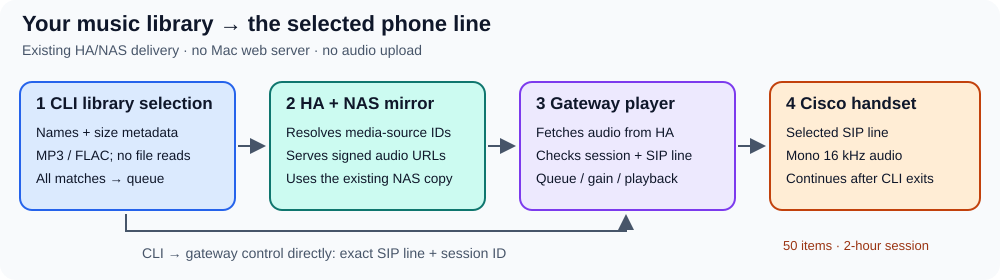

# Play a music library from the Cisco CLI

Use `cisco LINE play` to play an MP3 or FLAC library selection on the phone
containing that exact SIP line. The CLI searches local filenames and metadata;
Home Assistant resolves the matching NAS copy into a playable URL. The gateway
fetches and decodes the audio. No Mac web server or audio upload is needed, and
playback can continue after the CLI exits.



These commands ship with the current installation pin (Beta 28). A host still on
the Beta 25 baseline needs a newer revision: music itself needs five modules, and
a revision that also ships announcements and LifeSize controls contains [seven
CLI files](cli.md#install-and-private-configuration), all from that one revision.
The following source pin adds the CLI with default all-match playback, filename
masks and the cover-art playback fix without changing the gateway; it is a
source revision, not a release tag:

```bash
git clone --no-checkout https://github.com/4alvit/cisco-home-telephony.git cisco-home-telephony-music
cd cisco-home-telephony-music
git checkout --detach a9302fef78bfa43e9a4ddf711601dd0ee2e15d19
git rev-parse HEAD
python3 scripts/cisco.py --help
```

Confirm the printed commit matches the full pin. Then follow the
[command symlink and private connection setup](cli-installation.md#2-install-on-macos-or-linux)
using this checkout, skipping that guide's older clone command. Installing the
CLI alone does not update a running gateway; deploy the matching runtime fix
to support files whose embedded artwork causes metadata probing to fail.

## Prepare the existing services

The gateway needs its managed media player enabled and the reserved `699`
player route active in Asterisk and the phones' dial templates. Follow
[Phone media players](phone-media-player.md) for deployment and allowed origins.
The handset must be registered and available for playback.

Expose the NAS library through Home Assistant's existing media storage. The
relative filenames beneath the local library root must match those beneath
the selected HA media-source root. Confirm the same track is visible in HA's
media browser before configuring the CLI. This feature does not create a NAS
mount, synchronize music, install Music Assistant or change network access.

Mount the mirror read-only beneath an existing HA media directory, preserving
the deployment's other volumes and mounts. Verify an actual file read from the
HA container after deployment: resolving a media-source identifier alone does
not prove that the audio is readable. The HA address used by the resolver must
also be an exact approved gateway origin; another address for the same HA
server is not implicitly approved.

Keep the existing private gateway configuration and add or retain the optional
`home_assistant` connection described in the
[installation guide](cli-installation.md#7-add-optional-home-assistant-timers-and-alarms).
That configuration includes its existing `entry_id`, even though resolving a
media source does not operate a timer or alarm. The HA token is used only to
authenticate the resolver; it is not forwarded to the audio URL or the phone.

Add this object to the private CLI JSON, alongside those existing settings:

```json
{
  "music": {
    "directory": "~/Music",
    "media_source_prefix": "media-source://media_source/music/Example",
    "max_matches": 50
  }
}
```

This is a **configuration fragment**, not a replacement for the complete file.
See the [complete fictional example](../deploy/cisco-cli.music.example.json).
Use the actual media-source prefix advertised by your HA media browser. For
example, local `~/Music/Album/Track.flac` maps to the same relative path under
that prefix. Spaces, Unicode characters, `#` and `%` are encoded without changing
the filename's Unicode normalization. Keep real paths, filenames, tokens and
output outside the public repository.

## Install the client files

Keep these files together from the **same source revision**:

- `scripts/cisco.py`
- `scripts/cisco_http.py`
- `scripts/cisco_player.py`
- `scripts/cisco_library.py`
- `scripts/cisco_media_source.py`

Ordinary CLI commands, local library search and direct HTTP(S) audio URLs need
only Python's standard library. Resolving library files through a **direct HA
connection** additionally needs `aiohttp` in the Python environment running
the CLI. From a checkout containing the five files:

```bash
python3 -m venv "$HOME/.local/share/cisco-home/venv"
"$HOME/.local/share/cisco-home/venv/bin/python" -m pip install 'aiohttp>=3.12,<4'
. "$HOME/.local/share/cisco-home/venv/bin/activate"
python scripts/cisco.py 212 search "Example"
```

Keep that environment active when using a `cisco` symlink whose shebang selects
`python3`. Alternatively, invoke the virtual environment's Python explicitly
with the absolute path to `scripts/cisco.py`.

With the HA connection's `transport` set to `kubectl`, the resolver runs in the
configured HA container, which already includes `aiohttp`. The local Mac does
not need that dependency. Credentials and selected identifiers go to the fixed
worker on stdin. The CLI does not install packages in the container.

## Select and play

```bash
cisco 212 search "Example Artist"
cisco 212 play "Album/Track.flac"
cisco 213 play "$HOME/Music/Album/Track.mp3"
cisco 212 play "Example Artist"
cisco 212 play "*Artist*.flac"
cisco 212 play "Album/Track ?.mp3"
cisco 212 play "Album" --enqueue add
cisco 212 play "https://media.example.org/track.mp3"
```

Plain text matches literal, case-insensitive substrings of relative filenames.
Queries containing `*` or `?` are filename masks: `*` matches any number of
characters and `?` matches one character. These are masks, not regular
expressions; brackets and other regex punctuation remain literal. Quote masks
so the shell passes them to `cisco` without expanding files in its own directory.
A mask without `/` matches filenames at any scanned depth or the whole relative
path. A mask with `/` matches the relative path; `*` may span folder separators.
Absolute masks must remain inside the configured library.

Results are sorted deterministically, ignoring case with a case-sensitive tie
break. Exact file and directory paths take priority, including filenames that
literally contain `*` or `?`. The scan reads only metadata: OneDrive placeholders
need not be downloaded on the Mac when the corresponding NAS copy is
available. A configured
root may resolve through a symlink; links inside the library are not followed.
Traversal outside the root and special files are refused.

The scan includes files through four directory levels and examines at most
20,000 entries. The configurable match limit is 1–50, with 50 as the default.
An exceeded scan or match limit is an error, not a truncated playlist. Narrow
the query when necessary. Files deeper than the scan depth are not included.

`play` queues **all matches by default**, in sorted order. The old `--all` flag
is still accepted for compatibility and does not change this behavior. An exact
file selects that file; a directory selects its scanned tracks. The configured
limit still applies: too many matches fail before any playback command, without
silently dropping tracks. Direct HTTP(S) audio bypasses library search and HA
resolution, but still goes through the gateway's source validation. It must be an audio resource rather than a website.
For radio station numbers, use normal dialing such as `cisco 212 dial 708`.

The selected number is preserved: playback requested with `213` uses line
`213`, even when `212` is the phone's primary ID. Controls refuse a music
session owned by its sibling line. If a session changes while HA resolves a
file, the original request cannot silently take over the replacement session.

## Playback and queue controls

```bash
cisco 212 music                 # Current track, state, line and digital gain
cisco 212 queue                 # Current item and queue index/count
cisco 212 pause
cisco 212 resume
cisco 212 seek 45               # Seconds; only when the file is seekable
cisco 212 next
cisco 212 previous
cisco 212 clear-queue           # Keep the current track, remove other entries
cisco 212 gain 60               # Digital music gain, 0–100 percent
cisco 212 mute
cisco 212 unmute
cisco 212 stop                  # Stop this managed music session
```

`queue` reports the current item and queue position/count, not a complete
playlist. `gain`, `mute` and `unmute` control the managed player's digital
audio; they are separate from the phone's
[physical volume controls](hardware-volume.md). Music `stop` does not stop an
unrelated telephone call; ordinary calls use `hangup`.

`--enqueue replace` is the default: replace the queue and start the selection.
`add` appends, `next` inserts after the current track, and `play` inserts there
and starts the selection immediately. Selected track order is preserved.

Bulk selection is **not atomic**. The CLI resolves and validates the selection
before dispatch, then submits individual commands bound to the same line and
session. A later failure can leave earlier entries accepted. It reports
accepted item numbers and action IDs, plus unconfirmed and unattempted counts
when applicable. There is **no automatic retry**. After a partial or uncertain
result, inspect `music`/`queue`; do not blindly repeat `play` or change request
IDs to bypass an uncertain operation. An accepted request is not proof of
audible playback.

## Limits and troubleshooting

- The gateway queue holds at most **50 items**, including the current track.
  A session lasts at most **two hours**; a long playlist can outlast that limit.
- A file at or below the configured cache limit, at most **64 MiB**, can become
  seekable after its complete download and duration check. Larger FLAC files
  can stream, but are not seekable through this player. The limit is a cache
  threshold, not a blanket ban on larger files.
- Embedded cover art can prevent the strict audio-only metadata probe from
  identifying a duration. Playback still uses the existing audio decoder and
  retains the supplied track title; duration and seeking remain unavailable
  for that file. This fallback requires a gateway runtime containing the
  optional-metadata fix, not just the updated CLI.
- HA **2026.10** local-media signed URLs currently have a **24-hour** lifetime,
  longer than the gateway's two-hour session ceiling. Other providers may issue
  shorter-lived URLs. Do not store resolved URLs as a permanent music catalog;
  resolve the media-source identifier for a new playback request.
- **`music_client_not_installed`:** use a newer revision and keep every CLI file
  from that revision together (five for the music-only pin above, seven once
  announcements and LifeSize are included). Do not mix a new `cisco.py` with
  older helper files.
- **`media_source_dependency_required`:** use the virtual environment above for
  direct HA resolution, or the already configured HA container transport.
- **No match or missing NAS copy:** verify the local relative path, configured
  prefix and HA media browser. The CLI does not download or synchronize a
  missing copy.
- **Resolution fails:** check the HA connection and token. HTTP redirects are
  refused before HA authentication; configure the actual HA endpoint.
- **Resolved URL rejected:** compare its exact scheme, host and port with the
  gateway's private `allowed_origins`. Signed URL parameters remain private.
- **Other line/session changed:** inspect status and use the line owning the
  current music session. Do not stop a replacement call to force playback.

Music Assistant can remain the queue owner for its own provider streams. Its
flow stream appears as one gateway item; the CLI queue does not mirror or edit
Music Assistant's internal playlist. See [Phone media players](phone-media-player.md).
