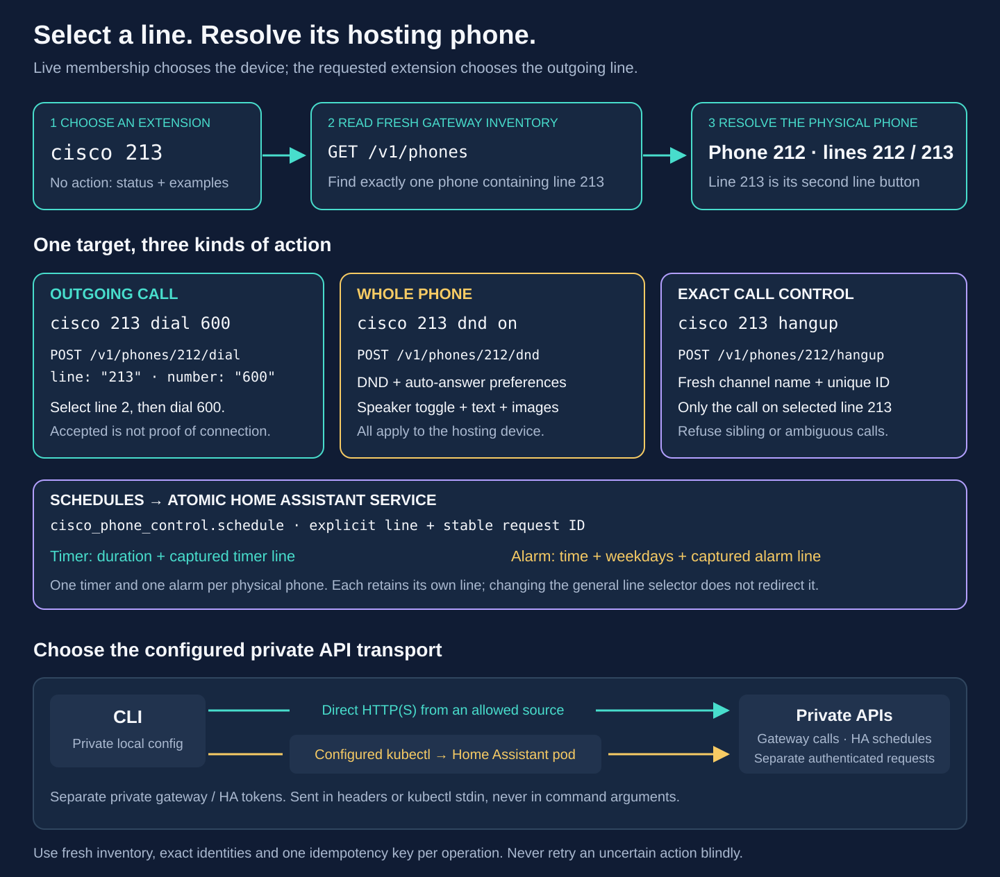

# Cisco command line

New installation? Follow the [CLI setup and troubleshooting guide](cli-installation.md)
for macOS/Linux prerequisites, private configuration, direct or Kubernetes
connections and optional Home Assistant scheduling. Server preparation is in
[Asterisk setup and operations](asterisk-operations.md).

`cisco LINE` reads live status and shows commands and concrete examples. When HA scheduling is configured, it also shows the current timer/alarm slots, their owning lines and HA timezone. A second numeric argument places a call **from the selected line**:

```bash
cisco 212
cisco 212 220
cisco 213 dial 600
cisco 213 hangup
```

The two dialing commands above originate from 212 and 213 respectively. They work only when the destination is in the gateway's current allowlist and the phone is available. Running status does not start a call.



The CLI uses the existing [phone gateway](phone-gateway.md). Ordinary gateway actions resolve the selected extension against fresh `GET /v1/phones` data. For example, 213 belongs to the phone whose primary ID is 212; requests go to that phone's API route while explicitly retaining `line: "213"`. Schedule actions let the HA service resolve the exact line from its validated gateway inventory. Voice controls use the gateway's configured mapping directly so status and Stop remain available during an AMI outage. None of these paths guesses the primary line from odd/even numbering. The Mac softphone, 209, can be a configured call destination but is not a Cisco gateway control target.

Status, directory and ordinary action dry runs do not request a new call or
the selected mutation. Their inventory GET can nevertheless trigger the
gateway's existing recovery work: it may hang up an operation-owned leg of an
expired, stopping or incomplete alert/intercom. This is not a side-effect-free
snapshot. See the [code and infrastructure map](code-and-infrastructure-map.md)
for the action and recovery boundaries.

## Room directory

`cisco directory` and `cisco 212 directory` both show the complete deployed
directory, sorted by extension; the latter selects the hosting phone's entry. Even
`cisco 209 directory` performs a directory lookup without a new call request. Use `cisco --json directory` for structured
output. Assigned room names come from the central private inventory, and
ordinary line status includes the hosting phone's room. A room is an intended
placement, not a location detected from registration or the network.

The public example includes **209 — Operator's Mac** as a fictional software-client
entry. Real room assignments and personal device names remain in private inventory.
This does not enable Cisco controls on 209. Continue dialing numeric
extensions; room names are not dialing aliases. See the [room directory guide](phone-directory.md)
for a fictional ten-room example, caller-ID behavior and safe inventory updates.

## Install and private configuration

The [step-by-step installation guide](cli-installation.md) expands this quick
reference and includes first-connection checks and fixes for common errors.

Use Python 3.10 or later on macOS or Linux; there are no extra Python dependencies. From the repository root:

```bash
mkdir -p "$HOME/.local/bin"
ln -s "$PWD/scripts/cisco.py" "$HOME/.local/bin/cisco"
export PATH="$HOME/.local/bin:$PATH"
cisco --help
```

Keep `scripts/cisco.py` and `scripts/cisco_http.py` together in the checkout; the symlink follows future repository updates. If `cisco` already exists, inspect it before changing the link. Add the PATH line to your shell startup file if needed.

The default configuration is `~/.config/cisco-home/cli.json`. Override it with `--config PATH` or `CISCO_CONFIG`. Configuration and token files must be owned by your user, have no group/other permissions, and must not be symlinks. Use a private parent directory as well:

```bash
umask 077
mkdir -p "$HOME/.config/cisco-home"
chmod 700 "$HOME/.config/cisco-home"
cp deploy/cisco-cli.kubectl.example.json "$HOME/.config/cisco-home/cli.json"
chmod 600 "$HOME/.config/cisco-home/cli.json"
```

Edit the copied example with your actual gateway address and Kubernetes target. Place the **existing** gateway API bearer token in `gateway-token.txt` beside `cli.json`, with mode `0600` or `0400`. Use a private editor or an existing secure provisioning process; do not place the token in a shell argument, public example, or Git. `token_file` may instead be an absolute path. An inline `token` string is supported, but exactly one of `token` and `token_file` is required. The repository's `.local/` and `private/` directories are ignored if you prefer to store private CLI configuration there.

Choose the transport explicitly:

- **Direct:** start from [cisco-cli.example.json](../deploy/cisco-cli.example.json). The CLI host must already be allowed by the gateway's `api_clients` and firewall. SIP access for a Mac does not grant gateway API access.
- **Kubernetes:** start from [cisco-cli.kubectl.example.json](../deploy/cisco-cli.kubectl.example.json). The configured context, namespace, label selector and container must identify exactly one Running, Ready pod whose source is already allowed by the gateway, such as an existing Home Assistant pod. The CLI requires existing pod-list and `pods/exec` permissions and Python 3 in that container. It does not create RBAC, modify a pod, install software, or widen firewall rules. It sends the fixed HTTP worker to `python3 -c` and sends the token and request body on stdin. A rollout with two matching Ready pods is refused; try status again after the rollout finishes.

Both transports require an explicit RFC1918 IPv4 gateway literal and disable HTTP proxies and redirects. HTTPS uses normal certificate verification. HTTP is for the existing trusted private network. There is no automatic transport fallback and no direct AMI, CGI, SSH or phone-reboot fallback.

## Commands and scope

```bash
cisco 213                       # Live status, commands and examples
cisco directory                 # Complete room directory; no new call request
cisco 213 directory             # The same complete directory, not a line filter
cisco 213 help                  # Local help; no config or network needed
cisco 213 destinations          # Read the current dial/ring allowlists
cisco 213 220                   # Place a call FROM 213 TO 220
cisco 213 call 220              # Same ordinary call; the destination rings
cisco 213 intercom 220          # Answer both Cisco phones on speaker for this call
cisco 213 drop-in 220           # Alias for intercom
cisco 213 dial 600              # Echo test FROM 213
cisco 213 answer                # Answer the exact observed ringing call on 213
cisco 213 pickup                # Alias for Answer; requires an actual ringing call
cisco 213 hangup                # Hang up the exact observed call on 213
cisco 213 dnd                   # Read status without changing DND
cisco 213 dnd on                # DND for the WHOLE phone, including its sibling line
cisco 213 dnd off
cisco 213 autoanswer on         # Opt in for the whole phone; alerts still need manual dismissal
cisco 213 autoanswer off
cisco 213 speaker toggle        # Whole phone; gateway requires idle
cisco 213 message "Dinner is ready"
cisco 213 message --text-file ./notice.txt --title Notice
cisco 213 image ./photo.png --title Photo
cisco 213 alert timer           # Start an immediate persistent alert on 213
cisco 213 stop-alert            # Stop the current alert only if it belongs to 213
cisco 213 stop-alert --alert-id 0123456789abcdef0123456789abcdef
cisco 213 ring 640              # Legacy finite ringing call; not a timer/alarm schedule
```

Commands are displayed only when the gateway advertises the relevant capability. DND, auto-answer, speaker, text and image actions affect the physical phone hosting the selected line. Images must be PNG or JPEG and at most 2 MiB; the gateway validates and resizes them for the service screen. Titles allow at most 48 characters and default to `Notice`. Text can be UTF-8 and at most 2,000 characters. Prefer `--text-file` for sensitive text to avoid storing it in shell history.

Answer and Hangup send both the exact fresh channel name and its unique ID. They refuse if the selected line has no call, if there is more than one phone channel, or if a sibling line is active. The gateway checks the identity again before acting, and blocks automatic answering of timer/alarm alerts. A CLI status snapshot is not proof that a later action has already happened.

### Intercom / Drop In


`cisco 213 intercom 220` (also `cisco 213 drop-in 220`) creates a two-way call
between the exact selected lines and requests speaker answer on both phones.
Neither person needs to accept it. Use two distinct, idle Cisco phones with
their handsets on-hook. There can be a brief ring while the gateway observes
the incoming call and presses Speaker. This is a local intercom feature, not
an integration with Google or Alexa.

Both phones must be available, free of other calls and active alerts, and have
DND disabled. The destination must be a configured Cisco line in the dial
allowlist; softphones, radio/service numbers, groups and external destinations
are not intercom targets. Ordinary `call`, `dial` and numeric shorthand retain
normal ringing behavior.

The gateway does not enable persistent auto-answer. It creates a unique AMI
channel identity, ignores call forwarding, and answers only isolated incoming
channels belonging to that exact operation. It does not trust caller ID as
proof of ownership. Each speaker key is sent at most once. A concurrent call,
missing leg or failed setup aborts the attempt; cleanup targets only channels
with the operation's identity. A gateway restart cancels incomplete setup and
retains cleanup records for delayed calls instead of resuming auto-answer.

Intercom requires both the updated gateway and the matching generated private
`cisco-intercom` context in Asterisk. The source goes through a Local-channel
helper, and both source and destination use `Dial` with forwarding ignored.
This prevents a forwarded source from making an unintended external call.
Keep that context separate from the normal phone dialplan. Updating only the
CLI or only the gateway is not a complete deployment; see the
[intercom deployment details](phone-gateway.md#intercom-deployment-and-call-ownership).

Success reports `connection_state: "connected"` only after both exact lines
are `Up` in the same Asterisk bridge. `speaker_requested` reports whether both
Speaker commands were issued. It cannot prove speaker volume, handset/headset
selection after user interaction, or that someone heard audio. To end it, use
`cisco 213 hangup` or hang up on either phone. On timeout or an unknown result,
inspect status before issuing another command; do not retry blindly.

The implementation uses Asterisk's [AMI Originate and ChannelId](https://docs.asterisk.org/Asterisk_22_Documentation/API_Documentation/AMI_Actions/Originate/),
[CoreShowChannel identities and BridgeId](https://docs.asterisk.org/Asterisk_22_Documentation/API_Documentation/AMI_Events/CoreShowChannel/),
and Cisco's [Speaker key URI](https://www.cisco.com/c/en/us/td/docs/voice_ip_comm/cuipph/all_models/xsi/7_0/english/programming/guide/70xsi/xsi70uri.html).

### Answering and persistent preferences

`pickup` is an alias for `answer`: it answers one isolated, freshly observed incoming **Ringing** call on the selected line. It is not a mechanical handset lift and does not silently toggle the speaker when idle. If there is no ringing call, it refuses before sending a control request.

For idle speaker/dial-tone use, explicitly run `cisco 213 speaker toggle`. The gateway requires no active phone channel and sends the handset's speaker toggle key. It cannot reliably observe the resulting speaker state, so there are intentionally no misleading `speaker on`, `speaker off` or idempotent `offhook` commands. A repeated toggle may reverse the previous state.

`cisco 213 autoanswer on` opts the whole hosting phone into gateway auto-answer; `autoanswer off` disables it, and `autoanswer` alone reads status. Incoming calls must pass the gateway's fresh isolated-call checks. Timer and alarm alerts remain manual regardless of this preference. Neither auto-answer nor pickup guarantees that a particular audio output device or volume is selected on the physical handset.

`alert timer` and `alert alarm` start an alert immediately; they do not schedule it. Alerts ring until manual answer/reject or Stop, with no audio after answering. For countdowns and recurring weekday schedules, use the [Home Assistant integration](https://github.com/ha-homelab/asterisk-telephony) and [radio/alarms guide](radio-and-alarms.md). `ring 640` keeps the legacy 20-second ringing timeout and finite destination behavior.

## Bounded voice sessions

An explicitly enabled voice gateway accepts `cisco LINE voice status`,
`voice start` and `voice stop`. Both lines of one physical phone share a single
session owner. These commands use the existing private client configuration
and direct or Kubernetes transport; they do not fetch call inventory first.

```bash
cisco 213 voice status
cisco 213 voice start --idempotency-key voice-example-001 \
  --attended --exclusive-media --enable-microphone --dry-run
cisco 213 voice stop --session-id 0123456789abcdef0123456789abcdef
```

The IDs above are examples. Start requires a stable caller-chosen request key
and explicit confirmation that an attendant is present, the phone media path
is reserved, and microphone use is authorized. Remove `--dry-run` only for the
intended attended attempt. Each session is bounded to at most 300 seconds.
Manual mode completes one turn; a configured wake profile can rearm after a
successful reply within the same fixed deadline. `voice stop` reads the current
owned session and stops that exact ID; `--session-id` targets a previously
recorded ID. Repeating an old Stop cannot stop a replacement session. See the
[voice quickstart](voice-quickstart.md) for readiness and repeat conversations.

Start dry-run validates through the gateway without launching the runner.
Stop dry-run reads status and checks both the exact ID and whether the reported
ownership permits gateway Stop; it sends no Stop POST. For `external_owner` or
the sanitized error `voice_owner_unavailable`, it returns
`status: "unavailable"`, `gateway_stop_available: false`, and exits nonzero,
retaining the sanitized voice status and session ID. Status and this dry run
explain how to use the live wake screen's **Stop** or the
[exact wake Job's normal shutdown](voice-wake-k3s.md#start-and-stop-an-attended-attempt).
Local `recovery_required` sessions retain gateway Stop unless ownership is
reported unavailable. A successful dry run does not guarantee later delivery
or confirm that capture has stopped. `--json` returns sanitized
metadata. An accepted request is not proof of capture or physical closure:
check `stop_confirmed`, and treat `recovery_required` as unresolved ownership.
Do not automatically retry an uncertain Start. See the
[voice control guide](voice-control.md) for setup, bounded replay history and
recovery details. The gateway and voice runtime must be deployed together;
updating this CLI does not enable voice on its own.

## Countdown timers and recurring alarms

These commands use the companion integration's atomic `cisco_phone_control.schedule` service. They require companion version **0.3.0 or later** and an optional `home_assistant` section in the private CLI configuration. The basic gateway commands remain independent of that service. Use [cisco-cli.schedule.example.json](../deploy/cisco-cli.schedule.example.json) as a template: keep the gateway token and HA long-lived token in separate owner-only files, set the existing loaded Cisco Phone Control entry ID, and choose the HA transport explicitly. An HA admin token is required by this admin-only service. The HA transport can be direct or use its own explicit `kubectl` target, using the same fields as the gateway transport.

There is **one countdown slot and one recurring alarm slot per physical phone**. They have explicit, independent target lines. For example, a timer on 213 does not change an alarm on 212 or the UI's general Line selector. The CLI does not implement schedules by changing a selector and pressing a button: HA validates and saves each request atomically under its schedule lock.

```bash
cisco 213 schedule                 # Both slots, target lines, active alert and HA timezone
cisco 213 timer                    # Same read-only schedule overview
cisco 213 timer status
cisco 213 timer start 5             # Ring line 213 in five minutes
cisco 213 timer start 30 --replace  # Explicitly replace the phone's pending countdown
cisco 213 timer cancel             # Cancel 213's countdown and stop its matching timer alert

cisco 212 alarm                    # Inspect the saved alarm before changing it
cisco 212 alarm set 07:30 --days weekdays --enable
cisco 212 alarm set 09:00 --days weekend --enable
cisco 212 alarm set 08:15 --days mon,wed,fri --enable
cisco 212 alarm set 20:00 --days daily   # Save a daily alarm, initially disabled
cisco 212 alarm on                  # Enable the saved alarm without rewriting its time/days
cisco 212 alarm off                 # Disable it and stop its matching active alarm
cisco 213 alarm set 06:45 --days tue,thu --enable --replace
```

Timer duration is a whole number of minutes from 1 to 1,440. Alarm time is 24-hour `HH:MM` in the **HA timezone**, which is shown by `schedule`; it is not implicitly the Mac timezone. Days are `mon,tue,wed,thu,fri,sat,sun`, or the aliases `weekdays`, `weekend`, and `daily`. Duplicate days and invalid times are refused. `alarm set` saves disabled unless `--enable` is present. `--replace` is available only for a new timer or alarm definition. Cancel, On, Off and Stop refuse to act on a sibling line's owned slot or alert; select that owning line explicitly instead.

`alarm on` and `alarm off` first read the saved schedule. If no alarm has been
configured, they exit with `ha_alarm_not_configured` without sending a change
request; create one explicitly with `alarm set`. An invalid or uncertain status
response also prevents the change. The same checks apply to `--dry-run`, which
only reads status once. A saved alarm with no selected weekdays still exists,
even though it has no scheduled occurrence.

Starting a timer when another countdown is pending requires `--replace`. Moving an existing alarm to the sibling line also requires `--replace`. Listing the schedule shows both owners so this limitation is visible before making changes. The system does not silently create a second timer slot, stack several weekly alarms, or retarget the shared phone using line-number arithmetic.

Pending schedules persist in HA. A due occurrence is saved as claimed before it is sent to the gateway. Events missed while HA is down are not replayed, and a running scheduler skips events more than 20 seconds late. Busy phones, DND, an existing active/unknown alert, unavailable services and ambiguous outcomes are not retried. The repeated autumn DST minute runs once; a nonexistent spring minute is skipped. These are convenience alerts, not a guaranteed wake-up service.

`stop-alert` ends the current exact alert but leaves future recurring alarms enabled. `timer cancel` also clears the pending countdown; `alarm off` disables future weekly occurrences. Scheduled alerts always require manual answer/reject or Stop even if gateway auto-answer is enabled. DND suppresses new calls and alerts; it does not cancel a pending schedule. Disable/cancel the schedule if that is the intended result.

The scheduler uses HA's [REST service response interface](https://developers.home-assistant.io/docs/api/rest/#post-apiservicesdomainservice), with an explicit request ID for mutations. The CLI filters responses to the selected schedule; it does not expose unrelated `changed_states`. If the service is absent, refuses the request, or times out, the CLI reports failure without falling back to non-atomic helper changes. Inspect the schedule before deciding what to do next.

Schedule commands go directly to the loaded HA integration. It resolves the exact selected line against one unambiguous phone in its validated current or cached gateway inventory; the CLI sends no guessed primary ID and maintains no stale local map. While the gateway is unreachable, the service can still read persisted schedules, cancel an owned pending timer or disable an owned alarm. Starting or enabling a schedule requires fresh gateway state. An offline cancellation may persist locally while the already-ringing state remains unknown; the CLI preserves the local schedule state in its error result. Use physical dismissal if a ringing phone cannot be reached.

For alarm On/Off, the CLI binds the change and its response to the phone and
line returned by the preceding status read. It confirms the requested enabled
state before reporting success. A failed preflight is a refusal with no action
ID; a failed or inconsistent response after sending the change is
`not_confirmed`, with the action ID retained and no automatic retry.

## Scripts, errors and retries

Global flags may be used before the line or after a command:

```bash
cisco --json 213
cisco 213 220 --json --idempotency-key evening-call-20261017
cisco --dry-run --json 213 220
cisco --timeout 60 213 message "Dinner is ready"
```

`--json` emits one JSON result without human examples. A successful read returns `status: "ok"`; a POST returns `status: "accepted"`, its action ID and the selected line/phone. **Accepted does not mean connected, answered, played or heard.** Run status to inspect the resulting channels, then use actual endpoint/media evidence where appropriate. The status field `phone.online` is aggregate availability of all assigned phone lines; the API does not expose per-line registration, firmware, handset IP, or speaker state.

Exit status is zero for a successful read, help, dry run or accepted action, one for a refused/unknown outcome or partial status, and two for a command-line syntax error. If an optional HA schedule read fails, default/status output retains the live gateway result, reports `status: "partial"` and a structured `schedule_error`, and exits one; it does not pretend the timer is inactive. If the gateway fails but HA can read the schedule, it instead shows the schedule plus `gateway_error`, without inventing live call/registration status. A missing private configuration still shows offline command help. `--dry-run` performs live reads and validation but does not request a mutation. Schedule reads use the HA service's read-only `status` operation over HTTP POST. Screen text, titles, entry IDs and image bytes are omitted from dry-run output.

HTTP socket timeout defaults to 20 seconds and is configurable from 1 to 60. Kubernetes subprocesses have an additional 10-second bound. HTTP responses are capped at 256 KiB. The CLI prints fixed error codes, not raw HTTP responses, subprocess stderr, tokens, request bodies or exception details. JSON status intentionally contains channel/alert IDs needed for precise control, so treat captured operational output as private.

No failed action is retried automatically. An action may have executed even when its HTTP response times out. Preserve the returned `action_id`, inspect status, and do not blindly issue a new command. An explicit `--idempotency-key` is for the same logical operation with the same exact request; the gateway refuses conflicting reuse and unknown partial outcomes. Re-running Hangup/Answer may capture a different channel identity and therefore is not a transparent retry. Never build an unbounded retry loop around a dialing or alert command.

The same option becomes a durable HA `request_id` for schedule mutations, limited to 8–80 safe characters. Reusing the same ID and payload cannot restart a countdown. For a new intentional operation use a new ID. After an uncertain cancellation, inspect both the pending slot and active alert; a local schedule cancellation and stopping an already ringing phone are distinct outcomes.

## Other useful operations and limits

- **Radio:** `cisco 213 701` or another number advertised by `destinations`; 708–710 are the children's stations when enabled. Stop the exact call with `hangup`. Audio quality and station availability still depend on the stream and network.
- **Assist:** `cisco 213 630` uses that selected line. Complete that line's native VoIP discovery, Allow calls and pipeline setup first; a sibling line does not inherit native Assist acceptance automatically.
- **Calling groups or a Mac:** use the currently allowed numeric destination, such as 620 or 209. The selected Cisco remains the caller. The CLI does not control Mac applications or start a Mac-originated call.
- **Call waiting or conferences:** the current Answer/Hangup commands require one isolated phone channel. They deliberately refuse multi-channel situations rather than guessing which party to interrupt. No transfer, conference, hold, DTMF injection or arbitrary SIP URI command is exposed.
- **Photos versus wallpaper:** `image` is a temporary service-screen notification. Persistent wallpaper installation/selection is a separate [phone-control](phone-control.md) workflow. This CLI does not reboot phones, cycle PoE, flash firmware, open TFTP, rotate secrets or execute arbitrary handset keys.
- **Screen and speaker state:** accepted screen delivery is not proof the user saw it, and speaker toggle does not return a reliable final speaker-state reading. Inspect the physical screen or use the separate authenticated diagnostics where needed.

## Validation

```bash
python3 -m unittest discover -s tests -p 'test_cisco*.py' -v
```

The tests cover secondary-line routing, non-consecutive line mappings, the numeric shorthand, stale/ambiguous inventory, exact channel and alert identity, refusal of sibling-call ambiguity, allowlists, JSON/help behavior, private configuration permissions, stdin-only Kubernetes credentials, redirects, response limits, atomic schedule request shapes and sanitized transport errors. They use synthetic fixtures and a local HTTP test server; they do not place calls.

Live basic CLI acceptance on 2026-10-17 verified secondary line 221 resolving to phone 220/button 2, a 221→600 Echo call with bidirectional audio packets, exact CLI Hangup, and numeric shorthand 212→220 reaching Ringing. A concurrent user call created two channels on the calling phone; no ambiguous CLI Hangup was attempted. Only the separately tracked test channel was cleaned up. These checks validate line routing and conservative ownership, not human listening on every handset or future scheduler availability.

Further live **216→221** checks verified `pickup` changing the exact ringing
call to `Up`, CLI Hangup, and ordinary incoming auto-answer. Both legs were
correlated by channel name, unique ID and linked ID. The shared auto-answer
preference was read back through line 220 and restored to off after cleanup.

The live HA 0.3.0 test also verified a one-minute timer on 221, unchanged
deadline/ID on request replay, exact sibling-line refusals, and independent
weekday-alarm enable/disable on 220. With ordinary auto-answer enabled, the
owned timer still rang for more than 27 seconds. `timer cancel` stopped it;
final checks found no active test call or enabled schedule, with auto-answer
off and the original alarm settings and timer duration restored. Detailed
scope and retained history are recorded in [deployment validation](server-validation.md).
