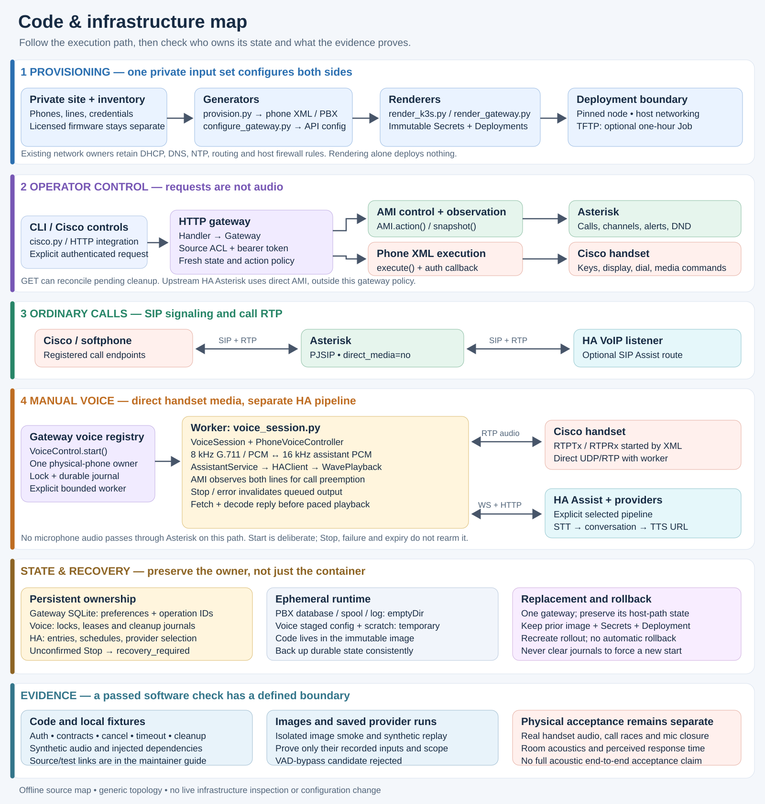

# Code and infrastructure map

This is a source map for maintaining the PBX, phone gateway and manual voice
adapter together. It describes the checked-in implementation and its test
boundaries, not a fresh inspection of a running installation. Site addresses,
credentials, phone identities and rendered manifests belong in private inputs.

## Start with three separate paths

1. **Ordinary calls:** Cisco SIP signaling and RTP media reach Asterisk.
   Generated PJSIP endpoints use `direct_media=no`, keeping call media through
   the PBX. The optional Assist extension dials HA's VoIP SIP listener.
2. **Phone control:** the CLI or HA control integration calls the HTTP gateway.
   The gateway observes or changes Asterisk through AMI, and sends authenticated
   `CiscoIPPhoneExecute` XML directly to the phone. An accepted XML command does
   not prove that a person heard audio.
3. **Manual voice:** the gateway starts a bounded worker. Legacy XML `RTPTx` and
   `RTPRx` commands establish media directly between that worker and the phone.
   The worker streams PCM to HA Assist over WebSocket, then fetches and decodes
   the reply. This path does not carry microphone audio through Asterisk;
   Asterisk supplies call-state observations for preemption.

The optional SIP Assist route and the manual WebSocket adapter are different
implementations. Likewise, a second line on one phone is not a second physical
microphone or an independent media owner.

## Operator entry points and authority

[`scripts/cisco.py`](../scripts/cisco.py) is the operator CLI.
`Gateway.request()` uses [`scripts/cisco_http.py`](../scripts/cisco_http.py)
either directly or through an explicitly selected `kubectl exec` transport.
The latter resolves exactly one ready target container and passes credentials
and request data on standard input. It is an alternate transport to the same
API, not a second implementation of phone actions. Inventory validation checks
freshness, physical-phone/line mappings and destination allowlists before
mutation.

The server is [`containers/asterisk/phone_gateway.py`](../containers/asterisk/phone_gateway.py):
`Handler.handle_request()` routes requests, `Gateway` owns orchestration and
`AMI.action()` / `AMI.snapshot()` implement PBX management. API authorization
combines the configured client source with a bearer token. Phone authentication
callbacks and phone application routes are separate from operator authority.
Do not expose the gateway because an endpoint appears read-only.

`execute()` sends a single XML action and checks the phone's response.
Dial, answer, speaker and display controls use that path after AMI gating;
ring, alerts, intercom and hangup use AMI, with intercom also using XML speaker
control. `Gateway.mutate()`, `intercom()` and reconciliation enforce the relevant
state and destination constraints. Even `GET /v1/phones` can finish pending
alert/intercom cleanup: `listing()` invokes reconciliation and may hang up
previously owned stopping channels. Errors with an unknown outcome must be
reconciled from state; replaying an originate or toggle can duplicate the action.
The CLI intentionally refuses automatic retry after transport uncertainty.

Phone menus and optional HA-backed applications live in
[`phone_apps.py`](../containers/asterisk/phone_apps.py) and
[`phone_apps_ha.py`](../containers/asterisk/phone_apps_ha.py).
Dialplan services and radio playback use
[`phone_services.py`](../containers/asterisk/phone_services.py) and
[`radio.py`](../containers/asterisk/radio.py). These are separate from the
voice worker; shared phone use still has to satisfy its media-exclusivity rules.

## Provisioning produces both ends of the contract

[`scripts/provision.py`](../scripts/provision.py) consumes the private site
configuration and phone inventory. `phone_xml()` emits Cisco profiles;
`manager_config()` and `gateway_manager()` create separate HA and gateway AMI
accounts; the generator also produces PJSIP endpoints, dialplan, RTP settings
and phone dial templates. Persist generated credentials across regeneration:
recreating one side's password independently breaks the other side's login.

[`scripts/configure_gateway.py`](../scripts/configure_gateway.py) `prepare()`
combines that inventory, callback credentials, gateway AMI credentials and API
clients into the gateway configuration. The contracts must agree on both lines
of every phone, its callback source and permitted destinations.

[`scripts/render_k3s.py`](../scripts/render_k3s.py) separates `render_core()`
from `render_tftp()`. The core is Asterisk plus a versioned immutable Secret.
TFTP is an optional, non-retrying Job with a one-hour deadline. Its init
container combines profiles from a Secret with licensed firmware from a
read-only host directory into temporary served storage. Firmware is not baked
into an image. DHCP, DNS, NTP and host firewall ownership remain outside this
renderer.

The generated dialplan contains echo and tone test applications, a ring group
when phones exist, and an optional route to HA VoIP. Bootstrap mode can omit
physical phones. A working test application or AMI login therefore says
nothing by itself about physical registration or two-way audio.

## Deployment and persistence

Asterisk and the phone gateway are separate single-replica, node-pinned
Deployments using host networking and `Recreate`. SIP/RTP use the selected
node's network; these renderers do not create a Service, Ingress or public
load balancer. Host firewall rules, routes and port ownership are part of
deployment correctness. Ordinary Pod NetworkPolicy is not assumed to protect
these host-network listeners.

[`scripts/render_gateway.py`](../scripts/render_gateway.py) `render()` builds
the base gateway. [`scripts/render_voice_gateway.py`](../scripts/render_voice_gateway.py)
`render()` upgrades that existing gateway to the dedicated voice image while
preserving its identity, full configuration, node placement and persistent
state binding. It checks image/capacity evidence and supported volume layout;
it does not provision storage or contact a cluster. Profiles alone leave voice
disabled; enabling Start still does not start a session.

| State | Owner and lifetime | Maintenance consequence |
| --- | --- | --- |
| Site inputs, inventory, credentials, generated profiles | Private operator files; rendered copies enter immutable Secrets | Preserve the matched set and old referenced Secrets for rollback. |
| Asterisk database, spool, logs and runtime files | `render_core()` mounts `emptyDir` volumes | Pod replacement loses this state; it is not a durable PBX archive. |
| Gateway preferences, operation-idempotency ledger, alerts and intercom reconciliation | Gateway SQLite under its persistent state directory | Preserve the existing host-path directory; desired DND is replayed into Asterisk. |
| Voice ownership and uncertain cleanup | File locks and durable journals on that same persistent volume | A restart must not erase a reservation or create a competing owner. |
| Staged voice configuration and runtime scratch | Owner-only files in ephemeral runtime/scratch volumes | Recreated from the reviewed Secret; audio fetch/decode uses memory and pipes, not persisted recordings. |
| HA configuration entries, schedules and selected voice providers | HA's own configuration/storage | A PBX rollback does not roll back HA state or its model/provider configuration. |

The voice renderer mounts the existing persistent volume both at the gateway's
state path and at the voice runtime's state alias. Its non-root init stage copies
an explicit configuration file list to regular private files; it does not
recursively repair ownership of persistent storage. See
[`containers/voice/stage_private.py`](../containers/voice/stage_private.py).

[`scripts/deploy.sh`](../scripts/deploy.sh) defaults to local validation and
rendering. Explicit server dry-run and apply modes contact Kubernetes; apply
uses a named field manager and waits for rollout. It does not automatically
roll back a failed rollout. The Asterisk image pins its source archive; the
voice image carries the worker and locked Python dependencies. Their build
helpers and [CI workflow](../.github/workflows/validate.yml) build and smoke-test
them separately.

For recovery, retain the prior Deployment, image digest, referenced Secrets
and consistent persistent-state backup. Restore through the installation's
established field-ownership workflow. A live SQLite backup must include its
transactions; copying only the database file can miss WAL data.
[`scripts/backup.sh`](../scripts/backup.sh) encrypts private workstation files,
not a live gateway host-path or the HA database. The detailed
[gateway upgrade guide](voice-gateway-deployment.md) covers those boundaries.

## Manual voice lifecycle

The gateway attaches [`VoiceControl`](../containers/asterisk/phone_voice_control.py)
only when configured. `start()` validates authorization, an explicit request
ID, attended use, exclusive media and the physical-phone profile. Sibling
lines share one owner. A lock plus journal is acquired before a subprocess
starts; status is observation, not implicit activation.

[`scripts/voice_session.py`](../scripts/voice_session.py) `run_session()` composes:

- [`VoiceSession`](../containers/asterisk/phone_voice_transport.py): bounded XML
  media commands, UDP/RTP validation, both-line AMI checks and independent
  watchdog cleanup.
- [`PhoneVoiceController`](../containers/asterisk/phone_voice_controller.py):
  transfers incoming 8 kHz phone PCM to the 16 kHz assistant and coordinates
  cancellation, preemption and terminal cleanup.
- [`AssistantService`](../voice_assistant/service.py): one event-loop owner,
  bounded input queues, explicit activation, turn deadline and stream-generation
  invalidation. Manual mode uses `NeverWake` from
  [`config.py`](../voice_assistant/config.py), not wake-model inference.
- [`HAClient`](../voice_assistant/ha.py): authenticated `assist_pipeline/run`,
  explicit pipeline selection, binary audio and end marker, then a protocol
  barrier after `run-end` to catch late errors.
- [`WavePlayback`](../voice_assistant/playback.py) and `RtpPCMSink`:
  `HAClient.fetch_audio()` owns the bounded same-origin fetch; playback decodes
  the complete payload, and the sink resamples and paces phone output.
  `PhonePCMPlayback` is a separately tested alternate adapter, not the one
  composed by `run_session()`. A streaming TTS capability does not make this
  client an incremental playback client.

The normal sequence is explicit Start, capture/recognition, conversation,
reply playback and terminal stop. Input exhaustion can explicitly end a finite
file; the live microphone path relies on the configured speech/turn limits.
The rejected finite-input VAD-bypass experiment did not change that live
behavior. See [measured performance and limitations](local-voice-performance.md).

`AssistantService.stop()` invalidates its active generation before awaiting
cleanup; queued output checks that generation before sending. At the controller
boundary, `request_stop()` first signals an event, and finalization stops the
physical transport before awaiting assistant cleanup. Call activity, unavailable
AMI state, missing valid input, lease expiry, provider failure and shutdown can
also terminate a session. There is no implicit return to listening after these
events. A late or unconfirmed phone Stop leaves `recovery_required`; a reserved
journal from another process also reports recovery required rather than proving
a live owner. Neither is permission to delete the journal and start again.

The gateway's shutdown path requests voice cleanup; the child and independent
watchdog cover different failure windows. Legacy RTP Stop commands lack an
application-owned stream identifier, so exclusivity remains a real operational
requirement. AMI observation and XML execution are separate operations and
cannot make call preemption atomic.

## Home Assistant is a companion, not part of the PBX image

The companion repository is
[`ha-homelab/asterisk-telephony`](https://github.com/ha-homelab/asterisk-telephony).
It contains two distinct integration paths:

- **Direct AMI:** the pinned upstream Asterisk integration handles AMI-derived
  entities and `asterisk.send_action`. The companion's
  [`stage_integration.py`](https://github.com/ha-homelab/asterisk-telephony/blob/main/scripts/stage_integration.py)
  verifies the archive against `upstream.lock.json`; `scripts/render.py`
  generates the HA package and dashboard. The upstream component discovers
  each SIP endpoint separately, including sibling lines. Its global raw-action
  service bypasses the HTTP gateway's ownership and DND policy. Reconnection
  does not rediscover endpoints or reconstruct missed events; component reload
  and fresh PBX evidence are separate operations.
- **HTTP controls:** the bundled
  [`cisco_phone_control`](https://github.com/ha-homelab/asterisk-telephony/blob/main/custom_components/cisco_phone_control/__init__.py)
  integration uses the gateway for phone controls, schedules and explicit voice
  sessions. `async_setup_entry()` initializes `PhoneCoordinator` and forwards
  seven entity platforms. Identity is one physical handset with its owned
  lines, rather than one device per SIP endpoint. Gateway credentials and
  per-entry HA storage are independent of the PBX's AMI account.

[`PhoneCoordinator`](https://github.com/ha-homelab/asterisk-telephony/blob/main/custom_components/cisco_phone_control/coordinator.py)
polls inventory every five seconds and runs its schedule tick every second.
Initial setup requires fresh inventory. `perform()` serializes ordinary actions,
refreshes ownership and sends one correlated request. HA owns the alarm/timer
settings and occurrence claims; the gateway owns current alert and voice-session
state. Message-entry text is transient, and its entity writes require Recorder
exclusions for the actual entity IDs.

The administrator
[`schedule()` service](https://github.com/ha-homelab/asterisk-telephony/blob/main/custom_components/cisco_phone_control/scheduling_api.py)
uses request fingerprints and a persisted claim before action. It publishes
candidate state only after an acknowledged save. Direct timer/alarm entity methods are separate code
paths and must be reviewed separately. Scheduled notifications intentionally
skip stale occurrences and do not retry ambiguous outcomes; they are not a
guaranteed-delivery alarm system.

The administrator
[`voice` adapter](https://github.com/ha-homelab/asterisk-telephony/blob/main/custom_components/cisco_phone_control/voice_api.py)
passes control metadata only. Once the entry is loaded, voice status and
exact-session Stop bypass inventory refresh and the ordinary action lock, so
they remain available during an AMI outage. Cancelling the HA request or
unloading the integration does not prove that the gateway worker stopped.
Recover through controller status and the exact session ID; the gateway still
owns its lease and cleanup.

HA owns its selected Assist pipeline and STT, conversation and TTS providers.
The manual voice worker supplies an explicit pipeline ID and a token; shipping
the voice image does not install or select those providers. The optional
phone-app HA bridge is another HTTP client with a narrower application role.

The separate HA configuration-overlay checkout (`ha-homelab/config`) owns
tracked YAML and pinned automation/script submodules. Its `tools/build.py`,
`tools/stage.py` and `tools/promote.py` build, validate and promote that overlay;
promotion restores managed files if the installed configuration check fails.
It preserves runtime integration entries, custom-component installations,
databases and media. The reviewed tracked active YAML does not wire in these
telephony integrations. Cluster workload manifests are owned elsewhere.
The overlay's checked-in target version and the companion's HA test matrix
also differ; neither establishes the currently deployed version.

## Failure-handling repairs and remaining limits

The source review identified three P2 defects. The repairs below require the
updated gateway and companion component 0.5.1; updating documentation or a CLI
does not update a running service. No failure was injected into the installation.

- **AMI response deadline:** [`AMI.action()`](../containers/asterisk/phone_gateway.py)
  previously accepted a synthetic response at 12 seconds despite an eight-second
  deadline. A bounded chunk reader now checks remaining time around each read
  and before returning success, preserving buffered bytes between frames.
  Connection, send and banner limits remain separate from the eight-second
  response limit. [Deadline regressions](../tests/test_gateway_ami_deadline.py)
  cover silence, partial lines, byte trickles, framing and response limits.
- **Entity-driven schedule save:** companion
  [`PhoneCoordinator.configure()` / `timer()`](https://github.com/ha-homelab/asterisk-telephony/blob/main/custom_components/cisco_phone_control/coordinator.py)
  now stage a candidate and publish it after its write completes. A strict
  [Store adapter](https://github.com/ha-homelab/asterisk-telephony/blob/main/custom_components/cisco_phone_control/storage.py)
  surfaces errors that HA's ordinary Store can log without raising. The
  [entity regressions](https://github.com/ha-homelab/asterisk-telephony/blob/main/tests/test_schedule_entity_failures.py)
  cover failed writes, recovery, queued changes and cancellation.
- **Schedule request crossing unload:** companion
  [`schedule()`](https://github.com/ha-homelab/asterisk-telephony/blob/main/custom_components/cisco_phone_control/scheduling_api.py)
  rechecks closing after awaited work. Explicit component unload drains the
  old settings owner, including in-flight executor writes, before replacement
  setup can reuse the Store key. The
  [unload regressions](https://github.com/ha-homelab/asterisk-telephony/blob/main/tests/test_schedule_unload.py)
  and [real Store tests](https://github.com/ha-homelab/asterisk-telephony/blob/main/tests/test_schedule_storage.py)
  exercise these lifecycle boundaries.

Cancellation cannot undo a completed filesystem write. An acknowledged
candidate is reflected in memory before deferred caller cancellation is reported;
inspect schedule status before retrying. Internal save cancellation or a
filesystem error after replacement can leave an uncertain disk outcome. These
repairs do not promise that every failed
request leaves the old file intact or that an alarm will fire during an outage.

The pinned upstream AMI adapter has additional source-derived limits: synchronous
response waits occur inside async HA paths, and its raw-action service does not
propagate every AMI rejection as a service failure. Its mocked runtime tests
do not establish cancellation or rejection behavior for a real AMI connection.

## What the evidence can establish

| Boundary | Read these tests or harnesses | What remains outside the check |
| --- | --- | --- |
| Configuration and deployment | [`test_provision.py`](../tests/test_provision.py), [`test_k3s.py`](../tests/test_k3s.py), [`test_render_voice_gateway.py`](../tests/test_render_voice_gateway.py) | Actual firewall, routing, host capacity, permissions and successful rollout. |
| CLI, HTTP and AMI control | [`test_cisco_cli.py`](../tests/test_cisco_cli.py), [`test_gateway_http.py`](../tests/test_gateway_http.py), [`test_gateway_ami_errors.py`](../tests/test_gateway_ami_errors.py) | Installed phone firmware behavior and audible results. |
| Ownership, cancellation and RTP | [`test_phone_voice_control.py`](../tests/test_phone_voice_control.py), [`test_phone_voice_transport.py`](../tests/test_phone_voice_transport.py), [`test_voice_session_lifecycle.py`](../tests/test_voice_session_lifecycle.py) | Real call/media races, microphone closure and recovery on a physical handset. |
| Assist protocol and output | [`test_voice_assistant_ha.py`](../tests/test_voice_assistant_ha.py), [`test_voice_assistant_service.py`](../tests/test_voice_assistant_service.py), [`test_phone_voice_controller.py`](../tests/test_phone_voice_controller.py) | General speech accuracy, room acoustics, audible latency and provider availability. |
| Cross-module session | [`test-voice-integration.py`](../scripts/test-voice-integration.py), [`test_voice_integration_fixture.py`](../tests/test_voice_integration_fixture.py) | Uses local fixtures and synthetic media; it does not prove a real phone-to-HA acoustic round trip. |
| Companion HA component | [`test_phone_controls_runtime.py`](https://github.com/ha-homelab/asterisk-telephony/blob/main/tests/test_phone_controls_runtime.py), [`test_phone_voice.py`](https://github.com/ha-homelab/asterisk-telephony/blob/main/tests/test_phone_voice.py), [`test_upstream_runtime.py`](https://github.com/ha-homelab/asterisk-telephony/blob/main/tests/test_upstream_runtime.py) | Actual HA framework tests still model gateway/AMI behavior; they do not prove live reconnect, SIP registration or physical delivery. |
| Container artifacts | [`smoke-containers.sh`](../scripts/smoke-containers.sh), [`smoke-voice-image.sh`](../scripts/smoke-voice-image.sh) | Image startup and isolated protocol checks do not verify the deployment network. |

Use these as a navigation map, not a claim that this documentation task reran
all tests. Existing synthetic provider qualification is useful evidence within
its recorded scope. It does not establish full acoustic end-to-end acceptance,
always-listening readiness or a new handset latency improvement.
