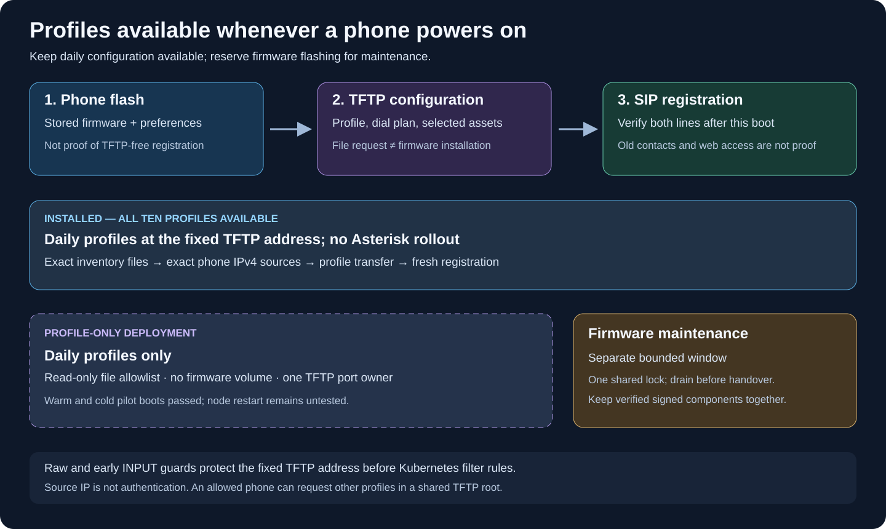

# Daily phone boot and TFTP availability

The repository now implements a persistent **profile-only** TFTP Deployment and
an independent, bounded firmware maintenance Job. Both use the same managed TFTP
image and exclusive host lock. `--profiles-only` updates only profiles and their
TFTP owner; it does not read, apply or restart the Asterisk configuration.

**Installed on 2026-10-22:** the dedicated service contains all ten inventoried
phone profiles, the dial plan and three wallpaper assets. The 14 served files,
their permissions, the immutable image and the single managed listener were
verified on the actual node. The server mounts no firmware directory. Asterisk,
the phone gateway and Home Assistant were not restarted for this installation.
The early INPUT guard remained effective across kube-router rule updates.

**Physical acceptance:** a 7945G completed an ordinary profile-only warm reboot
on 2026-10-22. The profile and dial-plan transfers completed and both lines
registered freshly. A subsequent phone-originated radio call negotiated G.722
with a 16 kHz internal audio path; the user confirmed improved listening quality.
Missing optional `be-sip.jar` and `g3-tones.xml` did not block that boot. This is
not acoustic qualification of every phone.

A second 7945G then passed a **cold boot through the permanent service**. One
verified PoE port was disabled briefly and restored. Both old SIP contacts
disappeared; the phone completed its profile and dial-plan transfers, including
their final acknowledgements, and both lines registered on a new TCP
connection. Its application and boot load stayed unchanged, and no firmware
download was observed. This qualifies the tested cold-boot pilot, not every
offline phone or a restart of the k3s node. Node-restart acceptance remains
untested.



## What is stored, and what is requested

The 7945G stores firmware images and user preferences in nonvolatile flash. Its
normal startup loads the stored image, obtains network settings, contacts TFTP,
requests configuration, and then connects to its call-control server. Cisco
documents configuration requests on reset/registration and a load-file request
when the configured image differs from the running image. These are different
operations: fetching a profile is not reinstalling firmware. See Cisco's
[configuration and startup chapter](https://www.cisco.com/c/ja_jp/td/docs/vauc/iptelep/ipphone7900/ag/029/P747_BK_W06BD6D9_00_adminguide_7945-7965-7970-7971-7975/P747_BK_W06BD6D9_00_adminguide_7945-7965-7970-7971-7975_chapter_010.html)
(official Japanese edition) and the
[English Cisco guide, pages 34–37](https://www.th-wildau.de/files/HRZ/dokumente/voip/Cisco-Unified-IP-Telefone-7975G-7971G-GE-7970G-7965G-und-7945G-2018.pdf#page=54)
(Cisco-authored PDF mirrored by TH Wildau).

This does not establish that every SIP load can register to Asterisk using only
cached configuration. Nor does a `.loads` request prove that firmware components
were downloaded or written. Distinguish requested filenames, completed transfers,
the resulting running load, and fresh SIP registration. Do not assume either
“nothing is cached” or “TFTP is unnecessary after conversion.”

## What the beta10 recovery showed

One configured phone failed to restore registration after an authorized power
cycle while TFTP was closed. Its web interface returned, but later PBX checks
did not confirm either fresh registration. Earlier retained contacts were not
evidence of successful boot. A version-display discrepancy was also observed;
it did not establish that the firmware had been replaced.

After the restricted TFTP window opened, both lines registered without another
reboot and the clock corrected. The same SIP application component was reported,
while the older web version label remained. The window made the accepted profile and firmware set available; actual
requests and completed transfers were not logged.
This supports a TFTP dependency but does not isolate its cause, prove a
profile-only boot, or establish behavior across all ten phones. The window was
then closed and its firewall baseline restored. Keep raw receipts private.

## Prepare the permanent profile service

### Obtain the managed image

[Beta 20](https://github.com/4alvit/cisco-home-telephony/releases/tag/v0.1.0-beta.20)
provides a TFTP-only `linux/amd64` archive built from source commit
`eba086718b8e1b3b58fbc1b928bf6941f99133a3`. Existing compatible Asterisk and
voice gateway installations can keep their current images.
Use the **Beta 20 release checkout** for the deployment scripts. The archive's
`source.json` records its image build; the release also contains deployment-only
fixes for k3s directory permissions and firewall ordering. Those fixes leave
the TFTP container sources unchanged.

```sh
umask 077
mkdir -p .local/tftp-beta20
gh release download v0.1.0-beta.20 --repo 4alvit/cisco-home-telephony \
  --dir .local/tftp-beta20
cd .local/tftp-beta20
shasum -a 256 -c SHA256SUMS
python3 - <<'PY'
import json
from pathlib import Path
source = json.loads(Path('source.json').read_text())
assert source['source_commit'] == 'eba086718b8e1b3b58fbc1b928bf6941f99133a3'
assert source['platform'] == 'linux/amd64'
PY
docker load --input tftp-amd64.tar.gz
docker image inspect cisco-home-ci/tftp:bookworm
cd ../..
```

Compare the loaded image's configuration ID and platform with `image.json`.
Publish it to your reviewed registry and record its immutable manifest digest
using the [image installation procedure](k3s-deployment.md#3-build-test-and-publish-images).
The configuration ID in `image.json` is not that manifest digest. Keep the
source, archive checksums and deployed digest together in private records.
For a new build or another release, follow the
[TFTP-only CI export instructions](ci-images.md#tftp-only-export).

### Prepare private profiles and network policy

Use the verified release image above, or a tested build from this revision, and
pin its immutable `repository@sha256:...` reference as `tftp_image` in the private site file. Older
images do not contain the managed lock supervisor or its readiness command.
The existing Asterisk image need not be rebuilt or deployed for this change.

The site file's directory must contain:

- `phones.json`: the verified physical inventory and exact accepted firmware
  load for each phone;
- `tftp/`: exactly `SEP<MAC>.cnf.xml` for every inventoried phone plus
  `dialplan.xml`, with no firmware, extra files, directories or symlinks;
- optional `wallpaper/`: exactly the reviewed `List.xml`, `home.png` and
  `home-thumb.png` assets supported by the existing renderer.

Each profile must retain the inventory load ID, `dialTemplate=dialplan.xml` and
`g722CodecSupport=2`. The mode does not regenerate profiles or change credentials.
Local profile reads reject symlink ancestors, changing files, unsafe XML and
oversized inputs. Use the real filesystem path rather than a symlink alias.

Supply each phone's fixed IPv4 in `phones[].ipv4`, or provide a separate private
address map. The map has exactly this shape (values below are examples):

```json
{"version":1,"phones":[{"mac":"020000000001","ipv4":"192.168.50.101"}]}
```

Join the reviewed gateway/static DHCP inventory by canonical MAC, never by list
position. The map must contain every inventoried phone exactly once and no other
entry. Duplicate MACs/IPs, a conflicting existing IPv4, the node address, public
addresses and known network/broadcast addresses are rejected. `phone_cidrs`,
softphones and management clients never expand the profile TFTP grant.

```bash
# Entirely local validation/render; does not read firmware or Asterisk files.
bash scripts/deploy.sh --site .local/site.json --profiles-only \
  --phone-addresses .local/phone-addresses.json
```

This writes mode-0600 files under `.local/rendered/`:
`tftp-profiles.yaml` and
`profile-tftp-policy.json`. The first contains credentials in immutable Secrets;
never publish or print it. The second is the exact, sorted IPv4 policy consumed
by the [version-2 firewall migration](external-firewall.md). No MAC address is
used as a network grant and the policy does not authenticate a device. An allowed
phone can request any profile in this shared root.

Before enabling the Deployment, migrate the existing closed firewall baseline
offline using `external_firewall.py migrate`, review the new private config and
install/apply it through the firewall runbook. Do not recapture a permissive live
baseline, modify old evidence or run a legacy TFTP firewall writer alongside it.
The version-2 guard permits only exact inventoried source IPv4 addresses to the
fixed node IPv4, UDP 69 and 20000–20031; other sources/destinations and IPv6 remain
closed for these ports.

Verify both existing guard units are enabled, the legacy baseline is closed,
and the external guard uses the version-2 config. Its `Before=k3s-agent.service
k3s.service` ordering covers normal startup on either node role. **Ordering is
not a startup-success dependency.** If the baseline guard itself fails without
installing rules, this retains the existing hostNetwork trust assumption; it is
not unconditional fail-closed boot. This change does not install a global K3s
`Requires=` dependency or stop/restart the cluster when maintaining the guard.
A node reboot and guard-failure exercise remain separate acceptance checks.

```bash
# Read-only cluster checks plus Kubernetes server dry-run.
bash scripts/deploy.sh --site .local/site.json --profiles-only \
  --phone-addresses .local/phone-addresses.json --server-dry-run
# After the host firewall, sockets and new image have been reviewed:
bash scripts/deploy.sh --site .local/site.json --profiles-only \
  --phone-addresses .local/phone-addresses.json --apply --firewall-reviewed
```

The namespace must already exist. The command refuses an active, pending or
malformed firmware Job and nonterminal maintenance Pods. It does not delete or
interrupt a flash. A repeated profile apply is safe: unchanged immutable Secrets
and Pod templates do not require a rollout. Changed profiles produce a new
Secret and a `Recreate` rollout of `cisco-tftp-profiles` only.

## Exclusive ownership and firmware maintenance

The Deployment and Job mount `/var/lib/cisco-tftp-control` at `/run/cisco-tftp`
and share `owner.lock`. The supervisor validates the private lock inode, acquires
an exclusive lock before starting the daemon, and retains it until the listener
and adopted transfer children have finished. It never unlinks the lock inode.
The fixed IPv4 listener is read-only; neither new-file nor existing-file uploads
are allowed. The managed image also carries a fixed TFTP remap policy that
rejects every write request, absolute paths and parent-directory traversal
before file access. This is required in addition to `--secure`: a chroot alone
can resolve `../profile` to an existing profile inside the same root. The
wrapper selects the packaged policy; operators cannot override its path.
See the [Debian TFTP server reference](https://manpages.debian.org/bookworm/tftpd-hpa/tftpd.8.en.html)
for `--secure`, `--map-file` and the deny/write-only remap operations. Profile Pods mount no firmware directory. The init container copies
only validated Secret keys into regular files, then sets files to `0444` and
directories to `0555`; the server sees a read-only volume.
The staging command uses explicit `chmod 00555` for directories: GNU chmod with
only four digits preserves the setgid bit inherited from a Kubernetes
`fsGroup` volume. The runtime deliberately rejects that unexpected bit instead
of silently accepting different permissions.

Readiness checks the held lock and the actual owned listener/socket, not merely
an open port. The supervisor needs `KILL` to signal the daemon after it switches
to the `tftp` user and `SYS_PTRACE` to inspect that child's socket descriptors.
These apply inside the Pod's private PID namespace; no host PID namespace,
shared process namespace or privileged mode is granted.
The only host directory mounted is the dedicated ownership directory (plus the
firmware directory for maintenance). An older unmanaged host daemon or Pod does
not participate in this lock: identify and retire it explicitly after transfers
finish before installing either managed owner.

```bash
# Retains firmware checksum/inventory validation, without applying the PBX.
bash scripts/deploy.sh --site .local/site.json --tftp-only
bash scripts/deploy.sh --site .local/site.json --tftp-only \
  --apply --firewall-reviewed
```

The controller checks for active maintenance, scales the verified daily owner to
zero, waits for its Pods to disappear, then creates the bounded firmware Job.
It deletes only a verified terminal old Job with UID/resource-version
preconditions. Once the firmware listener is Ready the daily Deployment stays at zero.
After maintenance finishes and the firmware Pods are gone, explicitly rerun
`--profiles-only --apply --firewall-reviewed` to resume it. Keep
the same exact-source firewall policy throughout; do not open broad temporary
CIDRs. The Job remains limited to one hour and no retry.

An interrupted or ambiguous transition must be inspected, not blindly retried
with forced deletion. The controller restores its own verified scale-down only when a fresh check
proves maintenance is quiet and no firmware Pods remain. An unknown outcome or
killed controller leaves the daily service suspended for inspection. If the
daily Deployment remains at zero, wait for all firmware transfers and Job Pods
to finish, then rerun `--profiles-only --apply --firewall-reviewed`. Do not scale
or delete an active firmware owner to make that command pass. Preserve the
current accepted profile/firmware set and rollback Secrets until acceptance;
remove only old unreferenced Secrets after reviewing references.

`--with-tftp` retains the combined PBX-plus-maintenance behavior. Use the two
TFTP-only modes above when no Asterisk change is intended.

## Acceptance checks for an installation

1. Run the unit suite and isolated managed-image smoke tests: exact file set,
   traversal/missing files, upload denial, competing owners and transfer drain.
   Run the firewall network-namespace tests for allowed/denied sources, fixed
   destination, transfer ports, IPv6, drift rejection and rollback.
2. Verify the new immutable image, version-2 firewall, one listener and expected
   served-file hashes on the actual node. Exercise maintenance handover and
   return to daily service without an active firmware write.
3. With the accepted firmware unchanged, warm- and cold-boot a pilot. Record
   complete profile transfer, current running load and fresh registration of
   both lines. A web response, an old contact or an RRQ alone is insufficient.
4. Confirm G.722 negotiation on a real radio call, then check the remaining
   inventoried phones as they are powered on. Never extrapolate one pilot's
   warm boot to all loads, all phones or a cold boot.

If profile-only boot fails, capture the actual requests and restore the accepted
bounded maintenance path. Do not add firmware to the daily root, use a factory
reset or repeatedly power-cycle a phone to hide the failure. Firmware recovery
is a separate operation using the reviewed signed bundle described in Cisco's
[7945/7965 SIP firmware instructions](https://www.cisco.com/web/software/282074288/128566/cmterm-7945_7965-sip.9-4-2SR2-2-readme.html).
