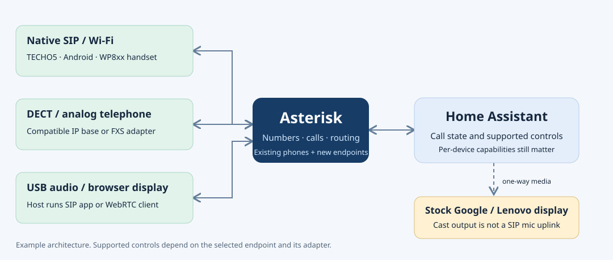

# Add existing speakers and displays to Asterisk

The same PBX can serve a converted speaker, an Android display and a conventional
SIP telephone. Registration, remote call control and music playback are separate
capabilities. Enable only the controls supported by each endpoint.



## Select the supported route

- **TECHO5 Dot:** its documented 1.0.40 release includes a native SIP client and
  Home Assistant phone actions. Configure that client before building a separate
  audio bridge. Its current phone path uses G.711 at 8 kHz; keep Sendspin for music.
  Validate echo cancellation and simultaneous speech on the actual device.
- **Converted Echo Show / Android:** use a compatible native SIP client. Integrate
  call-state events with the voice assistant's microphone owner, including remote
  hangup, rejected calls, application restart and network failure. Video requires
  compatible codecs at both ends; Asterisk does not transcode video.
- **Stock Lenovo Smart Display:** retain Cast output. No supported native SIP or
  arbitrary microphone-enabled browser path is documented. A Cast dashboard does
  not turn its microphone into a SIP endpoint.
- **Other already-owned Android/Linux clients:** use their normal supported SIP
  client and audio device. An inventory entry alone does not establish remote
  installation access or a working microphone/speaker.

See [TECHO5](https://github.com/HuskerMinion/techo5-dot/tree/dot-v1.0.40),
[the converted Show project](https://github.com/ha-homelab/ha-echo-show-5),
[Lenovo's FAQ](https://support.lenovo.com/us/en/solutions/ht507000-lenovo-smart-display-faqs-and-troubleshoot)
and [Asterisk video support](https://docs.asterisk.org/Configuration/Core-Configuration/Video-Telephony/).

## Provision without erasing existing services

For a fully managed new deployment, add clients under `softphones` in the private
site file and use the normal [provisioning workflow](macos-softphone.md).
The optional `codecs` list is ordered, nonempty and contains unique values from
`g722`, `ulaw`, `alaw`. Omission preserves the usual `g722,ulaw,alaw` policy.

For an existing deployment with additional service routes, do not regenerate it
from an old bootstrap site file. Capture the **current** complete configuration,
decode its files into a private flat directory, and use the additive renderer:

```sh
umask 077
mkdir -p .local/endpoints
cp deploy/endpoints.example.json .local/endpoints/clients.json
chmod 600 .local/endpoints/clients.json
# Edit fictitious addresses, labels and numbers to match your private registry.
# Snapshot all current configuration files into .local/endpoints/source/.
python3 scripts/provision_endpoints.py \
  --config-dir .local/endpoints/source \
  --endpoints .local/endpoints/clients.json \
  --secrets .local/endpoints/secrets.json \
  --out .local/endpoints/candidate
```

Keep the stable secrets file outside the source and candidate directories. It
must survive subsequent runs. The renderer owns marked blocks in `pjsip.conf`
and `extensions.conf`, preserves other files with the exception below, refuses number collisions and
requires the selected transport to exist. Use a private file with `node_ipv4`,
`softphones`, and optionally `gateway: {"enabled": true}`; the sample's full
schema is shown below. Empty `softphones` removes the managed blocks and their
optional audio allowlist entries while retaining saved credentials.
Additive routes always honor per-extension PBX DND, including when `gateway` is
omitted or disabled in this manifest. A missing DND value permits calls normally;
the optional `gateway.enabled` field remains accepted for input compatibility.

If the snapshot includes `dial-audio.json`, the renderer validates it and updates
only its `local_lines` list: newly owned endpoints gain access to existing audio
services, and retired owned endpoints lose it. Other line entries, service
definitions and the credentials-file path are preserved; this JSON file may be
reformatted. An absent file is not created. All bytes outside the two managed
blocks and this optional JSON file remain unchanged.

```json
{
  "node_ipv4": "192.168.50.10",
  "gateway": {"enabled": true},
  "softphones": [
    {"extension": "290", "label": "Speaker", "source_ipv4": "192.168.50.90", "transport": "udp", "codecs": ["ulaw", "alaw"]},
    {"extension": "291", "label": "Display", "source_ipv4": "192.168.50.91", "transport": "udp", "codecs": ["g722", "ulaw", "alaw"]}
  ]
}
```

Before deployment, reserve each endpoint's address through the existing DHCP
system, review its exact SIP/RTP source permissions, and preserve the separate
TFTP policy. The offline renderer does not configure a router or firewall.
G.711-only devices require `ulaw` or `alaw` on their PBX endpoint. Transcoding to
G.722 cannot recreate frequencies absent from the original 8 kHz signal.

For Kubernetes, create a new immutable Secret from the candidate files. Change
only the configuration volume reference on the **current** Deployment, guarded
by a JSON Patch `test` for its resource version and previous Secret name. Retain
all other mounts, images, sidecars and runtime state. Wait for rollout readiness,
then inspect registration and representative routes. Roll back only the changed
reference against freshly read state; do not apply an old complete Deployment
over another operator's changes. The same principle applies to owned firewall
chains and their persistent configuration.

## Expose honest controls

The optional generic endpoint gateway provides fresh PBX status, callback calling,
identity-checked hangup and DND. It does not emulate Cisco hardware commands.
Enable `controls_enabled` only for reviewed `softphones` entries, and add approved
destinations to `dial_allowlist`. See [Home Assistant endpoint setup](endpoint-home-assistant.md).

When generating a gateway candidate with `configure_gateway.py`, pass
`--control-endpoint 290 --control-endpoint 291` for the reviewed clients
(these numbers are examples), and retain those flags on future generations.
Each selected extension must already be a `softphones` entry in `site.json`;
Cisco lines and unknown extensions are rejected. Without the flags, software
clients retain the existing directory-only default.

A **callback** rings the selected endpoint first; after the user answers, Asterisk
dials the destination. It is different from a native device's immediate outbound
dial action. A native TECHO5 or display adapter may provide answer/hangup directly.
Do not show speakerphone, hardware volume, auto-answer or media-player controls
unless that device adapter actually implements them.

Cast speech uses the existing media player and TTS service. It may interrupt current
media; do not promise automatic restoration on devices that lack announcement
support. No generated package should place a call or play audio merely by loading.

## Deployment verification record

The existing-hardware pilot uses the native TECHO5 client, the shared endpoint
gateway and the generated HA package. One available Dot registered successfully;
a call to the echo service exchanged RTP in both directions, an incoming call
was answered through native HA control, and local/remote hangup returned it to
idle. The clock service also completed after the additive installer was updated
to maintain its explicit caller allowlist. These are signaling, packet and
lifecycle checks; they do not certify acoustic echo cancellation or sound quality.

Live acceptance also verified HA DND toggle/restoration and a gateway callback
answered through the native Dot action, followed by exact-call hangup from HA.
No test channels remained.

The HA package was checked with HA 2026.10.4, including its actual package merge
and script/template engine. Empty boolean selector maps must be represented as
`null` because package merging otherwise drops their selector type. Exact call
IDs and numeric-looking strings remain strings across action templates.

## Acceptance and recovery

1. Confirm the intended account and source address; preserve unrelated accounts.
2. Verify registration, then an outgoing internal call and an incoming call.
3. Check the negotiated codec, two-way audio and simultaneous speech at normal
   and high speaker volume. Signaling success does not establish audible quality.
4. End a call from each side. Check that no channel, microphone lock or paused
   assistant remains. Test busy, rejection and unanswered calls.
5. Verify recovery after client/PBX restart and Wi-Fi loss, including ringing
   after a long idle period. Keep an accessible physical mute/hangup control.
6. Verify existing phones, service routes, music and TFTP remain configured.

Keep actual extensions, device addresses, serials, tokens, logs and credentials in
ignored local/private files. Publish only synthetic examples and redacted results.

### Callback lifecycle and uncertain outcomes

`GET /v1/endpoints/{extension}` includes `callback_state`: `idle` means no pending
callback, `starting` means an originate has been submitted, `active` means its
exact assigned Asterisk `Uniqueid` was observed, and `unknown` means its outcome
cannot yet be established. An HTTP `accepted` receipt confirms submission, not
answering or successful audio. The normal `call_state` and `calls` fields still
describe the endpoint's current channels.

The gateway persists a random `ChannelId` before sending the originate. It rings
the endpoint for up to 20 seconds and retains that originating AMI connection
for a separate, bounded 30-second event observation after the queued response.
A matching `OriginateResponse` failure or exact-identity `Hangup` retires the
pending callback, including calls that begin and end between polls. The existing
two-second background loop also observes the assigned identity; disappearance
after that identity was observed establishes completion. An unrelated incoming
call cannot retire the pending callback. Each accepted callback has its own
daemon event reader; readers may briefly overlap with later calls, but each has
the 30-second deadline and a 1 MiB response bound. Readers wait without holding
the gateway lock and take it only for their state updates.

After 35 seconds, a never-observed callback changes from `starting` to `unknown`.
This is a display timeout, **not permission to originate again**. A lost AMI
connection, gateway restart, or new idempotency key does not clear the guard.
Explicit AMI rejection is terminal; a transport timeout is not.

For an exceptional persistent `unknown` state:

1. Stop retrying the call. Privately inspect the matching `endpoint_callbacks`
   SQLite row and its `channel_id`; retain a backup before any maintenance.
2. Inspect fresh AMI channels for that exact `Uniqueid`. If present, end only
   that call using its current channel/identity pair and verify its terminal
   event or disappearance after observation.
3. If the identity was never observed and terminal event evidence was lost,
   absence from one snapshot is insufficient. Keep the guard until a controlled
   PBX restart, scheduled after existing calls finish, establishes that every
   queued originate from the old process has ended. With the gateway stopped,
   an operator may then remove only the reviewed row matching both extension
   and `channel_id`, and restart the gateway.

Preserve the `operations` idempotency journal. Never clear all callback rows or
replay an uncertain operation merely because time elapsed. Make a new intentional
call only after the previous attempt's termination has been established.
