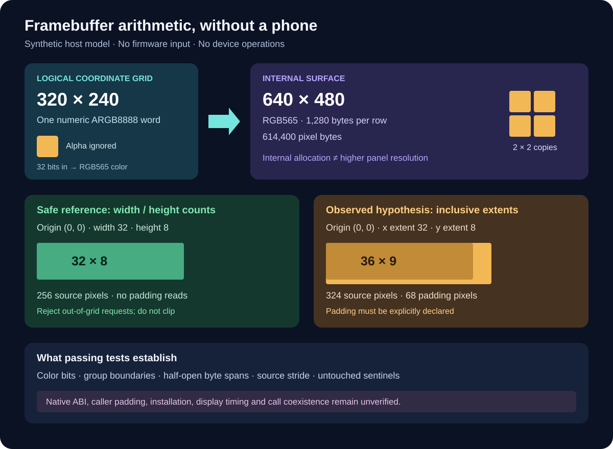

# Synthetic framebuffer boundary model

This host-only model makes the recovered display arithmetic testable without
firmware, a phone, a compiler toolchain or network access. It provides two
separate contracts: a safe rectangle reference and a bounded hypothesis of the
observed grouped accesses. Neither is a callable phone driver or a native
application installation route.

The recovered logical display is **320 × 240**. The recovered internal surface is
**640 × 480 RGB565**, with a fixed 1,280-byte row stride and 614,400 pixel bytes.
Duplicating one logical pixel into a 2 × 2 internal block does not increase the
physical panel resolution. Returned offsets start at the pixel array, excluding
the allocation prefix and surface descriptor.



## Run the independent synthetic tests

From the repository root, with Python 3.10 or later:

```bash
python3 -m unittest tests.test_firmware_lab_framebuffer -v
```

The module uses only the standard library. It accepts integers describing
synthetic layouts and returns JSON-serializable row spans. It has no firmware
input, file output, network operation, device pointer or native execution path.
The tests exercise color conversion, boundary arithmetic, row stride, declared
padding, sentinel preservation and resource limits using newly generated data.

## Compare the contracts

```python
from tools.firmware_lab.framebuffer import (
    argb8888_to_rgb565, plan_reference_blit, plan_observed_blit,
)

# Same declared source allocation for both examples:
# 32 active pixels + 4 padding pixels; 8 active rows + 1 padding row.
storage = dict(
    source_width=32, source_height=8,
    source_padding_pixels=4, source_padding_rows=1,
    source_stride_bytes=144, source_buffer_bytes=1296,
)
reference = plan_reference_blit(x=0, y=0, width=32, height=8, **storage)
observed = plan_observed_blit(x=0, y=0, x_extent=32, y_extent=8, **storage)

assert reference["touched_logical_rect"] == dict(x=0, y=0, width=32, height=8)
assert reference["padding_read_pixels"] == 0
assert observed["touched_logical_rect"] == dict(x=0, y=0, width=36, height=9)
assert observed["padding_read_pixels"] == 68
assert argb8888_to_rgb565(0xFFFF0000) == 0xF800
assert argb8888_to_rgb565(0x00FF0000) == 0xF800  # Alpha is ignored.
```

The **reference contract** uses positive width/height counts, rejects rectangles
outside the active source or logical display, and never reads declared padding.
It does not clip or round coordinates. Source and destination share the same
logical `x, y`; this is not a general source-to-destination copy API.

The **observed-access hypothesis** treats origin plus extent as an inclusive
endpoint, clips endpoints to 319/239, rounds the initial x down to a multiple of
four, and includes the whole four-pixel group containing the final x. The row
count includes the final y. A zero extent therefore still touches one row and
four pixels. Overflowing unsigned origin-plus-extent and out-of-grid origins
are refused before clipping.

For example, `x=5, x_extent=0` touches x=4 through x=7. At `x=319, y=239`, zero
extents touch the final four logical pixels of the final row. The model clips
large non-overflowing extents before generating bounded spans. This calculation
is supported by the retained static instruction trace; the original callers'
intended padding and extent convention remain unresolved.

## Buffer and color rules

Every source pixel is a numeric `0xAARRGGBB` word. Its big-endian byte sequence is
A, R, G, B; host-native byte unpacking is not implied. The conversion keeps the
upper five red bits, six green bits and five blue bits. It ignores alpha and
does no blending, gamma conversion or dithering.

Each logical source pixel contributes two adjacent RGB565 pixels on each of
two internal rows: four destination pixels, eight destination bytes. The model
returns half-open byte spans, `[start, end_exclusive)`, for one source row and
two internal destination rows. It describes accesses; it does not render or
allocate the framebuffer. Tests use a separate synthetic renderer to check
the spans against known color values and untouched sentinel bytes.

Source stride and starting offset must be multiples of four. Declared source
capacity must cover every full storage row, including its stride padding.
Extra stride bytes alone do not authorize extra pixel reads: the grouped model
requires explicit `source_padding_pixels` and/or `source_padding_rows` when an
access goes beyond the active dimensions. Missing capacity or undeclared
padding raises `FramebufferModelError`; the reference model refuses padding
reads even when capacity exists.

The destination layout is deliberately fixed to the recovered 1,280-byte
stride. Arbitrary destination strides are unsupported. Source dimensions
including padding are bounded at 1,024 per axis, stride at 64 KiB, and declared
capacity/offset at 16 MiB. The logical display bounds limit every plan to 240
row records. These are host-model limits, not claims about driver validation.

## Read results without overstating them

A successful test establishes the arithmetic and bounds of this synthetic
model. Every plan preserves `abi_verified: false`, `hardware_tested: false`,
and `caller_padding_contract_resolved: false`.

The model does not establish native installation, pointer validity, cache
coherency, display ownership during calls, frame timing, tearing, masked blits,
rotation, driver return codes or video decoding. A compiled program would not
establish any of those either. Address-bearing derivations and vendor inputs
remain in the private research packet; no vendor code or binary fixture is
distributed with these tests.

If a plan fails, inspect the named bound rather than adding arbitrary capacity:
confirm whether the input is a count-based rectangle or an inclusive extent,
calculate the touched group, declare intended padding explicitly, and confirm
the stride covers it. Keep the safe reference and observed hypothesis separate
when designing a future adapter.

See [native static findings](native-static-map.md) for the recovered interface
and remaining installation/ABI gates, and the [firmware lab](firmware-lab.md)
for retained-input handling.
