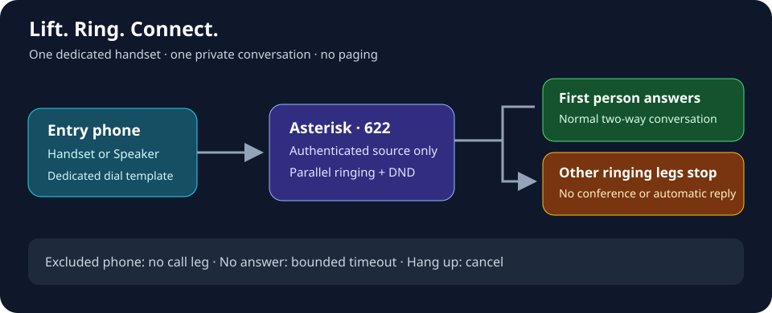

# Handset hotline

A dedicated Cisco 7945G can call a private household group immediately when its
handset is lifted. The first person to answer gets a normal two-way call; the
other ringing legs stop. No conference, paging server or extra hardware is needed.



## Behavior

- The selected physical phone uses a separate dial template. Both of its lines
  enter hotline mode; Speaker, NewCall and a line key can also start the call.
- Incoming calls can still be answered normally. Arbitrary outgoing keypad
  dialing is no longer the purpose of this dedicated phone.
- Reserved extension **622** accepts only the selected phone's authenticated
  PJSIP endpoints. Changing caller ID does not grant another endpoint access.
- Recipients ring in parallel, once per physical Cisco phone. The first answer
  cancels the other legs. Hanging up at the source cancels unanswered calls.
- Gateway DND is respected. Offline or busy recipients do not prevent other
  available recipients from answering. Call waiting follows each phone's policy.
- No answer ends the attempt after the configured timeout. There is no automatic
  redial loop while the source stays off-hook. Replace and lift the handset again
  to start another attempt.
- Automatic answer preferences in the Cisco gateway do not answer a hotline call.
  A person can still answer locally or with `cisco NUMBER answer`. Native autoanswer
  in a third-party softphone or conference phone must also be disabled.

The existing 620 and 621 groups retain their original membership and behavior.

## Configure a private installation

Keep the real room mapping, addresses and credentials outside Git. Add this block
to the installation's reviewed `site.json`, with its existing gateway enabled:

```json
{
  "hotline_ring_group": {
    "enabled": true,
    "extension": "622",
    "source": "201",
    "members": ["203", "205", "209"],
    "timeout": 25
  }
}
```

The values are examples. `source` must be a verified Cisco primary extension.
`members` contains primary Cisco extensions or declared local softphones, never
secondary Cisco lines, the source phone, or external numbers. Omit every line of
any room that must remain quiet. The timeout must be an integer from 1 to 120
seconds. Do not add a device that answers automatically when the intended winner
is a person lifting a handset.

Prepare a private candidate directory containing a copy of the complete current
installation inputs, including `site.json`, `phones.json`, existing generated
secret files and referenced management inputs. Preserve those secrets when
regenerating; starting from an empty output directory can create new passwords.
Use the same candidate root for generation, validation and deployment:

```sh
python3 scripts/provision.py --site /private/candidate/site.json \
  --inventory /private/candidate/phones.json --out /private/candidate
python3 scripts/preflight.py --site /private/candidate/site.json
bash scripts/deploy.sh --site /private/candidate/site.json --server-dry-run
```

See the [deployment guide](asterisk-operations.md) for the installation-specific
firewall and apply procedure. Preserve existing private overrides, runtime code
mounts and media/voice configuration; never deploy an older incomplete site file
on top of a newer installation. For a targeted existing deployment, retain every
unrelated config key and profile byte while replacing the reviewed route,
gateway module and source-phone template.

Install the gateway's hotline-aware autoanswer guard before enabling the route
and handset profile. Provisioning creates `dialplan-hotline-<MAC>.xml`, references
it only from the source phone's SEP profile, and keeps `dialplan.xml` unchanged.
Profile-only TFTP validates and serves the extra file; firmware files are not
required. Reboot only the source phone after TFTP is ready. Check actual TFTP
retrieval and registration before testing off-hook behavior.

The combined service directory includes 622 as **Handset hotline group** when the
feature and its ownership metadata are valid. To reconcile an existing gateway
catalog, use the normal `scripts/sync_directory.py --sync-services` workflow with
current private inputs; a catalog label does not grant other callers route access.

## Verify and troubleshoot

1. Lift the source handset or remotely use `cisco 201 speaker toggle` once while
   idle. Confirm an outbound source channel and parallel recipient legs in Asterisk.
2. Verify the excluded phone never receives a leg. With an autoanswer preference
   enabled on a test recipient, verify it keeps ringing until explicitly answered.
3. Answer one recipient, confirm only the source and answered recipient remain,
   then hang up. Verify all channels are gone.
4. Repeat and hang up at the source before anyone answers. Test no-answer expiry,
   DND, a second attempt and incoming calls to both source lines.

If there is only a dial tone, check the SEP `dialTemplate` reference and successful
retrieval of its dedicated file. If 622 rejects the call, inspect
`CHANNEL(endpoint)` and the private physical-line ownership map; caller ID is not
the authorization key. If another phone steals the call automatically, inspect
its native autoanswer setting and the gateway's live source version. Recipient
channels must inherit `CISCO_HOTLINE=1`. Failed or ambiguous AMI marker reads cause
the gateway to skip automatic answer rather than guess.

## Disable

Set `hotline_ring_group.enabled` to `false`, regenerate and validate. Deploy the
restored source profile and reboot that phone: it returns to `dialplan.xml` and
normal outgoing dialing. Provisioning removes the stale generated hotline
file; a service-directory sync removes the reserved 622 grant. Install the
restored handset profile before removing the route if a staged rollback must
keep the phone usable throughout.

## References

- [Cisco PLAR](https://www.cisco.com/c/en/us/td/docs/voice_ip_comm/cucm/admin/12_5_1/featureConfig/cucm_b_feature-configuration-guide-1251/cucm_b_feature-configuration-guide-1251_chapter_0101001.html)
- [Cisco/Asterisk dial template reference](https://usecallmanager.nz/dial-template.html)
- [Asterisk Dial: parallel calls and first answer](https://docs.asterisk.org/Asterisk_22_Documentation/API_Documentation/Dialplan_Applications/Dial/)
