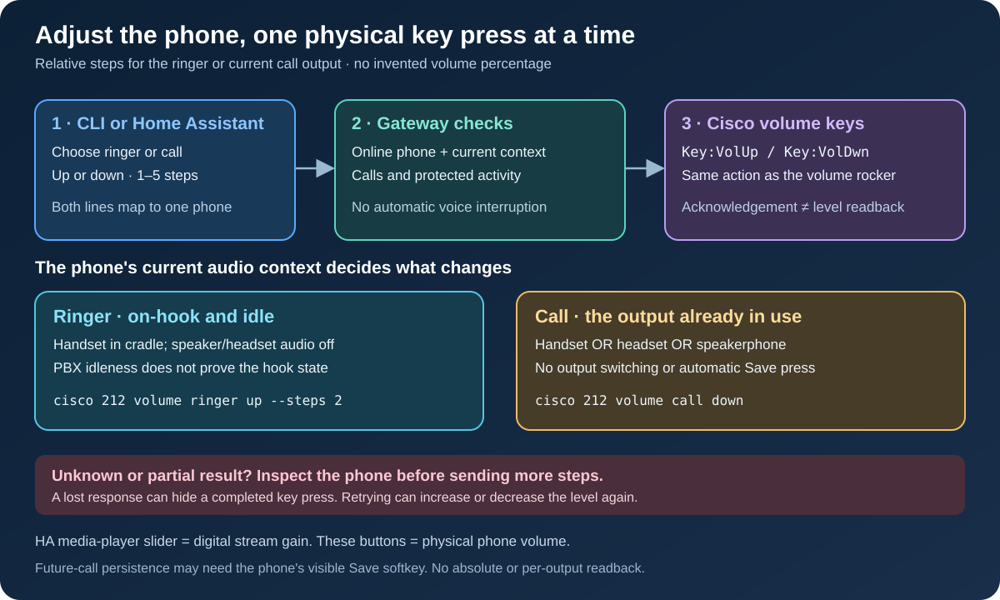

# Physical phone volume

The Cisco 7945G can receive the same volume-up and volume-down key presses as
its physical volume rocker. Use these controls for the phone's ringer or the
audio output already in use during a call. The controls send relative steps;
they do not read or set an absolute hardware volume percentage.



## Command line

Install the [CLI](cli-installation.md) and update the gateway to a version that
advertises the `hardware_volume` capability. Keep using your existing private
configuration and token. The examples use a configured extension; replace
`212` with the line of the phone you want to control.

```sh
cisco 212 volume ringer up
cisco 212 volume ringer down --steps 2
cisco 212 volume call up --steps 2
cisco 212 volume call down
```

Each request defaults to one step. `--steps` accepts whole numbers from `1` to
`5`. Use small adjustments and check the result before sending more. A step
means a key press, not a fixed percentage, decibel change, or guaranteed
movement: the phone may already be at its limit.

The selected extension resolves to one physical phone through the current
inventory. Its two lines do not have separate ringer or speaker controls.
The extension does not select a room, another output device, or a softphone.

## Ringer and call context

For **ringer** volume, leave the handset in its cradle, turn off the speaker
and headset audio modes, and keep the phone idle. The gateway checks that the
phone is free of calls and protected activity. However, an idle PBX does not
prove the physical handset is on-hook: local dial tone or someone lifting the
receiver can change what the next volume key affects.

For **call** volume, select the line with the phone's one active, answered call.
A ringing, sibling-line, or ambiguous call is rejected. Resume a held call
first: an AMI `Up` state alone does not prove that the phone is locally unheld. The
client includes the observed channel and unique ID; the gateway rechecks that
exact call before each key and after the sequence. The key adjusts whichever
output is currently selected on the phone: handset, headset, or speakerphone.
The operation does not switch outputs, answer a call, lift a handset, or turn
on the speaker. A user changing audio mode during the request can change the
affected output. Cisco describes these contextual behaviors in its
[7945G/7965G user guide, page 8](https://www.cisco.com/c/dam/en/us/td/docs/voice_ip_comm/cucme/ip_phones/7945_65/4-3/english/user/guide/65_45.pdf).

The phone may require its **Save** softkey after a call-volume adjustment to
retain the level for future calls. Use the currently displayed Save key on the
phone. This integration does not guess a softkey position or automatically
press it. See Cisco's
[SCCP/SIP handset, headset, and speakerphone guide](https://www.cisco.com/c/en/us/td/docs/voice_ip_comm/cuipph/7975G_7971g-ge_7970g_7965g_7945g/9_0/english/user_guide/P747_BK_IA116FD9_00_userguide-7945g-7965g-7970g-7971gge-7975g/P747_BK_IA116FD9_00_userguide-7945g-7965g-7970g-7971gge-7975g_chapter_0100.html).

## Home Assistant

Update the [Asterisk Telephony integration](https://github.com/ha-homelab/asterisk-telephony)
as well as the gateway. Each physical Cisco device has four one-step controls:

- Increase ringer volume.
- Decrease ringer volume.
- Increase call volume.
- Decrease call volume.

The integration's hardware-volume action supports the same `ringer` or `call`
context, `up` or `down` direction, and one to five steps. These controls belong
to the existing physical device; they do not create an extra device for its
second line. An unavailable phone or an older gateway cannot execute them.

The media player's existing volume slider remains **digital playback gain**.
It scales the audio supplied by the controlled player and is distinct from
the phone's physical output level. Raising digital gain does not raise the
ringer or guarantee that a quiet physical speaker becomes audible. See
[phone media players](phone-media-player.md).

## Refusals and uncertain results

Volume requests do not interrupt or automatically suspend hands-free voice.
If hands-free mode, a voice session, recovery, or other protected activity owns
the phone, finish or explicitly disable that activity before retrying. Inspect
the existing [voice status and Stop controls](voice-control.md); do not remove
ownership records or restart the gateway to bypass a refusal.

A call starting, ending, or being replaced during an adjustment can invalidate
its context. The gateway checks current state before sending keys, but cannot
lock the physical handset or prevent someone pressing its buttons.

An accepted request means the phone acknowledged the key command. It is not a
readback of the new volume, proof of the active audio path, or confirmation
that anyone heard the result. A timeout, lost connection, or partial sequence
can leave an unknown outcome. Inspect the phone before sending another
adjustment; do not blindly repeat a multi-step request.

## Protocol and implementation limits

The gateway action is `hardware_volume`, with `context` set to `ringer` or
`call`, `direction` set to `up` or `down`, and integer `steps` from `1` to `5`.
Clients use the existing authenticated phone-action route and its correlation
and call-context checks. They do not need the phone's management credentials.

`POST /v1/phones/<physical-phone-id>/hardware_volume` accepts exactly
`idempotency_key`, `line`, `context`, `direction`, and `steps`; the `call`
context also requires the freshly observed `channel` and `uniqueid`. A success
response includes `requested_steps` and `acknowledged_steps`, with
`level_known: false`, `volume_level: null`, `audio_output: "contextual"`, and
`physical_context_verified: false`. These fields preserve the distinction
between an acknowledged key event and a measured physical result.

The gateway sends Cisco `Key:VolUp` or `Key:VolDwn` through the existing XML
Execute interface. Cisco lists the 7945G as supporting Key URIs. The consulted
XSI API does not document an absolute hardware-volume setter or volume
readback. Its separate `RTPRx` volume parameter applies to initial XML-stream
playout and is ignored during an active call; it is not a replacement for
these controls. See the official
[Cisco IP Phone Services URI reference](https://www.cisco.com/c/en/us/td/docs/voice_ip_comm/cuipph/all_models/xsi/7_0/english/programming/guide/70xsi/xsi70uri.html).

There are deliberately no claimed percentages or separate stored handset,
headset, speakerphone, and ringer readings. All behavior described here is
bounded by the current phone context. Firmware-specific response and audible
behavior still need confirmation on the deployed phones.
