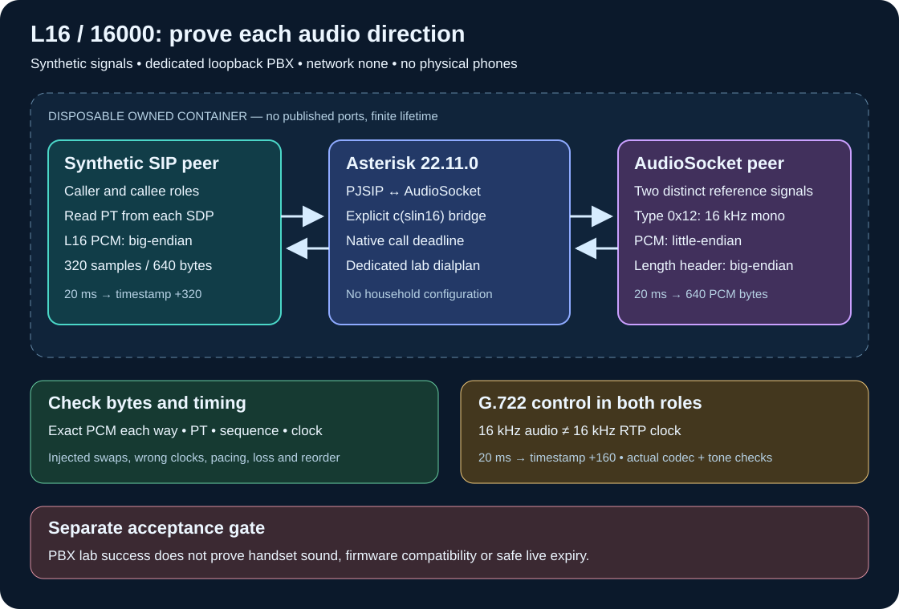

# L16/16000 interoperability laboratory

This laboratory separates SIP negotiation, PCM byte order, RTP timing and
two-way media delivery. It uses synthetic samples and a disposable Asterisk
22.11.0 container with **no external network and no published ports**. It does
not configure or call a physical phone. The existing G.722 deployment remains
independent of this experiment.

The Cisco offer documented in [Uncompressed audio](uncompressed-audio.md)
contains payload 102 for `L16/16000`. That is an advertised capability, not
proof of working two-way media. Asterisk's default payload allocation is not
a substitute for reading each offer and answer.



## Install and run

Clone this repository and use Python 3.10 or later from its root directory.
The offline checks need only the standard library. No SIP account or private
site configuration is required.

```sh
git clone https://github.com/4alvit/cisco-home-telephony.git
cd cisco-home-telephony
python3 -m tools.l16_lab
python3 -m tools.l16_lab offline --output .local/l16/offline-1
```

No command, or `plan`, prints the scope and examples without contacting
Docker. `offline` generates known packets and deliberately damaged variants;
it does not open network sockets. Its G.722 fixture checks packet geometry,
not G.722 decoding or audible quality.

For the actual PBX test, first obtain a locally built, compatible image from
the repository's [Asterisk image build](../scripts/build-images.sh). It must
contain Asterisk **22.11.0**, PJSIP, AudioSocket, `slin16`, G.722, Python and
FFmpeg. The runner neither builds nor pulls an image. Select a local Docker
context explicitly:

```sh
python3 -m tools.l16_lab asterisk \
  --image cisco-home-ci/asterisk:22.11.0 --docker-context LAB_CONTEXT
python3 -m tools.l16_lab asterisk \
  --image cisco-home-ci/asterisk:22.11.0 --docker-context LAB_CONTEXT \
  --execute --output .local/l16/asterisk-1
```

The first command remains a dry run. Replace `LAB_CONTEXT` with a local
context name. Linux CI may instead use `--docker-socket /var/run/docker.sock`.
TCP and SSH Docker endpoints are refused, and ambient Docker routing
variables cannot choose a target. An existing container cannot be selected.

Output must be a fresh directory under this checkout's `.local/`; existing
output and parent symlinks are refused. Reports have mode `0600`. A reported
`PASS` requires successful checks and confirmed removal of the exact owned
container. The container has a random name and ownership label, bounded CPU,
memory and process count, and a work deadline. Cleanup does not enumerate or
remove unrelated containers.

## Measurements

The real fixture runs five cases: an incoming L16 offer using payload 102,
an incoming offer using another dynamic payload, a PBX-originated L16 call,
and incoming/outgoing G.722 fallback. It uses a dedicated synthetic dialplan,
loopback SIP/RTP and an AudioSocket channel explicitly selected as `slin16`.

Two different reference signals identify the directions. For L16, the fixture
looks for a substantial exact sample sequence from AudioSocket in received
RTP and a different exact sequence from transmitted RTP in AudioSocket.
For G.722, actual FFmpeg encode/decode and distinct reference tones establish
delivery in both directions; lossy compressed bytes are not compared to PCM.

| Boundary | Expected representation at 20 ms |
| --- | --- |
| L16/16000/1 RTP | 320 signed samples, 640 bytes, big-endian, timestamp step 320 |
| AudioSocket `0x12` | 320 signed samples, 640 PCM bytes, little-endian; length header is big-endian |
| G.722 RTP at 64 kbit/s | 160 encoded bytes, timestamp step 160; decoded audio is 16 kHz |

These contracts follow [RFC 3551, L16 and G.722](https://www.rfc-editor.org/rfc/rfc3551.html)
and the [AudioSocket protocol](https://docs.asterisk.org/Configuration/Channel-Drivers/AudioSocket/).
Keep these boundaries separate: copying AudioSocket PCM bytes directly into
L16 RTP reverses each sample's byte order. Adding another swap inside the
existing radio worker would instead corrupt a conversion Asterisk already
performs.

The packet analyzer checks negotiated payload type, lengths, sequence/SSRC,
timestamp increments and arrival pacing. Packet checks alone do not prove
audible delivery. A byte-order diagnosis requires the known reference signal;
silence can be ambiguous and unknown speech does not justify an endian claim.
Arrival timing describes this local test and is not a measurement of the
phone's speaker latency.

## Fault isolation and the next physical test

| Observation | Next distinction |
| --- | --- |
| L16 offer rejected or answered without L16 | Compare both SDP directions and the permitted codec list before examining PCM |
| Answer selects L16, but no RTP reaches its advertised address/port | Check source/destination tuples, routing and packet counters |
| RTP arrives with a different payload number | Resolve that number through the actual negotiated mapping; do not assume 102 or 118 |
| L16 length is 640 bytes but timestamp step is 160 | The sender used G.722's clock rule for L16 |
| Expected samples match only after a byte swap | Locate the conversion boundary; use an asymmetric reference, not silence |
| AudioSocket receives the reference but the opposite RTP direction is absent | Isolate PBX egress, selected codec and bridge state |
| Both digital directions pass but a phone remains silent | Inspect its receive/transmit codec counters, audio route and hardware with an attended test |

The smallest useful future phone experiment is **one selected phone, one
short L16 call and two distinguishable reference signals**, followed by a
separate G.722 control call with the same topology. Preserve the current
working configuration. Capture both SDP messages and bounded RTP metadata,
then compare each direction independently. Record whether a human hears the
expected signal; a successful socket write cannot replace that observation.

Before any such test, qualify a server-enforced lifetime on the actual PJSIP
media channel, armed before Answer/AudioSocket, and a separate ringing/setup
limit. Use a dedicated context, immutable run and channel identity, one-use
admission, no reconnect/refresh, and exact owned cleanup. The normal lab calls
arm a native absolute timer and check ordinary hangup. A separate passive
guard case leaves an AudioSocket peer open and silent, observes a three-second
PBX expiry, and checks the target UniqueID disappears while an unrelated
sentinel remains. That case requires its own actual Asterisk result; it does
not kill the observer/controller process. **Controller-death behavior is still
unqualified.** Additional acceptance must kill/disconnect the controller,
leave the worker stalled and verify both exact media-channel identities
disappear without disturbing the sentinel. An outer container kill must
not count as passing that test. Do not rely on an SSH Stop command as the
only lifetime bound.

No physical test is enabled by this tool. Firmware reverse engineering and
native audio driver hypotheses are separate from this SIP experiment.
The legacy XML `RTPRx`/`RTPTx` interface retains its documented G.711 contract.

## Verification status and limits

```sh
python3 -m unittest discover -s tests -p 'test_l16_lab*.py' -v
```

Unit and offline tests validate known wire bytes, intentional faults,
configuration, parser boundaries and owned cleanup behavior. The actual
Asterisk run has its own receipt and must pass in an available local Docker
engine or CI before PBX interoperability is claimed. Mocked Docker tests and
an offline `PASS` are not that receipt.

Even a complete isolated PBX `PASS` does not establish Cisco firmware
interoperability, acoustic quality, hold/resume, transfer, NAT/SRTP behavior,
loss recovery or fleet readiness. It supplies a reproducible control case
for investigating those questions.
