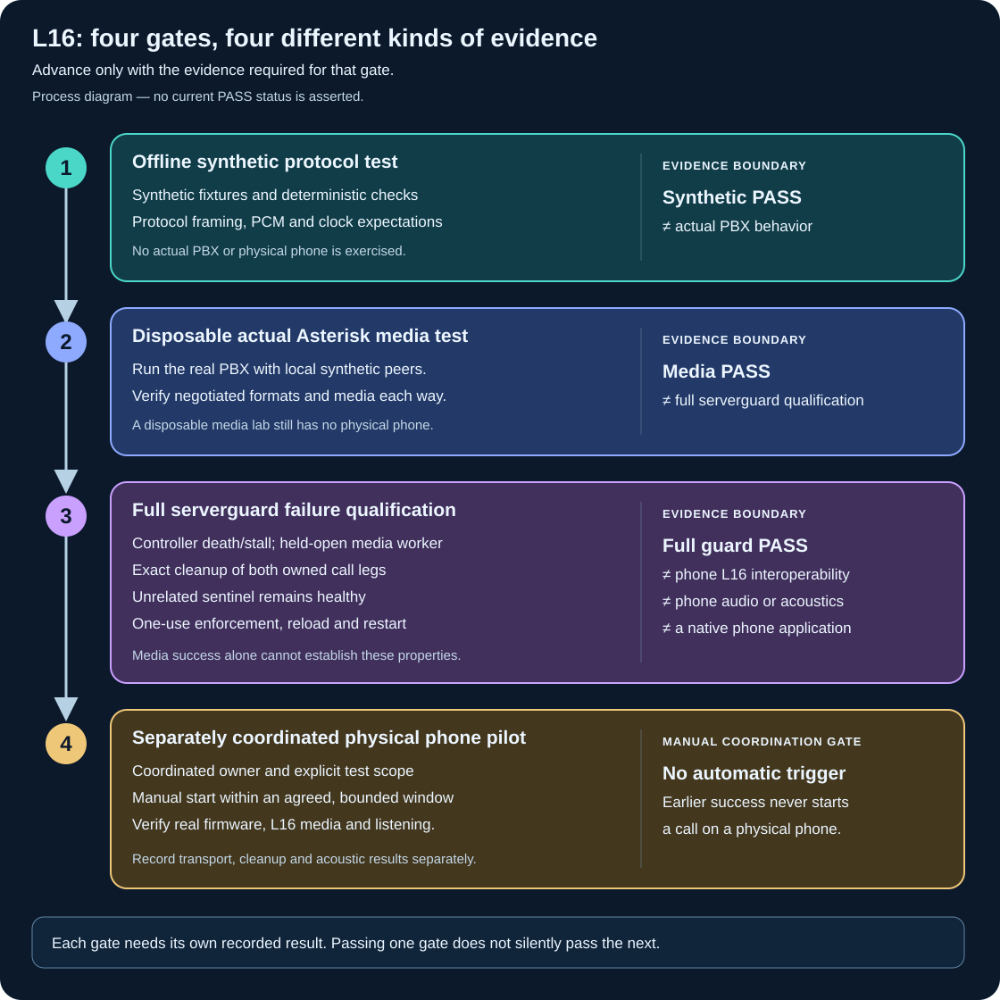

# Operate the L16 media and call-lifetime laboratory

Use four separate gates: synthetic protocol checks, real Asterisk media,
failure qualification of the server-side call guard, and a coordinated
physical-phone pilot. Record a result for each gate. Passing one does not
automatically pass the next.

The current `tools.l16_lab` command implements the first two gates and a
limited passive expiry probe. The full failure contract below is a requirement
for a future phone pilot, not a claim that the current runner implements it.
This guide does not enable a phone pilot or install a native phone application.



For normal phone operation, start with [CLI installation](cli-installation.md),
[CLI commands](cli.md), and [Asterisk operations](asterisk-operations.md).
The [foreground voice CLI](voice-cli-install.md) is a separate tool with its
own prerequisites. The commands here do not need a phone inventory, a gateway
token, SIP credentials, or access to the household PBX. See the
[L16 protocol guide](l16-interoperability-lab.md) for wire formats and test design.

## 1. Run the offline gate

Use Python 3.10 or later in a clean checkout of this repository. The offline
runner uses the standard library and no network. Run the following in Bash
from the repository root; retain the same shell for the later commands.

```bash
set -eu
umask 077
git diff --quiet
git diff --cached --quiet
mkdir -p .local/l16-operator
L16_RUN_DIR="$(mktemp -d "$PWD/.local/l16-operator/run.XXXXXX")"
export L16_RUN_DIR
git rev-parse HEAD > "$L16_RUN_DIR/source-commit.txt"
python3 --version > "$L16_RUN_DIR/python-version.txt" 2>&1
python3 -m tools.l16_lab > "$L16_RUN_DIR/plan.json"
if python3 -m tools.l16_lab offline --output "$L16_RUN_DIR/offline" \
  > "$L16_RUN_DIR/offline.console.txt" 2>&1; then
  l16_exit=0
else
  l16_exit=$?
fi
printf '%s\n' "$l16_exit" > "$L16_RUN_DIR/offline.exit-status"
cat "$L16_RUN_DIR/offline.console.txt"
test "$l16_exit" -eq 0
```

Inspect `offline/report.json`. Success requires `status: PASS`,
`network_used: false`, a successful clean fixture, rejection of all six
intentional faults, and a successful G.722 geometry check. The damaged fixtures
should have `ok: false`; that is expected. This gate does not run Asterisk,
decode G.722, measure a speaker, or prove that a phone supports L16.

The plan command does not contact Docker. Likewise, `asterisk` without
`--execute` prints a generic plan: it does **not** validate the supplied image,
socket, context, or dependencies.

## 2. Run real Asterisk in a disposable local engine

Provision and identify a dedicated local lab Docker engine separately. Do not
substitute a production engine, a socket proxy to another host, or a guessed
default socket. A Unix socket proves the transport type, not that its daemon
is disposable. These examples have no default Docker target and cannot fall
back to ambient Docker configuration.

Load a compatible image into that lab engine before this test. It needs
Asterisk 22.11.0, PJSIP, AudioSocket, `slin16`, G.722, Python, and FFmpeg.
Record its immutable image ID or digest and how it was built. The runner uses
`--pull never`; it neither builds nor downloads the image. The repository's
`scripts/build-images.sh` uses ambient Docker routing and downloads build
dependencies, so it is **not** part of the isolated command sequence below.

Set `L16_LAB_SOCKET` to the absolute Unix socket path of that dedicated engine
and `L16_LAB_IMAGE` to the verified image ID or digest. There are deliberately
no example production addresses or default socket values. Then run:

```bash
: "${L16_RUN_DIR:?Run the offline gate in this shell first}"
: "${L16_LAB_SOCKET:?Set the dedicated local lab engine socket explicitly}"
: "${L16_LAB_IMAGE:?Set the verified pre-existing image ID or digest}"
case "$L16_LAB_SOCKET" in /*) ;; *) exit 2 ;; esac
test -S "$L16_LAB_SOCKET"
printf '%s\n' "$L16_LAB_IMAGE" > "$L16_RUN_DIR/image-reference.txt"
if python3 -m tools.l16_lab asterisk \
  --image "$L16_LAB_IMAGE" --docker-socket "$L16_LAB_SOCKET" \
  --execute --output "$L16_RUN_DIR/asterisk" \
  > "$L16_RUN_DIR/asterisk.console.txt" 2>&1; then
  l16_exit=0
else
  l16_exit=$?
fi
printf '%s\n' "$l16_exit" > "$L16_RUN_DIR/asterisk.exit-status"
cat "$L16_RUN_DIR/asterisk.console.txt"
test "$l16_exit" -eq 0
```

The runner removes `DOCKER_HOST`, `DOCKER_CONTEXT`, `DOCKER_TLS_VERIFY`,
`DOCKER_CERT_PATH`, and `DOCKER_API_VERSION` from its Docker subprocess
environment. It creates a new container with a random ownership identity,
`--network none`, no published ports or host mounts, dropped capabilities,
and bounded CPU, memory and process count. It copies only generated synthetic
configuration and the lab's source into that container. It cannot select an
existing PBX container. This isolation does not cover unrelated commands
you run before or after the test.

Accept the media gate only when the process exits zero and
`asterisk/report.json` contains all of the following:

- `status: PASS`, `asterisk_version: Asterisk 22.11.0`, `network: none`,
  `synthetic_only: true`, and `physical_phones_called: false`.
- All five cases pass: `incoming_l16_102`, `incoming_l16_110`,
  `outgoing_l16`, `incoming_g722_fallback`, and `outgoing_g722_fallback`.
  Each has passing RTP diagnostics, bidirectional content evidence,
  `clean_bye: true`, and `channels_released: true`.
- The separate `native_expiry_guard` passes its three-second passive probe,
  including `target_uniqueid_reaped: true` and
  `unrelated_sentinel_preserved: true`.
- Top-level `channels_released: true` and `owned_container_removed: true`.

L16 content checks compare distinct known sample sequences in both directions.
G.722 checks actually encode/decode and detect distinct tones. Packet geometry
alone is insufficient. The passive probe keeps its audio peer open and silent,
observes PBX expiry, and checks the target PJSIP UniqueID. It does not kill the
controller or independently prove expiry of both media legs before observer
cleanup. Do not label it full serverguard qualification.

## 3. Qualify the complete serverguard failure contract

This is a separate acceptance gate. The current `tools.l16_lab` interface has
no command that completes it. Attach the future implementation's exact source
revision, frozen fixture contract, invocation, raw observations and verdicts
before marking any item passed. A proposed dialplan, mocked test or scheduled
CI job is not a runtime receipt.

The contract must demonstrate these cases in the disposable PBX:

1. **Controller death:** kill and reap the owning controller while an
   independent observer remains alive. Distinguish process death from a
   cooperative disconnect and AudioSocket EOF.
2. **Stalled media:** leave the media worker connected but unable to make
   progress. Prove that server expiry, rather than the worker closing its
   socket or the test's cleanup, terminates the call.
3. **Both actual legs:** record actual PJSIP and AudioSocket channel names,
   UniqueIDs and timer-arm events; prove both identities disappear before
   observer cleanup. A renamed channel, invented identifier or an empty final
   channel list after cleanup is not sufficient.
4. **Independent lifetime bounds:** isolate the PJSIP 20-second native timer
   with the AudioSocket timer at 40 seconds and no `L()` cap; reverse those
   two limits to isolate the AudioSocket timer. Then qualify the variant with
   both native timers at 20 seconds and the 15-second `L()` bridge cap.
   A 40-second last-leg bound is valid
   only when measured timer-arm and setup bounds support it. The 45-second
   outer containment stop is a failed test safely contained, never a pass.
5. **Unrelated-call preservation:** monitor one sentinel continuously and
   show that its actual identity and healthy media/call state persist through
   each failure and cleanup. Before/after names alone do not prove continuity.
   The intentional idle-PBX restart case is separate: require all channels
   absent before restart, rather than claiming a live sentinel survives it.
6. **Global one-use admission:** atomically consume a token once, reject
   replay, and reject simultaneous admission both within a run and across
   different runs. A per-run lock alone does not provide a global bound.
7. **Reload, restart and restoration:** reload cannot rearm a consumed run;
   a new PBX process invalidates the old run and does not reseed its admission.
   Terminalize admission before cleanup. Compare the current configuration
   with the test-installed version before restoring the saved version; do not
   overwrite an intervening operator change.

Keep ringing/setup bounds distinct from answered-media bounds. Record
monotonic timestamps for death/stall injection, both timer arms, both leg
removals, sentinel observations and containment. An SSH `Stop` request is
useful operator control, but cannot be the sole lifetime guarantee when the
controller or its connection has failed.

## 4. Coordinate the physical-phone pilot separately

Only after the required lab and guard receipts pass, assign one live operator
and an explicit test scope. Select one phone privately; preserve its working
configuration. Test one bounded L16 call with distinct reference signals in
both directions, then a separate G.722 control call using the same topology.
Use the qualified lifetime guard and inspect exact owned cleanup after each.

Record negotiated SDP, actual payload mapping, both RTP directions, firmware
version and phone codec counters. Record a separate human listening result
for handset or speakerphone. A SIP offer advertising L16, successful socket
writes, or an isolated Asterisk pass cannot replace these observations.
Neither this pilot nor the lab establishes fleet readiness, native application
installation, audio-driver access, wake-word support or incoming SIP video.

## Keep a reviewable receipt and handle failures

Keep raw reports under ignored `.local/`, including the source revision,
fixture/dialplan hashes, immutable image identity, dependency versions,
invocation, console output, exit status and each gate's verdict. The current
runner writes a successful `report.json`; it does not automatically collect
all of that provenance. For the full guard, also retain PBX process identity,
actual leg identities, timer and failure timestamps, sentinel continuity,
admission decisions and restoration comparisons. Public summaries must omit
credentials, room mappings, phone identities, firmware and private captures.

- **No report or nonzero exit:** preserve console output and the exit-status
  file. Some failures print JSON; a subprocess timeout can print a traceback.
  Neither an existing output directory nor a partial log is a pass.
- **Output already exists or has a symlink parent:** choose a fresh run
  directory. Do not delete the previous evidence to make a retry fit.
- **Image or socket unavailable:** correct the explicit lab prerequisites.
  Do not fall back to a production daemon, auto-pull, or a remote PBX.
- **One-way or corrupted media:** compare actual SDP payload mapping, RTP
  counters and known samples; use the protocol guide's fault-isolation steps.
  L16 and G.722 have different RTP clock rules, and AudioSocket/L16 PCM have
  different byte orders.
- **Cleanup uncertain:** retain the exact owned container identity for manual
  inspection on the selected lab engine. Do not use wildcard deletion,
  `docker system prune`, or a household PBX restart to clean up a lab run.
- **Guard containment fired or evidence incomplete:** mark that gate failed or
  unqualified. Resolve it in the isolated environment before a phone pilot.

The media runner's 180-second work and 30-second cleanup deadlines are outer
lab-process bounds. They are distinct from the full guard's 45-second
containment requirement and do not prove per-call lifetime behavior.
