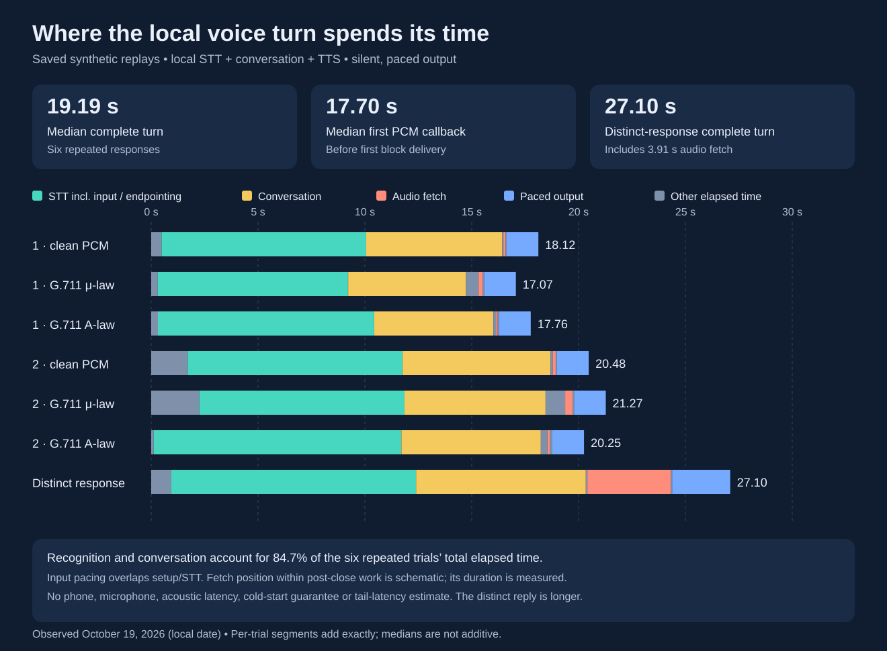

# Local voice performance

The qualified local pipeline completed six repeated synthetic turns in
**17.07–21.27 seconds** (median **19.19 seconds**). A seventh, distinct and longer
response completed in **27.10 seconds**. All seven matched the expected
transcript and answer. These saved October 19, 2026 results measure activation
through final cleanup after actual decoded audio was delivered to a paced,
silent sink. They do not include a physical phone, microphone, speaker, wake
detection or acoustic latency.

This investigation reuses those results. It adds offline analysis and a
prepared measurement plan; it has **not measured a new latency reduction**.
Live benchmarks remain deferred until the coordinating deployment work opens
a benchmark window. The existing STT services and assistant pipelines are
unchanged by this work.



## What takes the time

The first six trials use the same short utterance and answer: clean PCM,
G.711 mu-law and G.711 A-law, each twice. The seventh is a different workload,
so it is reported separately. Times below are seconds, observed on the client.

| Measurement | Six repeated turns: median | Six repeated turns: range | Distinct turn |
| --- | ---: | ---: | ---: |
| Activation to final cleanup | 19.187 | 17.067–21.274 | 27.098 |
| Activation to first PCM callback | 17.702 | 15.578–19.789 | 24.378 |
| Activation to STT start | 0.399 | 0.116–2.249 | 0.939 |
| HA STT interval | 9.830 | 8.905–11.591 | 11.454 |
| Conversation interval | 6.446 | 5.516–6.920 | 7.944 |
| Full audio fetch | 0.124 | 0.077–0.364 | 3.910 |
| Paced output delivery | 1.486 | 1.482–1.488 | 2.719 |

STT accounts for **52.07%** and conversation for **32.62%** of the six turns'
aggregate elapsed time. These percentages use summed durations, not a sum of
medians. First-PCM time is nested inside total time; it is not an additional
stage. It marks entry to the first sink write, before that block's pacing wait,
and is only a proxy for audible onset.

The six repeated replies contain 1.416 seconds of PCM each; the distinct reply
contains 2.592 seconds. Delivering the full answer necessarily takes time after
its onset. The old sink's relative sleeps add about 66–72 milliseconds to the
short answers and 127 milliseconds to the longer one. Those are benchmark
scheduling costs, not a measured phone defect.

The recorded TTS event interval is only **0.250–0.497 milliseconds** across all
seven turns. It reports response metadata availability, not the time to finish
waveform synthesis. The six repeated replies have identical downloaded audio
and decoded WAV hashes, with fast fetches. That is consistent with reuse, but
the records contain no cache-hit flag. The distinct reply has different text
and audio and a 3.910-second fetch; it still does not prove a cold cache or
separate synthesis time from transport and scheduling.

## Boundaries that matter

The primary timings use one local monotonic clock. Server timestamps can be
differenced within their own clock domain for comparison; they must not be
mixed with local timestamps to calculate one-way delays.

- **Input and recognition:** `stt-end - stt-start` includes input delivery,
  queuing, endpointing and service work. The source is paced into a local queue
  immediately after activation. The WebSocket sender starts after `run-start`
  and can drain queued audio in a burst. In one saved turn STT starts after
  the nominal 2.24-second input duration. Subtracting the whole input duration
  from every STT interval would therefore be wrong.
- **Endpointing:** the saved runs explicitly end the input after the file.
  They contain `stt-vad-start` but no `stt-vad-end`. The VAD's 1,050-millisecond
  timestamp is an audio position, not a wall-clock wait. These records cannot
  isolate a VAD timeout, the last spoken sample or pure model compute.
- **Conversation:** `intent-end - intent-start` is a complete observed stage.
  Its first nonempty token arrives after 4.378–6.522 seconds in the six repeats.
  This includes service scheduling and event delivery; it is not a measured
  model prefill time. One trial batches token callbacks, demonstrating why
  client token arrival alone cannot identify model compute.
- **Audio readiness:** the client waits for pipeline completion, its protocol
  barrier and WebSocket cleanup before starting a full audio fetch. Playback
  then decodes the complete payload before handing off PCM. The saved
  `run-end` to WebSocket-close interval is 0.051–0.917 seconds for the six
  repeats. The remaining decoder, evidence-file and callback residual is
  0.052–0.118 seconds; it is not a standalone decoder measurement.
  Fetch duration is measured, but its placement within the chart's
  close-to-first-PCM interval is schematic because absolute fetch boundaries
  were not saved.
- **Completion:** published total time includes final service cleanup and
  local evidence writes. Pre-activation setup/preflight is excluded; that
  separate interval was 0.474–1.579 seconds. Post-output cleanup was below
  0.002 seconds in every saved turn.

The earlier direct small-model tests took 4.398–6.259 seconds for the core
fixtures; Wyoming tests took 7.054–8.672 seconds. Those tests used different
timing scopes and were not simultaneous with these HA turns. Their differences
are not a measured network or VAD overhead budget. See the
[STT qualification](local-stt.md) and
[adapter transport contract](local-voice-assistant.md).

## Improvements worth testing

1. **Instrument the existing path first.** A prepared private replay preserves
   the qualified small model, explicit local pipeline, provider checks,
   sample-rate pacing and 30-second turn deadline. It adds timestamps for
   input feed, completed binary sends, end marker, Assist return, fetch,
   decoder and the first delivered PCM block. A short serial run after the
   HA change will establish comparable boundaries without replacing services.
2. **Investigate earlier audio delivery.** All seven saved runs advertise
   streaming TTS and an early proxy URL, while the current client waits and
   buffers the entire payload. A future implementation could fetch while the
   pipeline is running and incrementally decode audio. This is the strongest
   audio-path opportunity in the distinct-response case. Its benefit is not
   yet measured: server production, buffering and sentence boundaries still
   constrain onset. It needs tests for cancellation, late pipeline errors,
   incomplete compressed frames, size limits, backpressure and cleanup before
   rollout. Preserve the existing same-origin and no-redirect protections.
3. **Investigate conversation startup and reply length separately.** Most of
   the short-answer conversation interval precedes the first visible token.
   In a later approved test, record existing provider timing and model
   residency before considering thread settings or a smaller context. Short
   replies reduce spoken duration, but reducing an output-token cap does not
   by itself explain or fix the initial delay. Keep household control and
   conversational correctness gates intact.
4. **Tune endpointing only with a measured speech-end boundary.** Do not send
   saved audio faster than real time to claim a telephone speedup. A shorter
   endpoint timeout might truncate speech; its benefit and accuracy require
   pause-containing synthetic fixtures and later attended speech tests.

The smaller base model failed the core telephone-codec utterance, including
trials with larger beams. Reverting to it is not an acceptable latency win.
The qualified small model already uses CPU int8, two inference threads and
beam size one. Higher thread counts or resource limits are experiments, not
free improvements, especially on a shared CPU host. A small CPU request does
not reserve the burst capacity observed in these measurements.

The captured conversation configuration already disables thinking, keeps the
model resident and uses a bounded context and short history. Enabling those
same settings again would not constitute a new optimization; verify their
runtime effect and contention before proposing a change.

Optimizing decoder setup, final cleanup or benchmark sleep drift cannot explain
the multi-second delay. Removing the protocol barrier is also inappropriate:
the current adapter uses it to catch a late pipeline error after `run-end`.

## Offline tooling and the next benchmark window

`scripts/benchmark_voice_stages.py` uses the Python standard library. Its two
commands are **offline only**: neither contacts HA nor executes a subprocess.
Analysis outputs contain numeric measurements and fixed labels, not transcripts,
provider IDs, URLs or paths from the source. Plans contain private paths and
provider identifiers and must stay private. Both commands create new files
inside the ignored `.local` directory.

```sh
python3 scripts/benchmark_voice_stages.py analyze \
  --input .local/performance/trial-a/summary.private.json \
  --input .local/performance/trial-b/event-timings.safe.json \
  --output .local/performance/analysis.safe.json

python3 scripts/benchmark_voice_stages.py plan \
  --spec .local/performance/spec.private.json \
  --output .local/performance/plan.private.json

python3 -m unittest discover -s tests -p 'test_benchmark_voice_stages.py' -v
```

Analyze each experiment group separately; do not mix different phrases or
model/settings variants into one aggregate. A safe event-only receipt has
fewer boundaries than a complete private summary. Missing fields remain
missing rather than being invented as zero. Stage intervals and nested
measurements must not be summed indiscriminately.

A plan spec supplies `schema_version: 1`, a reviewed private Python `runner`,
its `python` interpreter, private `config`, `expected_files`, WAV `inputs`,
`repetitions`, explicit `stt_engine`, fresh `output_root`,
`per_trial_timeout_seconds` and `overall_timeout_seconds`. The planner accepts
at most ten serial trials, at most 60 seconds per child and at most 300 seconds
overall. It hashes the runner, config, expectation files and each WAV, and
preserves a virtual environment interpreter's path. **These are proposed
limits, not execution enforcement.** A reviewed supervisor must enforce them.
Hashes bind local inputs; they do not prove a running provider is still local
or unchanged after deployment work.

The prepared site-specific window uses **three serial trials**, one per saved
clean/mu-law/A-law input, **60 seconds per child** and **240 seconds overall**.
A private supervisor rechecks pinned files and fresh output paths, captures
logs privately, terminates the process group on timeout and stops at the first
failed acceptance check. It requires explicit execution, local-backend and
benchmark-window flags. The original runner retains its 30-second Assist turn
deadline. Process cleanup can add up to five seconds beyond a work deadline.

This adds one local supervisor, at most one local replay process and an optional
local decoder child. It adds **no Kubernetes deployment, model copy, CPU
reservation or HA pipeline**. Existing backend resource limits still govern
inference; a serial run can nevertheless contend with other users of those
backends. Wait for the deployment coordinator's window before executing it.

Acceptance requires the expected transcript and answer, nonempty decoded PCM,
normal stopped completion, all expected local providers and a complete turn
within 30 seconds. Preserve each failure instead of retrying until a pass.
Track first delivered PCM and complete-turn latency separately. Cache state,
fixture identity, reply duration and concurrent load must accompany any later
before/after claim. Seven saved trials do not establish a p95, a cold-start
guarantee or real-phone acceptance.

Site-specific commands, resource snapshots, raw audio, phrases, identities and
hashed source receipts are retained only in the private rollout directory.
