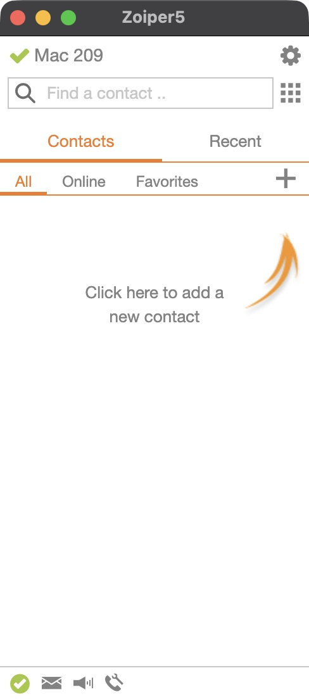

# A separate SIP line on a Mac

A softphone is a SIP application with its own extension and password. It is not a Cisco inventory entry: it has no fabricated MAC address, firmware requirement, SEP profile or TFTP dependency. Existing phones can dial a new `2xx` extension through the already generated `2..` pattern.

## Make a call in the installed setup

Open **Zoiper5** and use its existing **Mac 209** account. No second
application or public SIP-provider account is needed. Enter a connected phone's
three-digit extension and press **Return** to start an audio call.
For example, **210** reaches that phone's first line and **213** reaches the
second line of the 212/213 phone. Both line buttons are independently callable.
Dial **620** for the physical-phone group or **600** for the echo test. From a
Cisco phone, dial **209** to call the Mac.

Check the account indicator before dialing. A red registration error during a
PBX restart can persist until the client's next automatic retry. On the final
ten-phone rollout, the account recovered without a password or configuration
change, and the user's **209 → 210** call reached the phone's ringing state.
Allow reconnection and check `pjsip show contacts`; do not create duplicate
accounts to work around an outage. A disconnected physical phone cannot ring
even though its number and saved configuration remain valid.

### Linphone window behavior

Under **Settings → Calls settings**, enable **Keep the call view in background**
and save. This option is intended to keep the separate call window in the
background; verify that it remains selected after restarting the client.
Automatic answering and automatic recording are unnecessary for ordinary calls.

Linphone 6.2.3 does not provide a small telephone-style call window: its
[call-window source](https://github.com/BelledonneCommunications/linphone-desktop/blob/52d62ef470ec40a35585296b7de9c293f993e602/Linphone/view/Page/Window/Call/CallsWindow.qml#L13-L17)
sets a minimum of 1020 × 700 before applying screen scaling. This explains why
dragging its edges cannot make it a compact dialer. An audio-only call can still
use that large layout; switching the camera off does not remove the minimum
window size.

## Zoiper5: compact primary client

The installed primary client is **Zoiper5 5.6.15 Community Edition**, free for
noncommercial use. Download it from the [official macOS page](https://www.zoiper.com/en/voip-softphone/download/zoiper5/for/mac).
The package and application passed signature and Gatekeeper checks with
**Securax (8923WVMRDE)**, and the application and its helpers contain both arm64
and x86_64 code. No Rosetta installation was required.



Quit any other application using 209 before starting Zoiper: this endpoint has
one contact. Keep the previous client as a fallback, but do not run both with
the same identity. Choose **Continue as a Free user**, then enter the existing
`209@<PBX-private-IPv4>` and the saved password from the private softphone secret
file. Confirm the local PBX hostname and skip the unused outbound proxy. Use
**SIP TCP**, not UDP, to match this deployment.

On the tested installation, automatic detection reported “Not found” even
though TCP was reachable. **Skip** detection, choose **SIP**, and create the
local account manually with the already entered credentials. Give it the
friendly name **Mac 209**. The account then registered successfully. Do not
change firewall rules or create new credentials based only on the wizard's
probe result. Skip the camera setup wizard.

In version 5.6.15 the simplified interface settings are:

- **Settings → GUI → Appearance:** enable **Enable compact mode** and
  **Disable avatars**; disable **Enable animations**.
- **Settings → GUI → Behaviour:** enable **Collapse on hangup**; disable
  **Show PRO screen on start up**, chat blinking, contact-online popups and
  incoming-chat popups. Keep incoming-call notifications available.
- **Settings → Media → Video:** leave video disabled. The page should offer
  **Enable video**, rather than showing an active camera preview.
- **Settings → Media → Audio:** use the Mac's intended microphone and speakers
  or headset; retain echo cancellation for speaker use.

The [official guide](https://www.zoiper.com/pdf/User%20Guide%20Zoiper%205%20v.1.0.7.pdf)
uses older labels **Theme** and **Look and Feel** for the corresponding GUI
pages. Compact voice calls retain a narrow dialer and controls. Chat/video
functions can expand the window; use the ordinary audio call action.

During this deployment's UI verification, shrinking Zoiper5 through native
window automation reproduced blank content without a SIP call. Expanding it
back to its prior normal dimensions restored the contacts and registration
display without resetting the account. Compact mode controls the expanding
chat/history panel, not a fixed native window size, as described in the
[official manual](https://www.zoiper.com/pdf/User%20Guide%20Zoiper%205%20v.1.0.7.pdf).
The underlying cause remains unconfirmed. If this occurs, restore the last
working dimensions; no cache or account reset was needed in this case.

The tested macOS installation writes its local configuration to
`~/Library/Zoiper5/Config.xml`. Protect this file and backups as credentials;
do not publish them. The [official configuration schema](https://github.com/ZoiPer/public-docs/blob/Desktop/configuration-data.md)
documents account fields, but does not establish a safe plaintext-password
import procedure. Bootstrap through the normal account wizard, preserve its
account identifier and password representation, and verify a fresh registration
after any local edit. Paid remote provisioning is not required for this setup.

## Alternative clients and the previous Linphone setup

[Linphone](https://www.linphone.org/en/linphone-softphone/) is a free desktop
client with a modern interface and a
[Third-Party SIP Account](https://www.linphone.org/en/docs/login-sip-account/)
setup for this local PBX. The official stable release checked on 2026-10-17 is
**6.2.3**, available from the vendor's
[macOS download](https://download.linphone.org/releases/macosx/app/Linphone-6.2.3-mac.dmg).
Its release build targets both Apple Silicon and Intel. Verify the actual
installed application rather than relying only on the download name:

```sh
codesign --verify --deep --strict /Applications/Linphone.app
spctl --assess --verbose --type execute /Applications/Linphone.app
file /Applications/Linphone.app/Contents/MacOS/linphone
```

Use the application bundle's actual executable name if it differs. Microphone
access is required for speech; a public Linphone account is unnecessary for
registration to this PBX.

[Telephone](https://www.64characters.com/telephone/) is a small native macOS client. Its free tier supports ordinary calls; Telephone Pro is optional. The official [Mac App Store listing](https://apps.apple.com/us/app/telephone/id406825478) currently supplies version 1.6. The publisher added [Apple Silicon and the modern macOS interface](https://www.64characters.com/blog/) in that release. It supports SIP/TCP and [Opus, G.722, PCMA and PCMU](https://www.64characters.com/telephone/faq/).

The generated PBX profile permits G.722, PCMU and PCMA. An existing client
may still be configured for G.711 only: generating the PBX configuration
does not change the application's codec settings. Check those settings
and the actual negotiated call codec using the
[audio-quality guide](audio-quality.md); PBX-originated offers still allow
G.711 and do not guarantee a wideband call.

Install from the App Store. If the open-source `mas` command is already available, `mas get 406825478` acquires the free app; it may require the user's App Store session or macOS authorization. Do not enable Pro or change Apple account credentials to complete this setup. After installation, verify the application before entering a SIP secret:

```sh
codesign --verify --deep --strict /Applications/Telephone.app
spctl --assess --verbose --type execute /Applications/Telephone.app
file /Applications/Telephone.app/Contents/MacOS/Telephone
```

The official Store build is signed by Apple Mac OS Application Signing and contains an arm64 architecture. Verify these properties on the actual installed copy. Microphone access is required for speech; Contacts access is optional.

Telephone 1.6 registered successfully in this installation, but its first
numeric dial attempt hung in macOS Contacts authorization before reaching the
PBX. Its [numeric-token implementation](https://github.com/64characters/Telephone/blob/1.6/Telephone/ActiveAccountViewController.m#L499-L515)
calls the address-book API, and the upstream
[permission issue](https://github.com/64characters/Telephone/issues/530)
describes the main-thread authorization problem. There is no verified setting
that disables this lookup. A SIP URL follows the same token path. This is the
reason for first using Linphone for call acceptance on this Mac, before
switching to Zoiper for its smaller interface; it does not
mean Telephone registration failed.

## Declare a generic client

Add a `softphones` list to private `site.json`. This synthetic example uses extension 209 and a reserved example LAN address:

```json
"softphones": [
  {
    "extension": "209",
    "label": "Mac",
    "source_ipv4": "192.168.50.90",
    "transport": "tcp"
  }
]
```

All four fields are required; optional `room` supplies its directory and caller-ID name, for example `"Operator's Mac"`. Optional `codecs` selects an ordered, unique, nonempty subset of `g722`, `ulaw`, `alaw`; omission keeps `g722,ulaw,alaw`. Other unknown fields are rejected. The [room directory guide](phone-directory.md) covers room validation and the separate read-only software-client entry. Extensions are strings in `200..299`, unique across all Cisco lines and softphones. Labels use 1–24 ASCII letters, digits, spaces, underscores or hyphens. The source must be an explicit RFC1918 IPv4 literal; public addresses, hostnames, CIDRs, loopback and IPv6 are rejected. Transport is `tcp` or `udp`. Reserve the Mac's address through the existing DHCP system before relying on its exact `/32` permission.

The generator creates a separate `softphone-secrets.json`, mode `0600`, containing a stable random secret for each extension. Generated passwords are 24 URL-safe characters; existing passwords must have 24–30 letters, digits, `_` or `-`. They cannot duplicate another softphone password or a Cisco password. Back up this private file with the other credentials. Removing a client removes its runtime endpoint and route but retains its saved password for an intentional later re-addition.

Regenerate from the current canonical private configuration in a separate candidate directory, preserving all existing secrets:

```sh
python3 scripts/provision.py --site .local/candidate/site.json \
  --inventory .local/candidate/phones.json --out .local/candidate
python3 scripts/render_k3s.py --site .local/candidate/site.json
python3 scripts/preflight.py --site .local/candidate/site.json
```

For an installation with no physical Cisco devices, `--pbx-only` accepts the same optional softphone list and creates no Cisco inventory, TFTP files or `secrets.json`.

Each softphone gets one PJSIP endpoint, authentication object and dynamic AOR with one contact, symmetric RTP and `direct_media=no`. Its source ACL allows only its own `/32`. Both existing local SIP transports include the client `/32` for NAT classification; this does **not** add that address to Cisco endpoint ACLs. Preflight checks the exact generic endpoint, transport, source permission and direct-dial route, rejects stale removed clients, and keeps generic clients out of the private Cisco alert context.

The `home` context provides direct local calls and whichever service numbers are already enabled: echo 600, tone 601, group 620, Assist 630, legacy tone 640, radio and explicitly configured external test routes. A softphone appears separately in the gateway's read-only directory, but is not added to group 620, the Cisco device-control list, device management, or persistent Cisco timer/alarm targets. It can still call 620 to reach the physical phones. Existing DND checks also guard calls **to** its direct extension. Optional [generic endpoint controls](existing-endpoints.md) require a separate explicit opt-in; registration alone does not enable remote controls.

## Permit the exact client and register

Review the host guard and permit only the reserved Mac `/32` to PBX SIP TCP 5060 (or UDP 5060 if explicitly chosen) and UDP RTP 10000–10199. Preserve existing phone and HA permissions. Do not expose SIP through public ingress or expand Cisco source networks. No TFTP, DHCP option 150, firmware transfer, physical-phone reboot or new image is required. [Review the k3s deployment process](k3s-deployment.md) and use the existing Deployment field ownership and an idle maintenance window.

If the optional [external SIP guard](external-firewall.md) is installed, its INPUT
rules inherit local RTP sources from a captured raw-policy baseline. Updating
only the raw guard can therefore allow registration while blocking audio.
Update the baseline and the inherited INPUT source together, retaining the
existing external `ESTABLISHED`/`REPLY` restriction. For a TCP client the exact
change is two raw exceptions (TCP5060 and UDP10000–10199) and one inherited
RTP INPUT exception. Do not add the Mac to TFTP, AMI or UDP5060 permissions.
Check both complete policies before applying; preserve unrelated rules and
hook positions, and retain the previous scripts/configurations for rollback.

In Linphone choose **Third-Party SIP Account**, enter the PBX's private IPv4
address as the domain/server, use **209** as the username, and enter its saved
SIP password. If a SIP address is requested, use `sip:209@<PBX-private-IPv4>`.
Select **TCP**, port **5060**, to match the declared endpoint. Keep external
STUN/ICE/proxy services disabled for direct LAN use and use compatible
unencrypted media on the current local endpoint. SIP/TCP alone does not encrypt
calls. Keep only one client registered with this identity at a time.

For a working Telephone installation, its account setup uses:

- **Full Name:** the chosen display label, for example `Mac`.
- **Domain:** the PBX's private IPv4 address.
- **User Name:** `209`.
- **Password:** the saved secret for 209.

Set the account transport to TCP when the private declaration uses TCP. Use the existing PBX port 5060, leave external STUN/ICE/proxy services disabled for direct LAN operation, and keep media encryption compatible with the current unencrypted LAN endpoint. SIP/TCP alone does not encrypt calls. Telephone's [account implementation](https://github.com/64characters/Telephone/blob/master/Telephone/AccountSetupController.m) saves its password in the macOS Keychain. Do not put credentials in screenshots, shell arguments or public configuration.

## Configure Linphone from the existing private files

Linphone 6.2.3 also supports its documented `--fetch-config` option with a local
file URI. This avoids manually copying a password into the account form. The
[renderer](../scripts/render_linphone.py) reads the already declared softphone
and its saved secret; it creates no new account, changes no server settings,
and makes no network request.

Quit Linphone and other clients using this identity first. Back up
`~/Library/Preferences/linphone/linphonerc` privately. Inspect the existing
configuration before importing: the template uses `proxy_0` and `auth_info_0`,
so **do not import it over an existing account**. The renderer cannot inspect or
merge accounts in the application's configuration. It refuses to replace an
existing output file and requires a private, user-owned output directory.

```sh
umask 077
python3 scripts/render_linphone.py \
  --site .local/site.json \
  --secrets .local/softphone-secrets.json \
  --extension 209 \
  --output .local/linphone-import/account.xml
LINPHONE_IMPORT_URI=$(python3 -c 'from pathlib import Path; print(Path(".local/linphone-import/account.xml").resolve().as_uri())')
open -a Linphone --args --fetch-config "$LINPHONE_IMPORT_URI"
```

The standard XML configures the existing identity, matching SIP transport,
300-second registration refresh, IPv4 and transient provisioning. Its field
definitions come from the official
[Linphone provisioning reference](https://download.linphone.org/releases/docs/liblinphone/latest/c/group__group__provisioning__configuration__key.html).
The file URI option is implemented by the
[6.2.3 application](https://github.com/BelledonneCommunications/linphone-desktop/blob/52d62ef470ec40a35585296b7de9c293f993e602/Linphone/core/App.cpp#L1196-L1201).

After the application shows a green account and Asterisk confirms the exact
209 contact, check that transient provisioning cleared the stored provisioning
URI. Delete only the generated `.local/linphone-import/account.xml`; retain the
canonical softphone secret and private backup. Keep `linphonerc` private with
mode `0600`, since it holds account authentication data. The one-time XML must
never be committed or uploaded.

First confirm registration with `pjsip show endpoint 209` and `pjsip show contacts`. Registration alone is not an audio test. In an authorized call window, test echo 600, confirm bidirectional audio and clean hangup, then a call to and from a physical extension. Recheck existing contacts and providers after any PBX restart. Keep the Mac awake and the application running when expecting incoming calls; sleep and network changes require fresh registration.

## Installation verified on October 17, 2026

Zoiper5 **5.6.15** subsequently replaced Linphone as the primary client at the
operator's request for a compact interface. Its existing 209 account registered
over TCP. The operator confirmed audible echo on 600; the 18-second sample
showed PCMU with 880 received and 879 transmitted RTP packets and no reported
loss. The call ended cleanly. After a restart, the same account re-registered
and a call to the tenth phone, 220, reached `Ringing`. No answered physical-phone
audio claim is implied by that short routing test. A subsequent **221 → 209**
call was answered in Zoiper and exchanged PCMU/RTP in both directions with no
reported loss; the CLI then ended its exact Cisco call.

### Earlier clients


Telephone **1.6 (143)** passed signature and Gatekeeper checks and registered
209, but dialing encountered the Contacts issue described above. It was quit
with its Keychain account preserved. The replacement **Linphone 6.2.3** passed
Developer ID/notarization checks and was verified as universal arm64/x86_64.
Its local provisioning import created one account using the existing **209**
identity. The application showed a green account, and Asterisk confirmed one
reachable contact over TCP/IPv4.

A 20-second **209 → 600** echo call negotiated PCMU and exchanged RTP in both
directions with no reported loss in the sample. The operator confirmed audible
echo. The call ended cleanly and 209 remained registered. This establishes that
short local audio path; it is not a long-duration or every-device quality test.

The existing Wi-Fi private address was verified as Fixed and received an exact
DHCP reservation; no network renewal or phone reboot was needed. Both layers
of the PBX firewall were updated for only that client's SIP/TCP and RTP traffic,
preserving the other rules.

See the [live validation record](server-validation.md#mac-client-and-childrens-radio-expansion)
for call and audio acceptance results in addition to registration.
