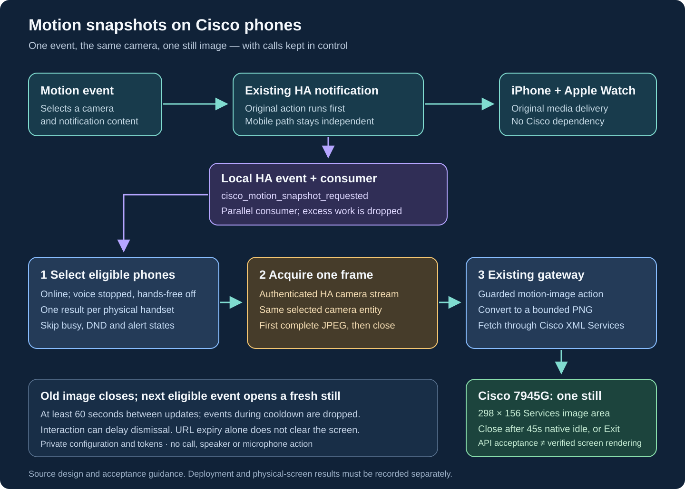

# Motion snapshots on Cisco phones

A Home Assistant motion notification can also show **one still image** on
configured, online, idle Cisco 7945G phones that have no gateway voice
profile. The original iPhone/Apple Watch notification runs first. It then
fires a local HA event; a separate automation invokes the snapshot helper.
A camera or phone failure cannot suppress the original notification.



This guide describes the implementation and its acceptance procedure.
Deployment verification and physical-screen acceptance must be recorded
separately. An API response saying `accepted` does not prove that a phone
rendered the image or that somebody saw it.

## What appears on the phone

The helper reads the first complete JPEG from the authenticated HA
`/api/camera_proxy_stream/<entity_id>` route, closes that response, and sends
one image to each eligible physical handset. The existing gateway converts
it to a PNG fitting the **298 × 156** Services image area. The page has an
**Exit** softkey. It does not place a call, play an alert, operate the speaker,
or enable a microphone.

Configure the **same camera entity selected for the mobile notification**.
For example, if mobile notifications use an HA camera that limits the stream's
frame rate or resolution, use that entity rather than its underlying raw
camera. The Cisco image comes from a separate request to that camera. It is
not guaranteed to be the identical frame that iOS received.

“First frame” means the first complete JPEG returned by this request. It does
not mean the first frame at the instant motion occurred. The event time shown
in the title is the original notification event time; it is not a verified
camera exposure timestamp. The source may itself supply cached imagery.

The title is limited to **32 characters**, as required by Cisco's
[displayable-object schema](https://www.cisco.com/c/en/us/td/docs/voice_ip_comm/cuipph/all_models/xsi/7_0/english/programming/guide/70xsi/xsi70sch.html).
Long camera labels are shortened so the complete UTC event timestamp remains
visible. A longer title can be accepted by the push endpoint while the phone
fails to display the image page.

This version sends a still, with no automatic slideshow or camera audio. It
does not forward an MP4, animated GIF or video call to the phone. The existing
[Camera Preview](camera-preview.md) is a separate, explicitly started feature;
a motion notification does not enable it. Cisco documents PNG display and
HTTP page refresh, but those interfaces do not establish native clip playback
on this model. See the [image object reference](https://www.cisco.com/c/en/us/td/docs/voice_ip_comm/cuipph/all_models/xsi/7_0/english/programming/guide/70xsi/xsi70obj.html)
and [HTTP interface](https://www.cisco.com/c/en/us/td/docs/voice_ip_comm/cuipph/all_models/xsi/7_0/english/programming/guide/70xsi/xsi70htp.html).

## Calls and hands-free take priority

Here, an eligible phone means a configured physical handset with current
online status and no observed call, DND or ringing-alert conflict. A phone
whose gateway inventory advertises the `voice` capability is always excluded
with reason `voice_configured`, even when momentarily idle or hands-free is
disabled. This deliberately avoids racing a voice-session renewal; there is
no override in this helper. Both line
numbers map to the same handset and are deduplicated. Selection occurs before
camera acquisition; no eligible destination means no camera request.

The gateway remains the authority for its current call and voice reservations.
The final image request also uses Cisco's native **Priority 2**, which executes
only if idle. A phone that becomes busy after preflight can therefore skip the
page. No delayed notification is queued for the end of a call.

**All voice-configured phones are skipped, including idle gaps between
sessions.** Online or powered on does not mean eligible. This feature never stops the assistant
or another call just to show a picture. Unavailable or ambiguous state is not
a reason to force the display. Backlight and native call-screen behavior still
require physical acceptance on the installed firmware.

## Install the helper and private configuration

The standalone [helper](../scripts/cisco_motion_snapshot.py) uses Python's
standard library and the existing gateway image action. It does not require
FFmpeg, Pillow in HA, a new SIP account, a firmware change or a gateway rebuild.
The deployed gateway still needs its normal image-conversion dependencies.

Install the helper as `/config/housekeeping/cisco_motion_snapshot.py` in the
HA runtime. For a deployment where the HA configuration directory is mounted
on the host, the equivalent copy is:

```sh
HA_CONFIG_DIR=/path/to/home-assistant-config
install -d -m 700 "$HA_CONFIG_DIR/housekeeping"
install -m 600 scripts/cisco_motion_snapshot.py \
  "$HA_CONFIG_DIR/housekeeping/cisco_motion_snapshot.py"
install -d -m 700 "$HA_CONFIG_DIR/.storage/cisco_motion"
```

Replace the host path; in Kubernetes, copy into the existing HA configuration
volume instead. Ensure that the HA runtime user can read the installed file
and own the private state directory. Do not replace an unrelated HA volume or
configuration. Keep the helper from the reviewed repository revision.

Copy [the sample configuration](../examples/motion-notifications.example.json)
to `/config/.storage/cisco_motion/config.json`, then edit it privately. A
minimal example is:

```json
{
  "version": 1,
  "gateway": {
    "base_url": "http://192.168.50.10:18084",
    "token_file": "gateway-token.txt"
  },
  "home_assistant": {
    "base_url": "http://192.168.50.20:8123",
    "token_file": "ha-token.txt"
  },
  "cameras": {
    "demo": {
      "entity_id": "camera.example_notify",
      "label": "Motion"
    }
  },
  "destinations": ["201", "203"],
  "state_directory": "state",
  "cooldown_seconds": 60,
  "max_event_age_seconds": 90
}
```

These addresses, labels and numbers are fictional. Relative token and state
paths resolve beside the JSON file. Store the **existing gateway API bearer
token** in `gateway-token.txt` and an **HA access token** in `ha-token.txt`;
they are different credentials. Configuration and token files must be private
owner-only files, normally mode `0600`; the state directory must be `0700`.
Keep all of them outside public Git. The sample contains no live credentials.

The gateway must allow the HA runtime's source address to use its API. Both
HTTP endpoints must be reachable from that runtime. Proxy environment
variables and HTTP redirects are not used; configure the final trusted
endpoint rather than a login or redirect URL.

- `destinations: []` selects no phones. `destinations: ["*"]` is an explicit
  all-phone candidate opt-in, bounded to ten physical handsets. Eligibility
  exclusions still apply, including `voice_configured`.
- `cooldown_seconds` is at least 60 seconds per physical phone, regardless of
  which camera triggered. This prevents two line numbers or repeated events
  from flooding the same screen.
- `max_event_age_seconds` defaults to 90 and cannot exceed 120. Do not replace
  the original trigger time with a later dispatch time to make a stale event
  look current.
- SQLite state stores event/destination metadata for deduplication and
  cooldown, not camera images. An accepted or uncertain operation is not
  automatically retried. Do not delete state to force an event to replay.

## Link the existing HA notification

The companion [HA package](https://github.com/ha-homelab/home-assistant/blob/main/config/packages/cisco_motion_notifications.yaml)
defines the `cisco_motion_snapshot_requested` event consumer and
`shell_command.cisco_motion_snapshot`. The consumer automation ID is
`ha_homelab_cisco_motion_snapshot`. Follow its
[HA installation guide](https://github.com/ha-homelab/home-assistant/blob/main/docs/cisco-motion-notifications.md)
for package loading, validation, reload and rollback. After validation, reload
shell commands with `shell_command.reload`, then reload the new consumer and
edited producer automations. Use targeted automation reload where the
installed HA service supports it. This integration does not add an HA script.
[HA documents shell-command reload](https://www.home-assistant.io/integrations/shell_command/).
Adapt approved camera keys to match your private JSON mapping; do not pass
arbitrary entity IDs, URLs or shell fragments through an event.

The event consumer runs with `mode: parallel`, `max: 4`, and drops excess work
instead of keeping a queue of stale frames. Its shell command invokes the
bounded helper in the foreground. **The producer only fires the event; it
does not wait for the consumer.** The HA package also respects the
deployment's notification-mute control. It uses neither `script.turn_on` nor
shell background operators for dispatch.

Append an event after the existing mobile notification action. This fictional
`demo` example must also be present in the package's approved key list and
private camera mapping:

```yaml
# Existing mobile notification action is above this addition.
- event: cisco_motion_snapshot_requested
  event_data:
    camera_key: demo
    event_id: '{{ trigger.to_state.context.id }}_demo'
    event_at: '{{ as_timestamp(trigger.to_state.last_changed) | int }}'
  continue_on_error: true
```

Use the actual original event identity and timestamp when an automation has a
different trigger shape. Event IDs must contain 8–96 ASCII letters, digits,
underscores or hyphens. Keep the call after the existing notification and
retain `continue_on_error`; the Cisco branch is optional. The worker has a
48-second operation budget and a 15-second source budget. Its parent starts
termination after 50 seconds and reaps the worker before returning, allowing
up to two additional seconds for termination and cleanup. Source reading stops after the first complete
JPEG of at most 2 MiB.

## Test without placing calls

Run these commands inside the HA runtime, substituting an approved camera
key. First inspect selection with a fresh event:

```sh
motion_event_epoch="$(date +%s)"
python3 /config/housekeeping/cisco_motion_snapshot.py \
  --config /config/.storage/cisco_motion/config.json \
  --camera demo \
  --event-id "check_${motion_event_epoch}_demo" \
  --event-at "$motion_event_epoch" \
  --dry-run
```

Dry-run reads inventory and performs preflight only. It does **not** fetch the
camera, send an image, or write deduplication/cooldown state. It still needs
valid private configuration, credentials and gateway access.

For a bounded physical test, temporarily select **one already-idle phone
without a gateway voice profile** in the private destination list and run a
fresh command without `--dry-run`.
Leave active calls and hands-free sessions alone. Confirm the picture, title,
legibility and Exit on the phone; an API acceptance result alone is
insufficient. Then restore the intended private destination list. Test a real
motion event separately and confirm that the original mobile notification
still arrives. Do not infer ten-phone acceptance from one device.

The gateway's image and XML URLs expire after **120 seconds**. This bounds
server resources; it does **not erase pixels already displayed**. A phone
may retain the last page until Exit or another UI event. The page is not an
ongoing camera monitor.

## Troubleshooting

- **No selected phones:** check `destinations`, inventory membership and the
  dry-run result. The helper deduplicates both lines of a handset.
- **`voice_configured`:** the phone has a gateway voice profile. It is excluded
  even if the assistant is disabled or between calls; there is no override.
- **Busy, DND or alert conflict:** skipping is expected. Do not bypass the idle
  rule or hang up a call to display the notification.
- **API accepted, but no picture:** the phone may have become busy, failed to
  fetch its temporary URL, or kept another screen in front. Check gateway and
  phone fetch evidence, then use an idle-device visual check. Avoid blind
  retries with new event IDs.
- **Duplicate, cooldown or stale event:** inspect the original event identity
  and time. A burst can intentionally reach no phones after the first event.
- **Camera failure:** verify the selected notification camera supports the
  authenticated proxy stream and supplies a complete JPEG within the source
  budget. A cached still is not proof of a recent camera exposure.
- **Permission or authentication failure:** check file modes, HA runtime
  ownership, the two separate tokens, endpoint addresses and the gateway
  client allowlist. Do not copy tokens into a shell command or public log.
- **No HA dispatch:** check the notification-mute control, approved camera
  keys, package loading and automation trace. At most four concurrent helper
  runs are admitted; overflow is intentionally dropped.

Disable this feature by removing its appended dispatch actions or setting
`destinations` to `[]`. That does not require changing the original mobile
notification, the camera, Asterisk, phone profiles or hands-free settings.
