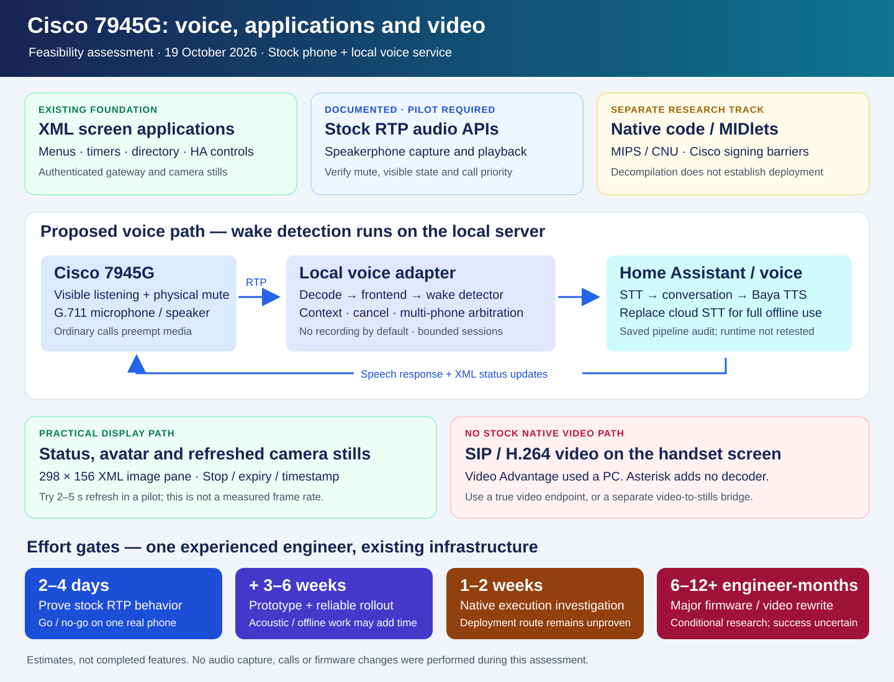

# Cisco 7945G: custom software, local voice activation and video

**Assessment date: 19 October 2026.** This is a feasibility study and an effort
estimate. Three parallel investigations covered firmware, voice and video.
No microphone was activated, call placed, firmware uploaded or phone changed
during this study. Existing deployment results are historical evidence, not a
new live acceptance test.

**Implementation follow-up:** the [stock-phone voice pilot](voice-rollout.md) now
contains working modules and separately recorded physical RTP evidence. This
original feasibility assessment remains the scope/effort reference.

## Decision

Build the first voice experience with the **stock phone's XML/RTP interfaces
and a local voice service**. The existing screen applications, authenticated
gateway, Asterisk and Home Assistant supply much of the foundation. Start with
a **2–4 engineer-day compatibility experiment** on one phone. If successful,
allow **another 3–6 engineer-weeks** for a useful, maintainable multi-phone
implementation. Local speech recognition, acoustic tuning and robust
interruptions can require additional work.

Investigating the firmware is practical. Installing our own native application
is a separate, currently unresolved problem. Do not make that problem a
prerequisite for the voice assistant. **Native SIP video on the 7945G is not an
available stock feature.** Still images and a low-rate picture sequence are
different, feasible display projects.

## Three different meanings of an application

| Approach | Where our code runs | Current position |
| --- | --- | --- |
| Cisco XML service | Local web/gateway server; phone renders XML | Already used for Home Apps, phone settings, directory, alarms and snapshots |
| Java MIDlet | Phone's Java environment | Supported by the model, but requires Cisco signing; our deployment/signing route is unresolved |
| Native code or modified firmware | Phone's MIPS/CNU environment | Requires executable loading, ABI/driver knowledge, build tooling and a viable authenticated deployment/recovery path |

Cisco explicitly lists the 7945G with SIP/SCCP firmware 8.4(1)+ for enhanced
services and **Cisco-signed Java MIDlets**. The documented allocation is **2 MB
for MIDlets, with each JAR limited to 512 KB**. An empty Applications list does
not mean that every type of application is unsupported. The available XML
Services SDK is not a CNU firmware build kit. No verified public route to sign
and install our own MIDlet was established in this investigation.
[Cisco enhanced services](https://www.cisco.com/c/en/us/td/docs/voice_ip_comm/cucmbe/rel_notes/7_1_3/cucmbe-rel_notes-713.html),
[Cisco developer's signing clarification](https://community.cisco.com/t5/other-collaboration-subjects/java-midlets-requirements/m-p/1205359/highlight/true),
[IP Phone Services SDK](https://developer.cisco.com/site/ip-phone-services/downloads/).

## What the actual firmware tells us

We inspected the existing private `SIP45.9-4-2SR4-3S` components offline. Their
sizes and SHA-256 values match the project's [recorded firmware manifest](firmware-archive.md).
The inspection did not modify or execute vendor code.

- `apps45.9-4-2SR4-3.sbn` contains 61 plausible ELF headers with class 32-bit,
  big-endian encoding and `e_machine = 8` (MIPS).
- `jar45sip.9-4-2SR4-3.sbn` contains another six such headers and embedded ZIP
  structure markers. The entire SBN is not an ordinary ZIP/JAR file.
- Native components include a Diab/MIPS compiler identification string.
- A gzip stream inside `cvm45sip.9-4-2SR4-3.sbn` decompressed successfully to
  6,815,252 bytes. This is evidence of inspectable packaging, not of a working
  native application toolchain.

Header counts are observations, not a claim that every executable has been
fully extracted, decompiled or linked. Java recovery may provide readable
classes; native decompilation provides approximate pseudocode. Neither
recreates original sources, drivers, build flags, signing keys or a reproducible
Cisco build environment.

Original security researchers describe the platform as **CNU, Cisco Native
Unix**, rather than a general Linux distribution. A direct teardown of an
older 7945G identifies 32 MiB RAM and 16 MiB flash. That board observation does
not establish the configuration of every hardware revision in this fleet.
Exact CPU speed, free heap, DSP interface and decoding headroom remain unknown.
[Original research](https://media.ccc.de/v/29c3-5400-en-hacking_cisco_phones_h264),
[physical 7945G teardown](https://goughlui.com/2022/11/28/teardown-cisco-7945-ip-phone-usb-5v-power-modification-power-consumption/).

### Why enabling SSH does not solve installation

Cisco firmware images are signed. Replacing an embedded JAR or native program
changes the authenticated image. The famous older phone compromise is not a
ready installation method for this release: Cisco records its core issue as
fixed in 9.4(2), with general Unix shell access removed and diagnostic SSH
interfaces retained. Clearing an old ITL, enabling SSH and obtaining permission
to run a newly built program are distinct operations. Do not downgrade newer
hardware to reproduce an old demonstration.
[Signed firmware requirement](https://www.cisco.com/web/software/282074289/50111/cmterm-7945_7965-sccp.9-2-1-readme.html),
[Cisco advisory and hardening](https://www.cisco.com/c/dam/en/us/support/docs/csa/cisco-sa-20130109-uipphone.html).

## Voice activation without replacing firmware

### The documented opportunity

The legacy Cisco XSI model matrix explicitly includes the **7945G** for unicast
and multicast RTP. `RTPTx` can transmit microphone audio and `RTPRx` can play
audio; the documented legacy format is G.711 mu-law with 20 ms packets.
Normal calls interrupt these streams, and transmit requests during an active
call are rejected. These are documentation findings; the exact behavior of our
installed SIP service release still needs physical verification.
[Cisco RTP URI reference and model matrix](https://www.cisco.com/c/en/us/td/docs/voice_ip_comm/cuipph/all_models/xsi/7_0/english/programming/guide/70xsi/xsi70uri.html).

The Component RTP API adds stream identifiers, stop events and a `sendReceive`
mode. Its schema mentioning G.722 does not prove that our phone supports G.722
through this API. Start the experiment with documented G.711 and treat the
Component API as a separate compatibility check.
[Cisco Component APIs](https://www.cisco.com/c/en/us/td/docs/voice_ip_comm/cuipph/all_models/xsi/7_0/english/programming/guide/70xsi/xsi70api.html).

Idle capture normally uses the speakerphone microphone and visible phone
indication; an attached/selected headset may affect routing. The handset
microphone is constrained by its hook switch. This is a **visible media session**,
not hidden listening and not necessarily a standing SIP call. Test the physical
Mute and Stop controls before unattended use.
[Cisco developer explanation](https://community.cisco.com/t5/audio-and-video-endpoints/recording-room-voice-while-phone-is-on-hook/m-p/3445908/highlight/true),
[microphone/indicator hardware explanation](https://www.cisco.com/c/dam/en/us/support/docs/csa/cisco-sa-20130109-uipphone.html).

### Proposed local service

1. Explicitly enable listening for a physical phone through the existing
   authenticated gateway. Maintain separate state from DND and auto-answer.
2. Receive allowlisted unicast RTP, decode G.711, handle loss/jitter and keep
   only a short in-memory pre-roll. Do not record room audio by default.
3. Resample 8 kHz to 16 kHz and run the matching frozen feature pipeline and
   custom wake-word classifier on the local server.
4. After a detection, play a cue, show Listening and send the bounded request
   to the selected Assist pipeline with per-phone conversation context.
5. Show Thinking/Speaking and return speech audio. Initial delivery can use
   turn-taking; reliable interruption during playback is a later acoustic gate.
6. Normal calls and ringing alerts take priority. Preserve explicit user stops;
   a reconnect must not silently override them. Coordinate with radio playback.
7. Arbitrate detections across multiple phones and existing voice devices so a
   single utterance does not produce several competing answers.

The existing custom Russian wake model is a potential server-side input, not
a ready MIPS binary. The saved model is itself an experimental release with
independent room-distance acceptance still pending. Its exact frontend and
embedding shape must be preserved.
G.711 removes frequency detail; resampling cannot restore it. Start with
telephony-degraded versions of existing permitted samples, then measure real
phone speech, background media and room distances. Existing voice-device
accuracy cannot be assumed to transfer to a desk phone.
[openWakeWord implementation](https://github.com/dscripka/openWakeWord).

Local wake detection does not guarantee fully offline conversation. The last
saved voice-pipeline configuration reviewed in this investigation still used
a cloud STT provider, although conversation and Silero Baya speech output were
local. A complete offline experience requires local STT selection, latency and
accuracy checks. This was a saved-configuration audit, not a fresh runtime
health assertion.

### Why a permanent call to 630 is not the complete design

Extension 630 is an existing, useful push-to-talk path. In the reviewed HA
2026.10.2 native VoIP implementation, audio initiates repeated STT turns rather
than this custom wake gate; TTS is accumulated before transmission. Keeping
that call open therefore does not reproduce the intended voice-device UX.
A dedicated adapter can instead use Assist's WebSocket pipeline and explicitly
manage wake detection, context, cancellation and playback.
[Reviewed HA VoIP implementation](https://raw.githubusercontent.com/home-assistant/core/2026.10.2/homeassistant/components/voip/assist_satellite.py),
[Assist pipeline API](https://developers.home-assistant.io/docs/voice/pipelines/).

### What must be proven on one phone

- Correct microphone source, visible indication, physical mute and user stop.
- Both lines retain ordinary call behavior; no assistant audio enters a call.
- Call/ringing/radio preemption and a deliberate return-to-listening policy.
- Stream lifecycle when the receiver, controller or network fails. A server
  watchdog alone cannot guarantee that an unreachable phone has closed its
  microphone; device timeout/stop behavior must be measured. Do not claim a
  hardware-enforced lease unless one is demonstrated.
- Recognition at agreed room distances, false wakes during radio/TTS, clipping
  and the effect of the 8 kHz codec. Collect measured results, not just examples.
- Audio echo and interruption quality. The advertised speakerphone echo
  canceller does not prove clean full-duplex audio through the application API.
- Ten-phone resource use and duplicate-wake arbitration with other voice devices.

If the RTP or acoustic gates fail, keep an external voice device as the
microphone/wake detector and use the Cisco for its screen and telephony. This
preserves most of the experience without depending on native phone execution.

## Screen applications and incoming video

The phone's panel is 320 x 240. The documented Services image area for the
7945G/7965G is **298 x 156**. The supported image object fetches a PNG; it is not
an H.264 video player. Cisco's Video Advantage arrangement uses an attached
PC for video. A `videoCapability` setting or a new Asterisk codec cannot add a
decoder to the phone.
[Cisco XML display matrix](https://www.cisco.com/c/en/us/td/docs/voice_ip_comm/cuipph/all_models/xsi/7_0/english/programming/guide/70xsi/xsi70obj.html),
[Cisco portfolio and Video Advantage](https://www.cisco.com/c/dam/global/de_de/assets/smb-partner-portal/vertriebliche-positionierung/index/downloads/cisco_products_quick_reference_guide_2008_summer_fall.pdf).

Already implemented in this repository:

- [Camera acquisition and 298 x 156 PNG conversion](../containers/asterisk/phone_apps_ha.py).
- [Camera menus and manual Refresh](../containers/asterisk/phone_apps.py).
- [Authenticated XML execution and temporary text/photo resources](../containers/asterisk/phone_gateway.py).

An assistant avatar, text answers and Listening/Thinking/Speaking pages can
reuse these functions. Start with status changes and static illustrations;
smooth sprite animation has not been established. A camera preview can use
timed refresh, initially trying one image every 2–5 seconds. That is a proposed
test interval, not a measured frame rate. Add a visible timestamp, Stop, expiry
and call-screen arbitration.

Cisco documents the HTTP Refresh mechanism. Its small POST payload limit also
favours pushing a short authenticated URL and fetching the actual XML/image.
The current gateway holds at most 64 temporary resources for 120 seconds;
repeated images need replacement/reuse and cleanup, not unbounded allocation.
[Cisco HTTP/Refresh API](https://www.cisco.com/c/en/us/td/docs/voice_ip_comm/cuipph/all_models/xsi/7_0/english/programming/guide/70xsi/xsi70htp.html).

For a doorbell with an existing HTTP camera snapshot, show a refreshed still
alongside call handling. For a source exposing only SIP video, a separate media
endpoint must receive the video and extract frames; that is substantially more
work and still produces pictures on the 7945G, not native video or lip sync.
Asterisk transports compatible video but does not transcode video formats.
[Asterisk media capabilities](https://docs.asterisk.org/Operation/Asterisk-Audio-and-Video-Capabilities/).

For real incoming video on the handset display, evaluate a genuinely
video-capable device. Cisco documents screen video on 8945, 9951/9971 and
8845/8865 MPP, with different firmware/camera requirements. These are comparison
candidates, not verified plug-and-play replacements or instructions to buy an
arbitrary Enterprise unit. Test SIP negotiation, H.264 profile/packetization
and the actual remote caller first.
[8945 specifications](https://www.cisco.com/c/ja_jp/products/collateral/collaboration-endpoints/unified-ip-phone-8945/data_sheet_c78-649595.html),
[phone-based video](https://www.cisco.com/c/en/us/td/docs/voice_ip_comm/cucme/admin/configuration/manual/cmeadm/cmevideo.html),
[8845/8865 MPP video](https://www.cisco.com/c/en/us/td/docs/voice_ip_comm/cuipph/MPP/common/ag_desk_mpp_6800_7800_8800/tpcc_b_cisco-ip-desk-phone-multiplatform/p881_m_vido-configuration-1131.html).

## Work estimate

These are planning ranges for **one experienced engineer working full time**,
using the existing stack and one accessible test phone. A day means roughly
eight engineering hours. Calendar time also depends on physical access,
acoustic samples and acceptance. Parallel research does not eliminate those
dependencies. Rows overlap; do not add every alternative together.

| Work package | Estimate | Exit criterion / dependency |
| --- | --- | --- |
| Polish button-to-630 and assistant status pages | 1–3 days | Existing voice path with clear state/error/cancel UI |
| Stock RTP compatibility gate | 2–4 days | Capture, playback, mute, stop, call priority and disconnect behavior measured on actual SIP firmware |
| Single-phone local wake/Assist/Baya prototype | 5–10 days after gate | Wake, cue, request, answer, context and explicit cancellation work |
| Household reliability and ten-phone integration | 10–20 further days | Per-phone settings, arbitration, failure recovery, monitoring, documentation and acceptance |
| Fully local STT selection/integration | 2–5 additional days | No cloud STT leg; measured Russian quality and latency on available hardware |
| Telephony-specific wake model adaptation | 3–10 days plus sample collection | Measured false-wake/miss behavior at agreed room distances |
| Robust speech interruption during loud playback | 5–15 additional days | Acoustic loop, echo, self-triggering and stop latency meet targets; success uncertain |
| Status/avatar display as a separate feature | 3–7 days including hardening | No loss of call controls or stale state; overlaps voice UI work |
| Automatic camera still refresh | 3–5 days | Bounded resources, fresh timestamps, Stop/expiry and stable phone behavior |
| Incoming-call preview from an existing camera snapshot | 3–7 days | Correct call association and acceptable call-screen coexistence |
| SIP-video-to-picture gateway | 5–10 day proof of concept; 2–4 weeks maintainable | Video endpoint, frame extraction and call association; still no native handset video |
| Video-capable replacement endpoint integration | 1–3 day prototype; 3–7 days integration | Matching firmware, SIP/video interoperability and actual caller tested |
| Offline firmware/Java/ABI map | 3–7 days | Component map and identified loading/audio/display boundaries; no deployment promise |
| Native/MIDlet execution gate | 1–2 weeks time-box | Reproducible build, permitted deployment, restart persistence and recovery demonstrated |
| Minimal native UI/transport application | 4–8 weeks after a successful execution gate | Working application and verified driver/API access |
| Wake inference on the phone itself | Another 4–8 weeks, conditional | MIPS runtime/frontend port, CPU/heap benchmarks and reliable audio coexistence |
| Substantial replacement firmware or native video stack | 6–12+ engineer-months, highly uncertain | Drivers, DSP, loader, media stack, display performance and recovery all solved |

The native execution gate is a **bounded investigation**, not a promise that a
signing/deployment route can be obtained in two weeks. If it fails, the native
branch stops. A small keyword model might fit after optimization, but model
size alone does not resolve CPU, audio access, ABI or deployment. Running a
modern full ASR/LLM/TTS stack on this phone is outside the proposed scope.

## Proposed implementation order

1. Keep the current signed firmware and existing phone services as the baseline.
2. Run the 2–4 day stock RTP gate with explicit visible listening on one phone.
3. Reuse the existing wake model/voice backend, with an adapter rather than a
   firmware rewrite. Benchmark the saved model with telephony audio first.
4. Build one-phone turn-taking, status display, Stop and call/alert priority.
5. Replace the cloud STT leg if full offline processing is required.
6. Add measured acoustic tuning, multi-device arbitration and gradual rollout.
7. Add camera stills independently. Use a video endpoint for true video calls.
8. Pursue native reverse engineering only as a separate research investment,
   with its own stop gate and a spare phone.

Public documentation contains no household wake phrase, private model weights,
room inventory, addresses, account details or vendor binaries. Detailed local
binary inspection and deployment-specific observations remain under `.local/`.
