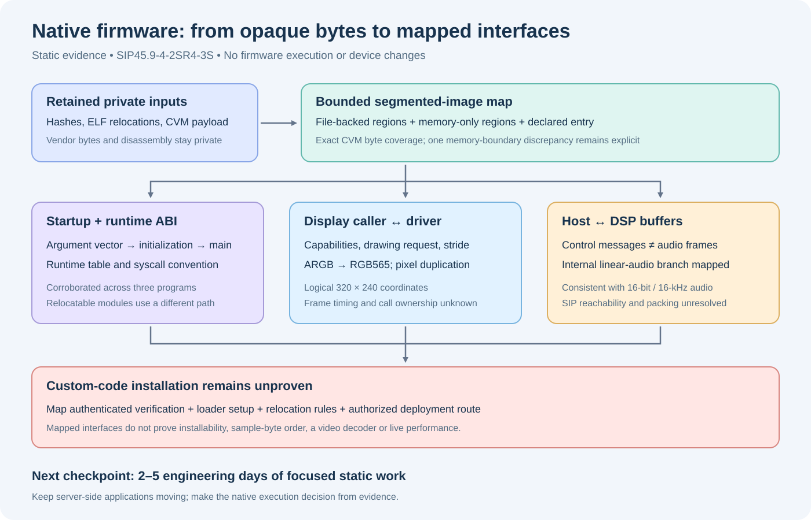

# Native firmware: recovered interfaces and the next decision

Assessment: **20 October 2026**, using the retained SIP45.9-4-2SR4-3S files.
This is a static-analysis result. No firmware was executed, emulated, patched,
installed or sent to a phone. Private reports retain the exact input hashes,
file offsets, declared addresses, relocations and selected disassembly. Vendor
code, extracted strings and household data are not included in this document
or its synthetic tests.

The investigation now has a reproducible image map and corroborated startup,
display and DSP interfaces. The remaining native-application blocker is an
authenticated installation path and a complete loader/build contract. The
existing server-side applications can continue independently.



## What advanced

### The previously opaque CVM payload has a bounded address map

The expanded payload fits an observed big-endian segmented layout: a fixed
prefix, a bounded table of region descriptors and sequential file-backed
regions. Its five descriptors account for all **6,815,252 bytes**, distinguishing
one code-like region, two initialized-data regions and two memory-only regions.
The same structural interpretation fits ten additional candidates in retained
application, CNU and DSP components. A different DSP-shaped object sharing the
marker fails this parser; a marker match is deliberately insufficient.

The first three words of the code-like region agree with its declared entry,
code end and initialized-data end. Its fourth word is eight bytes beyond the
declared memory end. Startup code uses that word as the third argument to the
application and clears BSS up to that boundary. This discrepancy is preserved
as evidence, rather than hidden by changing the region sizes. Loader-side
allocation of those extra bytes remains unexplained.

This map allows meaningful caller tracing inside CVM. It does not authenticate
an SBN container, identify all signed bytes or authorize loading a new image.

### Startup and runtime linkage are more specific than “MIPS”

Three symbol-bearing programs agree on a four-word startup header, an incoming
argv-shaped vector, BSS clearing, runtime initialization, conversion to the
usual `main` arguments and an orderly exit path. Shared-library wrappers use a
fixed runtime table and preserve the caller's global-pointer register. The
observed system-call interface passes a selector and an argument-block pointer;
it must not be replaced with an assumed Linux MIPS calling convention.

A separate module uses section-relative addresses, explicit relocations and
registration metadata even though its ELF header says `ET_EXEC`. Its module
callback distinguishes start, stop and a third event. The loader's relocation
rules, global-pointer initialization and memory ownership are still incomplete.
A generic cross-compiler is therefore not yet a reproducible phone toolchain.

### The display route has matching callers and a driver

The CVM image opens a display device and sends capability and drawing requests.
The LCD module registers that same device and dispatches the same commands.
Caller stores agree with a six-word drawing request; driver code reveals a
40-byte surface object, allocation/free behavior and byte-stride fields.

The observed drawing loop converts numeric ARGB words to RGB565 and duplicates
pixels in both directions. It exposes logical **320 × 240** coordinates while
allocating a **640 × 480, 16-bit internal surface**. That internal allocation is
not evidence of a higher-resolution physical panel. Edge/padding conventions,
display ownership during calls, tearing and throughput remain unmeasured.
No handset video decoder was established.

### DSP control and audio frames are different paths

A retained host program and the DSP module agree on distinct control-message
and frame-transfer paths. Control messages use 96-byte entries. Audio frames
have a 12-byte header and a length-described, aligned payload; the host provides
a 320-byte receive capacity. Shared-memory addresses and queue indices are
visible. DMA behavior is not established by these CPU copy routines.

The separate audio-device module exposes hardware-control operations; its
read/write slots are stubs. It should not be treated as an immediately usable
PCM device. The DSP interface also has an exclusive-open check, making sharing
with the stock call engine an unresolved requirement.

One internal media-type branch selects a linear-codec category and matching
encoder/decoder parameters: **320 bytes, a 160-count value and a duration value
of 10**. This is code-backed evidence consistent with 16-bit, 16-kHz linear
audio. Sample signedness, channel layout, sample-byte order and the precise
duration/count units are not fully established. These internal constants do
not prove that a particular SIP offer or XML request reaches the branch.
Wire-level L16 interoperability is a separate experiment.

### Application verification has a visible boundary

The CVM MIDlet-verification wrapper submits a request containing the filename,
signature data and signature length. It distinguishes verification success,
verification failure and request failure before returning to its caller. The
underlying verifier and authenticated byte coverage are not yet mapped.

Three dynamic-library helper bodies associated with open, symbol lookup and
close log a request and return zero in this image. Their callers are present.
This closes one plausible native plug-in lead; it is not proof that every
loading mechanism on the phone is absent. No signing bypass, trust-anchor
change or downgrade is part of this work.

## Reproduce the public layout recognizer

Use Python 3.10 or later from the repository root. This tool requires only the
standard library. Supply your own legally retained input; it downloads nothing.
The existing [firmware lab](firmware-lab.md) describes how the earlier private
extraction produced the expanded payload.

```bash
mkdir -p .local/native-map
python3 -m tools.firmware_lab.native \
  --input .local/firmware-lab/sr4-3-review/0061.bin \
  --output .local/native-map/cvm-map.json
```

For a candidate embedded in a larger file, add `--offset` with its known decimal
or hexadecimal byte offset. The report records absolute input-file offsets,
declared memory ranges, complete input/candidate hashes, the consumed span and
unconsumed suffix length. Translation helpers refuse a request spanning two
regions and return no file offset for a memory-only region.

Limits are 64 MiB of input, 64 descriptors and 256 MiB of declared memory.
Unknown kinds, unordered kinds, overlapping memory ranges, truncated payloads,
unaligned regions and arithmetic beyond a 32-bit address space are rejected.
Memory-only bytes are never allocated. A suffix is allowed because a candidate
may be embedded; the caller must inspect it rather than assume it is padding
or a signature. Header cross-check failures remain explicit observations.

Output must be beneath a `.local` directory. Existing output files, symlinked
output parents, parent traversal and symlinked input files are refused. Reports
are written with mode `0600`; no vendor payload is extracted. Choose a new
output name for each run.

Run the synthetic regression tests with:

```bash
python3 -m unittest tests.test_firmware_lab_native -v
```

The private ABI/DSP/display analyses additionally used Capstone 5.0.6 and
pyelftools 0.32. They do not belong in the runtime dependencies. Their reports
separate section-relative module offsets from image-declared addresses and
preserve undecoded instruction words where applicable.

## Next experiments and effort

The next useful checkpoint is **2–5 engineering days** of focused static work,
not another broad scan. This is a planning estimate, not a delivery promise:

1. Trace the identified verification request into its receiving service and
   recover the authenticated input contract and success/failure ordering.
   Stop with an explicit unresolved boundary if the responsible component
   cannot be mapped; do not substitute guessed verification patches.
2. Identify the loader's global-pointer, stack, environment and relocation
   setup, including the eight-byte CVM memory-boundary discrepancy. Produce a
   newly authored, offline structural build specimen only after these agree.
3. Follow the internal linear media type from the SIP/XML boundary to the
   recovered host branch, including sample packing and ownership. Correlate
   with the separate L16 interoperability result without treating either as
   proof of the other.
4. Use the [synthetic framebuffer model](framebuffer-model.md) to compare safe
   count-based rectangles with the observed inclusive, grouped-access
   hypothesis. Its tests check byte spans, color conversion and explicitly
   declared padding; the native caller's padding contract remains unresolved.
   Native frame timing and call coexistence remain later hardware acceptance
   gates.

A dedicated reverse-engineering chat would materially help maintain these
cross-references and isolate this research from normal application delivery.
One owner and two or three bounded analysts are sufficient for the next
checkpoint. More parallel coding cannot supply a missing signing entitlement.
Retain the earlier **1–2 week native-execution investigation time box**; continue
toward installation only with a credible authorized loader/signing route and
a matching build contract. Until then, native execution remains unproven.

See the [original feasibility assessment](native-app-feasibility.md) for the
larger effort ranges, and [firmware lab](firmware-lab.md) for the retained-input
and public-artifact policy.
