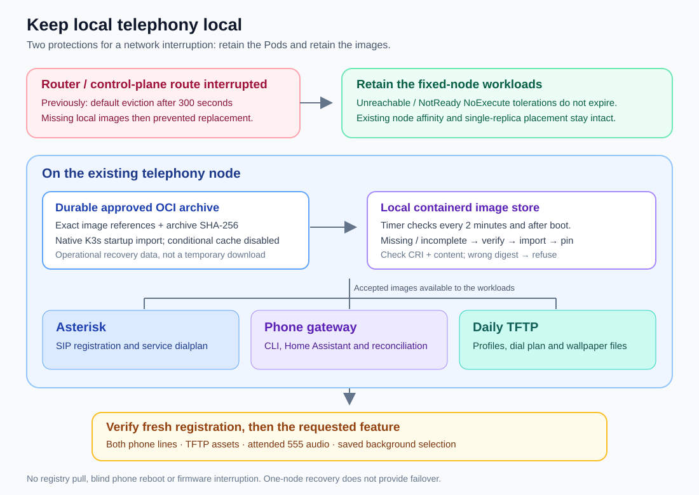

# Recovery after a router or network interruption

The local PBX, gateway and daily profile server must keep working through a
temporary loss of the route to the Kubernetes control plane. They also need a
durable local copy of their container images. A cached image alone is not a
recovery plan when its name begins with `localhost/` and no registry serves it.



## What the November 2026 incident established

A router interruption left the telephony node temporarily unreachable from the
control plane. The default 300-second `NoExecute` tolerations allowed its
fixed-node Pods to be evicted. Their replacements could not start because their
exact `localhost/...@sha256:...` images were missing from the local image store;
pulling those names from a nonexistent local registry failed. Asterisk, the
gateway and TFTP therefore became unavailable together. Phones remained at
**Registering**, and the time service could not work.

The telephony node had approximately 13 days of uptime: this incident was **not a
reboot of that node**. The observations do not establish why the cached images
were missing. They do not justify attributing their removal to a particular
cleanup command or garbage-collection event.

One phone also lost its selected background. An unavailable TFTP server can
prevent a requested image from being retrieved, but that observation alone does
not establish whether its saved selection changed. Recover image availability
first, then inspect the phone's selection.

## Two complementary protections

The generated fixed-node Asterisk, gateway and persistent profile-server Pods
tolerate the `node.kubernetes.io/not-ready` and
`node.kubernetes.io/unreachable` `NoExecute` taints without an expiration. Their
existing node affinity remains in force. This avoids replacing otherwise useful
local Pods merely because the control-plane route is temporarily unavailable.
It does not create failover or redundancy: an actually failed node still needs
repair. A bounded firmware maintenance Job retains its separate lifecycle.

The second protection is a small, explicit image set stored outside containerd's
disposable cache:

1. Keep a verified OCI archive under the node's actual K3s
   `<data-dir>/agent/images/` directory. K3s imports these archives at startup.
   Do not enable conditional imports with `.cache.json` for this setup: skipping
   an unchanged archive can leave a previously removed image missing.
2. The [image-cache helper](../scripts/telephony_image_cache.py) checks the local
   containerd namespace `k8s.io` and the container runtime interface used by
   kubelet. If an approved image is unavailable or incomplete, it verifies
   the archive and imports it locally. A reference already pointing to a
   different digest causes a refusal, not an overwrite.
3. The helper pins only the exact configured references with
   `io.cri-containerd.pinned=pinned` and its own ownership label. A
   [systemd timer](../deploy/telephony-image-cache.timer) checks after boot and
   every two minutes, so a missing image can also be restored without restarting
   K3s. Healthy checks do not repeatedly hash large archives.

The helper uses no registry, Internet connection, Kubernetes API, phone controls
or service restart. It cannot repair disk failure, a changed node address,
broken DHCP/firewall rules or missing Kubernetes configuration. Local image
recovery does not promise that a newly booted node can recreate every ordinary
Pod while the control plane is absent.

K3s documents [startup image imports and the conditional-cache tradeoff](https://docs.k3s.io/installation/airgap).
The November incident did not exercise a subsequent full node reboot or provide
new acoustic acceptance; those remain separate checks.

The installed recovery helper was exercised with a disposable image reference:
its metadata was removed, then a sandboxed systemd invocation restored it from
the approved local archive and verified CRI visibility and pinning. Production
image references and running containers were preserved. All three powered
Cisco phones subsequently had fresh registrations for both lines. The clock
service also generated its configured speech and 16 kHz playback file in a
silent server-side check; no test audio was sent to a handset.

## Prepare the approved image archive

Run these commands on the intended Linux telephony node. All paths and image
names below are examples. Confirm the actual K3s data directory, node
architecture and deployed image references first. The helper supports
`linux/amd64` and `linux/arm64`; it calls `/usr/local/bin/k3s`.

Use the exact images from both `containers` and `initContainers` in the live
Deployments. Include every required distinct image, not just Asterisk. Preserve
their existing manifest digests, provenance and private configuration. An OCI
manifest digest is different from a container configuration/image ID.

Include any required canonical references and runtime aliases in both the
export and the approved configuration. Earlier manual imports can leave a
normalized name such as `docker.io/library/import-YYYY-MM-DD@sha256:...` in CRI
metadata. Record the actual reference; do not invent or guess an alias. Matching
`ctr images list` output alone does not prove the image is usable by kubelet:
CRI visibility and complete local image content must agree too.

Do not rebuild an image simply to repair its missing cache entry. Recover the
accepted artifact from its verified release archive or another trusted copy.
If the exact images are still present on the node, export them:

```bash
set -e
# First install the reviewed helper from this checkout.
sudo install -o root -g root -m 0755 scripts/telephony_image_cache.py \
  /usr/local/sbin/telephony-image-cache

# A staging directory outside K3s' watched images directory avoids partial imports.
sudo mkdir -p /var/lib/cisco-telephony-image-cache/staging
sudo chmod 0700 /var/lib/cisco-telephony-image-cache/staging

pbx_image='localhost/cisco-home-telephony/asterisk@sha256:REPLACE_WITH_EXACT_DIGEST'
tftp_image='localhost/cisco-home-telephony/tftp@sha256:REPLACE_WITH_EXACT_DIGEST'
voice_image='localhost/cisco-home-telephony/voice-wake@sha256:REPLACE_WITH_EXACT_DIGEST'

# Add any required approved CRI aliases as further exact-reference arguments.
sudo /usr/local/bin/k3s ctr --namespace k8s.io images export \
  --platform linux/amd64 --skip-manifest-json \
  /var/lib/cisco-telephony-image-cache/staging/cisco-telephony.tar \
  "$pbx_image" "$tftp_image" "$voice_image"
sudo sha256sum /var/lib/cisco-telephony-image-cache/staging/cisco-telephony.tar
```

Use a standard OCI archive, not a Docker `save` archive. The helper accepts the
standard `ctr export` layout, including `blobs/` directory entries and the
`@sha256:...` short annotation paired with a full `io.containerd.image.name`.
Every full name must exactly match the approved set. Unrelated images, undeclared aliases,
symlinks, traversal paths, missing blobs and inconsistent hashes are rejected.
The archive contains images only; do not add phone profiles, credentials,
firmware, model caches or runtime state.

Copy the [configuration example](../deploy/telephony-image-cache.example.json)
to a root-owned file at
`/var/lib/cisco-telephony-image-cache/staging/cache.json`. Replace all placeholders
with the archive checksum and exact image references. At this stage its `path`
must point at the staging archive. Set mode `0600`; archive files and all parent
directories must be root-owned, with no group or other write permission or
symlink components.

Validate the complete archive before placing it in K3s' watched directory. This
uses the installed helper's validators without making a runtime call:

```bash
sudo python3 - <<'PY'
import runpy
m = runpy.run_path('/usr/local/sbin/telephony-image-cache')
config = m['load_config']('/var/lib/cisco-telephony-image-cache/staging/cache.json')
for archive in config['archives']:
    with m['open_trusted'](archive['path'], m['MAX_ARCHIVE']) as stream:
        m['verify_archive'](stream, archive, config['platform'])
print('Approved OCI archive and exact image references verified.')
PY
```

## Install automatic recovery

The following example uses the default K3s data directory. If `.cache.json`
already exists there, stop and review its use; do not silently remove another
workload's configuration or claim that every archive will be reimported.

```bash
set -e
sudo mkdir -p /var/lib/rancher/k3s/agent/images
sudo test ! -e /var/lib/rancher/k3s/agent/images/.cache.json
# This is a first-install example. Review an existing installation separately.
sudo test ! -e /var/lib/rancher/k3s/agent/images/cisco-telephony.tar
sudo test ! -e /etc/cisco-telephony-image-cache.json

# Keep staging and destination on the same filesystem for an atomic rename.
# If they differ, copy to a temporary non-watched path on the destination
# filesystem, verify that copy, and only then rename it into agent/images.
sudo mv -n /var/lib/cisco-telephony-image-cache/staging/cisco-telephony.tar \
  /var/lib/rancher/k3s/agent/images/cisco-telephony.tar

sudo python3 - <<'PY'
import json, os
from pathlib import Path
source = Path('/var/lib/cisco-telephony-image-cache/staging/cache.json')
value = json.loads(source.read_text())
value['archives'][0]['path'] = '/var/lib/rancher/k3s/agent/images/cisco-telephony.tar'
target = Path('/etc/cisco-telephony-image-cache.json')
# Refuse to replace an existing installation without separately reviewing it.
fd = os.open(target, os.O_WRONLY | os.O_CREAT | os.O_EXCL, 0o600)
with os.fdopen(fd, 'w') as output:
    json.dump(value, output, indent=2)
    output.write('\n')
PY

sudo /usr/local/sbin/telephony-image-cache --apply --verify-archives
sudo install -o root -g root -m 0644 deploy/telephony-image-cache.service \
  deploy/telephony-image-cache.timer /etc/systemd/system/
sudo systemctl daemon-reload
sudo systemctl enable --now telephony-image-cache.timer
sudo /usr/local/sbin/telephony-image-cache --check
sudo systemctl status telephony-image-cache.timer --no-pager
```

The helper reports `ready` only when the configured images have matching
digests, complete local content, usable CRI metadata and the expected
pin/ownership labels. `unavailable` is exit status 1;
invalid input, an unexpected target or an unsuccessful operation is status 2.
Failures retain a concise reason in the journal. Do not retry by deleting images
or changing a digest to whatever happens to be available.

```bash
sudo journalctl -u telephony-image-cache.service -n 30 --no-pager
sudo /usr/local/sbin/telephony-image-cache --check --verify-archives
```

The durable archive and `/etc/cisco-telephony-image-cache.json` are operational
recovery dependencies, not disposable downloads. After acceptance, remove the
now-unused staging configuration and empty staging directory. Retain only the
current approved archive plus any specifically required rollback set. Updating
the archive/configuration is an explicit maintenance operation; the timer does
not discover new images or promote releases.

## Verify the PBX, phones and background

1. Check node reachability and the three telephony Deployments. Confirm their
   actual containers are Ready, not merely that images are listed. Inspect
   `ImagePullBackOff`, init-container errors and events before touching phones.
2. Verify the daily TFTP listener, current profiles, dial plan and all three
   wallpaper files: `Desktops/320x212x16/List.xml`, `home.png` and
   `home-thumb.png`. Keep the exact-source firewall restrictions. Do not add
   firmware to the permanent profile root.
3. Verify DHCP reservations, network mask and option 150 if addresses changed.
   Then inspect fresh Asterisk SIP contacts for both lines on each powered
   phone. Old contacts or a responsive web interface are not registration proof.
4. Let the phones retry registration after service recovery. Do not repeatedly
   reboot them. Never interrupt an **Upgrading** screen or take ownership away
   from an active firmware transfer.
5. Once registered, verify the time-service dialplan and its dependencies.
   Where configured, call `555` from one attended phone and confirm spoken time;
   a CLI `accepted` receipt alone does not prove audio. A silent server-side
   check is useful but is not acoustic acceptance.
6. If a background remains missing after its TFTP assets are available, inspect
   **Settings → User Preferences → Background Images**, preview the intended
   image and save/select it. Background selection is a phone preference;
   restoring TFTP availability does not prove that the selection was restored.

See [daily phone boot](daily-phone-boot.md),
[static phone addresses](static-phone-addresses.md) and
[the deployment checks](k3s-deployment.md) for their full procedures.
