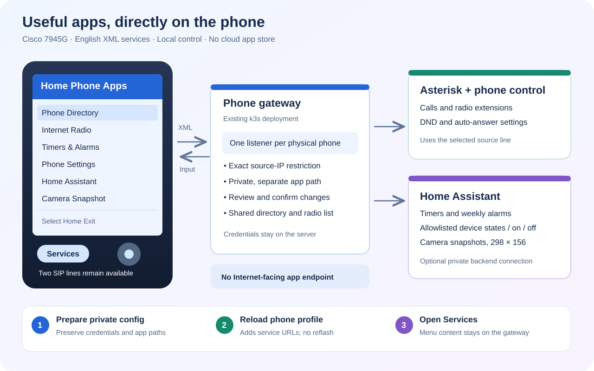

# Applications on the Cisco 7945G



**Home Apps** adds an English menu to the phone's **Services** button. **Phone
Directory** is also registered on the **Directories** button beside the native
Missed Calls, Received Calls and Placed Calls lists. Both SIP line buttons remain
available. The menu works on the phone screen; it does not require a browser,
smartphone or installation of an APK.

The phone renders small Cisco XML documents served by the existing private
gateway. Cisco explicitly lists the 7945G among phones supporting menu, input,
text, directory and image objects. Separately, the firmware's Applications list
can contain installed **Cisco-signed Java MIDlets**. This project supplies XML
services, not a signed MIDlet, so an empty installed-applications list does not
mean Home Apps is missing. See Cisco's [XML object support](https://www.cisco.com/c/en/us/td/docs/voice_ip_comm/cuipph/all_models/xsi/7_0/english/programming/guide/70xsi/xsi70obj.html)
and [enhanced phone services, including supported SIP phones and signed MIDlets](https://www.cisco.com/c/en/us/td/docs/voice_ip_comm/cucmbe/rel_notes/7_1_3/cucmbe-rel_notes-713.html).

## Use the menu

Press **Services**. On the tested SIP firmware this opens **Home Phone Apps**
directly; if a service list appears, choose **Home Apps**. **Home** returns
to the main menu and **Exit** closes it. The main menu shows the selected source
line; **Select line** switches between the two numbers on this physical phone.
The default is the first line. Selecting a different line cannot control a
different phone.

- **Phone Directory** includes every configured local phone line, softphone and
  enabled service number. Private room names come from the existing inventory.
  Longer lists have Previous page and Next page entries.
- **Internet Radio** lists enabled stations from the shared service catalog,
  including children's stations when enabled in the site configuration. Select
  a station, review the source/destination, then confirm the call.
- **Timers & Alarms** shows the current schedule, starts or cancels a timer,
  sets a weekly alarm, enables/disables a saved alarm and stops a ringing alert.
- **Phone Settings** controls Do Not Disturb and persistent auto-answer for the
  physical phone, affecting both lines, and can stop its current ringing alert.
- **Home Assistant** shows only the explicitly configured entities. Selected
  lights, switches and input booleans can have separate on/off commands.
- **Camera Snapshot** displays one still image from an allowlisted HA camera.
- **Phone Status** shows registration, DND, auto-answer, active calls and alert
  status without displaying SIP passwords, management credentials or HA tokens.

Changes and calls require a separate **Confirm** selection. Merely opening a
menu or submitting a form does not execute an action. Confirmations expire after
90 seconds and are consumed once, including when a dependency fails. Reopening
the menu creates a new confirmation; do not blindly repeat an operation after
an uncertain outcome. Confirmations are short-lived memory state and do not
survive a gateway restart.

### Timers and recurring alarms

Scheduling uses the existing `cisco_phone_control` Home Assistant integration,
not a second scheduler. Its configured HA time zone applies. The app accepts
timer durations from **1 to 1440 minutes**. For an alarm, enter **HHMM** in 24-hour
time, such as `0730`, and days as digits **1–7**, Monday through Sunday. Examples:
`12345` for weekdays, `67` for weekends, `1234567` for every day. Review the
confirmation before applying it.

There is one timer and one saved alarm per physical phone. Their owner is an
exact line. If an existing schedule belongs to the sibling line, select that
line to operate on it; the menu does not silently take ownership. **Enable saved
alarm** and **Disable saved alarm** never invent an alarm: when no alarm exists,
the response explicitly says it is not configured. **Set and enable weekly
alarm** is the explicit creation operation.

Alerts ring until manually dismissed or stopped, subject to registration,
network and PBX availability. Persistent auto-answer is excluded from alert
calls. **Stop ringing alert** stops the exact current alert; it does not cancel
future weekly occurrences. **Cancel timer** cancels the pending timer and its
active timer alert. **Disable saved alarm** disables future occurrences and
stops its active alarm. See the full [alert ownership contract](phone-gateway.md#alert-identity-and-manual-stop).

## Install into an existing deployment

Use the updated repository image and the existing persistent gateway from the
[gateway installation guide](phone-gateway.md). The Python tools run from the
repository root. All paths below are private examples; adapt filenames to your
existing deployment. Keep the matching inventory, gateway state, AMI secrets,
SIP secrets and SSH secrets backed up together.

The migration helper reads the existing gateway and inventory, verifies every
device/line/callback mapping, and writes a **new directory**. It preserves all
existing credentials and any existing application paths. For a phone without an
application path, it creates a separate random 256-bit path. Inputs must be
regular private files with mode `0600`; symlinks and overwrites are refused.

```bash
umask 077
python3 scripts/configure_phone_apps.py \
  --gateway .local/gateway.json \
  --inventory .local/phones.json \
  --output .local/apps-candidate
```

Outputs are `.local/apps-candidate/gateway.json` and
`.local/apps-candidate/phones.json`. Running again against those outputs and a
different new output directory keeps the same per-phone URLs. It never rotates
them because a command was rerun.

For HA scheduling, entities and camera snapshots, first prepare a private HA
configuration based on [the synthetic sample](../examples/phone-apps-ha.example.json).
Supply the real HA base URL, private long-lived access token and config entry ID
of the existing **Cisco Phone Control** integration, not the separate Asterisk
integration. Replace the example entity IDs with real IDs or use empty arrays.

```bash
umask 077
cp examples/phone-apps-ha.example.json .local/phone-apps-ha.json
chmod 600 .local/phone-apps-ha.json
# Edit only the private file, then create a new candidate directory:
python3 scripts/configure_phone_apps.py \
  --gateway .local/gateway.json \
  --inventory .local/phones.json \
  --home-assistant .local/phone-apps-ha.json \
  --output .local/apps-ha-candidate
```

The HA URL must be an explicit private IPv4 HTTP(S) origin, optionally with a
port, and no path, query, fragment or embedded credentials. The token stays on
the gateway; the phone never receives it. This implementation does not accept
arbitrary URLs or entity IDs from the phone.

### Configure HA entities and cameras

`entities` supports at most 12 entries with `id`, `label`, `entity_id` and
optional `control`. `id` is a short lowercase identifier, `label` is printable
English text up to 48 characters, and `entity_id` is the exact HA entity ID.
Read-only entries show the entity state and unit; arbitrary attributes are not
rendered. Set `control: true` only for `light`, `switch` or `input_boolean`
entities. The app sends explicit on/off operations and rereads their state; it
does not claim that an accepted service call proves the device changed.

`cameras` supports at most 8 entries with `id`, `label` and `entity_id`, where
the entity belongs to the `camera` domain. Snapshots pass through HA's camera
proxy and are converted to RGB PNG within the **298 × 156** Services pane. This
is a refreshed still image, not a live video player. Images and private labels
must not be copied into public screenshots or documentation.
The returned frame can be cached by the HA camera integration. A notification
camera may expose the last motion event rather than the current view; select
the primary camera entity and check its frame timestamp. Any timestamp burned
into the picture comes from the camera and may use a different time zone.

### Generate and deploy the matching profile

1. Update the private site's `asterisk_image` to the immutable digest of the
   image containing the apps modules. Render and deploy the gateway using the
   candidate configuration, while retaining its existing persistent state:

   ```bash
   python3 scripts/render_gateway.py --site .local/site.json \
     --config .local/apps-ha-candidate/gateway.json \
     --output .local/apps-ha-candidate/gateway.yaml
   kubectl apply -f .local/apps-ha-candidate/gateway.yaml
   kubectl -n telephony rollout status deployment/phone-gateway
   ```

2. Regenerate the phone profiles into a **copy of the current deployment output**,
   using the candidate inventory and preserving its existing secret files.
   Never generate into an empty directory and replace a running installation's
   SIP secrets accidentally:

   ```bash
   python3 scripts/provision.py --site .local/site.json \
     --inventory .local/apps-ha-candidate/phones.json \
     --out .local/deployment-candidate
   ```

3. Compare generated SIP credentials, phone/line mappings and firmware load IDs
   with the previous output. For this menu change, only the new service profile
   fields need to change; firmware files and wallpaper stay as they were.
4. Serve the candidate profiles through a bounded, source-restricted TFTP
   maintenance window, reload one phone, then check **Services → Home Apps**
   and **Directories → Phone Directory**. Follow the existing
   [deployment and troubleshooting guide](asterisk-operations.md).
5. Validate the other phones before promoting the candidate as the canonical
   private configuration. Shut down the temporary TFTP listener and remove only
   its owned firewall exceptions when all intended profiles have been fetched.

The generator writes `servicesURL`, `directoryURL` and an explicit root-level
`phoneServices` block with XML service entries. Native call-history services are
preserved. This avoids relying on a firmware default that only exposes internal
services. Cisco describes [internal versus external service provisioning](https://www.cisco.com/c/en/us/support/docs/unified-communications/unified-communications-manager-callmanager/117556-config-disableaccess-00.html)
and publishes an [example configuration containing phoneServices](https://www.cisco.com/c/en/us/support/docs/unified-communications/unified-communications-manager-callmanager/200769-Two-Ways-to-Obtain-a-Phone-s-Configurati.html).

Menu content comes from the gateway, so subsequent catalog/label/entity changes
need a gateway configuration update but do not require reflashing the phone.
Changing a phone's services URL itself requires another profile reload.

## Network and privacy boundaries

Applications reuse each phone's existing callback TCP listener, with no public
Ingress or Internet port forward. Its firewall and HTTP handler accept only
that exact phone source IP. `/apps/<random-path>` is separate from
`/auth/<random-path>` and cannot authenticate a management request. The gateway
API remains on its separate bearer-protected listener. No broad subnet exception
is necessary for the new menus.

The phone's old XML browser uses private HTTP for these local URLs. Source-IP
restrictions and an unpredictable path are not TLS or protection against a
compromised LAN device. Keep the voice/management networks trusted and isolated.
Do not publish application URLs, private inventory, generated phone XML, HA
tokens, camera images, or real room names. `.local/` and `private/` are already
gitignored. The checked-in samples use synthetic addresses and cannot be
deployed without deliberate replacement and physical device verification.

## Troubleshooting

- **Applications is empty:** open the hardware **Services** menu and select
  **Home Apps**. XML services are not installed MIDlets. Do not factory reset a
  converted phone to fix this distinction.
- **Home Apps is absent:** check that the exact device fetched its new SEP
  profile. Inspect the generated `phoneServices` entries and service URLs
  locally. Check the phone's current service URL and provisioning errors.
- **Host not found / request times out:** check gateway readiness, the phone's
  current DHCP address, exact-source firewall mapping and per-phone port. A
  request from a laptop or even the node can be rejected deliberately; do not
  widen the ACL merely to make a laptop test work.
- **XML parse error:** use the paired gateway/profile version, a fresh menu
  request, and the phone's status log. A login HTML page, proxy redirect or
  modern web dashboard is not a Cisco XML response.
- **Home Assistant unavailable:** check its private URL, gateway-to-HA routing,
  token and correct Cisco Phone Control entry ID. Directory/radio/phone control
  do not depend on the optional HA backend.
- **No entities or cameras:** configure valid IDs in the private allowlists.
  Empty lists are intentional; the app does not expose the full HA inventory.
- **Alarm is not configured:** use Set and enable weekly alarm. Enable/disable
  never create an alarm. If it belongs to the sibling line, select that line.
- **A confirmation expired:** return Home and inspect current status before
  preparing a fresh operation. A stale confirmation cannot execute twice.
- **Call fails:** inspect DND, registration and the catalog allowlist. The app
  uses the selected source line and the same gateway checks as the CLI; it does
  not bypass call restrictions or activate unconfigured provider accounts.

For rollback, restore the previous gateway image/configuration and matching
phone profiles from the private backup. Preserve the gateway state database and
existing credentials. Phones remain SIP endpoints when the XML service is
unavailable; only the app pages fail. Record actual handset acceptance in the
[validation log](server-validation.md) separately from unit-test success.
