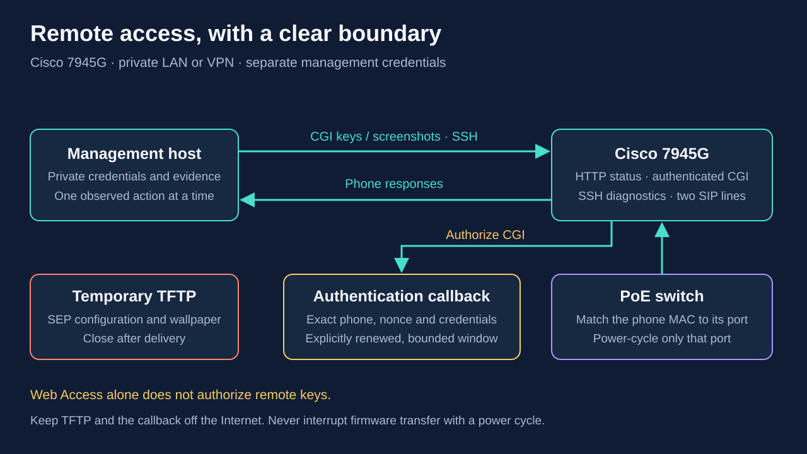

# Remote management of the Cisco 7945G

The provisioning inventory enables web access, SSH diagnostics and authenticated
personalization. `scripts/phone_control.py` supplies the authentication callback,
one keypad action per invocation, and screenshots. Start an attended maintenance
window with the phone idle. For an owned active call, record that intent with
`--allow-active`; the caller remains responsible for checking call state.

The phone's HTTP home page provides status and logs, not a settings editor.
`web_access: true` alone does not authorize changing a line or selecting a
wallpaper. Persistent line definitions, callback URLs and SSH settings come
from the provisioned `SEP…cnf.xml`. Authenticated CGI can operate the visible
menus and select a wallpaper that has been supplied through TFTP. SSH opens a
diagnostic interface; it is not the configuration editor for those settings.



The callback accepts only the configured phone source IPv4 address and nonce
path. Both documented authentication forms are supported: GET query parameters
and POST `application/x-www-form-urlencoded`. Each must contain exactly one
case-sensitive `UserID`, `Password`, and `devicename`. All values must match the
private configuration; successful replies contain exactly `AUTHORIZED`.
The callback never logs requests, query strings, bodies, or credentials.
It uses bounded requests, an absolute three-second request read deadline,
and a maximum 45-minute authorization lifetime that persists across restarts.

## Prepare a private window

Create a mode-0700 local working directory and a fresh configuration. Replace
the synthetic addresses and device ID with the verified phone and callback
host. The callback host must own the selected address and run Python 3.

```sh
install -d -m 0700 .local/phone-control
python3 scripts/phone_control.py --config .local/phone-control/control.json init \
  --phone-ipv4 192.168.50.21 \
  --auth-bind-ipv4 192.168.50.10 \
  --auth-port 18080 \
  --device SEP020000000001 \
  --ttl-seconds 2700
```

`init` generates independent 24-character URL-safe credentials (144 random bits
each) and a random callback path; it
refuses to replace an existing file. Keep the JSON private. Do not put its
contents, credentials, or callback URL into logs, command-line arguments,
public configuration, or Git. This is a distinct credential from SIP auth.

On the tested `SIP45.9-4-2SR4-3S` firmware, a 32-character username with a
48-character password produced HTTP 401 **before any callback request**. A
24-character username and password authenticated successfully after the callback
was restarted, and `/CGI/Screenshot` returned a BMP showing both configured
lines. Incorrect credentials were denied with `CiscoIPPhoneError Number="4"`;
HTTP 200 alone did not indicate success. Boundary probes also attempted the
callback with a 64-byte decoded
`username:password` pair, while a 65-byte pair was rejected by the phone before
any callback traffic. The validator limits that pair to 64
bytes, and the generated 49-byte pair leaves room below the observed limit.
`renew` preserves credentials and does not shorten them; it rejects an older
file whose credentials exceed this limit until the file is explicitly migrated.
For an affected older file, stop the callback, replace both credential values
with independently generated `secrets.token_urlsafe(18)` values in that private
file, securely update any separate controller copy, then renew and restart the
callback. Preserve its URL/nonce and device fields; no phone profile change or
reboot is needed for this credential-only correction. Never weaken callback
checks to diagnose a phone-side HTTP 401.

The callback listener is HTTP. Phone management and its authentication exchange
therefore require a trusted private network. Add only a narrow temporary host
firewall rule for TCP 18080 from the exact phone `/32`, preserving existing
rules. Never expose this listener through an ingress, Internet port forward,
or a broad source rule. The script creates no firewall rules itself.

Set the phone inventory's optional `authentication_url` from the private
configuration as `http://{auth_bind_ipv4}:{auth_port}{auth_path}`, without printing
it. Also set `web_access: true` and `background_image_access: true` if these
features are needed. Generate and stage the updated XML through the existing
private TFTP process. The URL validator accepts an RFC1918 IPv4 literal and a
plain path, with no userinfo, query, fragment, or hostname. If the field is
omitted, no `authenticationURL` element is generated. Keep the configured URL
in the private inventory for later renewal windows. HTTPS URLs are allowed for
an independently managed compatible TLS callback; this temporary server
implements HTTP only.

The phone must load this configuration before the controller can authenticate.
A separate, verified phone configuration refresh/restart procedure is required;
this utility does not guess a SIP NOTIFY event or reboot a phone. Start the
callback on the host that owns the bind address:

```sh
python3 scripts/phone_control.py --config .local/phone-control/control.json serve
```

Run this in a foreground maintenance session or a bounded transient service.
Authorization stops at the configuration's original expiry, even if the server
is restarted. There is no allow-all mode. To open a later maintenance window,
stop any previous callback process, explicitly renew the private file, and start
the callback again:

```sh
python3 scripts/phone_control.py --config .local/phone-control/control.json \
  renew --ttl-seconds 2700
python3 scripts/phone_control.py --config .local/phone-control/control.json serve
```

`renew` preserves the device, credentials, nonce path, and bind address. It accepts
an expired private configuration and atomically updates only its timestamps and
TTL. Ordinary startup never renews a window. A running process retains its
original deadline, so renewal requires stopping and restarting that process.
The listener can reuse its address after shutdown while older TCP connections
remain in `TIME_WAIT`; a second live listener on the same address is refused.
The phone's existing callback URL remains valid without another provisioning
cycle. Reopen only the same narrow firewall rule for the new window.

### Run a bounded window on a systemd management host

Choose one canonical `control.json`; the following procedure keeps it on the
callback host. Stage the current `phone_control.py` and this file in a private
directory owned by the existing service account. Use mode `0700` for the
directory and `0600` for the JSON, and copy over SSH with the host key checked.
The examples use the synthetic SSH alias `voice-node`, account/group `operator`,
directory `/home/operator/.local/share/cisco-phone-control`, and unit
`cisco-phone-control-pilot.service`. Substitute your recorded values together.

For each later window, stop the previous unit if it exists, then run renewal
on the canonical copy as its owner:

```sh
# On the callback host; omit stop only after confirming the unit is not loaded.
sudo systemctl stop cisco-phone-control-pilot.service
python3 /home/operator/.local/share/cisco-phone-control/phone_control.py \
  --config /home/operator/.local/share/cisco-phone-control/control.json \
  renew --ttl-seconds 2700
```

If a separate workstation runs the controller, securely copy that exact renewed
file back before issuing requests. Do not independently run `init` or renew two
copies: the server and controller need the same credentials and expiry. Preserve
the working callback path and the phone's inventory URL. From the workstation:

```sh
scp -p -o StrictHostKeyChecking=yes \
  voice-node:/home/operator/.local/share/cisco-phone-control/control.json \
  .local/phone-control/control.json
chmod 0600 .local/phone-control/control.json
```

Use the same script version on both hosts and compare the private copies if
authentication or expiry differs. Keep host clocks synchronized. Updating a
file does not update a running callback: stop, renew, synchronize, then start.

Before starting, record the exact temporary firewall rule and its prior absence.
On a host already managed through `iptables`, this synthetic guard rejects
every other source at the callback's exact bound address and port:

```sh
sudo iptables -C INPUT -d 192.168.50.10/32 ! -s 192.168.50.21/32 \
  -p tcp --dport 18080 -m comment --comment cisco-phone-control-pilot -j DROP
# Add only if the check confirms this exact rule is absent.
sudo iptables -I INPUT 1 -d 192.168.50.10/32 ! -s 192.168.50.21/32 \
  -p tcp --dport 18080 -m comment --comment cisco-phone-control-pilot -j DROP
```

Do not insert a duplicate or treat a permission/backend error as an absent rule.
The phone's own traffic still follows the existing firewall policy. If that
policy denies it, add and record a separate narrow allow rule through the
existing manager; an allow rule alone would not exclude other sources on a
default-accept host. If the host uses a different firewall manager, use its
equivalent owned rule;
do not mix managers or flush a chain. This callback rule is separate from the
temporary TFTP permission. Retain the exact rule specification for cleanup.

Start the callback as the unprivileged owner of its files:

```sh
sudo systemd-run --unit=cisco-phone-control-pilot --collect \
  --service-type=exec --uid=operator --gid=operator \
  --property=RuntimeMaxSec=2700 --property=Restart=no \
  --property=TimeoutStopSec=5s --property=NoNewPrivileges=yes \
  --property=ProtectSystem=strict --property=ProtectHome=read-only \
  --property=PrivateTmp=yes --property=UMask=0077 \
  /usr/bin/python3 /home/operator/.local/share/cisco-phone-control/phone_control.py \
  --config /home/operator/.local/share/cisco-phone-control/control.json serve
sudo systemctl show cisco-phone-control-pilot.service \
  --property=ActiveState --property=SubState --property=Result
sudo ss -lnt 'sport = :18080'
```

Require a listener at the configured private address and an authenticated
screenshot before sending a key. A successful `systemd-run` command alone does
not prove that the callback bound its socket. The JSON deadline can expire
earlier than `RuntimeMaxSec`; neither restarting the service nor reconnecting
SSH renews it. Inspect only this unit's journal when startup fails, and keep
any diagnostic output private.

A stopped or expired transient unit can disappear, especially with `--collect`.
`Unit not found` after its completion does not mean the script or private
configuration was lost. Confirm there is no remaining listener, renew and sync
the files, then recreate the unit with the full command above. Do not rely on
`systemctl restart` finding a collected unit, create a permanent enabled service,
or configure automatic renewal. See systemd's
[transient-unit lifecycle](https://github.com/systemd/systemd/blob/v249/man/systemd-run.xml),
[runtime limit](https://github.com/systemd/systemd/blob/v249/man/systemd.service.xml)
and [execution protection settings](https://github.com/systemd/systemd/blob/v249/man/systemd.exec.xml).

## Optional SSH diagnostics and personalization

Per-phone `ssh_enabled: true` enables the SSH server through
`vendorConfig/sshAccess=0`. The generator creates separate random SSH credentials
in the private `phone-management-secrets.json`, keyed by `SEP` plus normalized
MAC. It writes them to the device-level `sshUserId` and `sshPassword` fields.
Existing credentials survive regeneration and disabling/re-enabling SSH. They
are never copied from SIP or the temporary callback. Keep this file and the
generated phone XML private; TFTP provisioning carries the configuration without
encryption and must retain its exact-phone source restriction.

The generator currently chooses an 11-character alphanumeric SSH username and
a 16-character random alphanumeric password. These are project choices, not
asserted firmware maxima. Cisco's common device configuration documentation
allows usernames up to 50 characters and SSH passwords up to 127; its published
correction supersedes an older erroneous 200-character password limit. The
pilot on `SIP45.9-4-2SR4-3S` accepted the generated credentials, then accepted
the second-stage `debug` / `debug` login and displayed help at its diagnostic
prompt. This verifies authenticated SSH diagnostics, beyond the port listener
and host-key exchange.

Use an SSH client with these generated credentials and verify the phone's host
key through the trusted provisioning/management path. Some firmware may require
legacy algorithm compatibility: inspect the actual negotiation failure and
scope any necessary exception to this one host rather than changing global SSH
policy. Never disable host-key checking globally. These older phones offer a
diagnostic interface rather than a general-purpose shell. On supported 7900
firmware, after authenticating with the generated credentials, the second-stage
diagnostic login is `debug` / `debug`. Inspect the available help before using
commands; this project does not invent a reboot command or claim every diagnostic
command is safe during a call. Restrict SSH reachability to trusted management
hosts using existing network controls.

### Exact SSH compatibility settings for the tested firmware

On the tested `SIP45.9-4-2SR4-3S` phone, adding legacy algorithms to modern
defaults with `+` was insufficient. The phone negotiated key exchange and then
closed the connection before sending its host key. Its console log recorded
`dropbear: exit before auth: bad buf_getwriteptr`. Replacing the algorithm
lists with the single supported choice allowed OpenSSH 8.9 to receive the
server's RSA host key. This did not require changing firmware, credentials or
rebooting the phone. The experiment established that the minimal proposal
works; it did not isolate which item or size in the larger proposal triggers
the embedded server's buffer error.

Use a dedicated client configuration, with the verified address and generated
username substituted for these synthetic values:

```sshconfig
Host cisco7945-pilot
    HostName 192.168.50.21
    User REPLACE_WITH_GENERATED_SSH_USER
    KexAlgorithms diffie-hellman-group1-sha1
    HostKeyAlgorithms ssh-rsa
    Ciphers aes128-cbc
    MACs hmac-sha1
    PubkeyAuthentication no
    PasswordAuthentication yes
    StrictHostKeyChecking yes
    UserKnownHostsFile ~/.ssh/cisco7945_known_hosts
    ConnectTimeout 10
```

Verify the host-key fingerprint through a separate trusted management path and
populate that dedicated known-hosts file before authenticating. Keep the actual
fingerprint in private deployment evidence. Connect using
`ssh -F .local/phone-control/ssh_config cisco7945-pilot`, and supply the generated
password interactively or through a credential-safe client. Do not put the
password in shell arguments. The exact lists above are deliberate replacements,
not `+algorithm` additions, and apply only to this legacy device. An unknown
host-key failure after key exchange is a separate, expected verification step;
it must not be bypassed to diagnose the earlier buffer error.

The pilot's `help` output identifies `help commands` for listing available
commands, `show ?` for exploring show arguments, and `help COMMAND` or
`COMMAND ?` for command-specific help. These are the next read-only discovery
steps; no particular `show` subcommand has been accepted by this project yet.
Build a status-command allowlist from this firmware's help. Commands that enable
debug logging, clear logs, modify files or reset the phone are separate actions,
not read-only inspection. Do not import router IOS commands or newer phone
models' Linux-shell instructions into this diagnostic prompt.

Per-phone `phone_personalization: true` writes the device-level
`phonePersonalization=1`. It requires both `web_access: true` and a valid
`authentication_url`; this avoids enabling personalization without the intended
authentication callback. The firmware can accept personalization XML through
authenticated CGI, but this controller intentionally exposes only its bounded
key and screenshot commands. Wallpaper selection through observed keypad
navigation remains available. Neither optional setting changes the defaults
when omitted. `ssh_enabled: false` disables SSH; `phone_personalization: false`
explicitly disables personalization.

## HTTPS support and verification status

Cisco's security guide explicitly lists the 7945 among models that can act as
both an HTTPS client and an HTTPS server. A model-specific Cisco Community
report also distinguishes the phone's **HTTPS Only** and **HTTP and HTTPS**
server settings. The pilot's TCP 443 listener and a TLS handshake were verified;
certificate validation and authenticated HTTPS control remain separate checks.

A minimal diagnostic handshake from OpenSSL 3.0.2 on the management host
succeeded with TLS 1.0 and `AES128-SHA`, after a broader client attempt had
received `bad record mac`. This command sends no HTTP request or credentials:

```sh
timeout 10 openssl s_client -connect 192.168.50.21:443 \
  -tls1 -cipher 'AES128-SHA:@SECLEVEL=0' \
  -legacy_server_connect -noservername -brief </dev/null
```

The address is synthetic. These options affect this diagnostic process only.
`s_client` reports certificate failures but can still complete a handshake, so
`CONNECTION ESTABLISHED` is not proof of a trusted server. In the pilot, the
phone presented its manufacturer-installed certificate, which had expired on
July 24, 2026; the management host also lacked its issuer trust chain. No
credentials were sent over this test connection. A trusted HTTPS deployment
needs a valid device certificate and verified identity, not merely this cipher
workaround. Do not disable certificate verification globally or switch the
phone to HTTPS-only on the strength of this probe. The
[OpenSSL client documentation](https://docs.openssl.org/3.0/man1/openssl-s_client/)
describes these diagnostic options and verification behavior.

The current controller deliberately uses the already verified HTTP CGI path.
Before adding HTTPS control, verify the exact phone firmware's server setting,
listener, certificate identity/trust, supported TLS negotiation, and the
authentication callback used for secure requests. The common XML reference
documents `vendorConfig/webProtocol` (`0` for HTTP and HTTPS, `1` for HTTPS only),
but this project does not emit that setting until its behavior on the target
firmware is verified. Do not switch to HTTPS-only before a trusted client can
successfully authenticate and retrieve a screenshot, and do not present a
certificate-verification bypass as secure HTTPS support.

## Other access and restart paths

TCP 23 was closed on the tested phone. No supported, verified Telnet enablement
setting was established for this firmware, so the generator does not emit a
guessed Telnet option. SSH is the verified diagnostic access path.

SIP NOTIFY examples using `check-sync` or `service-control` are not an accepted
restart procedure in this deployment: no such request was used to refresh the
pilot. Support and required event/body details vary with firmware and call
control environment. A server-side NOTIFY definition alone would not prove
that the phone accepted it. The confirmed remote restart used the
[verified single PoE port](#recover-through-a-verified-poe-port); keep that
procedure available when the phone has not yet loaded its CGI callback URL.

## Inspect, then issue one key

The controller makes requests only to `http://{phone_ipv4}/CGI/Screenshot` or
`http://{phone_ipv4}/CGI/Execute`, with Basic Auth from the private file. It does
not use environment proxies, follow redirects, or print raw responses. Key
requests have a 20-second socket timeout; screenshots use five seconds. Both
have a two-MiB response limit, and neither request is automatically retried.
The phone can execute a key before its HTTP response times out. After a timeout
or an ambiguous failure, inspect a fresh screenshot and, during a call, the PBX
channel state before deciding whether another key is necessary. Never repeat a
key blindly: it could enter a second digit, choose a different menu item, or
toggle a call state. Screenshots can contain personal information and are saved
as new mode-0600 files.

```sh
python3 scripts/phone_control.py --config .local/phone-control/control.json \
  screenshot --output .local/phone-control/before
python3 scripts/phone_control.py --config .local/phone-control/control.json \
  key Settings
python3 scripts/phone_control.py --config .local/phone-control/control.json \
  screenshot --output .local/phone-control/settings
```

The screenshot suffix is determined from the returned bytes: `.bmp`, `.png`, or
`.xml` for `CiscoIPPhoneImage`/`CiscoIPPhoneImageFile`. XML references are not
automatically fetched. The utility refuses HTML/error responses, existing
output files, and a specified suffix that disagrees with the actual format.

Allowed keys are `Settings`, `NavDwn`, `NavUp`, `NavLeft`, `NavRight`, `NavSelect`,
`Line1`, `Line2`, `Speaker`, `Release`, `Soft1` through `Soft4`, `KeyPad0` through `KeyPad9`, `KeyPadStar`, and
`KeyPadPound`. Each invocation sends one `Key:` URI with `Priority="2"`
by default and requires a successful Cisco response. **Priority is not an idle
guard for keys:** Cisco specifies that priority applies only to HTTP URLs;
internal `Key:`, `Dial:` and `Play:` URIs execute immediately. Verify the phone
and its actual PBX channels are idle before sending a key. Observe the
screen after each navigation step; a successful request does not prove that the
desired setting was selected. Softkey positions depend on the current screen.
Do not operate another person's active call. For an explicitly authorized test
call that the operator started and is monitoring, `key --allow-active` sets
`Priority="0"` for that one request. This flag records the caller's explicit
active-call intent; neither value enforces call-state isolation. Automated
callers must check fresh PBX state and the exact channel identity themselves.
The flag does not expand the allowed keys or permit arbitrary XML/URIs.

```sh
# First verify that the phone is idle, then inspect the selected line on screen.
python3 scripts/phone_control.py --config .local/phone-control/control.json key Line2
# During an explicitly authorized, monitored test only: one digit per invocation.
python3 scripts/phone_control.py --config .local/phone-control/control.json \
  key KeyPad6 --allow-active
```

For an echo test, send each remaining digit separately while checking the screen
and PBX channel identity. `Speaker` emulates the physical speaker button; when
the verified test call uses speakerphone, pressing it again can end that call.
For the operator's monitored test, `key Release --allow-active` sends the
documented release key; verify the PBX channel disappears afterwards.
Alternatively use the currently visible **EndCall** softkey or the existing
PBX/HA guarded hangup action. Do not guess a softkey position or treat a speaker
toggle as a universal hangup command. The controller does not enable `Onhook`
or `Offhook`: the model-specific Cisco matrix marks them unsupported on 7945G.

The 9.1.1 model matrix also marks several navigation URIs (`NavDwn`, `NavLeft`,
`NavRight`, `NavSelect`) unsupported for the 7945G group despite listing these
names in the general Key URI API. Treat their behavior as firmware-dependent
until a screenshot confirms a change; use visible numeric menu shortcuts or
softkeys when navigation is ignored. Never infer success from HTTP 200 alone.

On the pilot, `NavRight` visibly selected the second wallpaper thumbnail;
`Settings`, the observed softkeys, numeric menu entry, `Line2` and dial digits
also worked. A `Release` request did not produce a confirmed hangup in the
live echo test, so that test was ended through the PBX. Keep the verified
PBX/HA hangup path available instead of assuming every documented key behaves
identically on this firmware.

For wallpaper, inspect the Settings → User Preferences → Background Images
screens and the available softkey labels. Navigate to the desired image, select
it, save it, and verify the resulting screenshot. Do not assume a universal key
sequence, fixed menu index, or undocumented automatic-selection tag.

## Close the window

After verification, stop the callback and remove only its dedicated temporary
firewall rule. Retain `authentication_url` and its private configuration for
future explicit `renew` windows; the listener remains stopped between windows.
Close the temporary TFTP window through its existing cleanup procedure. Retain
only the scoped private evidence needed for the task. The server automatically
stops at expiry but does not remove firewall rules or rewrite phone configuration.
If permanently retiring remote control, remove its URL and disable the optional
management features in the inventory, regenerate and apply the phone profile,
then remove the obsolete credentials. SSH, when explicitly enabled, is independent
of the callback lifetime and remains available until disabled on the phone.

For the systemd/iptables example above, stop the unit if still loaded and delete
only the exact rule owned by this window:

```sh
sudo systemctl stop cisco-phone-control-pilot.service
sudo iptables -D INPUT -d 192.168.50.10/32 ! -s 192.168.50.21/32 \
  -p tcp --dport 18080 -m comment --comment cisco-phone-control-pilot -j DROP
sudo ss -lnt 'sport = :18080'
sudo iptables -C INPUT -d 192.168.50.10/32 ! -s 192.168.50.21/32 \
  -p tcp --dport 18080 -m comment --comment cisco-phone-control-pilot -j DROP
```

Completion means no callback listener and the exact rule check reports absence;
handle a missing, already-collected unit without skipping the firewall cleanup.
Remove any separate allow rule created by this window using its recorded exact
specification as well.
Never delete a rule by a stale numeric position, flush INPUT, or remove the
ordinary SIP/RTP policy. A runtime timeout stops the process but does not remove
the firewall rule. Record these checks, TFTP cleanup, registered line states and
zero remaining test-call channels in the private deployment receipt. Retaining
the callback URL and private files is intentional; the closed window should
have no listening callback service.

## Protocol references

- [Cisco external authentication discussion](https://community.cisco.com/t5/collaboration-knowledge-base/cme-ip-phone-external-authentication/ta-p/3631045)
  documents POST fields and the plain authorization response.
- [Cisco StadiumVision local control guide](https://www.cisco.com/c/dam/en/us/td/docs/Sports_Entertainment/StadiumVision/Director/design/guides/2_4/SV_Local_Control_DIG_2-4.pdf)
  describes the phone authentication request.
- [Reference authentication implementation](https://github.com/usecallmanagernz/services/blob/v3.0/authentication.py)
  confirms GET `UserID`/`Password` and the plain-text response; this utility adds
  exact device, source-address, nonce-path, and lifetime checks.
- [Cisco phone screenshot instructions](https://community.cisco.com/t5/collaboration-knowledge-base/how-to-take-a-screen-shot-from-a-cisco-ip-phone/ta-p/3120882)
  cover the authenticated screenshot endpoint.
- [Cisco 7.0 internal URI guide](https://www.cisco.com/c/en/us/td/docs/voice_ip_comm/cuipph/all_models/xsi/7_0/english/programming/guide/70xsi/xsi70uri.html)
  includes the 7945G in the Key URI support matrix and documents `Key:Line1`,
  `Key:Line2`, and `Key:Speaker`. This controller limits line keys to the two
  physical buttons on a 7945G. Observe the actual screen to confirm which
  configured extension is selected; a key name alone does not prove the mapping.
- [Cisco 9.1.1 model-specific Key URI matrix](https://www.cisco.com/en/US/docs/voice_ip_comm/cuipph/all_models/xsi/9_1_1/xsidevguide911.pdf)
  table 5-2, printed page 5-4 (PDF page 66), confirms Line, Speaker and Release
  support in the column that explicitly includes 7945G.
- [Device configuration reference](https://usecallmanager.nz/sepmac-cnf-xml.html)
  documents the SSH, callback and personalization XML fields.
- [Cisco 7945/7965 SSH diagnostic example](https://community.cisco.com/t5/ip-telephony-and-phones/cisco-ip-phone-7945-g-or-7965-g-screen-goes-blank-randomly-with/m-p/1965365/highlight/true)
  confirms the model's SSH diagnostic interface.
- [Cisco common device SSH fields](https://www.cisco.com/c/en/us/td/docs/voice_ip_comm/cucm/admin/12_5_1/systemConfig/cucm_b_system-configuration-guide-1251/cucm_b_system-configuration-guide-1251_chapter_0101000.html)
  document username and password constraints in the Secure Shell User table.
- [Cisco SSH password documentation correction](https://www.cisco.com/c/en/us/td/docs/voice_ip_comm/cucm/rel_notes/11_5_1/SU1/cucm_b_release-notes-for-cucm-imp_1151SU1/cucm_b_release-notes-for-cucm-imp_1151SU1_chapter_0100.pdf)
  records the 127-character limit under CSCvb33353.
- [Cisco HTTPS support, printed page 41](https://www.cisco.com/c/en/us/td/docs/voice_ip_comm/cucm/security/11_5_1_SU1/secgd/cucm_b_security-guide-1151su1.pdf)
  explicitly includes the 7945 as both client and server.
- [Cisco 6.1(3) HTTPS release notes](https://www.cisco.com/c/en/us/td/docs/voice_ip_comm/cucmbe/rel_notes/6_1_3/cucmbe-rel_note-613.html)
  also list secure HTTPS web access for the 7945G, under Cisco Unified IP Phone
  Support HTTPS. Older Cisco PDF links may redirect after document retirement.
- [Cisco 7945 HTTPS server setting report](https://community.cisco.com/t5/unified-communications-infrastructure/informacast-error-logs/td-p/3217741)
  describes the impact of HTTPS-only versus dual HTTP/HTTPS on phone control.

Local tests exercise real loopback HTTP requests, malformed/duplicate input,
expiry, strict credentials, no request logging, file permissions, fixed controller
targets, redirect refusal, image/error recognition, explicit renewal, and distinct
preserved SSH credentials. The tested 7945G on `SIP45.9-4-2SR4-3S` returned an
authenticated BMP screenshot with the 24-character credential pair. It also
completed SSH authentication with the generated SSH credentials, the
second-stage `debug` / `debug` login, and a help command at the diagnostic
prompt. This acceptance does not imply that arbitrary diagnostic commands or
authenticated HTTPS control have been tested. In each new deployment, verify
an authenticated screenshot, one observed idle-phone key action, and an SSH
login separately before claiming those management paths work.


## Recover through a verified PoE port

A single-port PoE cycle can load a staged phone profile when authenticated CGI
or a compatible SIP restart path is not yet available. This is a power
interruption: first confirm the phone is idle, the approved TFTP window is
running, and the served profile, firmware and optional image files match the
prepared hashes. Keep the switch management path independent of the target
port. Do not reboot the switch or change its VLAN, link or power-budget settings.

Identify the connection before changing power. The phone's **Network-Port
Information** status page can expose **LLDP Neighbor IP Address**. On the switch,
correlate the phone MAC in its forwarding table with the bridge port, interface
name and LLDP remote identity. A management IP or a plausible power draw alone
does not identify the correct physical port. Read the mapping again immediately
before the cycle.

After a profile refresh, the tested phone legitimately changed its LLDP system
name from `SEP<MAC>.example.internal` to the bare `SEP<MAC>`. A hostname change
alone does not prove that the device was replaced. Stop an exact-name guard,
then revalidate the complete MAC, model and firmware, LLDP remote port ID,
forwarding-table entry, bridge interface and physical port. Update only that
device's expected name in the private inventory after its boot has completed;
do not replace exact identity checks with an unrestricted prefix match.

Useful read-only SNMP objects for a GS110TP are:

- `1.3.6.1.2.1.1.1.0`: system description; verify the actual switch model.
- `1.3.6.1.2.1.17.7.1.2.2.1.2.<fdb-id>.<six-decimal-MAC-bytes>`:
  VLAN-aware forwarding-table bridge port. Discover the forwarding database ID;
  it is not necessarily `1` or interchangeable with a VLAN number.
- `1.3.6.1.2.1.17.1.4.1.2.<bridge-port>`: bridge port to interface index.
- `1.3.6.1.2.1.31.1.1.1.1.<if-index>`: interface name, such as `0/3`.
- `1.0.8802.1.1.2.1.4.1.1.9.<time-mark>.<local-port>.<remote-index>`:
  LLDP remote system name. The same entry's column `7` is the remote port ID.
  Confirm the expected `SEP...` identity and phone-side port.

SNMP tools may render an IF-MIB enumeration as `INTEGER: up(1)` rather than
`INTEGER: 1`. Parse the numeric enumeration (or request numeric output) instead
of comparing the entire display string. Otherwise a healthy link can be
mistaken for a failed one.

The original GS110TP tested here exposes its PoE objects under NETGEAR's private
branch, rather than the standard `1.3.6.1.2.1.105` branch:

- `1.3.6.1.4.1.4526.11.16.1.1.1.3.<group>.<port>` is
  `pethPsePortAdminEnable`: integer `1` enables power and `2` disables it.
- `1.3.6.1.4.1.4526.11.16.1.1.1.6.<group>.<port>` reports detection status;
  integer `3` means **deliveringPower**.

Verify the branch and index on the installed switch revision. An SNMP read
community working does not establish write permission. Do not alter community
configuration to make a maintenance cycle work. NETGEAR's
[GS110TP PoE discussion](https://community.netgear.com/discussions/business-smart-plus-click-switches/gs110tp-mibs/1853327)
identifies this private branch; its
[software administration manual](https://www.downloads.netgear.com/files/GS108Tv2/gs108tv2_gs110TP_usermanual.pdf)
describes the web PoE controls.

The authenticated legacy web interface uses **System → PoE → Advanced → PoE
Port Configuration**, at `/base/poe/poe_port_cfg.html`. Select only the verified
port, change **Admin Mode** to **Disable**, apply, wait five seconds after power
disabling is confirmed, and restore **Enable**. Leave every other setting at
its observed value. The default-password login was sufficient for the attended
pilot, but credentials and session cookies belong only in private maintenance
files, never in documentation, request logs or command-line arguments.

For reproducing this specific legacy form in a controlled helper, its own
JavaScript constructs a form-urlencoded POST to the same path with
`unit_no=1`, `selectedPorts=g3;`, `multiple_ports=0`, and `submt=16`, plus
`poeAdminMode=Disable` or `Enable`. **`g3` is a synthetic example, not the pilot
port.** Read the actual form first and preserve the target row's priority,
detection mode, timer and power-limit fields; their values and this private web
API may differ across firmware revisions. A successful HTTP response is not
proof that power changed.

A helper must restore **Enable** in a `finally` block once a disable request has
been attempted, including after a timeout with an unknown outcome. Confirm
admin state `1`, then detection state `3`. Compare all other ports' admin states
and configuration fields against the private before-record. Record the cycle
and verification timestamps without credentials. Finally verify the phone's
TFTP requests, firmware identity and SIP registrations; power delivery by itself
does not prove that the new phone configuration loaded.

Allow the phone to finish booting before continuing. A responding HTTP page or
an earlier available SIP contact is insufficient: capture a new screenshot
showing both intended numeric line labels, confirm fresh registrations, and
correlate the current profile/dialplan requests with the maintenance window.
During the multi-phone pilot, other phones fetched the updated dialplan
automatically while one phone was being refreshed. Their fresh TFTP requests,
correct HTTP identities, new registrations and normal home screens made
additional PoE cycles unnecessary. Prefer that verified completion over a
preplanned power interruption.
