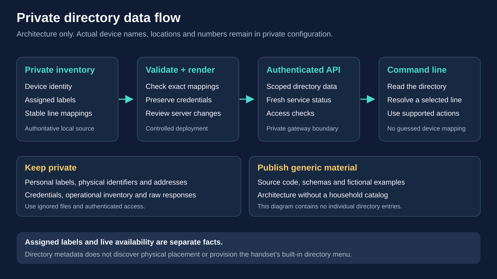

# Phone directory: fictional example

All room names and client display names in this public guide are fictional
examples, independent of any private household directory. Keep actual room
assignments and personal device names only in ignored private inventory files.

The directory connects a named room to a stable physical phone and its two
extensions. Rooms are **operator-assigned destinations**, not locations detected
from the switch, DHCP, SIP registration or a floor plan. A phone can remain
registered while it is temporarily sitting in another room.



## Example directory

This demonstration uses ten two-line phones and generic extension numbers:

1. **Example Room A:** 201 / 202
2. **Example Room B:** 203 / 204
3. **Example Room C:** 205 / 206
4. **Example Room D:** 207 / 208
5. **Example Room E:** 210 / 211
6. **Example Room F:** 212 / 213
7. **Example Room G:** 214 / 215
8. **Example Room H:** 216 / 217
9. **Example Room I:** 218 / 219
10. **Example Room J:** 220 / 221

**209 — Operator's Mac** is the example's separate software client, listed for reference
and calling, but it is not an eleventh Cisco phone or a target for Cisco keypad,
speaker, DND, screen, timer or alarm controls.

This example is not a record of actual rooms, placements or connected devices.
In a private deployment, disconnected phones retain their numbers and assigned
rooms. Check current availability separately.

## Read the deployed directory

```bash
cisco directory
cisco 212 directory
cisco 209 directory
cisco --json directory
cisco 213
```

All `directory` forms read the complete deployed directory; supplying 212 or 209
selects that entry without restricting the list. The list is sorted by extension and includes
assigned room, line mapping, device type and current availability. Ordinary
`cisco 213` status also identifies its hosting phone and assigned room. These
commands read the authenticated gateway; they do not place calls, change rooms
or consult an unverified local address book.

Gateway data exposes Cisco entries through `GET /v1/phones` and optional
software clients through its separate `softphones` array. An absent room remains
unassigned; the CLI does not invent one. Availability is a separate observation:
the Cisco phone's `online` flag covers its configured lines, while the software
client has its own registration status. Neither flag proves physical placement.

This directory is available through the authenticated gateway API and CLI.
Adding room metadata does not provision the Cisco handset's built-in
**Corporate Directory** menu or a phone-side directory XML service.

Continue dialing numbers explicitly: in this fictional example, `cisco 213 205`
calls Example Room C from Example Room F's second line. Room names are descriptive metadata, not CLI dialing
aliases. See the [CLI guide](cli.md) for transport, exact call ownership and
failure handling.

## Maintain the central inventory

The authoritative room assignment belongs in each phone's optional `room`
field in the **private phone inventory**. Both lines inherit the same room:

```json
{
  "room": "Example Room F",
  "label": "212_213",
  "lines": [
    {"extension": "212", "label": "212"},
    {"extension": "213", "label": "213"}
  ]
}
```

For a separate Mac, the example uses `room: "Operator's Mac"` on its entry in
`site.json` under `softphones`. Use the desired real display name only in the private
site file. Keep its extension, label, transport, exact
source address and credentials unchanged.

Room names accept 1–48 ASCII characters: start with a letter or digit, then use
letters, digits, spaces, underscores, apostrophes, parentheses or hyphens, with
no trailing whitespace. Omit the field for an unassigned room; `null` and an
empty string are invalid in the source phone/site inventory. The gateway API
can report an unassigned room as `null`. This restriction also keeps generated
caller-ID configuration unambiguous.

The full [ten-phone example](../examples/phones.rooms.example.json) preserves
the line allocation above. Its locally administered MACs are **synthetic**,
every entry is `verified: false`, and hardware/load fields require observation.
Do not mark these example identities verified or replace an existing private
fleet inventory with them. The [software-client fragment](../examples/softphones.rooms.example.json)
shows the separate Mac field with an example address; merge it into an existing
private site only after verifying that client's real source address.

For an existing installation, edit only the intended `room` values in a copy of
the current canonical private inventory/site. Preserve all devices, line
ordering, labels, MACs, firmware selections, source permissions and secrets.
Regenerate and preflight the candidate using the [provisioning workflow](provisioning.md),
then review and deploy its Asterisk and gateway configuration. Do not hand-edit
generated gateway JSON as an independent room registry: the next generation
would replace it from the central inventory.

Use `sync_directory.py` to update an existing gateway without rotating its
API token or callback credentials. In this example, `.local/current` is a
private snapshot of the current installation and `.local/candidate` already
contains a copy of its inventory, site and credential files. Edit the room
fields in that candidate first. Both `gateway.directory.json` and
`rendered/gateway.directory.yaml` must be new output names:

```bash
python3 scripts/provision.py --site .local/candidate/site.json \
  --inventory .local/candidate/phones.json --out .local/candidate
python3 scripts/sync_directory.py --site .local/candidate/site.json \
  --phones .local/candidate/phones.json --gateway .local/current/gateway.json \
  --output .local/candidate/gateway.directory.json
python3 scripts/render_k3s.py --site .local/candidate/site.json
python3 scripts/render_gateway.py --site .local/candidate/site.json \
  --config .local/candidate/gateway.directory.json \
  --output .local/candidate/rendered/gateway.directory.yaml
python3 scripts/preflight.py --site .local/candidate/site.json
```

The sync checks exact device, primary-ID and ordered-line membership. It changes
only room fields and the read-only software-client directory metadata, while
preserving callbacks, credentials, API clients, AMI settings and dial permissions.
It refuses to overwrite an existing output file. Review the newly rendered
`gateway.directory.yaml` alongside the candidate's `core.yaml`, and use that
new gateway manifest for deployment rather than a copied older `gateway.yaml`.
After successful deployment and directory/caller-ID verification, promote the
reviewed inventory/site and `gateway.directory.json` to the canonical private
configuration, with the latter becoming its `gateway.json`. Retain the previous
snapshot for rollback. **Do not rerun `configure_gateway.py` for a room update:**
that bootstrap tool generates a new API token.

A room-only change updates metadata and PJSIP caller-ID names. It does not
require firmware changes, a TFTP window, a PoE cycle or a handset reset. The
numeric Cisco line-button labels remain unchanged. Apply server changes using
the normal reviewed deployment procedure; a server rollout can interrupt calls.

## Room, caller ID, registration and voicemail

- **Assigned room** describes the intended destination of a physical phone.
  It appears in the directory and status independently of connectivity.
- **PJSIP caller ID** uses the room name when present, retaining the extension
  as its number, for example `Example Room F <213>`. Without a room it retains the
  existing line label. The Mac follows the same rule with its own label as the
  fallback. Receiving equipment can format or override displayed caller names.
- **SIP registration** associates each existing authenticated extension with
  its current contact. Adding a room does not rename the SIP username, create
  an account, rotate a password or change routing permissions.
- **Asterisk `Directory()`** is a separate telephone application for searching
  names from voicemail configuration. This project does not enable voicemail
  or a dial-by-name IVR merely by adding rooms. The CLI directory is an
  authenticated inventory view. See the [Asterisk 22 Directory documentation](https://docs.asterisk.org/Asterisk_22_Documentation/API_Documentation/Dialplan_Applications/Directory/).

The public directory is a fictional demonstration. Actual room assignments,
personal device names, MACs, addresses, credentials and the complete operational
inventory stay in ignored private files. Do not publish household maps, raw
gateway responses or private manifests.
