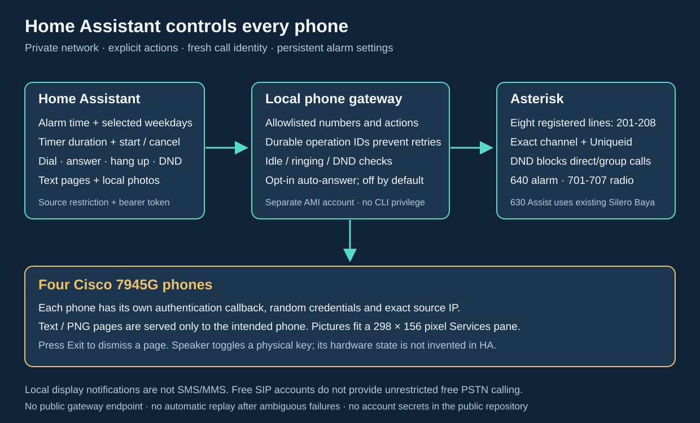

# Persistent phone control from Home Assistant



The optional gateway connects HA to the existing local Cisco phones. It supports
numeric dialing, answering a selected ringing line, exact-channel hangup,
explicit speaker-button toggling, PBX Do Not Disturb, opt-in auto-answer, text
pages, photographs, catalog radio playback and one-time speaker intercom calls. The separate `cisco_phone_control` HA integration supplies
entities and recurring alarms/timers. Scheduled alerts keep the phone ringing
until a person answers, rejects the call or presses **Stop alert**. They never
auto-answer and play no audio after an answer. A button press is not evidence
of successful delivery; see the dated [validation record](server-validation.md).

The alert contract below requires the matching gateway, Asterisk helper and
HA integration update. All three were deployed on 2026-10-17, and the operator
confirmed manual dismissal on the physical phone. The dated validation record
tracks the remaining acceptance checks. Earlier finite-tone tests do not
validate the revised alert behavior.

This service is an explicit change from the short-lived commissioning callback.
It keeps the previously provisioned callback URLs and credentials, so the phones
do not need a new profile or another restart. It runs only on the private network.
Never publish its API or callback ports on the Internet.

## Prepare private configuration

Enable the dedicated AMI account in the private site input:

```json
"gateway": {"enabled": true, "ami_client_ipv4": "192.168.50.10"}
```

The address is the PBX/gateway node, not an arbitrary client network. Provisioning
creates `gateway-ami-secret.json` separately from the HA AMI account. Preserve all
existing secrets when generating into the deployment directory.

After all phones have verified profiles and working commissioning callbacks:

```bash
umask 077
python3 scripts/configure_gateway.py \
  --site .local/site.json --inventory .local/phones.json \
  --ami-secret .local/gateway-ami-secret.json \
  --callback .local/phone-a/control.json \
  --callback .local/phone-b/control.json \
  --ha-source-ip 192.168.50.11 --enable-persistent \
  --output .local/gateway.json
python3 scripts/render_gateway.py --site .local/site.json \
  --config .local/gateway.json --output .local/gateway.yaml
```

Include exactly one callback for every inventoried phone. The generator verifies
each device, exact source ACL and previously provisioned authentication URL. It
does not overwrite an existing gateway file. Preserve its bearer token and state
across upgrades. Add only reviewed internal radio extensions to `dial_allowlist`
and, if wanted, `ring_allowlist`; neither is an unrestricted dialplan.

## Deploy and hand over the listeners

Build the Asterisk image containing `phone_gateway.py` and Pillow and use its
immutable digest. On the selected node, create `/var/lib/cisco-phone-gateway`
owned by UID/GID `10001:10001`, mode `0700`. Back up this directory with the
private gateway input; it contains preferences, operation idempotency state and
durable alert identities.

Review host firewall changes before applying. The API port (default TCP18084)
admits the actual HA source. The node itself may complete TCP health probes;
HTTP API requests still require the HA source and bearer token. Each callback
port admits only its exact phone IP. Keep the dedicated AMI account restricted to the node's
source address. Also admit that exact node `/32` to **TCP 5038 in the host's raw
telephony guard**, alongside the existing HA exception. A connection from the
node to its own private address can traverse local/loopback routing and still
be blocked by raw PREROUTING; host networking does not bypass that rule. Match
the gateway's actual source address rather than opening AMI to a subnet or all
loopback traffic. Asterisk's AMI user ACL must independently permit the same
source. A healthy gateway TCP listener does not prove its AMI connection works;
verify authenticated inventory/state requests too. Ordinary Kubernetes network
policy alone does not provide this boundary.

`scripts/gateway_firewall.py` manages only its own `CISCO_PHONE_MGMT` INPUT
chain in IPv4/IPv6. It returns allowed traffic to the existing host policy;
it never broadly accepts traffic or flushes Kubernetes chains. Its JSON input
contains `bind_ipv4`, `api_port`, `api_clients` and `phones` (each with `ipv4`
and `port`), without credentials. Copy the script and reviewed input to the node,
run `check`, then `apply`; `status` verifies the exact owned rules. Run `apply`
from a root-owned systemd oneshot unit before the gateway starts, and retain
that unit across node reboots. IPv6 is blocked on all reserved ports. Changed
owned rules are refused unless an explicit `--previous-config` matches them.
`remove` deletes only the owned hook and chain. Keep predecessor callback
source restrictions until the replacement has been verified.

With no active commissioning requests or phone calls, stop the old temporary
callback services, cancel their stale cleanup timers, and apply the reviewed
gateway manifest. Never run two listeners on one callback port. Check readiness,
authenticated inventory, every phone's callback and a harmless notification.
Then add the HA integration using the private API URL and token. Do not expose
the token in screenshots, public YAML, Git, terminal output or URLs.

Rollback: remove the gateway Deployment, restore the previous exact-source
firewall rules, and explicitly renew/start the original bounded callbacks if
needed. Existing SIP registrations do not depend on the gateway. Alarm and
auto-answer control stop when it is unavailable; failed alarms are not replayed
automatically after recovery.

## API contract

All API requests require `Authorization: Bearer <private-token>` from a configured
HA source. `GET /v1/phones` returns stable primary IDs, assigned lines, live AMI
registration/call state, PBX DND, auto-answer, the latest `alert` and capability names. It does not
return credentials. The `motion_image` object reports current voice-guard
eligibility (`eligible` and `reason`); it does not override the separate online,
call, DND or alert checks. Every mutation is a JSON POST to
`/v1/phones/<primary-line>/<action>` with a unique `idempotency_key`.

- `dial`: `line`, `number`; only explicit configured numbers are accepted.
- `media_play`: `line`, `source`; starts an advertised radio service on the
  selected owned line. The source must be classified as `radio` and present in
  `dial_allowlist`. A busy handset, DND, active alert or uncertain voice ownership
  is refused. A supervised assistant may hand off through its existing guard.
- `media_stop`: `source`, `line`, `channel`, `uniqueid` copied from the observed
  `phone.media` object. Only that exact, freshly revalidated radio session is
  stopped, using AMI Uniqueid. A changed or ordinary call is never substituted.
- `answer` / `hangup`: `line`, `channel`, `uniqueid` copied from a fresh inventory.
- `speaker`: `mode: "toggle"`; only an idle phone is accepted. This emulates a
  physical button, so there is no invented boolean speaker state.
- `dnd` / `autoanswer`: `enabled: true` or `false`. Both default to false.
- `intercom`: `line`, `number`. Establishes a one-time speaker call between two
  distinct, idle, DND-off Cisco phones. Both exact lines must be in the inventory;
  the destination must also be in the dial allowlist. Returns `connection_state:
  "connected"`, `intercom_id`, and `speaker_requested` after observing both legs
  in one bridge. It leaves persistent auto-answer preferences unchanged.
  See [CLI intercom behavior and failure handling](cli.md#intercom--drop-in).
- `alert`: `line`, `kind` (`"timer"` or `"alarm"`). Starts one alert with no
  application ring-duration limit. It returns a new `alert_id`, the selected
  line/kind and `ring_timeout_seconds: null`.
- `alert_stop`: `alert_id`. Stops only the exact owned alert associated with
  that phone. The ID must be the returned 32-character lowercase hexadecimal
  identity. Use a new `idempotency_key` for this stop operation.
- `ring`: `line`, `destination` (default 640). This legacy finite call rings for
  at most 20 seconds and runs the allowlisted destination after answer. It is
  **not the timer/alarm scheduler path**. Manual 640 remains a finite tone test.
- `message`: `title`, `text` (up to 2000 characters). Manual text uses native
  `Priority=0` to foreground its page, replacing a visible menu or motion image.
  Existing fresh call and voice-ownership checks still apply. The plain text
  page issues no call, speaker or audio commands.
- `image`: `title`, `image_base64`; PNG/JPEG up to2MiB and16million source pixels.
  Images retain native idle-only `Priority=2` delivery.
  Optional `idle_close_seconds` is an integer from 10 to 120. It assigns a unique
  Cisco application ID and requests native idle-time closing for that image.
  Omit it to keep the existing manual-dismissal behavior. See
  [motion snapshots](motion-notifications.md#automatic-dismissal-and-the-next-snapshot)
  for lifecycle limits and firmware acceptance.
  EXIF orientation is applied, metadata is removed, and the picture is converted
  to a bounded RGB PNG fitting the7945G's **298×156** Services pane.
- `motion_image`: the same image payload, with native idle closing fixed at
  45 seconds. It rechecks idle registration, DND, alerts and voice ownership
  before dispatch. A voice profile is allowed when hands-free is disabled and
  its session has fully stopped; active or uncertain ownership is rejected.
  It never stops or disables an assistant and retains native `Priority=2`.
  See [all-phone motion delivery](motion-notifications.md).

Successful requests return `status: "accepted"` and `action_id`. HTTP409 means
busy, DND or stale/ambiguous ownership; an unavailable dependency returns503.
Acceptance, including a Cisco Execute `Status=0`, is not proof that the page
rendered or someone saw it. Image requests can be discarded by a busy native
interface. The gateway does not automatically resend a notification.
An ambiguous network outcome is never retried automatically. Reusing a completed
idempotency key returns its recorded result without reopening the page; a pending
key returns a conflict.
Retain keys for one logical timer/alarm occurrence, not across different events.

### Radio state and Home Assistant media players

The `media` capability and `phone.media` object let the existing
[Cisco phone controls integration](https://github.com/ha-homelab/asterisk-telephony/blob/main/docs/media-player.md)
attach one **Radio** media player to each physical handset device, including
configured offline phones. Two SIP lines share the player. The catalog is the
intersection of advertised radio services and the dialing allowlist.

The object always contains `state`, `source`, `line`, `channel`, `uniqueid` and
`reason`. States are `idle`, `buffering`, `playing`, `blocked` and `unknown`.
Only `buffering` and `playing` carry a source and call identity; their reason is
null. Inactive states have null identity fields. Blocked/unknown reasons are
`offline`, `dnd`, `alert`, `call`, `voice`, `unavailable`, `ambiguous` or `unmarked`.

A matching generated PBX dialplan is required as well as the gateway update.
The radio route sets `CISCO_RADIO=1:<source>:<Uniqueid>` on its actual caller and
clears it immediately after the radio AGI returns. The gateway validates this
marker against a second channel snapshot. **Playing** also requires exactly
one matching Up AudioSocket partner in the same bridge. This proves the radio
path is connected; it does not measure speaker sound or expose song metadata.
A manually dialed catalog radio number is recognized by the same mechanism.
An older, unmarked PBX cannot authorize radio Stop or report verified Playing.

Before advertising idle media readiness or starting radio, the gateway checks
`DIALPLAN_EXISTS(home,<source>,cisco-radio-v1)` against the loaded PBX routes.
The versioned label is attached to the ownership-marker instruction. Missing
or malformed support leaves an idle player's media capability unavailable and
refuses Play before voice handoff. The selected route is checked again before
phone commands. This uses the active dialplan rather than a global variable
that could survive a rollback. An already verified radio call retains its
media state and exact Stop even if route support subsequently disappears.

Regenerate and activate the PBX configuration while preserving existing secrets.
For an immutable configuration Secret mounted as the entire `/etc/asterisk`
directory, create its replacement, update the workload reference and perform a
planned PBX restart; a reload cannot read files absent from that mount. Preserve
AstDB/DND and other runtime state if the workload stores it on ephemeral volumes.
Use the [operations guide](asterisk-operations.md) and verify the effective radio
route before accepting the update.

The HA player supports catalog browse, source selection, `play_media` for a
numeric advertised station and exact-session Stop. Stop before changing stations.
It does not accept arbitrary URLs, media-source IDs, announcements or queues,
and does not advertise pause, seek or volume. An unavailable phone is never
queued for later playback. Existing calls, alerts and voice admission retain
priority. Keep any private entity IDs, labels and deployment evidence outside
public Git.

### Intercom deployment and call ownership

Intercom requires a coordinated update of **the gateway image and the generated
Asterisk configuration**. Regenerate the private configuration with the matching
`scripts/provision.py` and preserve the existing phone, AMI and gateway secrets.
The deployed dialplan must contain the private `cisco-intercom` helper. Updating
only the CLI or only the gateway does not install that helper. Use the
[Asterisk operations guide](asterisk-operations.md) to validate and deploy the
generated configuration.

The gateway originates `Local/<selected-line>@cisco-intercom` for the selected
source line. With the gateway enabled, provisioning generates exact helper
entries only for configured physical Cisco lines, each using
`Dial(PJSIP/<line>,8,i)` followed by `Hangup`. The `i` option ignores call
forwarding. The destination leg also uses `Dial` with `i`. Both legs therefore
stay on the two selected endpoints; a forwarded source must not become an
unintended external call. The helper is private and must not be included in
the normal `home` context.

Keep normal Local-channel optimization enabled for this path: do not append
`/n` as the separate alert path does. After both Cisco legs answer, optimization
allows them to share the bridge that the gateway verifies. The gateway tracks
the two explicit Local-channel identities and their linked legs, using fresh
AMI channel state to answer each isolated ringing leg with one Speaker command. It confirms success
only when the two exact Cisco lines are `Up` in the same bridge. Caller ID is
display metadata, not proof that a channel belongs to this operation.

DND, busy phones, active alerts, a sibling-line call, or an unexpected channel
prevent setup. Persistent auto-answer preferences are unchanged. A failed or
interrupted setup is recorded for cleanup of only its own channels; restart
does not resume auto-answer. `speaker_requested` records whether both Speaker
commands were issued, not measured audio output or volume. See the
[CLI reference](cli.md#intercom--drop-in) for commands and recovery after an
unknown result.

### Alert identity and manual stop

For a synthetic example, POST
`{"line":"201","kind":"timer","idempotency_key":"timer-example-0001"}`
to `/v1/phones/201/alert`. Later POST
`{"alert_id":"<returned-32-hex-id>","idempotency_key":"stop-example-0001"}`
to `/v1/phones/201/alert_stop`. The wire field is `idempotency_key`, not `key`.
Never invent an alert ID or stop a channel by extension alone.

Each phone in `GET /v1/phones` has an `alert` object, or `null` when none exists.
It contains `id`, `kind`, `line`, `state` and `reason`. States are `starting`,
`ringing`, `stopping`, `ended` or `unknown`; `reason` can be null. An accepted
request is not proof of ringing. Observe `ringing`, and after a stop confirm
`ended` and no associated channels. Treat `unknown` or an ambiguous timeout as
an operation to reconcile, not a reason to create a second alert.

The updated HA integration exposes **29 entities per physical phone**. It removes
the Alarm sound and Timer sound selectors and adds **Stop alert**. **Cancel
timer** cancels a pending timer and stops its active timer alert. Disabling
**Alarm enabled** stops an active alarm as well as future occurrences. A person
can also answer or reject the ringing call at the phone; either ends the alert
without an after-answer tone. HA's ordinary **Answer** action is blocked for
alert channels. The per-phone auto-answer preference never applies to them.

The private `cisco-alert` context creates a Local channel and dials only the
inventoried line, without a Dial timeout and with call forwarding ignored.
Its companion waits in `WaitForSignal` without a periodic retry or audio loop.
The five-second AMI Originate timeout only bounds the initial Local-leg answer;
it is **not** a five-second phone-ring limit. On physical answer, a subroutine
aborts the call before bridging or playing audio. The context is not included
in the normal phone dialplan.

The gateway persists the alert identity before originating and reconciles the
same owned channels after a gateway restart. A PBX restart, power loss or call
failure can end ringing; recovery never replays the occurrence. One alert may
be active per phone. Registered/idle and DND checks apply before it starts, so
busy, offline and missed occurrences remain visible instead of interrupting
another call. This is not a guarantee of ringing through a network failure.

## Optional bounded voice controls

Start the gateway with both `--voice-control-config PATH` and
`--voice-workspace DIR` to load an explicitly configured voice registry.
Omitting them preserves the ordinary gateway without a voice owner. An invalid
registry is a startup error. The runtime needs the complete voice source layout
and dependencies described in the [voice control guide](voice-control.md).

These authenticated endpoints resolve either configured line directly to its
physical phone and do not require a fresh AMI snapshot:

- `GET /v1/phones/LINE/voice_status`
- `POST /v1/phones/LINE/voice_start`
- `POST /v1/phones/LINE/voice_stop`

Start accepts `idempotency_key`, `attended`, `exclusive_media`,
`enable_microphone` and optional `dry_run`. The three confirmations must all
be literal `true`; no default request enables microphone capture. The private
profile selects a manual session of at most 30 seconds with rearm disabled.
Stop accepts `idempotency_key` and the exact `session_id` returned by Start or
status. Unknown request fields are refused.

Mutations return the existing `status: "accepted"` and matching `action_id`,
plus a sanitized `voice` object. Status returns `status: "ok"` with that object.
Acceptance is not evidence that capture began or the microphone closed.
Clients must inspect `stop_confirmed` and preserve `recovery_required`
uncertainty. Never create a fresh Start automatically after an ambiguous reply.

Existing exact-source and Bearer checks apply to API requests. Phone menu
requests use the existing source-checked, per-phone application path and a
one-use microphone confirmation. Closing the gateway requests owned-session
cleanup and retains authentication callbacks for up to 145 seconds while local
or external owners drain. Use the gateway renderer's minimum 180-second Pod
termination grace; larger inventories may require more time for listener
closure. Persist the private voice state through replacement and never delete
a lock or journal to bypass an unresolved session.

## Behavioral limits

The controller distinguishes Asterisk **Ringing** (the phone is being called)
from **Ring** (the phone is originating a call). Auto-answer is opt-in per phone
and attempts one answer only for a single freshly observed ringing channel.
It must not press a line key during an outgoing call or another active line.
Alerts always bypass this feature and require manual dismissal.

PBX DND blocks local direct/group routing and gateway alarm/dial requests. It does
not claim to synchronize the phone's native DND softkey/icon, or protect routes
which bypass this gateway and the guarded dialplan. Preferences are restored to
Asterisk after a PBX restart. Partial two-line updates retain the desired state
and are retried by reconciliation; inventory exposes `dnd_pending` until the
update completes. A short recovery interval can precede restoration.

Text/photo delivery is a Cisco XML notification, **not cellular SMS/MMS**.
The gateway serves each resource only to the intended phone for120seconds and
retains no message/image in its SQLite state. Expiring the URL does not clear a
page already on the display; press its Exit softkey. Opt-in image
`idle_close_seconds` uses a separate native application timer; interaction
can delay or cancel it. The timer closes that application's XML context,
not a phone call. It is neither a video player
nor animated-GIF support. Still sprites or a composed sprite sheet can be sent
as a normal image. Font/locale coverage limits arbitrary Unicode.

The exact Cisco syntax, model limits and external calling options are documented
with primary sources in [extended services research](extended-services-research.md).
