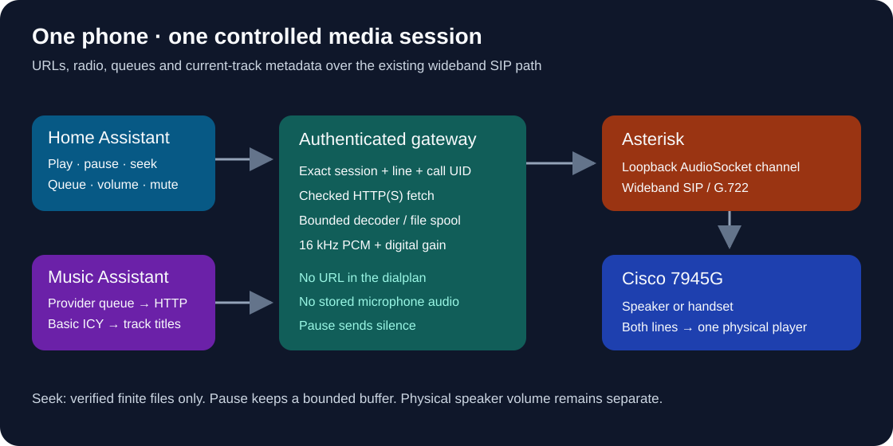

# Phone media players

The `cisco_phone_control` Home Assistant integration presents each physical
phone as one media player, with both SIP lines belonging to the same device.
Existing `media_player.cisco_<primary>_radio` entity IDs remain unchanged.

The optional controlled player extends the original radio dialer with HTTP(S)
audio, Home Assistant media sources, Music Assistant, queues, pause/resume,
next/previous, file seeking, digital volume and mute. It continues using the
16 kHz AudioSocket channel driver and the handset's negotiated SIP codec
(normally G.722). It does not turn a 7945G into a stereo or high-resolution DAC.



## Install and enable

1. Update both this gateway and the
   [Asterisk Telephony integration](https://github.com/ha-homelab/asterisk-telephony).
   The integration retains the radio-only behavior with an older gateway.
2. Regenerate the Asterisk configuration with `scripts/provision.py` using your
   existing **private** site and inventory. Sites with the persistent gateway
   enabled gain the reserved `699` player route. Reload the dialplan. Do not
   assign `699` to another service. It does nothing without a pending player
   reservation, and is not a public streaming endpoint.
3. Merge the `media_player` object in
   [the example](../deploy/gateway.media-player.example.json) into your private
   gateway JSON. Enable it explicitly. Replace the example origins with the
   exact scheme, hostname and port that HA and Music Assistant put in their
   audio URLs. Each origin authorizes fetching from that local service.
   Do not add router, Kubernetes, metadata or other administrative endpoints.
4. Deploy the new gateway image containing `phone_player.py`, `media_runtime.py`,
   `radio.py` and its catalog. Keep gateway and Asterisk on the same host network:
   their AudioSocket connection is loopback-only. Retain existing API source
   restrictions and bearer authentication. Nothing needs public port forwarding.
5. Allow enough writable temporary space for `max_calls × max_bytes` plus
   overhead (for example 512 MiB for four 64 MiB files). Temporary audio is
   removed when playback changes or ends; caller microphone audio is discarded.
6. Reload the HA integration. All configured phones retain entities while
   unplugged; controls become available after the phone comes online.

Keep real URLs with access tokens, addresses, credentials, private config and
deployment receipts out of Git. The example is deliberately not a complete
gateway configuration.

## Home Assistant controls

Use the phone's media card or `media_player.play_media`:

```yaml
action: media_player.play_media
target:
  entity_id: media_player.cisco_201_radio
data:
  media_content_type: music
  media_content_id: https://media.example.org/recording.mp3
  enqueue: replace
  extra:
    metadata:
      title: Example recording
      artist: Example artist
```

Curated station numbers such as `708` still work. HA resolves `media-source://`
references before sending their playable URL to the gateway. The gateway
accepts direct HTTP(S) audio; a web page, Spotify page or YouTube link is not a
direct audio stream. Use Music Assistant for supported provider content.

Queue modes follow HA conventions: `replace` clears and starts a new queue;
`add` appends; `next` inserts after the current item; `play` inserts there and
immediately advances. Queue entries exist only for the current playback session.
Next and previous select items without dialing another phone call.

Pause holds the phone's media connection and emits silence while preserving
the decoder position. Network streams use bounded TCP backpressure rather than
an ever-growing recording. A provider can disconnect a sufficiently long pause;
in that case restart playback. Stop releases the connection. Volume is a digital 0–100%
gain inside the player; the physical handset speaker volume remains a separate
limit. The default 50% gain preserves the earlier radio player's level.

Seek is offered only after a bounded file has been downloaded and its duration
verified. Chunked streams and live radio have no seek bar. A supplied duration
label alone never enables seeking. Direct file size and session duration limits
are configurable; the default session ceiling is two hours.

## Music Assistant

In Music Assistant add/enable the **Home Assistant Media Players** provider and
select the Cisco entities. Preserve any existing selected speakers. This uses
Music Assistant's normal HTTP audio stream, not SIP provider credentials.

For each imported Cisco player, under its advanced protocol settings set
**Enable ICY metadata** to **Basic** and reload the player when prompted.
Music Assistant 2.10.2 uses flow mode for HA players and sends new track titles
through ICY. Without this setting, HA receives only the initial title from
`play_media`. The gateway requests ICY metadata and removes it before decoding.

Let Music Assistant own its queue and provider-specific seek behavior. Its flow
stream appears as one live stream to the phone gateway. The local HA queue is
for separate direct URLs/stations; it is not a mirror of the MA queue. Do not
expect sample-synchronized multiroom playback from this HA protocol bridge.

## Current track and troubleshooting

The player shows metadata from HA/Music Assistant and live `StreamTitle` updates
when the station supplies them. Stations that publish no track metadata still
show their station name. The gateway does not guess the song or send audio to
an identification service. Signed URL query parameters are removed from state.

- **No URL controls:** check that both gateway and HA were updated and the
  private gateway `media_player.enabled` flag is true.
- **`player_dialplan_unavailable`:** reload the generated dialplan; verify
  `dialplan show 699@home` contains `cisco-player-v1`.
- **Local URL rejected:** compare its exact origin with `allowed_origins`.
  Adding a broad subnet is neither necessary nor supported.
- **Phone busy/DND:** finish the call or disable DND. Starting media does not
  seize an unrelated call. Hands-free voice yields through its existing lease.
- **No track changes:** enable Basic ICY for MA; other stations must actually
  send metadata. A station label is the honest fallback.
- **No seek:** wait for a finite file to finish downloading, or seek using MA's
  own controls. Live streams are intentionally unseekable.
- **Control refused after a hangup:** refresh state and start a new session.
  Every control carries the observed session and physical line. Old commands
  cannot hang up or change a replacement telephone call.

Manually dialing a radio number retains the legacy radio behavior and exact-call
Stop. Start playback from HA or MA to use the richer controlled player.
