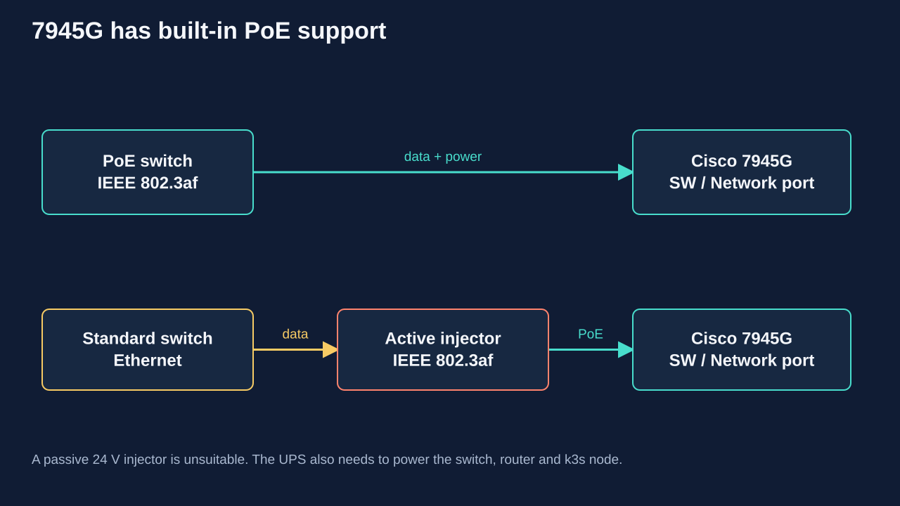

# Powering ten Cisco 7945G phones

**The 7945G has built-in PoE. No soldering or internal modification is needed.**
It supports IEEE 802.3af, not only legacy proprietary Cisco power.
See the [Cisco PoE FAQ](https://www.cisco.com/c/en/us/support/docs/voice-unified-communications/unified-ip-phone-7900-series/97869-poe-requirement-faq.html).

## Connection

A managed PoE switch with a voice network is convenient for the full batch:

1. Connect the switch to the router and UPS.
2. Run a known-good Cat5e/Cat6 cable from a PoE port to the phone's
   `10/100/1000 SW` / `Network` port.
3. Wait for DHCP and registration. Check power draw and PoE faults on the switch.
4. The `PC` port connects a computer; it is not the power input.

If your switch lacks PoE, add an **active IEEE 802.3af/at injector**:
`LAN → Data In → Data+Power Out → phone SW port`. Choose a gigabit injector for a
gigabit link. A splitter is unnecessary because the phone accepts PoE directly.

An approved external adapter is another option. Cisco lists `CP-PWR-CUBE-3`
with the appropriate mains cord for the 7900 series. A random adapter with a
similar plug is not a substitute.
See [Cisco Unified Communications SRND 8.x, IP Telephony Endpoints](https://www.cisco.com/c/en/us/td/docs/voice_ip_comm/cucm/srnd/8x/uc8x/endpnts.pdf).

## Power budget

The 7945G is **Class 3**. Conservative 802.3af allocation at the source is up to
**15.4 W per port**: **154 W** for ten phones, or about **193 W** with 25% headroom.
Plan for **at least 200 W dedicated to phones**, plus other powered devices.
This is a source-sizing allowance, not a claim of continuous 154 W consumption.
Sources: [Cisco phone classes](https://www.cisco.com/c/en/us/td/docs/voice_ip_comm/cvd/G2srsmbrnt/G2srsmbrnt_Book/FeatServ.html),
[Cisco PoE allocation](https://www.cisco.com/c/en/us/support/docs/voice-unified-communications/unified-ip-phone-7900-series/97869-poe-requirement-faq.html).

Check the number of PoE ports, each port's limit and the total budget separately.
A 24-port switch does not necessarily power 24 phones. A 120 W supply may be
insufficient when Class 3 power is fully reserved, even if average consumption is
lower. Cameras and access points need additional allowance.

A PoE+ 802.3at source supports an 802.3af phone. 802.3bt is unnecessary for one
7945G. Back up the switch, router and PBX power together for continued service.

## If the phone does not power on

1. Check the `SW` port and verify that PoE is supported and enabled on the switch.
2. Test a working phone with the same cable/port, and test the suspect phone on
   another working PoE port.
3. Check budget exhaustion, port faults, shutdown schedules and low power limits.
4. Check cable pairs and connectors; remove incompatible intermediate devices.
5. Test with the approved adapter. If the phone works with the adapter but not
   with several working PoE sources, its PoE input may be faulty.

Do not use a passive 24 V injector or apply DC directly to Ethernet pairs.
A faulty PoE input requires diagnosis, not a generic hardware conversion.

## If the batch includes a different model without PoE

Identify the exact model first; this project targets the 7945G. A phone that
truly lacks PoE may use an external **active IEEE PoE splitter** feeding its
normal DC input. Voltage, polarity, connector size, power capacity and Ethernet
speed must all match. Select a splitter only from that model's specifications.
The identified 7945G phones do not need one.

## UPS

Power the switch, PBX node, router and, when using an external SIP provider,
Internet access equipment from the UPS. Estimate runtime from measured total
load and battery specifications. PoE itself is not a backup power source.
