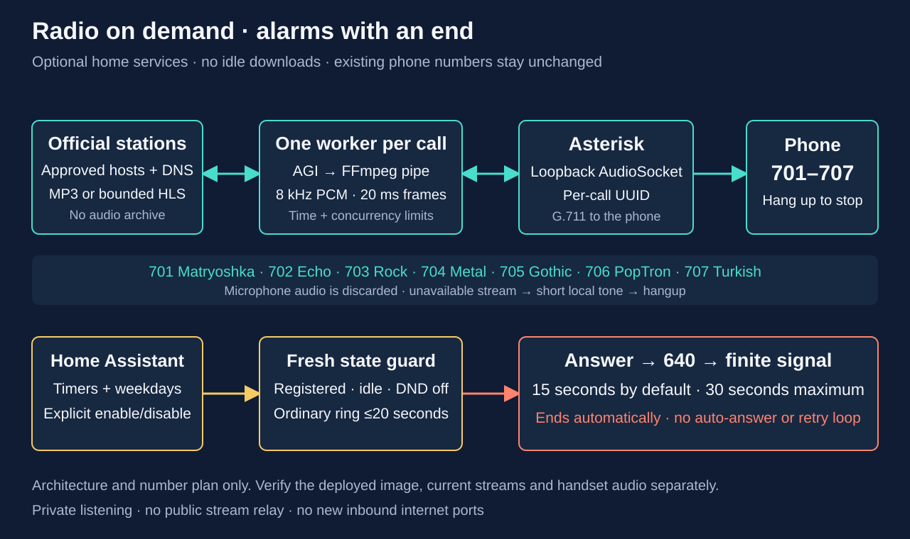

# Radio, alarms and do-not-disturb

These optional services use the existing Asterisk instance. They add no paid
service, public listener, or continuous radio downloader. Radio starts only
after an authenticated phone calls an enabled station number. Existing lines
201–208, Echo 600, test tone 601, first-line group 620 and Assist 630 retain their
numbers. All features on this page are disabled unless explicitly enabled.



The revised timer/alarm path rings until manual dismissal, without auto-answer
or after-answer audio. It requires the matching Asterisk, gateway and HA
updates. Asterisk, the gateway and Home Assistant were deployed and verified
on 2026-10-17. Physical tests confirmed manual dismissal, a selected-weekday
alarm ringing for more than 90 seconds, and the actual HA **Stop alert** button
ending the exact ringing alert. An HTTP routing defect found during acceptance
was corrected and redeployed before the successful Stop test. Earlier
finite-tone tests validate only the previous behavior. Radio and manual
dialing are unchanged.

## Station numbers

The versioned [catalog](../containers/asterisk/radio-catalog.json) contains the
stream entry points and the exact host policies. The broadcaster pages below
are the sources, not third-party stream aggregators. Each station was decoded
to nonzero 8 kHz PCM by the real worker on **2026-10-17**; availability can change.

- **701 — Matryoshka Radio London** (`matryoshka`), Russian-language music and
  programmes. [Official station](https://matryoshka.fm/). Its HTTPS entry point
  redirects to rotating `nNN-euN.rcs.revma.com` HTTP nodes. This is the only
  catalog entry that permits HTTP; transport integrity is consequently weaker.
  The catalog restricts that hostname pattern and checks every resolved IP.
- **702 — Echo online** (`echo`), Russian-language talk/news.
  [Official Echo](https://echofm.online/). This is the current online service,
  not a claim that the former Echo of Moscow FM station is still broadcasting.
- **703 — RADIO BOB! Rock** (`bob-rock`), the main rock stream.
- **704 — RADIO BOB! Metal** (`bob-metal`).
- **705 — RADIO BOB! Gothic** (`bob-gothic`).
  The three streams come from the [official RADIO BOB! stream directory](https://streams.radiobob.de/).
- **706 — SomaFM PopTron** (`soma-poptron`), electronic/indie pop.
  [Official direct-stream page](https://somafm.com/poptron/directstreamlinks.html).
  SomaFM specifies personal, individual listening; this implementation is for
  private home listening and does not authorize public redistribution.
- **707 — Radyo Viva** (`radyo-viva`), Turkish music.
  [Official station](https://www.radyoviva.com.tr/). Its embedded live player
  supplies an HLS playlist with AAC segments; the worker supports that bounded,
  unencrypted audio format.
- **708 — Toddler music** (`deti-toddlers`), simple songs for young children.
  [Official channel](https://detifm.ru/channel/327).
- **709 — Lullabies** (`deti-lullabies`), lullabies and gentle music.
  [Official channel](https://detifm.ru/channel/95).
- **710 — Children's songs** (`deti-songs`), a broader children's song mix.
  [Official channel](https://detifm.ru/channel/93).

These three dedicated Children's Radio channels are the selected options for
ages 1–4. The third channel serves a broader age range; the broadcaster can
change its playlist. They are separate from the main FM schedule, which also
has programmes for older children. All three routes are deployed with the
updated worker and private station selection, and are available as named
destinations in Home Assistant.

There is no station audio in this repository, archive, proxy endpoint, or
download library. Use the original broadcasts under each provider's terms.
Programmes, adverts and availability remain controlled by the broadcaster.

## Enable and verify

Merge the following into the existing private `site.json`; do not replace its
network, image or HA fields with an example:

```json
{
  "radio": {
    "enabled": true,
    "stations": ["matryoshka", "echo", "bob-rock", "bob-metal", "bob-gothic", "soma-poptron", "radyo-viva", "deti-toddlers", "deti-lullabies", "deti-songs"],
    "max_seconds": 1800,
    "max_calls": 2
  },
  "alarms": {"enabled": true, "duration_seconds": 15}
}
```

The [complete synthetic example](../deploy/site.radio.example.json) requires
real local settings and verified image digests before use. An enabled `radio`
object without `stations` uses the whole catalog. `max_seconds` accepts
30–7200 seconds; `max_calls` accepts 1–4 concurrent radio calls across the PBX.
The default two-call limit keeps this small-node workload bounded.
The `alarms.duration_seconds` setting controls only the legacy/manual 640 tone.
It does not set the duration of a scheduled alert. The new alert context is
generated for an enabled gateway and verified phone inventory.

Build the image containing Python, FFmpeg, `app_audiosocket`, `res_audiosocket`
and `res_agi`. Reusing an old image while changing only `site.json` is not
sufficient. Deploy its verified architecture-specific digest using the
[k3s runbook](k3s-deployment.md), after checking that all calls are idle.
Readiness checks require the radio worker, FFmpeg and running AudioSocket
application when radio is enabled.

Use the same private output directory that contains the existing secrets:

```bash
python3 scripts/provision.py --site .local/site.json \
  --inventory .local/phones.json --out .local
python3 scripts/preflight.py --site .local/site.json
python3 scripts/check_radio_streams.py
python3 scripts/check_radio_streams.py --station echo
```

The last command contacts one broadcaster and decodes a few seconds without
placing a call or writing audio. `--all` explicitly probes all ten stations.
The command without an option lists the catalog and performs no network
fetch. Diagnostics contain station IDs, PCM frame counts, signal peaks and
success state, not redirect tokens, caller details, or raw stream content.
The local probe requires Python 3 and FFmpeg; the container includes both.

The generator preserves existing SIP and management passwords. It writes
`asterisk/radio.conf` as a private runtime catalog selection and extends the
shared Cisco `dialplan.xml` with the enabled exact numbers. Phones need to
retrieve the updated dial template through a reviewed temporary TFTP window
for immediate number recognition. That step need not change their firmware
or credentials. Keep the per-phone source guards and normal
[provisioning cleanup](adding-phones.md) procedure.

Before that optional template refresh, use **on-hook predial** for 708–710:
leave the handset down and Speaker/Headset off, enter the complete number,
then press the **Dial** softkey. Do not press a line key first. Cisco documents
this procedure in the [7945G/7965G user guide](https://www.cisco.com/en/US/docs/voice_ip_comm/cuipph/7965g_7945g/6_1/english/user/guide/65enu61.pdf)
and describes the resulting en-bloc digit submission in its
[SIP dial-rule guidance](https://www.cisco.com/en/US/docs/voice_ip_comm/cucm/srnd/5x/50dialpl.html).
The new server routes must already be deployed. Verify this method on the
installed firmware before deciding a template refresh is unnecessary.

Call one enabled station from a single idle phone. Confirm intelligible audio,
then hang up and verify that the channel and its decoder disappear. Repeat
with a second station. Pressing `#` also ends the radio session when Asterisk
receives the negotiated RFC4733 digit. A third simultaneous call at the default
limit receives the finite failure tone. A failed connection, invalid redirect,
unsupported payload or stalled stream also produces a two-second local tone
and hangs up; there is no automatic retry loop. Silence from an actual silent
broadcast is not classified as a network failure.

To disable radio, set `radio.enabled` to `false`, regenerate and redeploy at an
idle window. The generator removes stale runtime radio configuration and
routes. Do not remove or regenerate unrelated secret files.

## Live network verification

On **2026-10-17**, all seven catalog stations also passed a passive probe inside
our running Asterisk pod, using its installed worker and FFmpeg 5.1.9. Each
station produced 251 nonzero-signal PCM frames, about five seconds of audio,
through a synthetic loopback AudioSocket session. Every probe released its
concurrency slot, stopped its worker thread and reaped its exact FFmpeg child.
The installed worker and catalog hashes matched the repository sources.

The three new children's channels first passed the same five-second probe
using temporary copies of the candidate worker and catalog. After deployment,
all three were tested again using the installed worker, whose source and
catalog hashes matched commit `38b7bb1`. Each produced 251 PCM frames with
nonzero signal; all three decoders were reaped and workers stopped. No calls
or audio files were created by those probes. The deployed 708–710 AGI routes
were checked separately. These passive results alone do not establish physical
speaker output.

This verifies stream reachability and decoding from the deployed network.
The probes created no Asterisk calls and saved no audio. They do not establish
AGI dialplan execution, SIP/RTP delivery, speaker output, or human audibility on
a physical phone. Those require the separate handset checks above.

On **2026-10-17**, a real call from Cisco line **207 to 708** executed
`AGI(radio.py,deti-toddlers)`, and the user confirmed that music was audible.
Existing PBX logs record the AGI start at **21:16:17 UTC** and its hangup result
at **21:16:33 UTC**; a later check found zero active channels and calls. The
digit-entry method was not confirmed, so this is not specifically an on-hook
predial test. Stations **709 and 710** passed the installed-worker PCM probes
above but have not yet been confirmed audible on a physical phone.

## Audio and network lifecycle

An AGI process starts for one station ID. It acquires a local concurrency slot,
opens an ephemeral **loopback-only** TCP socket, and asks Asterisk to connect
using a random per-call UUID. Only that matching connection can start the
downloader and decoder. No new host firewall rule or Kubernetes Service is
needed for AudioSocket.

Children's Radio supplies temporary stream URLs through the API embedded in
its official player. For each call, the worker fetches bounded JSON from the
fixed `101.ru` channel endpoint, requires a successful response and selects the
single HTTPS/443 AAC64 URL on `srv01.gpmradio.ru` for that exact channel. Both
requests use the same User-Agent. The temporary query token is neither saved
in the catalog nor included in diagnostics. API and audio redirects have
separate exact host/path policies. If the provider changes this contract, the
call fails with the existing finite error tone rather than accepting another
host or arbitrary URL.

Python resolves the approved hostname and rejects non-public or mixed
public/private address results. It connects to the checked address, verifies
TLS hostname/certificate where HTTPS is used, and validates up to three
redirects against the station's immutable host policy. Site configuration
cannot add URLs or hosts. The HTTP client does not use proxy environment
variables. Outbound DNS and TCP 443 are needed; Matryoshka additionally needs
TCP 80 to its approved CDN. Do not open inbound internet ports.

FFmpeg receives audio bytes on standard input with its protocol whitelist set
to `pipe`, a fixed MP3/AAC demuxer and no shell. It cannot follow a playlist URL
or open another network/file source. The HLS adapter independently validates
each playlist and segment URL; playlists are capped at 64 KiB, segments at
2 MB, nesting at two master playlists, and encryption/key/map/byte-range
features are rejected. Both adapters impose a total byte ceiling. There is
one decoder per call, with bounded threading and no unbounded audio queue.

PCM is mono, signed 16-bit little-endian, 8 kHz, paced in 20 ms frames with a
0.5 volume multiplier. Asterisk converts this to the phone's negotiated
G.711 codec. Incoming microphone frames are discarded; they are never sent
to the station or recorded. Network operations time out after eight seconds;
initial audio has a 15-second startup bound. A channel-bound watchdog provides
a final bound if an operation stalls. Hangup, `#`, time limit or failure closes
the AudioSocket and terminates/reaps FFmpeg. There is no background fetch
between calls.

This uses Asterisk's documented [AudioSocket application](https://docs.asterisk.org/Asterisk_22_Documentation/API_Documentation/Dialplan_Applications/AudioSocket/),
[AudioSocket framing](https://docs.asterisk.org/Configuration/Channel-Drivers/AudioSocket/)
and [AGI application](https://docs.asterisk.org/Asterisk_22_Documentation/API_Documentation/Dialplan_Applications/AGI/),
plus FFmpeg's [protocol whitelist and pipe protocol](https://ffmpeg.org/ffmpeg-protocols.html).

## Timers and weekday alarms: ring until manually stopped

Home Assistant owns countdowns, clock times, selected weekdays and enable/disable
state. When an occurrence is due, it requests a gateway `alert` with the verified
line and `kind: "timer"` or `"alarm"`. The gateway requires a registered, idle
phone with DND off and gives the occurrence its own persisted identity.

The [CLI](cli.md#countdown-timers-and-recurring-alarms) uses the same scheduler:
`cisco 213 timer start 5` sets a five-minute countdown on line 213, while
`cisco 212 alarm set 07:30 --days weekdays --enable` sets a weekday alarm on
212. Each physical phone has one countdown slot and one recurring alarm slot,
with independently saved target lines. Changing the general Line selector
does not retarget a saved alarm. Inspect both slots with `cisco 213 schedule`.
Use `timer cancel` or `alarm off` on the owning line to disable that schedule;
`stop-alert` stops current ringing while preserving future alarm occurrences.

The phone keeps ringing without an application ring-duration limit until one of
these manual actions ends it:

- Answer or reject the call on the physical phone. Answering dismisses the
  alert before bridging; there is no tone, radio or other after-answer audio.
- Press **Stop alert** in Home Assistant.
- For a timer, press **Cancel timer**. For an alarm, turn **Alarm enabled** off.

Alerts never use auto-answer, even if that phone's ordinary auto-answer switch
is enabled. HA's ordinary Answer control is also blocked for alert channels.
The updated integration removes Alarm sound and Timer sound selectors and
provides Stop alert instead: **29 entities per physical phone**.

The Asterisk `cisco-alert` helper uses a private Local channel, no Dial timeout,
and ignores forwarding. Its other leg waits in `WaitForSignal` without a
repeating interval. AMI's five-second timeout applies only to the initial Local
answer, not to ringing at the handset. The helper never plays the manual 640
tone. [The gateway API](phone-gateway.md#alert-identity-and-manual-stop) documents
the exact alert/stop identity and observable states; the
[companion repository](https://github.com/ha-homelab/asterisk-telephony)
documents HA scheduling.

Gateway restarts reconcile an existing alert from persisted identity. PBX or
power loss can end the call; neither recovery nor a missed schedule replays the
occurrence. Busy, offline, DND and ambiguous outcomes must be reported. Do not
retry by creating a second alert. This is an attention feature, not an emergency
alarm or a guarantee through network failure.

Validate the new deployment with one attended timer and one selected-weekday
alarm. Confirm ringing continues beyond the old 20-second boundary, auto-answer
does not activate, and each manual dismissal method leaves no owned channels.
Also verify restart reconciliation and that unrelated calls are preserved.
Do not count the previous finite-tone tests as acceptance of this new behavior.

### Legacy/manual 640 tone

Directly dialing **640** still answers and plays a local intermittent 880 Hz tone
for 1–30 seconds, then hangs up. The default is 15 seconds, with an absolute 35-second
channel bound. The gateway's older `ring` action likewise retains its 20-second
ring limit followed by the allowed destination after answer. Neither path is
used by the revised timer/alarm scheduler. Ordinary manual radio calls retain
their existing behavior and limits.

## Optional gateway DND

The [phone gateway](phone-gateway.md) uses a separate AMI account when this
private site option is enabled:

```json
{"gateway": {"enabled": true, "ami_client_ipv4": "192.168.50.10"}}
```

Use the actual exact private source address of the gateway, not a subnet. The
generator stores and preserves its independent credentials in
`gateway-ami-secret.json`. `cisco_gateway` receives `read=system,call` and
`write=system,call,originate`, an exact `/32` permit, and no AMI CLI-command
permission. Asterisk's [DBPut](https://docs.asterisk.org/Asterisk_22_Documentation/API_Documentation/AMI_Actions/DBPut/)
and [DBGet](https://docs.asterisk.org/Asterisk_22_Documentation/API_Documentation/AMI_Actions/DBGet/)
operate the `cisco-dnd` family, keyed by extension.

When that key is `1`, a direct home-context call to the line receives Busy.
Group 620 includes only each physical phone's primary line and skips a primary
with DND set, so a dual-line phone is never rung twice by the group. Secondary
lines have independent DND for direct calls. An empty group returns Busy.

AstDB lives in an `emptyDir`; the gateway's private persistent state is the
source of truth and must restore DND after PBX reconnect/recreation. A short
reconnect gap can otherwise lose DND. **AMI Originate directly to `PJSIP/...`
bypasses the home dialplan DND check**, so alarm and call-button guards must
consult the gateway's DND state themselves. DND is not a security boundary or
a substitute for fresh call-state checks. Disabling the gateway option removes
its account and DND dialplan additions while retaining the private secret file.

## Validation and limits

Unit tests exercise default compatibility, all eight preserved SIP passwords,
invalid configuration/URL/DNS rejection, HLS bounds, concurrency locks,
unauthorized AudioSocket UUID refusal, and real FFmpeg decoding with hangup
cleanup. `scripts/smoke-containers.sh` also runs a synthetic local radio call
through actual Asterisk AGI/AudioSocket, checks nonzero recorded PCM and reaped
FFmpeg, and exercises real gateway AMI startup fingerprints, DBPut/Get/Del, direct/group DND Busy,
channel access and refused CLI permission. Its test-only audio fixture is not
installed in the production image and uses no broadcaster connection.

These checks passed locally with Asterisk 22.11.0 on Linux ARM64. The separate
broadcaster probes validate current network playback; they do not establish
physical-handset audibility, home egress behavior, long-session reliability or
AMD64 deployment acceptance. Record those results only after testing the
deployed image and actual phones. Broadcast endpoints can change without
notice: update the reviewed catalog, rerun the bounded probes and rebuild the
image rather than allowing arbitrary URLs at runtime.
