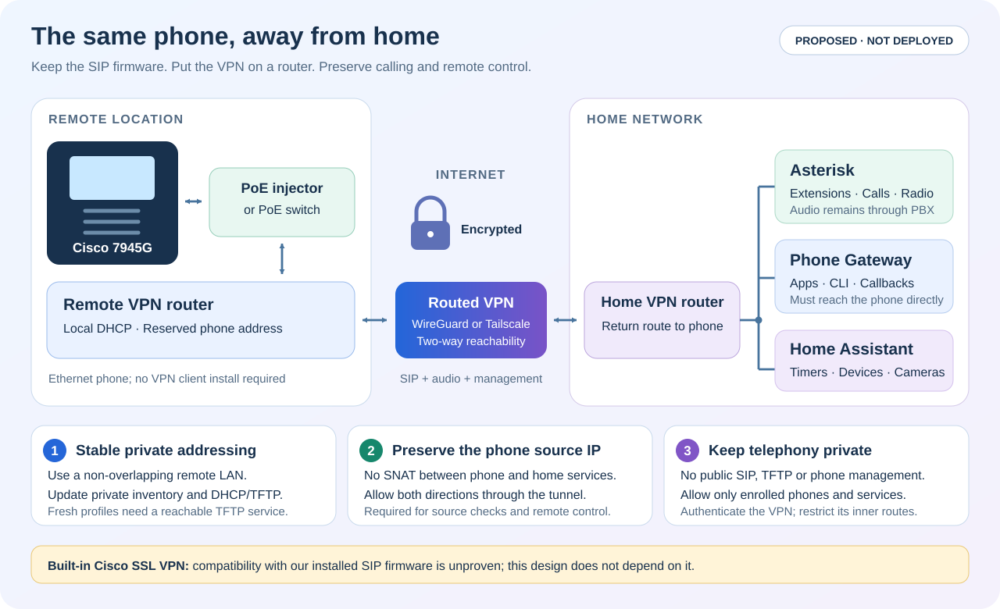

# Using the Cisco phones away from home

Research checked on **2026-10-18** for **CP-7945G running
SIP45.9-4-2SR4-3S**. This is a proposed design, not a deployed or remotely
call-tested feature. No phone firmware, VPN, firewall or routing was changed
during the investigation.

**These SIP phones can use the existing Asterisk from another location through
a routed VPN. The recommended design puts the VPN on a router beside the phone.**
The phone's built-in VPN is a different, older feature whose support has not been
established for our exact SIP firmware.

## What the phone's VPN menu means

Cisco documents a built-in **SSL VPN / AnyConnect-compatible** client using
TLS and DTLS, with Cisco ASA or suitable IOS SSL-VPN routers as the server.
Its documented model list includes the 7945, and its minimum phone release is
9.0(2)SR1S. This is not a WireGuard, Tailscale or OpenVPN client. The native
tunnel carries phone traffic; it does not turn the phone's PC port into a VPN
router. [Cisco's phone security design](https://sec.cloudapps.cisco.com/security/center/resources/ip_phone_certificates.html).

The important qualification is the **phone protocol**. Cisco's
[original comparison](https://www.cisco.com/c/dam/global/da_dk/assets/docs/presentations/Tech_Update_March_Collaboration_Enduser.pdf)
limits the 79xx native client to SCCP firmware. A later
[Cisco employee's CUCM 10.5.2 feature export](https://community.cisco.com/t5/unified-communications-infrastructure/features-different-between-cucm-8-6-9-x-10-x-and-11/td-p/2698006?attachment-id=120322)
lists Virtual Private Network Client for **7945/SCCP**, but not in its
7945/SIP feature list. Cisco's
[CME configuration chapter](https://www.cisco.com/c/en/us/td/docs/voice_ip_comm/cucme/admin/configuration/manual/cmeadm/cmevpn.html)
also explicitly covers SCCP phones.

We found no later authoritative confirmation that this capability was added to
SIP45.9-4-2SR4-3S. A guide covering both SCCP and SIP, or a visible VPN menu,
does not establish that compatibility. Conversely, this investigation did not
perform a native VPN handshake, so it does not prove that every unsupported
combination is technically impossible. Do not promise native VPN deployment
on the current SIP fleet based on the model name alone.

A read-only check of an idle handset confirmed the installed SIP load. Its
web Device, Network Configuration and Status pages exposed no VPN entries.
That observation is not an inventory of every on-phone Settings menu. Private
device evidence is excluded from this repository.

## Could a free VPN server replace Cisco ASA?

**ocserv** is an open-source AnyConnect-compatible server. Its current
[manual](https://www.infradead.org/ocserv/manual.html) includes
`cisco-svc-client-compat` for Cisco phone clients. However, its
[Enterprise phone compatibility note](https://gitlab.com/openconnect/ocserv/-/blob/master/doc/README-cisco-svc.md)
names the 7800, 8800, 8900 and 9900 series, not the 7945. Server compatibility
does not add a missing client feature to SIP firmware. This remains a lab
candidate, not a verified free solution for this fleet.

Native VPN also needs provisioning of the gateway, authentication policy and
certificate trust before the phone leaves the trusted network. Cisco documents
these in `vpnGroup` and associated credential fields in the SEP profile.
Erasing an old ITL is not a substitute for provisioning the new VPN trust.
Certificate changes and legacy TLS/DTLS behavior require a recovery plan.
See [Cisco's native VPN configuration and troubleshooting example](https://www.cisco.com/c/en/us/support/docs/security/anyconnect-secure-mobility-client/116162-trouble-anyconnect-vpn-phone-00.html).

Returning a working SIP phone to SCCP would also require a different Asterisk
endpoint integration and renewed testing of this project's phone controls.
It is not necessary for the external-router design.

## Recommended: a router handles the VPN

Connect the phone's **SW Ethernet port** through an 802.3af PoE injector or
PoE switch to a small router. Alternatively, use the phone's supported power
adapter. Do not assume a travel router supplies PoE. The router can obtain
Internet access from Ethernet or, where supported, Wi-Fi and then create the
encrypted tunnel. The phone keeps its existing SIP firmware and extension
credentials.

Use **routed site-to-site WireGuard**, with a distinct remote phone subnet,
fixed DHCP reservations and a return route from home to those phones.
GL.iNet documents both the remote LAN route and its client-side
Allow Remote Access the LAN Subnet setting; OpenWrt documents routed site-to-site
WireGuard. These are router configuration capabilities, not claims that every
model has the same UI or PoE hardware.
[GL.iNet instructions](https://docs.gl-inet.com/router/en/4/tutorials/wireguard_server_access_to_client_lan_side/),
[OpenWrt instructions](https://openwrt.org/docs/guide-user/services/vpn/wireguard/site-to-site).

If a direct tunnel is inconvenient because of NAT or CGNAT, two Linux
**Tailscale subnet routers** are another option. The official site-to-site
recipe uses route advertisement/approval, IP forwarding, access policies,
route acceptance and `--snat-subnet-routes=false`, plus return routes.
The Cisco phone does not run Tailscale. Prefer a direct peer connection and
measure voice quality if a relay is required. Keep the handset in an RFC1918
subnet behind the router: this project's phone-address validators do not accept
a direct Tailscale `100.64.0.0/10` address as the phone IP.
[Tailscale site-to-site](https://tailscale.com/docs/features/site-to-site),
[connection types](https://tailscale.com/docs/reference/connection-types).

## Why an ordinary NAT VPN client is insufficient here

The repository already sets `direct_media=no`, `rtp_symmetric=yes`,
`force_rport=yes` and `rewrite_contact=yes` on phone endpoints. These help keep
media at Asterisk and accommodate SIP behind NAT; they do not provide reverse
access for phone management. See
[Asterisk's PJSIP NAT guide](https://docs.asterisk.org/Configuration/Channel-Drivers/SIP/Configuring-res_pjsip/Configuring-res_pjsip-to-work-through-NAT/).

Our [phone gateway](../containers/asterisk/phone_gateway.py) enforces the
actual phone source IP for authentication callbacks and Home Apps. It also
opens HTTP connections back to that same phone for `CGI/Execute`, including
dialing, speakerphone controls and notifications. Masquerading a remote phone
behind a VPN-router address can therefore leave calls working while breaking
Apps or CLI/HA controls.

For the complete system, preserve a unique phone IP across the tunnel. Do not
SNAT traffic between enrolled phones and the home telephony services. Keep
remote and home subnets non-overlapping, provide return routes, and update the
private inventory and gateway mappings together. Avoid weakening the callback
source check or allowing an entire VPN peer network as a workaround.

## Configuration work required before a remote pilot

1. Select one phone and an actual remote network. Assign it a fixed private
   address in a non-overlapping remote subnet and configure the router tunnel.
2. Add only the selected phone's `/32` to the relevant private `phone_cidrs`,
   routes and firewall rules. The provisioner already supports explicit phone
   networks and includes them in PJSIP `local_net`; regenerate and review the
   paired configuration rather than editing only a runtime rule.
3. Keep the Asterisk and gateway addresses reachable through the tunnel. Give
   the phone working DNS/NTP. DHCP option 150, or Alternate TFTP, must point to
   the reachable private provisioning address.
4. Permit the actual required flows **inside the VPN**: SIP TCP/UDP 5060,
   Asterisk RTP UDP 10000–10199 and replies to phone media ports, each phone's
   assigned gateway callback TCP port, and gateway-to-phone HTTP TCP 80.
   Permit management SSH only from its intended administration source if used.
   Use the generated configuration for exact ports and source identities.
5. Provisioning requires UDP 69 and TFTP transfer ports 20000–20031, with
   replies to the client's selected ports. The current TFTP service is
   temporary. VPN connectivity does not restart it. Reliable unattended remote
   profile updates require a separately implemented persistent, restricted
   provisioning service; otherwise schedule a maintenance window.
6. Establish the tunnel before the boot/profile test. Confirm both line
   registrations, incoming and outgoing calls, and bidirectional audio. Test
   Home Apps, the directory, CLI dial/hangup, HA controls, an alert and a camera
   snapshot. Then test cold boot and recovery after an Internet interruption.

Check the tunnel MTU during the provisioning test. The current TFTP command
allows a 1468-byte block; this is too large to fit without fragmentation inside
a 1280-byte IP MTU after UDP/TFTP headers. Negotiate and verify smaller blocks
for such a path rather than assuming a successful initial request proves the
complete profile or firmware transfer will work.

Remote use is accepted only after these checks at the remote location. The
current home-LAN tests do not prove remote routing, NAT recovery or audio
quality. Expose only the selected VPN service at the Internet boundary; SIP,
TFTP, phone HTTP and AMI remain private. Preserve the existing exclusions and
security rules for every unrelated VPN peer.

Keep endpoint addresses, keys, routes, phone profiles, packet captures and
device screenshots under ignored `.local/` storage. This page and its diagram
contain design information only.
