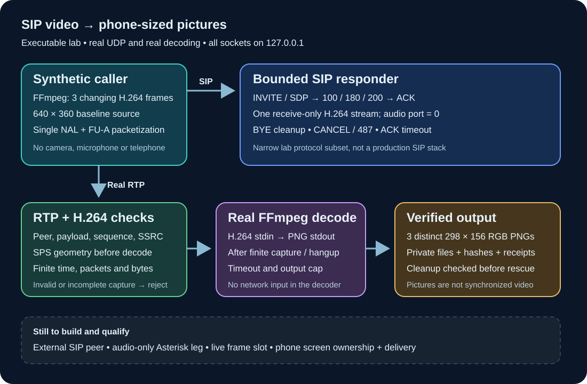

# SIP video to phone-sized pictures: executable laboratory

This prototype negotiates a real SIP session over UDP, receives actual H.264
RTP packets and decodes them into **298 × 156 RGB PNGs**. Both peers bind only
to `127.0.0.1`; the caller generates synthetic video. No telephone, camera,
microphone, Home Assistant connection or Asterisk account is used.

It is a first executable part of the bridge described in
[the firmware laboratory](firmware-lab.md). It **does not** add native video
to a Cisco 7945G. The prototype rejects the offered audio leg, captures a short
bounded video clip and decodes it after capture when the dialog ends. It does
not yet forward pictures to the phone or bridge audio.



## Run it

Requirements: Python 3.10 or later and FFmpeg with the `libx264` encoder,
H.264 decoder and PNG encoder. The tool uses the Python standard library and
the repository's existing PNG validator; no additional Python package or
global SIP-stack installation is required. Pillow is used by an additional
pixel-content test when available.

From the repository root:

```sh
python3 -m tools.sip_video probe
python3 -m tools.sip_video demo \
  --output .local/sip-video/first-run \
  --scenario all
```

The output directory must be new and below this checkout's literal `.local/`.
An existing directory is refused. Choose a new name on the next run; the tool
does not overwrite earlier results. Parent symlinks are rejected.
Directories are created with owner-only access and generated files with mode
`0600`.

The four scenarios are also available separately:

```sh
python3 -m tools.sip_video demo \
  --output .local/sip-video/video-only \
  --scenario complete
```

- `complete`: INVITE/SDP, provisional responses, 200, ACK, H.264 RTP, BYE/200,
  and three distinct decoded pictures.
- `cancel`: cancel while ringing; 200 for CANCEL and 487 for INVITE, with no
  media receiver created.
- `ack-timeout`: negotiate a session but withhold ACK; close and discard media
  without producing pictures.
- `malformed-rtp`: establish the dialog, send invalid RTP, then hang up;
  reject the capture and produce no pictures.

The CLI returns zero only if its selected scenarios satisfy their assertions.
Missing dependencies and failed protocol/media checks return a nonzero status.
`probe` checks installed capabilities; it does not download anything.

Each scenario writes `result.json`. The successful scenario also writes
`frames/*.png`. The report contains protocol status codes, packet counts,
picture hashes, and resource state before and after fixture cleanup.
It contains no packet payload or SIP credentials. The test checks natural
media cleanup **before** its final fixture cleanup, so closing a failed
receiver afterward cannot turn a broken protocol result into success.

## What is real, and what is synthetic

The SIP caller and responder use separate UDP sockets. They exchange actual
wire-format SIP requests/responses and SDP. The video receiver's port is
obtained from the SDP answer; the agreed payload type is enforced. This lab
also requires the sender to transmit from the port it advertises in its offer.
SDP normally advertises a receive port, not a guaranteed source port; this
extra pinning is a deliberate interoperability restriction.
The synthetic caller generates three changing
640 × 360 baseline H.264 frames using FFmpeg, packetizes the bitstream into
single-NAL and FU-A RTP packets, and sends those datagrams to the negotiated
port. The receiver reconstructs H.264, validates it and invokes the real
FFmpeg decoder.

The resulting three pictures must have different hashes and the exact phone
image dimensions. A separate test decodes a known red H.264 image and checks
the output pixel color, so nonempty files alone are insufficient.

These checks prove the local signaling-to-media path. They do not establish
interoperability with an external SIP provider, doorbell, camera or telephone.
No canned PNG substitutes for decoding; there is also no simulated claim that
a Cisco screen has displayed the files.

## Deliberately narrow protocol support

`tools/sip_video/signaling.py` is a bounded lab responder, not a mature general
SIP stack. PJSUA, baresip and GStreamer were unavailable in the development
environment; FFmpeg supplies the established codec implementation. Avoiding a
large toolchain installation kept this slice independent of firmware research.

Supported behavior follows a small subset of
[SIP, RFC 3261](https://www.rfc-editor.org/rfc/rfc3261.html) and
[H.264 RTP, RFC 6184](https://www.rfc-editor.org/rfc/rfc6184.html):

- One accepted dialog per server instance; INVITE, ACK, BYE, CANCEL and OPTIONS.
  Responses are tied to the local request socket. Dialog tags, Call-ID, CSeq
  and transaction branches are validated.
- Delayed answer permits cancellation testing. Duplicate transactions reuse
  cached responses; pending 200 responses have a bounded retransmission loop.
- One sending H.264 video stream, dynamic payload type, 90 kHz RTP clock and
  packetization mode 0 or 1. The answer is `recvonly`; audio media lines are
  answered with port zero.
- Single NAL packets, STAP-A and FU-A. Packet sequence, SSRC and timestamp
  continuity are checked. A loss, reorder, changed parameter set, malformed
  fragment or unsupported format rejects the capture rather than repairing it.
- Numeric IPv4 loopback only for SIP and SDP. No DNS destination, proxy route,
  re-INVITE, registration, authentication, TLS, SRTP, ICE, BUNDLE, RTCP feedback
  or general-purpose jitter buffer is implemented.

The responder requires the explicit full-header forms generated by the demo;
it is not a complete SIP grammar implementation. A closed dialog keeps a
bounded transaction cache until explicit server shutdown or its deadline.
“Dialog closed” therefore means its media is closed; the report's separate
`socket_closed` and `worker_alive` fields establish final signaling shutdown.
Local call expiry closes media without sending an outbound BYE; production
dialog teardown is still required.

## Resource and failure bounds

All incoming media is accumulated within fixed limits before any native decode:

- SIP message ≤ 8 KiB, SDP ≤ 4 KiB, at most 32 headers and a bounded transaction
  cache. The server has a finite total lifetime, answer and ACK deadlines.
- RTP datagram ≤ 2 KiB, at most 8,192 packets, elementary stream ≤ 4 MiB,
  at most 512 NAL units and 256 KiB per NAL.
- At most eight access units and ten seconds of capture. The demo uses three
  access units. Sequence wrapping is supported; packet loss recovery is not.
- Every accepted SPS is checked **before decoding**, including coded geometry
  before cropping: at most 1024 × 768, progressive 8-bit 4:2:0, supported
  profiles/levels and at most four reference frames. Changed SPS/PPS and
  embedded start-code smuggling are rejected.
- FFmpeg receives H.264 through stdin and emits PNG through stdout. It has no
  media URL, file input or network input protocol. Input, output, allocation
  size, worker threads and elapsed decode time are bounded; timeout or output
  overflow kills and reaps the child.
- PNG dimensions, format/chunks and CRCs are validated before files are
  accepted. A rejected decode or incomplete write removes its own partial
  output; previously existing output is never replaced.

These are application bounds, **not an operating-system sandbox or a total
RSS quota**. Do not expose this prototype to untrusted network traffic.
The command has no public-listen or remote-peer option. Local test deadlines
also do not promise a particular video latency or phone refresh rate.

## Tests

```sh
python3 -m unittest discover -s tests -p 'test_sip_video*.py' -v
```

The protocol tests exercise real loopback UDP, including incorrect dialog
identity, duplicate requests, cancellation and expiry. Media tests cover SPS
bounds, parameter-set relationships, payload negotiation, fragmentation,
source pinning, incomplete captures, decoder timeouts and output overflow.
Integration tests perform the full SIP/RTP/PNG path and inspect the generated
files. The real decoder test is explicitly skipped if FFmpeg is absent; such
a run is not evidence of working video decoding.

## What is required for a useful telephone bridge

1. Replace or extend the lab signaling adapter with a qualified SIP/media stack
   and controlled external-peer interoperability tests.
2. Implement a separate audio-only dialog to Asterisk, bridge audio and couple
   answer/cancel/hangup in both directions. The current rejected audio offer
   is not this second leg.
3. Decode continuously into a bounded latest-frame slot, carrying actual
   acquisition/capture provenance and discarding stale frames. This prototype
   decodes after capture, so it is not yet that live worker.
4. Feed the phone's authenticated picture service with call association,
   explicit expiry and shared screen/media ownership. Coordinate with the
   [camera and voice display contract](voice-display.md); its current focus
   rules yield to native calls rather than overlay them.
5. Check the actual caller's H.264 profile, packetization, NAT/security
   requirements and Cisco screen behavior in an attended test.

Even after those steps, the 7945G receives refreshed pictures rather than
native synchronized SIP video. A real video-capable endpoint remains necessary
for a normal video-call experience. No firmware decompilation, repackaging or
flash operation is a dependency of this executable lab.
