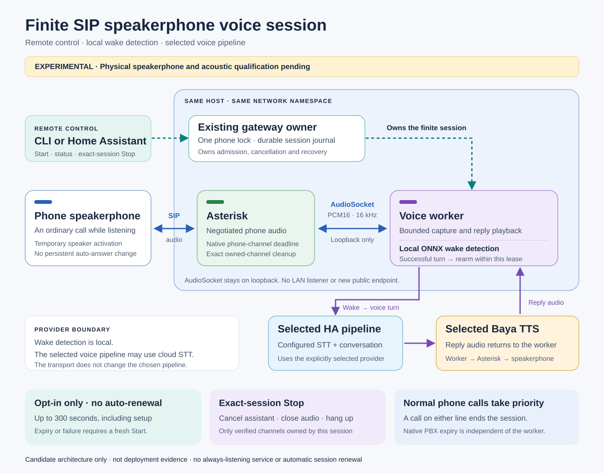

# SIP speakerphone voice prototype

This optional transport keeps one ordinary, bounded SIP speakerphone call open
while the existing local wake detector and Home Assistant pipeline handle voice
turns. It avoids the stock phone's separate XML RTP transmit/receive commands.
The user can start it remotely; no physical button press is required. A normal
incoming or outgoing call on either handset line ends the assistant call.

This is an experimental transport, not a claim of physical acceptance. Each
assistant call has a maximum 300-second lease and occupies a phone call while
listening. One-session mode does not restart automatically. The explicitly
enabled [hands-free policy](voice-control.md#hands-free-policy-and-status) can
supervise successive sessions after verified cleanup and fresh idle checks.
Status is available through the gateway, CLI and Home Assistant; omit the
optional XML live-status display for this transport.

The following diagram shows the one-session transport. Hands-free adds the
[supervised renewal policy](voice-quickstart.md#enable-hands-free-mode) around it.



## Deployment boundary

Keep the Asterisk and voice gateway on the same node, both in its host network
namespace. The worker binds **127.0.0.1 only**, on the selected profile's
`bind_port`. No Service, Ingress, LoadBalancer, firewall port, ARI endpoint or new
public API is required. If they are on different nodes or in different network
namespaces, this prototype is not configured correctly: do not substitute a LAN
listener to make it work.

Use the current wake-capable voice image, rebuilt from a reviewed revision that
contains these new modules. The build helper's explicit source allowlist and the
optional-wake image's base manifest include the three new runtime files. The
stock PBX image already requires `chan_audiosocket`, G.722 and resampling; no new
PBX package or runtime capability is requested.

The existing gateway AMI account needs its current `read=system,call` and
`write=system,call,originate` permissions. This path uses endpoint/channel
snapshots, `Getvar`, `Originate` and exact-identity `Hangup`.
`DBGet` reads the current DND state without invoking an escalating dialplan
function through AMI. It does not request AMI command permission or enable ARI.
The existing phone HTTP credentials are
used for one guarded speaker-key request if the owned incoming call is ringing.
Persistent auto-answer and other phone preferences are unchanged.

## Prepare an opted-in profile

1. Preserve the current private voice control and transport files as the rollback
   point. Keep configuration, tokens, device identity and deployment receipts
   under the ignored `.local` directory with their existing 0600 permissions.
2. Add this **overlay** to the private site configuration, choosing an inventoried
   line. It is disabled unless `enabled` is explicitly true:

   ```json
   {"sip_voice": {"enabled": true, "lines": ["201"]}}
   ```

3. Run the normal provisioning script against the private inventory. Review the
   generated `cisco-voice-sip` and `cisco-voice-sip-bound` contexts before applying
   the PBX configuration. No caller-facing context may include them. The context
   allows only explicitly inventoried lines, rejects phone redirects, validates
   a session token and deadline, and sets `TIMEOUT(absolute)` on the actual phone
   channel **before initiating its outgoing SIP call**.
4. Copy `examples/phone-voice-sip.example.json` to a private transport file and
   adapt only the example addresses, line, paths and ports. `media_transport` is
   the explicit opt-in. `bind_port` becomes the loopback TCP AudioSocket port;
   the legacy `bind_ipv4` and `phone_rtp_port` remain part of the shared profile
   schema but are not used to open a raw phone RTP stream in SIP mode.
5. Reference that transport in the existing voice control profile. Preserve the
   **same physical-phone state directory** as the current gateway. A second lock
   directory would defeat mutual exclusion. Omit `display_port`. The sample
   control file intentionally starts with `enabled: false`; enable it only when
   the matching image, private PBX context and topology have been verified.
6. Reuse the existing ONNX voice configuration and its explicitly selected HA
   pipeline, originating phone device ID and configured Baya voice. To match an
   Echo-style setup, select that same pipeline and voice. SIP transport requires
   ONNX mode; it does not select the HA default pipeline or change the voice.
   Local wake detection does not make STT local: the selected pipeline may still
   use cloud recognition. Enable successful-turn rearming if you want repeated
   questions within the original session deadline.

## Choose hands-free or one session

For hands-free, the profile must use ONNX wake mode with `rearm_after_turn: true`
and a configured session length of 30–300 seconds. The explicit Enable command grants persistent microphone operation. No phone
button or recurring CLI process is needed:

```sh
cisco --json 201 voice enable --idempotency-key handsfree-example-001
cisco --json 201 voice status
cisco --json 201 voice disable
```

The example line/key are synthetic. Enable supports `--dry-run` without changing
intent or starting audio. Read [the hands-free quickstart](voice-quickstart.md#enable-hands-free-mode)
for actual readiness and Disable confirmation. A policy that is enabled may
still be waiting, warming up, backing off or faulted.

Disable prevents new automatic starts before requesting Stop. A valid finite
Stop of the current supervised session also disables intent; a historical Stop
does not affect a newer generation. Hanging up the assistant call or sending DTMF Stop
disables it as well; that is different from a positively observed ordinary call,
which can pause the assistant and permit later resumption. Never treat ambiguous
call disappearance as permission to redial.

For one session, disable hands-free first. Use the existing CLI configuration
and commands; the same manager remains the owner:

```bash
voice_check_key="voice-check-$(python3 -c 'import secrets; print(secrets.token_hex(16))')"
cisco --json 201 voice start --idempotency-key "$voice_check_key" \
  --dry-run --attended --exclusive-media --enable-microphone

voice_start_key="voice-start-$(python3 -c 'import secrets; print(secrets.token_hex(16))')"
cisco --json 201 voice start --idempotency-key "$voice_start_key" \
  --attended --exclusive-media --enable-microphone
cisco --json 201 voice status
cisco --json 201 voice stop --session-id EXACT_SESSION_ID_FROM_START
cisco --json 201 voice status
```

Both validation and live Start require a key. The dry run checks the profile
without reserving or replaying an operation; separate keys keep it distinct
from the live request. Keep the live key when retrying the same logical
operation and exact request; do not rerun its key-generation assignment for
that retry. After an uncertain response, read status before retrying. Generate
a new key for each deliberately new Start. The request key is not the session
ID used by Stop.

Use the existing exact-session Stop operation with the `session_id` returned by
Start. Do not invoke `voice_session_sip.py` directly: its live mode additionally
requires the descriptor inherited from the owning manager. Do not use the old
standalone `run_reserved.py` wrapper for this transport; its report contract is
the XML/RTP contract. The gateway path has a separate SIP completion validator.

## Use the session without handset buttons

Wait for the matching session's [wake-ready status](voice-quickstart.md#start-without-touching-the-handset)
before speaking; an accepted Start or running process alone is not readiness.
There is no audible ready cue. Say the configured wake phrase and question,
then wait for playback to finish and readiness to return before asking again.
Use CLI or Home Assistant status and exact-session Stop; the optional live XML
assistant display is unavailable in SIP mode. Check that the matching session
is inactive and Stop is confirmed.

Each inner session lasts at most 300 seconds including setup. Replies do not
extend it, and an inactive phone cannot hear the wake phrase through this path.
Enabled hands-free mode requests Stop of its own session five seconds before
the deadline, then renews only after confirmed cleanup and two fresh idle
observations separated by a quiet period. Setup and model warmup may create
capture gaps; call setup/renewal effects on the stock phone need physical checks.
The native PBX deadline stays in place. Do not schedule repeated Starts or clear
leases to simulate persistent operation.

With the paced-idle update installed, an admitted SIP session sends PCM silence
when no reply audio is waiting. Silence and speech share the same serialized
writer and pacing; this is not a second audio stream or an audible ready cue.
The sender remains subject to Stop, call preemption and the original deadline.
It neither extends the session nor proves that a wake phrase was detected.

Idle frames are transport maintenance. They do not increment `turns_completed`
or `completed_pcm_bytes`; outgoing frame counts alone cannot establish a
spoken reply. Install the matching gateway runtime to get this behavior; a
CLI-only update does not add the sender.

For a status-only playback check after installing the
[playback diagnostics update](voice-control.md#playback-diagnostics):

```sh
cisco --json 201 voice status --playback
```

Positive `completed_pcm_bytes` records completed delivery of nonempty decoded
PCM to the software sink. It does not prove non-silent or audible sound, the
actual synthesis backend, or that Baya generated the reply. The diagnostic
needs the updated gateway and both CLI files; it needs no HA update.

## Ownership and failure handling

- One random UUID identifies the AudioSocket stream. It is checked before PCM is
  delivered to the assistant. UUID correlation is not network authentication;
  loopback-only topology is mandatory.
- The child verifies the inherited physical-phone lock's inode and the current
  reserved journal's phone/session identity. The existing manager owns Start
  idempotence, Stop signalling and durable recovery.
- A private `Local/.../n` source leg and `Dial(...,i)` prevent a phone redirect from
  silently changing the target. Both generated root IDs are tracked, and the
  actual phone channel must have the matching inherited token and deadline.
- The AMI observer exempts only that exact phone channel and Uniqueid. Another
  channel on either line, a stale snapshot, an unavailable endpoint, lease expiry,
  wire failure or explicit Stop ends the session. Linked-call identity alone does
  not exempt another phone channel from preemption.
- Stop closes AudioSocket, cancels the assistant and hangs up only this operation's
  verified channels. It sends the exact Uniqueid in AMI's `Channel` field; pinned
  Asterisk 22.11.0 supports Uniqueid lookup there. A fresh empty result is
  required to confirm the owned PBX channels are gone; an AMI success response
  alone does not suffice. Physical microphone closure still needs its own check.
- A never-attempted originate may finish as failed without fabricating a Stop ACK.
  This requires the current owner's complete child report, normal failure exit,
  launch-bound SIP cleanup proof, zero media/turn evidence and a durably written
  terminal journal. A bare no-start flag has no authority. The worker seals future
  starts before reporting this proof; XML and SIP proofs are not interchangeable.
  An attempted but never-observed asynchronous originate remains reserved because
  it could still appear later. Its private deadline prevents a late indefinite
  call. Ambiguous cleanup stays `recovery_required`; do not delete the journal.

The 300-second inner-session budget includes preparation and call setup.
Hands-free renewal does not extend an existing phone-channel lease. The native PBX timeout
is independent of Python and ends the call even if a terminated worker cannot run
its cleanup path. A later fresh reconciliation is still needed before releasing
an uncertain manager reservation. The PBX deadline rounds down conservatively
because Asterisk's `EPOCH` value has whole-second precision.

## Qualification before a physical rollout

Offline tests cover stream UUID, framing, PCM rate, pacing, cancelled playback,
two wake/reply/rearm turns through the actual coordinator, exact-call focus,
lease expiry, repeated cancellation, inherited-lock checks and the manager's
transport-specific completion contract. Provider responses in these tests are
synthetic; they do not prove real STT, Baya audio or room acoustics.

Keep installation, model checks and physical conversation results separate.
Matching source hashes and a successful model positive control on the target
host do not test speech pickup through the phone. A sustained idle call or
clean Stop/preemption likewise does not establish an audible answer. Require
the full wake/question/reply/rearm sequence on the installed revision before
claiming conversational or across-room readiness.

A separate isolated Asterisk 22.11.0 test used a fresh `--network none` container
with no published ports. It verified a synthetic G.722 callee, AudioSocket UUID
admission, the actual phone-channel timeout, Uniqueid-targeted AMI Hangup/BYE,
and a passive native-expiry/BYE case without a client Stop. The container was
removed after the test. This is PBX interoperability evidence, not physical
speakerphone or acoustic acceptance.

The real-PBX test used a synthetic callee that automatically answered. The stock
phone's HTTP speaker-key operation is covered by mocks only. It has an inherent
snapshot-to-key race that must be assessed on hardware. Continuous SIP microphone
input, room echo suppression, and the three-second media-idle bound also need
physical qualification. Hands-free is persistent intent over bounded sessions,
not guaranteed uninterrupted capture; it adds no barge-in behavior.

The required physical acceptance is one opted-in phone, a remotely started
speakerphone call, audible wake/command/reply/rearm, exact Stop, normal-call
preemption, and worker-death/native-timeout cleanup. Preserve unrelated calls and
do not enable a fleet until the one-phone result is verified. For hands-free,
also verify lease renewal, ordinary-call pause/resumption, failure handling and
Disable during startup or renewal with no later automatic capture. Clean restart
may preserve intent; uncertain ownership must fault without starting audio.

## Troubleshooting and rollback

For a failed owned child, the controller attempts to retain one private
`<sha256(device)>.last-failure.json` in its configured state directory. The file
is at most 4 KiB, mode `0600`, and replaced by a later failure for that phone.
It is outside `run-<session_id>` and survives normal run-directory cleanup.
Check its session ID before associating it with an attempt; successful sessions
do not erase the previous failure.

The receipt records the report-validation category and bounded child claims.
A valid `startup_diagnostic` contains fixed runner/AMI stages, an allowlisted
error reason/type and sanitized AMI action/error categories. It captures the
startup exception before cleanup. It contains no raw exception text, AMI
responses, audio, credentials or launch challenge, and is not exposed in public
status. A missing receipt can mean persistence failed; a retained receipt does
not prove that the journal write or lease release completed. Neither diagnostics
nor the receipt authorize cleanup, retry or recovery. Preserve it as private
incident evidence alongside the authoritative journal.

- **Stuck in `preparing` after AudioSocket connects:** an early SIP build waited
  for server closure while its accepted stream was still open. The
  [startup lifecycle fix](https://github.com/4alvit/cisco-home-telephony/pull/17)
  consumes that stream before waiting for listener closure and closes the
  accepted writer before bounded writer/listener shutdown waits. Real loopback
  TCP regressions cover startup, Stop and cancellation; they do not establish
  phone audio. Verify that the installed gateway includes the fix; updating
  only the CLI is insufficient. If Stop remains unconfirmed, follow recovery
  rather than clearing the reservation or forcing another Start.
- `phone_not_idle` or `call_changed`: inspect both handset lines. Never ignore all
  active channels just to make the assistant run.
- `pbx_deadline_unverified` or `call_admission_mismatch`: the private PBX contexts,
  token inheritance or actual phone-channel timeout did not match. No speaker
  attempt should occur before these checks pass.
- No AudioSocket connection: verify PBX/worker co-location, the loopback port and
  `chan_audiosocket`. Do not open the port to the LAN.
- `snapshot_stale`: fix AMI latency or infrastructure. The observer's one-second
  freshness requirement is intentionally unchanged.
- `receive_idle_timeout`: verify that the negotiated SIP media supplies microphone
  PCM; keep radio quality and assistant-capture acceptance as separate findings.
- `recovery_required`: inspect exact root IDs, channel Uniqueids, native deadline
  and manager journal. Do not blindly redial or clear ownership.

For rollback, Disable hands-free, stop any exact owned session and confirm its
cleanup and channel absence. Follow the [gateway rollback procedure](voice-gateway-deployment.md#upgrade-rollback-and-cleanup)
to restore the reviewed baseline Deployment, immutable image, private profile
and exact Secret references while preserving persistent state and ownership
journals. For an earlier SIP release, retain its saved SIP profile and private
`sip_voice` site overlay. Restore the saved XML/RTP profile and disable that
overlay only when deliberately reverting the transport to XML/RTP. There is
no firmware, persistent auto-answer or public routing change to undo.

References: [AudioSocket protocol](https://docs.asterisk.org/Configuration/Channel-Drivers/AudioSocket/),
[Dial pre-dial subroutines](https://docs.asterisk.org/Asterisk_22_Documentation/API_Documentation/Dialplan_Applications/Dial/),
[native channel timeout](https://docs.asterisk.org/Asterisk_22_Documentation/API_Documentation/Dialplan_Functions/TIMEOUT/),
[pinned AMI implementation](https://github.com/asterisk/asterisk/blob/22.11.0/main/manager.c),
[pinned Uniqueid channel lookup](https://github.com/asterisk/asterisk/blob/22.11.0/main/channel.c).
