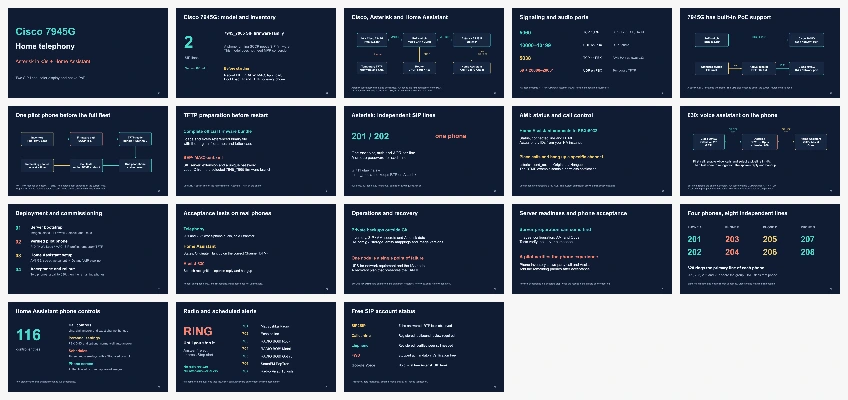

# Presentation: Cisco 7945G, Asterisk and Home Assistant

[Open PDF](cisco-home-telephony.pdf) · [Download editable PowerPoint](cisco-home-telephony.pptx)



14 English slides cover the purchased batch of ten 7945G phones, home network
architecture, PoE, SCCP/SIP conversion, TFTP, Asterisk PJSIP, Home Assistant over
AMI, Assist on extension 630 with G.711 ↔ Opus, deployment, call acceptance,
backups and batch rollout. PPTX labels and diagrams are editable objects.
Speaker notes link to primary sources. The PDF is suitable for reading and printing.

The presentation accompanies the [k3s runbook](../k3s-deployment.md),
[phone provisioning guide](../provisioning.md) and [Home Assistant guide](../home-assistant.md).
A separate [PBX bootstrap procedure](../pbx-bootstrap.md) uses `--pbx-only` to
prepare the server before verified phone profiles are available. Detailed HA
packages, dashboard, installation and acceptance procedures live in the
[companion repository](https://github.com/ha-homelab/asterisk-telephony).
Before flashing, check each phone's App Load and hardware revision. HW 13.0+
must not run firmware below 9.3(1)SR3. Follow the chosen release's upgrade notes.

The slides distinguish server preparation from adding verified hardware and
physical acceptance. They do not establish that home deployment or a real call
has been completed. Successful container/runtime checks do not replace tests of
two-way audio, DTMF, call control and Assist on physical phones.

## Sources

- [tools/build_slides.mjs](../../tools/build_slides.mjs) contains text, colors,
  object layout, source-linked speaker notes and the four SVG definitions.
- [SVG diagrams](../diagrams/) can be edited in a text editor, Inkscape or another
  SVG editor. They contain no external images or fonts.
- Presentation font: Arial. Format: 16:9, 1280 × 720.

## Rebuild SVG files without special packages

From the repository root:

```bash
node tools/build_slides.mjs --svg-only
```

This updates `docs/diagrams/architecture.svg`, `assist.svg`, `commissioning.svg`
and `power.svg`. It needs a modern Node.js runtime and makes no network requests.

## Rebuild PPTX and PDF

Authoring uses `@oai/artifact-tool` from Codex's bundled workspace runtime.
This is **not a public npm dependency**; do not install an unrelated package with
the same name. In Codex, obtain paths with `load_workspace_dependencies`, then
set these variables to the returned paths:

```bash
export RUNTIME_NODE=/path/to/bundled/node
export RUNTIME_NODE_MODULES=/path/to/bundled/node_modules
export ARTIFACT_TOOL_ROOT="$RUNTIME_NODE_MODULES/@oai/artifact-tool"
export SOFFICE=/path/to/bundled/soffice
"$RUNTIME_NODE" tools/build_slides.mjs
```

For the built-in package check before delivery, also set:

```bash
export PRESENTATION_SKILL_DIR=/path/to/presentations/skills/presentations
export RUNTIME_PYTHON=/path/to/bundled/python3
"$RUNTIME_NODE" tools/build_slides.mjs
```

The build writes PPTX, PDF and `preview.webp` to `docs/slides/`. Visual-review
images, the candidate PPTX and validation reports go to Git-ignored
`.slides-build/`. If native PDF export is unavailable, the script uses LibreOffice
via `SOFFICE`. Review every slide after edits: structural validation does not
establish that labels and arrows are legible.

Editing the resulting PPTX in PowerPoint or LibreOffice does not require this runtime.
