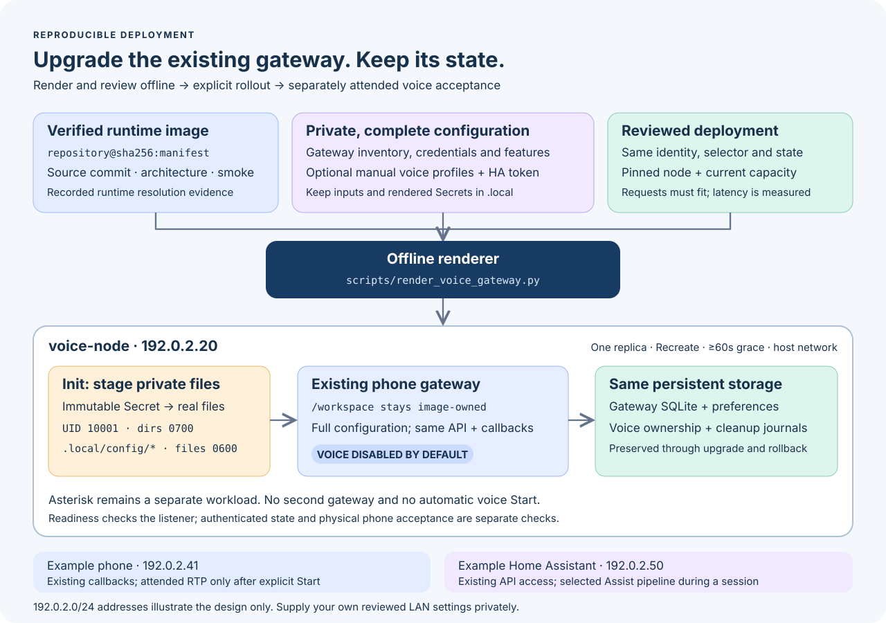

# Deploy or upgrade the voice-capable gateway

[`scripts/render_voice_gateway.py`](../scripts/render_voice_gateway.py) renders
an offline replacement for the **existing single phone gateway**. It keeps the
complete gateway configuration, Deployment identity and selector, node pinning,
and persistent state binding. It selects the dedicated voice image and stages
private configuration as ordinary owner-only files. Rendering makes no cluster,
phone, Home Assistant, or microphone calls.



Voice is disabled by default. With no profiles, the gateway starts without a
voice registry. Supplying profiles attaches a disabled registry; only
`--enable-voice` enables its Start API. Even an enabled registry does not start
a session automatically. The ordinary gateway still runs its normal background
reconciliation, including DND: **do not launch a second gateway as a canary or
preflight probe**.

This guide uses documentation-only addresses and generic names. Keep your real
inventory, configuration, credentials, image receipts, capacity snapshots and
rendered manifests under `.local`. Kubernetes Secret data is encoding, not
encryption; protect cluster access and backups as well.

## Supported deployment shape

The input is one `apps/v1` Deployment JSON object, with one gateway container,
host networking, one replica with `Recreate`, an explicit required node affinity,
and an existing `hostPath` state volume of type `Directory` mounted directly at
the gateway's `--state-directory` path (normally `/state`). The renderer also accepts
its own output's Deployment on a subsequent upgrade. It rejects ambiguous
multi-container deployments, foreign init containers, unsupported state
mappings, custom RuntimeClasses and Pod-level resource overrides instead of
guessing a migration. RuntimeClasses can add resource overhead at admission
that is absent from the captured Deployment.
Migrating persistent gateway state to a PVC is outside this renderer's scope. A separate read-only model PVC is supported for wake profiles.

The output contains an immutable, content-addressed Secret and the replacement
Deployment. It uses one replica, `Recreate`, UID/GID `10001`, dropped
capabilities, a read-only root filesystem and no service-account token. The
shutdown grace is derived when `--grace-seconds` is omitted. It is at least
180 seconds and covers the conservative external-owner horizon (415 seconds
for a possible 300-second session), one second per phone/API listener and ten
seconds of margin. An explicit shorter override is refused. This is a maximum
shutdown budget to preserve callback authentication for a separately owned
runner; it is not a fixed sleep. Known owned sessions receive Stop immediately,
and the gateway exits early once all cleanup and fencing are confirmed.
Existing gateway `/state` storage remains at the same path. The same volume is
also mounted at `/run/voice/.local/state` for persistent voice ownership and
cleanup journals. Source stays in the image under `/workspace`.

The non-root init container creates its own mode-0700 configuration directory
under a fresh volume and uses
[`stage_private.py`](../containers/voice/stage_private.py) to copy an explicit
file list to mode-0600 regular files. It does not recursively change ownership
or permissions on the persistent state volume. `fsGroup` alone does not make a
volume's root owned by UID 10001. Prepare the persistent directory with the
correct ownership before installation; an existing directory must be reviewed,
not silently replaced.

`Recreate` orders Deployment upgrades, but manual Pod deletion can create a
replacement while the old Pod is terminating. Do not scale this Deployment,
add an HPA, force-delete its Pod, or use a second controller as a rollout
shortcut. Preserve the existing voice locks and recovery journals. See
[Kubernetes Deployment replacement semantics](https://kubernetes.io/docs/concepts/workloads/controllers/deployment/#recreate-deployment).

## 1. Save the baseline and verify the image

Use the [gateway installation guide](phone-gateway.md) to establish the
dedicated AMI account, callback credentials, exact-source firewall rules and
full gateway configuration. For an existing installation, reuse that complete
configuration; do not reconstruct it from the minimized manual-pilot gateway
file. Preserve applications, allowlists, services, softphones, phone metadata,
API credentials and both lines of each physical phone.

For an upgrade, save the current Deployment, its referenced Secrets and the
gateway input privately, using the explicit context and namespace. Select the
kubeconfig deliberately: an inherited `KUBECONFIG` can route a familiar context
name to a different API endpoint. Set the path below and the context, namespace
and Deployment variables to your reviewed values:

```sh
export KUBECONFIG="/absolute/path/to/reviewed-kubeconfig"
umask 077
mkdir -p .local/voice-gateway
kubectl --context "$KUBE_CONTEXT" -n "$NAMESPACE" \
  get deployment "$GATEWAY_DEPLOYMENT" -o json \
  > .local/voice-gateway/deployment-before.json
```

Compare your full gateway input with the actual running Secret's `gateway.json`
privately. Record the original image, state host path, node, ports, selector,
Secret names and field manager. Keep an apply-ready rollback manifest without
API-generated `status`, UID, resource version, creation timestamp, generation,
managed fields or stale last-applied annotations. Save its referenced Secrets
too. An image tag alone is not a rollback record.

Back up the persistent directory. For a live SQLite database, use SQLite's
online backup API or the existing backup procedure; a plain copy of only the
database file can omit WAL transactions. A full file-level copy requires the
gateway to be fully stopped. Include voice journals in a consistent backup.
Do not delete ownership files to make a later start pass.

For a first installation, render the ordinary gateway base locally, but do not
apply it first:

```sh
python3 scripts/render_gateway.py --site .local/site.json \
  --config .local/gateway.json \
  --output .local/voice-gateway/base-list.json
python3 - <<'PY'
import json, os
from pathlib import Path
p = Path('.local/voice-gateway')
items = json.loads((p / 'base-list.json').read_text())['items']
deployment, = [item for item in items if item['kind'] == 'Deployment']
secret, = [item for item in items if item['kind'] == 'Secret']
for name, value in [('deployment-before.json', deployment), ('base-secret.json', secret)]:
    fd = os.open(p / name, os.O_WRONLY | os.O_CREAT | os.O_EXCL, 0o600)
    with os.fdopen(fd, 'w') as target:
        json.dump(value, target, indent=2)
        target.write('\n')
PY
```

Create the new persistent host directory on the selected node as UID/GID
`10001:10001`, mode `0700`, following the gateway guide. The renderer requires
that directory to exist; it does not provision storage or change the firewall.

The replacement preserves the original configuration mount, although its main
command reads the newly staged full gateway file. On a first install, create
the extracted **base Secret only** during step 4; otherwise the preserved mount
refers to a nonexistent Secret and the Pod cannot start. Do not apply
`base-list.json`, which also contains the original Deployment.

For a published installation, [Beta 16](https://github.com/4alvit/cisco-home-telephony/releases/tag/v0.1.0-beta.16)
provides `voice-wake-amd64.tar.gz`, `SHA256SUMS`, `image.json`, `receipt.json`
and `source.json`. Download all five into a new private directory. Verify
`SHA256SUMS` with `sha256sum -c SHA256SUMS` (or `shasum -a 256 -c SHA256SUMS`
on macOS), and confirm that the source record identifies
`e3e4f36e6b08074082bd18716b00819532be7e86`. Before conversion, compare the
exported archive's configuration ID and `linux/amd64` platform with the supplied
metadata. After import, verify the final manifest and any configuration/rootfs
mapping as described below; the converted configuration ID need not equal the
exported Docker ID. Keep the receipt with the archive. This is the wake-capable image required for
hands-free operation, not the lean manual voice image. Supply private
profiles, credentials and wake models separately.

Alternatively, build and smoke-test the dedicated image using the
[voice image instructions](voice-k3s.md#build-and-check-the-voice-runtime), or
verify a successful [CI voice export](ci-images.md#voice-runtime-export). Match
the source commit, archive checksums, image configuration and architecture.
After registry transfer or node import, verify the final manifest bytes and
that the target runtime resolves the exact `repository@sha256:...` reference.
A Docker configuration ID is not a manifest digest. Conversion may change
JSON encoding and the config ID; preserve the mapping and verify configuration
contents and rootfs layer digests if conversion is involved.

Set `VOICE_IMAGE` to that verified immutable reference. Create a private
`image-verification.json` record with these fields, filled from the evidence:

```json
{
  "verified": true,
  "immutable_image_reference": "<repository>@sha256:<64 lowercase hex characters>",
  "manifest_digest": "sha256:<the same 64 lowercase hex characters>",
  "source_commit": "<40 lowercase hex characters>",
  "platform": "linux/amd64",
  "node_name": "voice-node",
  "kube_context": "reviewed-context",
  "runtime_resolution_verified": true,
  "smoke_passed": true
}
```

This is a verification attestation, not a signature or an image scanner. Set
success fields only after those checks pass. The renderer validates its shape,
reference agreement, target node/context and architecture; it does not contact a registry or repeat
the build, smoke test or node import. Keep the underlying evidence alongside it.

## 2. Record current capacity

The renderer requires an explicit scheduling budget, including the context,
node and Deployment being replaced. Capture fresh read-only node and Pod
snapshots; do not substitute CPU utilization from `kubectl top` for requests:

```sh
kubectl --context "$KUBE_CONTEXT" get node "$VOICE_NODE" -o json \
  > .local/voice-gateway/node.json
kubectl --context "$KUBE_CONTEXT" get pods --all-namespaces \
  --field-selector "spec.nodeName=$VOICE_NODE" -o json \
  > .local/voice-gateway/node-pods.json
```

Prepare `capacity.json` from those snapshots. The following numbers illustrate
the schema; replace them and the timestamp with current evidence. The illustrated
`192.0.2.20` address is not an accepted live address: use your node's actual
reviewed RFC1918 LAN address.

```json
{
  "version": 1,
  "kube_context": "reviewed-context",
  "node_name": "voice-node",
  "node_ipv4": "192.0.2.20",
  "node_arch": "amd64",
  "namespace": "telephony",
  "deployment": "phone-gateway",
  "captured_at": "<current UTC timestamp, for example YYYY-MM-DDTHH:MM:SSZ>",
  "allocatable": {"cpu": "2", "memory": "4Gi"},
  "other_requests": {"cpu": "1200m", "memory": "2Gi"}
}
```

Use node **allocatable** resources. `other_requests` includes every other
assigned, non-terminal Pod, across namespaces, including DaemonSets, effective
init-container requests, sidecars and Pod overhead. Exclude only Pods owned by
the exact gateway Deployment being replaced; do not subtract unrelated Pods
with similar labels. Do not count terminating Pods as reclaimed before their
termination is confirmed, except for the reviewed same-Deployment replacement
credit under `Recreate`.

For the supported new gateway shape, the renderer checks
`other_requests + max(gateway_request, init_request) + pod_overhead <= allocatable` separately
for CPU and memory. It rejects stale capacity data by default after 900 seconds;
`--max-capacity-age-seconds` accepts 60 through 3600 seconds. It also matches
contextual identities, addresses and image architecture. Admission policy,
quotas, node taints and new competing Pods can still prevent scheduling. Refresh
the snapshot before applying and inspect the server-side dry run.
[Kubernetes resources](https://kubernetes.io/docs/concepts/configuration/manage-resources-containers/)
and [init-container accounting](https://kubernetes.io/docs/concepts/workloads/pods/init-containers/#resource-sharing-within-containers)
describe the scheduler's rules.

Choose a CPU request and limit explicitly. A small request may fit a busy node
but does not establish adequate voice latency. Measure CPU throttling, memory,
turn duration and concurrent workload contention during separately attended
acceptance. Increase resources or free capacity if necessary; do not lower a
request merely to hide an unschedulable workload. HA pipeline latency is also
independent of the gateway's scheduling budget.

## 3. Render with voice disabled

For the initial image migration, omit profiles entirely:

```sh
python3 scripts/render_voice_gateway.py \
  --deployment .local/voice-gateway/deployment-before.json \
  --gateway-config .local/gateway.json \
  --image "$VOICE_IMAGE" \
  --image-verification .local/voice-gateway/image-verification.json \
  --capacity .local/voice-gateway/capacity.json \
  --cpu-request 250m --cpu-limit 1000m \
  --memory-request 128Mi --memory-limit 512Mi \
  --output .local/voice-gateway/candidate-disabled.json
```

The resource values above are examples, not sizing guarantees. All input files
must be owner-only regular files beneath the chosen workspace's `.local`.
Symlinks and traversal are rejected. `--workspace` selects a different
workspace; paths resolve against it. Output is a new mode-0600 file, never an
overwrite. The renderer keeps private values out of its summary and errors.

To prepare voice profiles without enabling them, supply `--profiles` pointing
to a private file with this shape:

```json
{
  "version": 1,
  "profiles": [
    {
      "transport_config": ".local/voice/transport.json",
      "voice_config": ".local/voice/assistant.json",
      "display_port": 18090
    }
  ]
}
```

Omit `display_port` when unused. Each transport file must reference a gateway
configuration semantically equal to the full input. The renderer keeps the
full gateway file and rewrites file references only in staged transport and
assistant copies. Profiles select distinct physical phones and a finite media
session of at most 300 seconds. Manual mode completes one turn; an ONNX wake
profile can rearm after successful playback within the same deadline. Referenced
HA tokens are private files. An optional `ha.device_id` must identify the actual
Cisco device, never a copied Echo identity. Room-relative Home Assistant tools
also require the correct area assignment for that device; a device ID alone
does not provide it. Check actual host port availability
separately from configured-port collision checks. See
[voice configuration and controls](voice-control.md).

### Enable repeatable wake sessions

Use the verified [wake-capable image](voice-wake-runtime.md), not the lean manual
image. In the private assistant profile select `wake.mode: "onnx"`, set
`wake.bundle_file` to the pinned local bundle, and explicitly enable
`service.rearm_after_turn`. Set the transport's `duration_seconds` to the intended
finite budget, for example 300. Keep per-turn timeouts separately bounded.

Provision a read-only model PVC in the same namespace, containing the three
model files at the relative paths recorded in that bundle. Keep matching local
files beside the bundle for offline validation. Add these options to the render
command above, using your real profiles and PVC name:

```sh
  --profiles .local/voice/profiles.json \
  --models-claim reviewed-wake-models
```

The renderer validates the local files against the bundle hashes without
loading inference. It places only the small manifest in the configuration
Secret. A startup init container repeats the hash checks against the PVC and
stages the normalized bundle and three models into an owner-only directory.
The main process mounts that directory read-only. No model is downloaded, no
weights enter the Secret, and no voice session starts during initialization.
All wake profiles in this deployment must use the same pinned bundle; use a
separate design review before introducing per-phone model bundles.

For this wake variant, a minimal root init step creates/chowns only fresh
`emptyDir` children. Model staging and the gateway run as UID 10001. There is
no Pod `fsGroup` that could recursively alter the existing model PVC or state
volume. Provision PVC read permissions for UID 10001 explicitly. The model
stager requests 128 MiB; capacity validation includes this peak. The ordinary
manual-only variant retains its original non-root init and needs no model PVC.

Add `--enable-voice` only when ready to expose Start. Opening the phone menu
still does not activate the microphone. Use the
[operator quickstart](voice-quickstart.md) for Start, readiness, repeat questions
and exact-session Stop. Returning to manual profiles without `--models-claim`
removes the generated model mounts and wake initialization steps.

## 4. Review and install during a maintenance window

Review the candidate privately: same Deployment name/namespace/selector,
complete gateway configuration, exact state host path, node affinity, image
digest, resources, callback/API ports, one replica, `Recreate`, grace period
and disabled voice. There must be no volume mounted over `/workspace`.

Use your established field manager for the server-side dry run and apply; set
`FIELD_MANAGER` from the baseline review. Do not force ownership conflicts or
mix apply methods without inspecting `managedFields`. If the existing
installation used client-side apply, follow the
[field-ownership migration notes](k3s-deployment.md#updating-an-installation-with-an-existing-field-owner).

For a first installation only, create the extracted base Secret before applying
the candidate. This creates configuration without starting the base gateway:

```sh
kubectl --context "$KUBE_CONTEXT" -n "$NAMESPACE" create \
  -f .local/voice-gateway/base-secret.json
```

These commands contact the cluster; only the last one changes it:

```sh
kubectl --context "$KUBE_CONTEXT" -n "$NAMESPACE" apply --server-side \
  --field-manager="$FIELD_MANAGER" --dry-run=server \
  -f .local/voice-gateway/candidate-disabled.json

# During the reviewed maintenance window, after active work has stopped:
kubectl --context "$KUBE_CONTEXT" -n "$NAMESPACE" apply --server-side \
  --field-manager="$FIELD_MANAGER" \
  -f .local/voice-gateway/candidate-disabled.json
```

Before replacement, prevent new voice starts and allow active calls, alerts and
voice sessions to finish. If a voice session is active, use the normal Stop
path and verify cleanup while callbacks remain available. Do not kill the
gateway to stop a microphone. The grace period gives cleanup time but cannot
guarantee physical microphone closure after node or network failure.

Wait for the existing Deployment to become ready; inspect init completion and
restart counts privately. Check authenticated inventory, AMI registration/call
state and expected DND/preferences. The TCP readiness probe alone proves only
listener reachability. Verify ordinary callback behavior under the established
gateway acceptance procedure before enabling voice. This renderer does not
change the PBX, phone provisioning, host firewall or HA pipeline.

When ready for voice acceptance, refresh capacity, render a new candidate with
the reviewed profiles and `--enable-voice`, and apply it through the same
reviewed rollout. A Start dry run is still separate from an attended real
session. Follow the [voice acceptance and Stop procedure](voice-control.md#start-status-and-stop);
readiness or a successful image smoke test does not prove live audio works.

## Upgrade, rollback and cleanup

For every upgrade, export the current Deployment again, preserve its full
configuration and state binding, verify the new image, refresh capacity, and
render a new private output filename. The same renderer supports an already
converted Deployment. Save the currently referenced immutable Secret until the
rollback window closes. Changing a profile requires a new Secret and rollout;
do not edit the mounted projection or the staged files in a running Pod.
[Immutable Secret behavior](https://kubernetes.io/docs/concepts/configuration/secret/#immutable-secrets)
keeps each Pod's staged input coherent.

To roll back, Disable hands-free on each affected phone, then confirm cleanup
and channel absence for its exact owned assistant session. Retain persistent
state and ownership journals. Apply the reviewed baseline Deployment with its
recorded immutable image and exact Secret references using the same ownership
process. Keep one replica and `Recreate`; allow the generated shutdown grace
for the voice-capable Pod being replaced. A plain
`kubectl set image` is insufficient because command, mounts and init staging
also changed. Do not automatically restore an old database backup during an
image rollback: it would discard legitimate newer preferences and operations.
Restore data only under a separate, stopped and reviewed recovery procedure.

When returning to an earlier SIP release, retain that baseline's saved SIP
profile and site overlay. Reverting to XML/RTP is a separate transport change,
not a required step in a gateway version rollback.

After the rollback window and confirmed session cleanup, remove only obsolete
generated Secrets that no current or retained rollback Pod template references.
Do not delete the persistent directory, voice locks/journals, namespace, or PBX
resources as deployment cleanup.

## Troubleshooting

- **Rejected image receipt:** compare the full manifest reference, source commit,
  architecture and success evidence. A tag, config ID, missing smoke result or
  a receipt for another image is not sufficient.
- **Capacity error or Pending Pod:** refresh node/Pod evidence, include init
  requests and overhead, check quotas/taints and read scheduling events. Free
  capacity or choose measured resources; a lower request is not a latency fix.
- **Init permission or staging failure:** inspect sanitized init logs. Confirm
  the input Secret exists, the new configuration directory is owned by UID
  10001 with mode 0700, and the persistent host path already exists with the
  expected ownership. Do not solve this by running the gateway as root or
  relaxing private files to world-readable permissions. Staging deliberately
  refuses an existing destination, including after a partial init attempt.
  After fixing the cause and confirming active work has stopped, perform a
  reviewed Deployment template rollout using `Recreate` to obtain a fresh Pod
  and empty configuration volume. Do not clear the persistent state volume or
  force-delete a Pod to retry staging.
- **Ready but API or AMI fails:** check the preserved bearer token, exact-source
  firewall rules, local-node AMI ACL and actual callback ports. Readiness does
  not authenticate to AMI or HA.
- **Voice unavailable:** the default is disabled. Verify the intended profiles
  and explicit enablement were present in the deployed revision. Do not add a
  second gateway to expose the API.
- **Recovery required or ownership refusal:** retain the journal, identify the
  exact session and follow [cleanup recovery](voice-control.md#deadlines-and-uncertain-cleanup).
  Do not remove a lock, reset state or force-delete a Pod to bypass the refusal.
- **Slow turns or restarts:** inspect throttling, OOM/restart history, network
  reachability and the selected Assist pipeline. Synthetic smoke and scheduler
  fit are separate from measured end-to-end voice performance.
