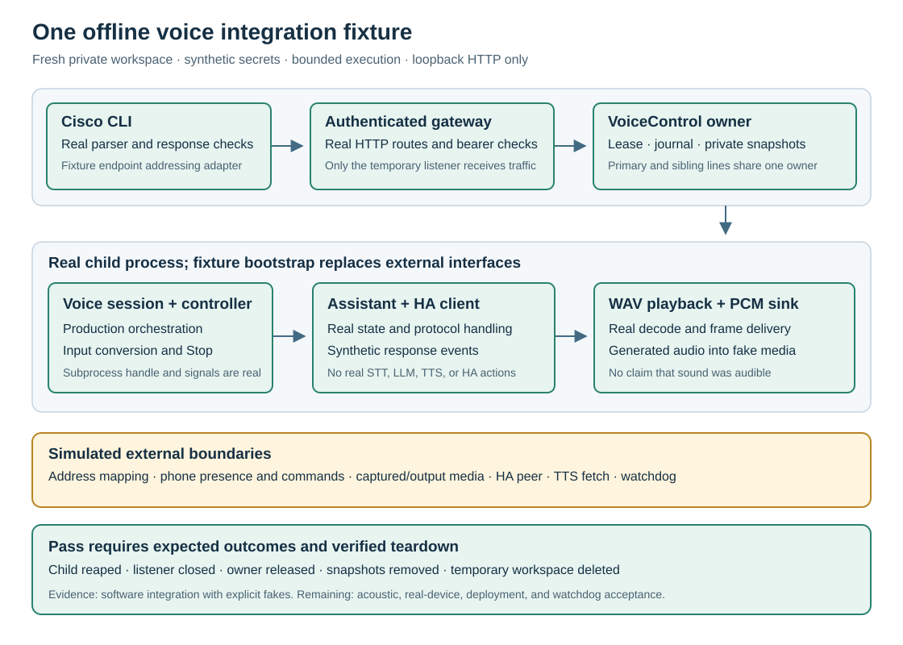

# Offline integrated voice acceptance

`scripts/test-voice-integration.py` joins the voice command, gateway, ownership,
runner, assistant, and playback layers in one bounded fixture. It uses a fresh
temporary workspace, synthetic credentials, generated audio, and a loopback
HTTP listener. It does not read deployment configuration or contact a phone
or Home Assistant.

A passing result is software integration evidence. It is not acoustic
acceptance, wake-word qualification, speech-recognition accuracy, or proof that
a phone's microphone or speaker works.



## Run

Use Python 3.11 or newer on macOS or Linux, from the repository root. The
ownership and process checks use POSIX file locks, inherited descriptors, and
signals:

```sh
python3 scripts/test-voice-integration.py
```

The fixture uses the standard library and existing repository code. It does not
install packages or download models. Its default run is offline apart from
requests to its own loopback listener.

The default selects all three scenarios: `complete`, `stop`, and
`provider-failure`. To isolate one:

```sh
python3 scripts/test-voice-integration.py --scenario stop --timeout-seconds 30
```

Completed scenario runs print JSON; `--json` is also accepted for clarity. There are
no target, credential, or deployment-configuration arguments, and no persistent
output directory. The default execution deadline is 30 seconds; the accepted
range is 10–120 seconds, with additional bounded cleanup waits. If retaining a
receipt, save stdout in an owner-only file under an ignored private directory.

Run the dedicated regression tests separately:

```sh
python3 -m unittest discover -s tests -p 'test_voice_integration_fixture.py'
```

## Why this fixture exists

The existing tests already verify CLI payloads, gateway authorization,
supervisor lifecycle rules, session cleanup, and assistant behavior. Most
replace the adjacent layer with a fake. This fixture checks whether those
layers work together across the actual HTTP and child-process boundaries.

It uses the production command parser and response validation, the gateway's
voice routes and authorization, and the supervisor's configuration snapshots,
owner lock, journal, session identity, and runner report handling. The child
process executes the production voice-session entry point with the hardware
and provider interfaces replaced before execution.

## Reading the implementation

Start with `run_fixture()`. It validates the arguments, then uses one
`FixtureCoordinator` to carry the resources owned by that run through five
named stages:

1. `setup_gateway()` prepares private configuration, attaches the real voice
   owner, and starts the loopback listener.
2. `check_start_guards()` checks authorization, explicit start flags, and dry run.
3. `run_scenario()` starts the selected turn, checks sibling ownership, performs
   Stop when requested, and verifies the observed outcome.
4. `verify_owner_cleanup()` checks snapshots, the lock, the journal, and file
   permissions after the scenarios.
5. `cleanup()` runs from `finally`, tears down owned resources, and records
   individual cleanup failures without skipping later steps.

The child-process boundary is in `fixture_worker()`. Its `Synthetic*` adapters
name the substituted phone and HA interfaces; the calls to the production
runner and service builder remain explicit. `network_guard()` and
`cli_bootstrap()` define the restricted route to the loopback HTTP listener.

## Real code and explicit substitutes

The following code runs as repository code:

- Cisco CLI parsing, request construction, HTTP transport, and response checks.
- Gateway voice routes, bearer checks, and voice-owner authorization.
- `VoiceControl`, its private snapshots and lease, and `_SubprocessHandle`.
- The voice-session runner and controller.
- `AssistantService`, the HA protocol client, WAV playback, and the PCM bridge.

The fixture supplies these substitutes:

- A small launcher redirects the one synthetic configured gateway endpoint to
  the fixture's loopback listener. Production configuration validation expects
  a private LAN address, so this is an explicit addressing adapter. After
  validating the synthetic gateway configuration, the fixture replaces its
  allowed client address with loopback before attaching voice control. Both
  authorization layers then check the actual socket peer. This does not test
  production LAN source addressing.
- Phone presence, device commands, media capture, and media output use bounded
  in-memory behavior. Generated 8 kHz PCM enters at the media interface and uses
  the real conversion to 16 kHz. RTP packet transport and G.711 encoding or
  decoding are not exercised.
- The existing simulated HA socket supplies protocol events. Its transcript,
  intent result, and TTS reference are synthetic.
- TTS fetching supplies generated PCM WAV data. Playback proves delivery through
  the software sink, not audible speech.
- Watchdog completion describes the fixture's simulated device cleanup. It does
  not test survival of the production watchdog after host or process failure.

The authorization checks include an incorrect bearer and a disallowed actual
socket peer. For the latter, the fixture temporarily changes the allowed source
to a different loopback address; it does not forge forwarded headers.

The runner-launch adapter retains a real child process and the production
subprocess handle. It substitutes the fixture bootstrap for direct startup so
that hardware interfaces are replaced before the production entry point runs.
The fixture uses manual activation and loads no wake model. It does not edit
the runtime source files.

## Ownership and Stop

A synthetic handset has a primary line and a sibling line. Starting through the
sibling must resolve to the same physical owner. Status, repeated start
requests, and Stop must retain the session identity rather than create a second
owner for the other line.

The normal turn carries generated input audio through the controller into the
assistant, receives a simulated HA response, and delivers generated playback
frames. The Stop case uses observed progress rather than treating a fixed sleep
as proof that playback began. Stop must reach the owned child, cancel the active
work, and finish the session with confirmed fixture cleanup.

The provider-failure scenario supplies a failing synthetic HA peer. The
integration must expose the failed turn and still clean up the child and owner.
A passing fixture summary means that the failure was handled as expected; it
does not mean that this scenario produced a successful assistant reply.

Cleanup evidence covers child exit, listener shutdown, release of ownership,
removal of per-run credential snapshots, and deletion of the temporary
workspace. A cleanup error must fail the run rather than be hidden behind a
successful turn. This checks orderly and handled-failure teardown; it cannot
guarantee cleanup after a host crash or an uncatchable process kill.

The regression helper first interrupts a timed-out fixture and waits for its
cleanup to reap the owned workers. Hard termination of the CLI process group
is a last resort. Production subprocess handles place workers in separate
sessions, so that last-resort group kill alone cannot guarantee their cleanup
if the fixture is unresponsive. The tests distinguish this limit from verified
cleanup after a handled interrupt. An interrupt can clean up without emitting
a final JSON summary.

## Interpreting the result

Inspect both the overall result and the reported simulated boundaries. A turn
can process audio successfully while cleanup fails; those are separate facts.
Likewise, an expected authorization refusal is a passing check only when it
prevents runner creation.

Expected scenario outcomes are:

- `complete`: owner state `stopped`, runner reason `turn_complete`, exit zero.
- `stop`: owner state `stopped`, runner reason `shutdown`, runner exit one
  because the turn was interrupted.
- `provider-failure`: owner state `failed`, runner reason `assistant_error`,
  runner exit one, and no playback.

All three require confirmed fixture cleanup. Their individual runner exit
codes are distinct from the fixture's exit code: the overall fixture exits
zero only when all selected scenarios behave as expected.

The temporary workspace uses owner-only directories and files. Credentials
are generated for the fixture and are not deployment secrets. Reports should
contain only bounded test evidence, not tokens, audio, or transcripts.

The JSON includes checks, per-scenario outcomes, command and HTTP traces,
cleanup results, and a list of real and simulated components. A complete turn
delivers 50 frames of generated audio; Stop delivers fewer than the full
150-frame response. Exact interrupted-frame counts and wall time vary with
process scheduling and are not production latency measurements.

This fixture cannot establish:

- Real microphone capture, speaker audibility, codec quality, or room acoustics.
- Wake-word false accepts, missed wakes, or speech-recognition quality.
- Real HA integrations, model behavior, intent safety, or device actions.
- LAN reachability, production source addressing, TLS, or deployment health.
- Physical Stop behavior, phone display state, or independent watchdog recovery.

Use [offline wake qualification](wake-qualification.md) for labeled wake
evaluation and an explicitly authorized attended hardware trial for the
remaining physical behavior. Synthetic integration success alone is not a
reason to enable an always-on listener.
