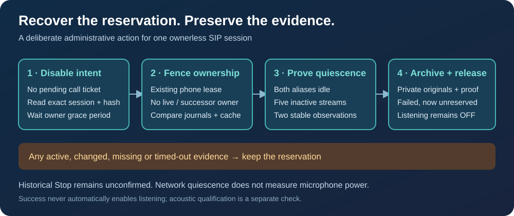

# Recover an ownerless SIP voice session

An interrupted gateway can leave a reserved `recovery_required` journal after
the process that owned it has exited. Ordinary Stop cannot adopt another
process's session. Administrative recovery can release this exact reservation
after new, bounded evidence that the phone's network media is quiescent.



This operation supports configured `sip_audiosocket` profiles. It does not
start listening, hang up an unrelated call, reboot a phone, send XML RTP Stop,
or clear arbitrary ownership records. Both line aliases select the same
physical phone. Update the gateway image and the [ordinary `cisco` CLI](cli-installation.md)
together; updating only the CLI cannot add the server operation.

## Operator procedure

Use the existing private CLI configuration. The example line is synthetic;
replace it with a configured voice line. Keep captured responses private.

```sh
cisco --json 201 voice disable
cisco --json 201 voice recovery-status
```

`recovery-status` reads local journals and reports the exact `session_id`,
`journal_sha256`, local `eligible` gate, a refusal `reason`, and
`minimum_age_remaining_seconds`. It does not contact the phone or prove that
the owner lock is free. `quiescence_verified` is always false on this read.
An eligible result is permission to attempt the checks, not a recovery receipt.

Wait for the reported conservative owner horizon to expire. The implementation
uses the controller's external-owner grace interval, currently 415 seconds
after the finite journal's last modification. A gateway rollout alone does
not prove that an inherited runner or late SIP Originate has ended.

Copy the exact identity and hash from a fresh response:

```sh
cisco --json 201 voice recover \
  --session-id <EXACT_SESSION_ID> \
  --journal-sha256 <EXACT_JOURNAL_SHA256>
cisco --json 201 voice recovery-status
cisco --json 201 voice status
```

Replace the angle-bracket placeholders before executing. The command creates a
correlation key unless `--idempotency-key` is supplied. Its identity/hash
comparison prevents replay against a changed record; the key is not an
instruction to retry until successful. `recover --dry-run` is refused: use
`recovery-status` for a read-only inspection. Recovery uses at least a 45-second
client timeout, allowing a 30-second server proof budget plus transport overhead.

The success receipt is `ORPHAN_RECOVERY_COMPLETE`, with `enabled: false`,
`stop_confirmed: false`, and `proof_kind: phone_reported_transport_quiescence`.
The finite record becomes failed and unreserved. Its original error, Stop flag
and diagnostic fields remain intact; this operation does not rewrite failure
as a successful Stop. The hands-free policy remains disabled. Ordinary status
can therefore still report a failed historical session after recovery.

Enabling listening is a separate deliberate operation. First inspect the
receipt and disabled policy, then follow the [normal voice readiness checks](voice-control.md#hands-free-policy-and-status).

## What the server verifies

The server acquires the existing physical-phone lease without replacing its
lock inode, checks the supplied session and raw journal hash, excludes current
or successor owners, and requires disabled hands-free intent with no pending
ordinary-call ticket. It preserves the policy generation and request history.
It serializes against phone mutations and checks the exact journals and
in-memory state again before changing them.

A separate bounded worker makes only AMI reads and HTTP GET requests to the
configured phone. Two observations must show:

- Both configured SIP aliases idle, no phone channels and no channels related
  to the old session's identifiers, before and after each phone snapshot.
- All five streaming-statistics pages from the expected device reporting
  `Not Ready`, with valid packet and octet counters.
- Stable send/receive counters and stream start/address identity across the
  observations. Historical nonzero counters are allowed; changing or reset
  stream identity is not.

The worker must finish and be reaped before the proof is accepted. Active,
missing, malformed, ambiguous or timed-out evidence leaves the reservation in
place. A new owner, changed journal, held inherited lease or enabled policy
also causes refusal. No client-supplied boolean or proof can bypass the worker.

Cisco describes five streaming-statistics pages for this model and a stream
status field indicating whether streaming is active in its
[administration guide](https://www.cisco.com/c/en/us/td/docs/voice_ip_comm/cuipph/7975G_7971g-ge_7970g_7965g_7945g/9_0/english/admin_guide/P747_BK_W06BD6D9_00_adminguide_7945-7965-7970-7971-7975/P747_BK_W06BD6D9_00_adminguide_7945-7965-7970-7971-7975_chapter_01000.html).
These observations demonstrate phone-reported network-media quiescence during
the bounded interval. They do **not** measure electrical microphone power,
prove receipt of a historical SIP BYE, guarantee future silence, or qualify
acoustic wake-word performance.

## Refusals, interruptions and retained evidence

- `hands_free_disable_required`: disable the policy and read status again.
- `voice_recovery_grace_pending`: wait the reported remaining interval.
- `voice_phone_busy`: a local operation, owner or inherited lease still exists.
  Let its normal owner finish; do not delete lock files.
- `voice_recovery_session_changed`: the supplied identity/hash or protected
  state changed. Inspect the new status instead of reusing the old request.
- `voice_recovery_not_quiet` or `voice_recovery_unverified`: the proof did not
  complete. Inspect the phone and normal call state; this command does not
  terminate active calls to manufacture eligibility.
- A timeout or lost response has an unknown outcome. Use the returned read-only
  `recovery_command`, inspect journals and receipt evidence, and do not retry
  blindly or delete state files.

Before changing either journal, recovery fsyncs a private
`.orphan-recovery-<session>-<nonce>/` archive beside the finite journal. It holds
the original finite and policy records plus the accepted proof. Files are
owner-only; include these in private backups, never the public repository.

The finite and hands-free files are replaced separately, finite first. A crash
between the two writes can leave a partially reconciled record; the archive
retains the evidence and the desired policy remains off. There is no automatic
rollback or automatic resume for that case. Inspect both records and the
archive before further administrative changes; never restore enabled intent
from an old backup or infer completion from a missing reservation alone.

## API contract

These routes require the existing source allowlist and API bearer token. The
phone's XML-menu proof is not accepted for administrative recovery.

- `GET /v1/phones/<line>/voice_recovery_status`: no body; returns
  `{ "status": "ok", "recovery": { ... } }`.
- `POST /v1/phones/<line>/voice_recover`: exactly `idempotency_key`,
  `session_id` (32 lowercase hex characters), and `journal_sha256` (64 lowercase
  hex characters). Returns `status: accepted`, the same `action_id`, and a
  separate `recovery` receipt.

The existing strict `voice` and Home Assistant response schemas are unchanged.
