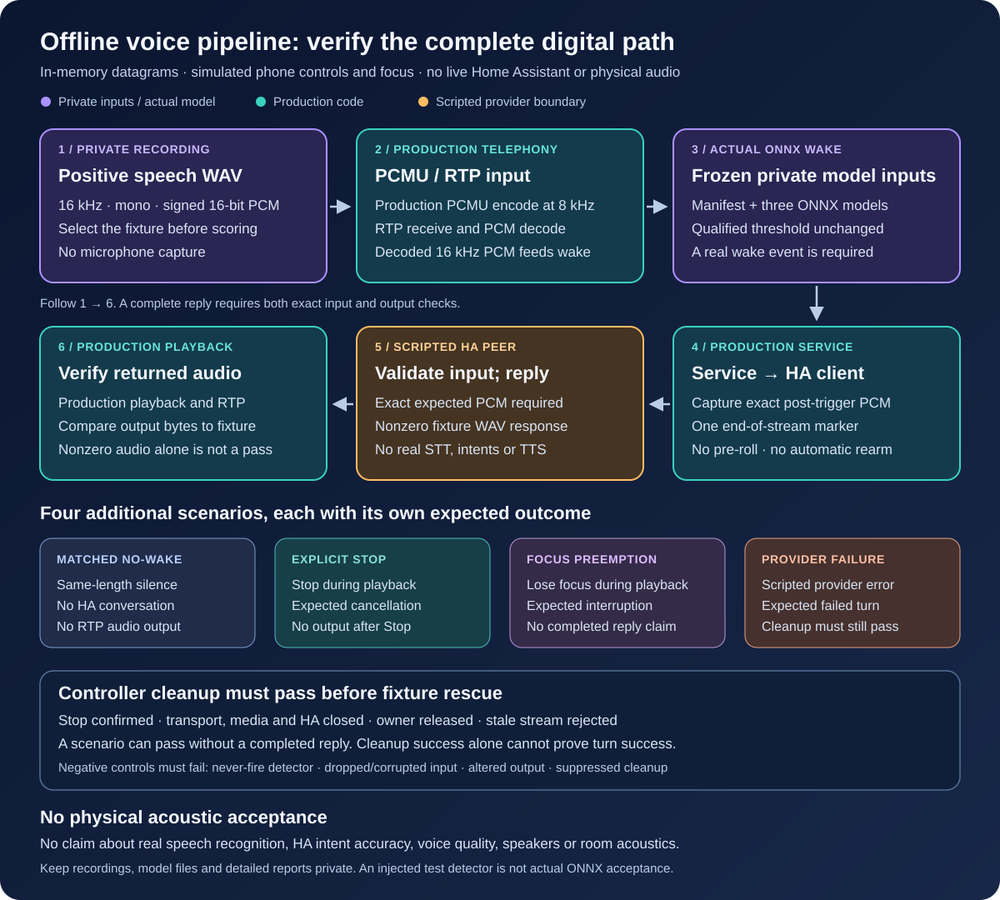

# Offline voice pipeline acceptance

This check connects the production wake detector and telephone audio path to a
scripted Home Assistant peer. It fills a gap between individual model tests and
the existing [CLI/session integration fixture](../scripts/test-voice-integration.py):
the latter starts manually and substitutes silent PCM for the UDP audio path.

The offline check uses a supplied positive speech recording and the frozen
private model bundle. It does not download models, load a household configuration,
connect to Home Assistant, open a microphone, place a call, or play sound.



## What a passing run means

The positive recording must trigger the actual frozen ONNX detector after
conversion through the telephone's PCMU path. The decoded post-trigger audio
must reach the production HA client, and the nonzero scripted WAV response must
reach the production playback and RTP output code. A matched no-wake control
must not start a conversation.

The check also exercises deliberate Stop, focus preemption and a provider
failure. Each outcome has different success criteria: a cancelled turn is not a
completed answer, and successful cleanup does not turn a failed provider request
into a successful conversation.

Controller cleanup is inspected before the fixture performs its final safety
cleanup. The latter must not rescue a broken controller and turn the test green.
Negative controls include a detector that never fires, dropped or corrupted
post-wake input, altered output and suppressed controller cleanup.

The Home Assistant peer and its response audio are fixtures. A passing result
does **not** establish speech-recognition accuracy, correct real HA intents,
actual voice quality, loudspeaker operation, room acoustics or a working physical
wake phrase. The physical acceptance procedure in
[the wake deployment guide](voice-wake-k3s.md) remains necessary.

## Runtime and private inputs

Use the same NumPy and ONNX Runtime versions as the qualified wake runtime:
NumPy 1.26.4 and ONNX Runtime 1.23.2. The
[wake runtime guide](voice-wake-runtime.md) describes supported environments and
the model manifest. Missing runtime dependencies must fail clearly; an injected
unit-test detector is never a substitute for real-model acceptance.

For the supported Linux CPython 3.11/3.12 environments, the hash-pinned
dependencies can be installed in a private virtual environment:

```sh
python3.11 -m venv .local/voice-check-venv
.local/voice-check-venv/bin/python -m pip install \
  --require-hashes --only-binary=:all: \
  -r containers/voice-wake/requirements.lock
```

That lock contains Linux wheel hashes. Do not assume it also installs unchanged
on macOS. Use a separately verified matching local environment or the supported
Linux runtime.

Keep the model manifest, its three ONNX files, speech recordings and detailed
reports under the repository's ignored `.local` directory. Never commit them.
Use a short mono 16-bit PCM WAV at 16 kHz, with enough leading audio for the
model's 1.28-second warm-up and enough trailing audio for a captured utterance.
Use the clean recording; the check performs the PCMU conversion itself.

Select fixtures and record their provenance before inspecting detector scores.
Preserve the manifest's qualified threshold. Passing a selected synthetic clip
is a reproducibility check, not an accuracy estimate or a reason to tune the
threshold against that clip.

## Run the check

Run from the repository root. These paths are examples; supply your own
qualified bundle and positive recording:

```sh
umask 077
.local/voice-check-venv/bin/python scripts/test-voice-pipeline.py \
  --private-root "$PWD/.local" \
  --bundle "$PWD/.local/wake/bundle.json" \
  --positive-wav "$PWD/.local/wake-fixtures/positive.wav" \
  --scenario all \
  --duration-seconds 20 \
  --timeout 120 \
  --json > .local/voice-pipeline-report.json
```

The command deliberately fails without explicit private inputs. It accepts
`complete`, `stop`, `preempt`, `provider-failure`, `no-wake`, or `all`. The
no-wake scenario replaces the supplied recording with silence of the same
length, then confirms that no HA conversation or audio output starts.

The per-scenario media lease is at most 30 seconds. The total async timeout is
at most 120 seconds. Neither is a process-level watchdog for native model
loading or inference: an automated runner should also give the whole process
an external wall-clock deadline. Keep raw reports private and preserve the
process exit code.

`success` means that the selected scenario met its assertions.
`turn_success` means a complete reply was produced; it must not be inferred
from `cleanup_success`. A Stop, preemption or deliberately failed provider
scenario can pass its checks without completing a reply.

The harness uses a fixed synthetic profile: no pre-roll, ten 20 ms frames per
utterance and no rearm. It constructs the production service objects directly;
it does not load or validate your deployed household profile. The scripted peer
only sends its completion events after matching the exact expected PCM bytes
and one end-of-stream marker.

## Evidence boundaries

Read the report's outcome and individual assertions together. A process exit
code, a nonzero audio-byte count, or successful resource cleanup alone does not
prove the whole path worked. The input, model and output fingerprints establish
which bytes were exercised without publishing the recordings.

Public unit tests may inject a deterministic detector to test failure handling
without distributing model weights. Their results must be labelled separately
from a run that loads the private ONNX bundle. CI has no access to household
recordings or models and must not silently claim real-model acceptance.
