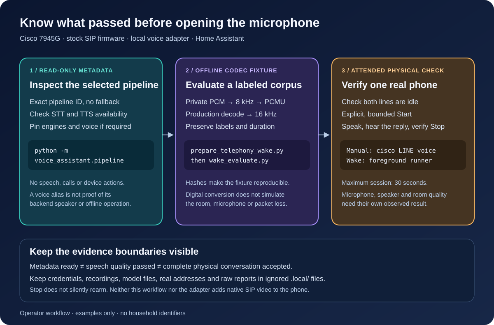

# Inspect the selected voice pipeline



Before enabling a phone, inspect the **exact pipeline in its private voice
configuration**. This command does not start a voice session, open a microphone,
place a call, send an utterance, synthesize speech or change Home Assistant.
The existing voice service behavior is unchanged; this is an explicit operator
check.

Use the Python environment installed for the
[voice CLI](voice-cli-install.md), from the repository root:

```sh
.local/voice-venv/bin/python -m voice_assistant.pipeline \
  --workspace . \
  --config .local/voice.json
```

The configuration format is the same as
[`local-voice-assistant.example.json`](../examples/local-voice-assistant.example.json).
Both that configuration and its `ha.token_file` must resolve inside the
workspace's `.local` directory. Inspection also works when voice listening is
disabled. It requires the configured WebSocket transport; pass
`--transport aiohttp` to use the optional aiohttp transport.

For an automation or deployment check:

```sh
.local/voice-venv/bin/python -m voice_assistant.pipeline \
  --workspace . \
  --config .local/voice.json \
  --expect-stt stt.example_local_recognizer \
  --expect-conversation conversation.example_local_assistant \
  --expect-tts tts.example_local_speech \
  --expect-voice example_voice \
  --json
```

Replace the example identifiers with values from the intended private
configuration. Exit status is **0** when the reported speech providers are
present/available and every supplied exact expectation matches, **1** on a
failed check, and **130** on keyboard interruption. A malformed CLI invocation
returns **2**. JSON includes `success`, an optional `pipeline` snapshot, `issues`
and a sanitized `error_code`. Pipeline and entity IDs are private deployment
metadata; keep output in `.local` and out of public CI logs.

The probe retrieves one pipeline by ID and briefly subscribes to the two
selected speech entities. It closes the connection after receiving their
initial state, including on a deadline, error or cancellation. It never falls
back to Home Assistant's preferred pipeline. A whole request is bounded to
15 seconds, followed by at most the client's two-second close deadline.

An idle STT or TTS entity can legitimately report `unknown`. A missing entity or
`unavailable` fails the check. A legacy provider name without an entity ID is
reported as availability-unverified and also fails. Missing conversation
configuration fails, but the command does not test the conversation provider.

This is a **configuration and reported availability check**, not a complete
voice test. Engine names do not establish offline operation. A configured
default voice alias does not establish which Silero speaker the backend uses.
Verify the speech backend's speaker setting separately; then use the bounded
[foreground session](voice-cli-install.md) for actual STT, conversation,
reply audio and physical phone acceptance. The separate
[offline integration harness](voice-integration-test.md) uses explicit
substitutes for the phone and HA; it does not establish that physical result.

The implementation follows Home Assistant's
[pipeline-get API](https://github.com/home-assistant/core/blob/2026.10.2/homeassistant/components/assist_pipeline/pipeline.py)
and filtered
[entity subscription API](https://github.com/home-assistant/core/blob/2026.10.2/homeassistant/components/websocket_api/commands.py).
