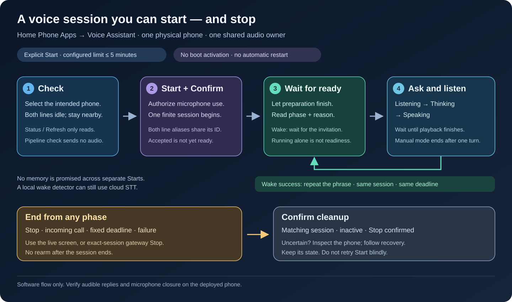

# Use the voice assistant on a Cisco phone

Start a finite session, ask a question, hear the reply, and stop when finished.
The updated runtime supports **up to five minutes per explicitly started
session**, including preparation, waiting and playback. Another question does
not reset the deadline.

This guide describes the finite-session implementation, not proof of deployment
or acoustic acceptance. Check the installed revision and
[acceptance record](voice-rollout.md); older clients may expose earlier controls.



## Start without touching the handset

While you are present with the phone, use the [CLI or Home Assistant](#use-the-cli-or-home-assistant)
to start its configured session remotely. The controller opens the authorized
microphone and playback paths; there is no handset menu, Speaker or Answer
button to press for this path. Across-room speech pickup and reply audibility
still require a physical check in the intended room.

For repeated wake-phrase requests, the administrator must first select a **wake**
profile with rearming enabled and a session budget of up to 300 seconds. These
are private server settings, not options on each CLI Start command. A manual
profile accepts one request and then ends.

1. Check ordinary phone status with `cisco 201 status` (substitute your line).
   Confirm it is online with neither line in a call or playing radio, then check
   `voice status` for existing session ownership.
2. Send one explicit Start with a fresh request key and all three confirmations.
3. Read the matching session's status. In wake mode, require `state: running`,
   `active: true`, `error: null`, `stop_requested: false`,
   `stop_confirmed: false`, positive `remaining_seconds`, `phase: armed` and
   `phase_reason: wake_ready` together. An accepted request, running process
   or stale phase alone does not establish readiness.
   There is no audible ready cue; read the CLI or Home Assistant response before
   speaking.
4. Say the configured wake phrase and question. Wait for playback to finish and
   readiness to return before the next wake phrase. Watch `remaining_seconds`;
   replies do not extend the original deadline.
5. Stop that session remotely and verify it is inactive with Stop confirmed.

This removes the need to touch the phone during a session. It still requires
a deliberate Start: an inactive phone cannot hear a wake phrase through this
prototype. Expiry, a call, a failure or a restart does not start another session.
Do not schedule repeating Start commands to turn the finite session into
permanent listening.

## Start at the phone

1. Make sure neither line is in a call or playing radio. Stay at the phone.
2. Press **Services**. If a service list appears, choose **Home Apps**. In
   **Home Phone Apps**, choose **Voice Assistant**.
3. Check the selected line, state, mode and session length. Both numbers on
   this phone share one microphone and session. Opening the page or pressing
   **Refresh** does not start capture.
4. Choose **Start**, then **Confirm** to authorize microphone use. Wait for
   preparation to finish: **running** alone is not a readiness signal.
5. Follow the reported phase or live screen:
   - **Manual:** when Listening appears, ask one short question without a wake
     phrase. The session ends after the reply.
   - **Wake:** wait for the explicit wake-ready invitation, then say your
     configured wake phrase and question. Do not speak during model warmup.

The operator's private profile selects the mode. If Voice Assistant is missing,
check that phone's enabled profile. An empty installed **Applications** list is
unrelated: these menus are XML services, not installed Java applications.

## Ask another question

A wake profile with successful rearming enabled returns to readiness **after
playback finishes**, while time remains. Say the wake phrase again for each
question. Wait for the reply to finish; speaking over it is not supported.

The session ID and deadline stay the same. Context can be retained within that
session; a separate Start begins without its previous context.
`turns_completed` counts software playback completion, not confirmation that
someone heard it. Stop, call preemption, failure and expiry do not restart listening.

## Stop and verify

Press **Stop** on the live assistant screen. For a gateway-owned session you
can also return to **Home Phone Apps → Voice Assistant** and stop the session
shown there. Refresh and check its matching ID, **inactive** state and
**Stop confirmed: Yes**.

A request acknowledgement, stale Stopped screen or closed menu is not proof of
microphone closure. If cleanup is unconfirmed or `recovery_required` appears,
inspect the phone and follow [recovery](voice-control.md#deadlines-and-uncertain-cleanup).
Do not delete state or force a restart to clear it.

A separately launched wake Job has its own owner. If gateway Stop is unavailable,
use that Job's live screen or its operator's
[exact Job shutdown](voice-wake-k3s.md#start-and-stop-an-attended-attempt).

## Use the CLI or Home Assistant

The ordinary `cisco` client needs its [private connection](cli-installation.md).
The line and request key below are examples; choose your configured line and a
fresh key for each deliberately new session:

```sh
cisco 201 voice status
cisco 201 voice start --idempotency-key voice-example-001 \
  --attended --exclusive-media --enable-microphone
cisco 201 voice status
cisco 201 voice stop
cisco 201 voice status
```

Start requires all three stated conditions. Add `--dry-run` to validate without
launching media; that still contacts the gateway and does not prove readiness.

With no ID, `voice stop` reads the current gateway-owned session and stops
**that exact ID**, never a wildcard or replacement session. To target a recorded
session, use `voice stop --session-id YOUR_RECORDED_SESSION_ID`. Action/request
IDs and session IDs are different. Exiting `cisco` does not stop its remote session.
After an uncertain response, [read status before retrying](voice-control.md#if-the-cli-loses-a-start-or-stop-acknowledgement).

Home Assistant uses the administrator-only `cisco_phone_control.voice` response
service, sharing the same owner and Start gates. See its
[status/start/stop contract](voice-control.md#gateway-and-interface-integration).
Read voice phase and remaining time from that response. The ordinary Call status
sensor does not show voice-session readiness; the current integration has no
dedicated voice phase/remaining-time entities or voice Start button.

## Speech setup and common problems

Before the first session, run [pipeline preflight](voice-pipeline-preflight.md)
on the exact private profile. This checks reported availability without audio
or an intent. Then use a harmless informational question for acoustic acceptance.

Provider choice is explicit: local wake detection does not make recognition
local. An Echo-style pipeline may retain **cloud STT**, a local conversation
agent and local Baya TTS. Verify the selected providers and speaker; keep their
IDs and credentials private. Selecting this profile need not change HA defaults.

- **Running but not ready:** inspect `phase` and `phase_reason`. Missing optional
  fields or `model_warmup` do not establish readiness; check the matching runtime.
- **Slow or missing reply:** inspect the phase/error and pipeline. Each turn has
  its own timeout; increasing the session does not extend it. Instant replies
  are not promised.
- **Expired session:** clean expiry reports `stopped` and `lease_expired`.
  Check Stop confirmation separately, then deliberately Start again if needed.
- **Incoming call:** it takes priority and ends voice; listening does not resume
  automatically afterward.

Dialing **630** is a separate SIP Assist route, not a test of this session path.
Permanent background listening, barge-in and whole-house wake arbitration remain
outside this prototype.
