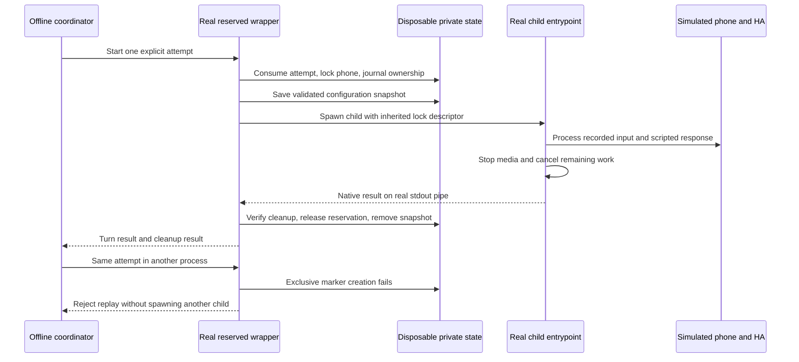

# Offline reserved voice acceptance

`scripts/test-voice-reserved.py` exercises the outer wake-session launcher and
its real child process. The earlier [entrypoint check](voice-entrypoint-acceptance.md)
starts at `voice_session.main`; it does not exercise the durable attempt marker,
shared reservation, configuration snapshot, child-result pipe or wrapper cleanup.

The new fixture calls the production `run_reserved.main`, launches a real child,
and calls the production `voice_session.main` with the exact arguments and
configuration files prepared by that wrapper. The fixture replaces phone and
Home Assistant boundaries. It does not replace the reservation manager,
filesystem locks, attempt claiming, journal, cleanup or child-result parser.

The only launch substitution is an inspectable bootstrap in the new Python
process. It installs the simulated device and HA boundaries, then invokes the
baked child entrypoint with the wrapper's prepared arguments. The production
process handle still creates and supervises that child, drains its stdout and
passes the real locked descriptor. The native child report is kept separate
from fixture evidence. The production device-watchdog subprocess is simulated;
this does not test survival of its descendants after a crash.
Verifier mutation tests reject fabricated cleanup claims, but do not execute
the production's full uncertain-cleanup grace or simulate a storage failure.



## Run with private, prequalified input

Use the qualified Python, NumPy and ONNX Runtime environment from the
[pipeline guide](voice-pipeline-acceptance.md). The executable requires an
explicit private bundle and a previously selected positive recording. Do not
change the model threshold or choose a different recording after a failure.

```sh
umask 077
.local/voice-check-venv/bin/python scripts/test-voice-reserved.py \
  --private-root "$PWD/.local" \
  --bundle "$PWD/.local/wake/bundle.json" \
  --positive-wav "$PWD/.local/wake-fixtures/positive.wav" \
  --scenario all \
  --duration-seconds 8 \
  --timeout 120 \
  --json > .local/voice-reserved-report.json
```

This creates a disposable synthetic installation. Never point it at the
gateway's real state directory or substitute household configuration, phone
addresses or live HA credentials. Keep recordings, models and detailed evidence
in ignored `.local` storage with owner-only permissions.

Public regression tests use an explicitly identified deterministic detector;
they do not establish ONNX or wake-word accuracy. An actual-ONNX claim requires
the executable's private-input run and the recorded model/runtime provenance.

## Scenarios and assertions

- **Complete:** wake detection leads to the selected synthetic HA pipeline,
  the expected uploaded PCM, one end-of-audio marker and the expected RTP reply.
  The native child and wrapper report a completed turn.
- **No wake:** silence reaches the detector, but no HA conversation or reply
  starts. The bounded session ends without claiming a completed turn.
- **Slow HA:** the scripted backend does not finish within the session budget.
  The wrapper stops its child; HA work is cancelled, and no late reply is sent.
- **HA timeout:** the provider-turn timeout expires before the outer lease.
  The assistant reports an error and the wrapper releases the session safely;
  this is distinct from stopping a child at the outer deadline.
- **Cancel:** a real stop signal reaches the wrapper after the scripted
  conversation begins. Child shutdown, cancellation and reservation release
  must complete without claiming that the conversation finished.

A second wrapper process repeats the same attempt against the same private
state. It must reject the attempt without starting another child, retain the
consumed marker and leave the prior journal unchanged. A successful cleanup
does not authorize an automatic retry.

Inspect turn completion and cleanup separately. A stopped wrapper can report
`cleanup_success: true` and `turn_success: false`. The outer deadline normally
causes a SIGTERM; the child may consequently report `shutdown`, rather than
reaching its own `lease_expired` branch. Neither outcome means that HA answered.

Evidence must show cleanup before any fixture teardown: child media and HA
work stopped, no post-stop output, native result parsed, journal no longer
reserved, inherited lock released, and per-run snapshot removed. Test cleanup
cannot turn an incomplete production cleanup into a passing assertion.

## Check the exact image

For an image acceptance run, use the retained immutable image and its baked
production source. Supply `/workspace/scripts/test-voice-reserved.py` and its
helper `/workspace/scripts/test-voice-pipeline.py` if absent. Do not overlay the repository onto
`/workspace`; that would replace the code being tested.

Use a read-only root filesystem, no external network or audio devices, an
unprivileged user, bounded writable temporary storage, and finite CPU, memory
and process limits. The external supervisor must bound the entire process
tree, including separately launched children. Record the inspected image
digest, launch arguments and resource limits alongside the fixture report.
Source hashes reported by Python alone do not prove container image identity.

## What the 30-second limit includes

In the current implementation, `VoiceControl.start` records its start time
before creating the child process. `tick` requests a stop after the configured
duration. Startup, model loading, wake waiting, uploaded speech, STT, intent
processing, TTS and reply playback therefore share the outer budget.

The [saved local performance measurements](local-voice-performance.md) report
17.07–21.27 seconds for six repeated turns and 27.10 seconds for a different,
longer turn. Those measurements exclude process startup, wake detection and
physical phone acoustics. They do not establish that an entire reserved
session will finish within 30 seconds.

The fixture verifies deadline handling and exact selection of the synthetic
pipeline on the protocol wire. It does not establish the deployed pipeline ID,
whether its STT/intent/TTS providers are local, or their real latency. Verify
those separately with a finite prerecorded input and the live-runtime owner.

## Practical next seams

Model initialization already happens before the microphone opens:
`run_session` builds the service and constructs its detectors before
`PhoneVoiceController.run` starts media. Moving initialization before phone
reservation is not a simple reorder in this one-shot process design.

A future bounded child-ready handshake could keep the shared reservation,
apply a separate startup deadline, then begin the existing media deadline when
the same verified child is ready. It would need journal, cancellation and crash-recovery
tests. Keep the lock before child activation; acquiring it afterwards would
introduce competing ownership. Preloading models also does not remove acoustic
warm-up: `listen` resets the detector's feature history.

Finishing HA after closing capture needs a separate lifecycle feature.
Currently `VoiceSession.stop` closes both media directions, the controller
cancels the assistant, and the RTP sink refuses stopped transport. A future
design would need confirmed capture stop, an explicit end-of-audio marker,
a separately bounded backend phase, and a fresh playback-only session under
the retained reservation with another idle/call check. It must never silently
reopen the microphone. This fixture neither implements nor proves that design.

No firmware reverse engineering is required for these host-side improvements.
The remaining operational questions are complete-turn latency and lifecycle
behavior. This offline test does not establish phone acoustics, real HA intent
results, live captions or current deployment state.
