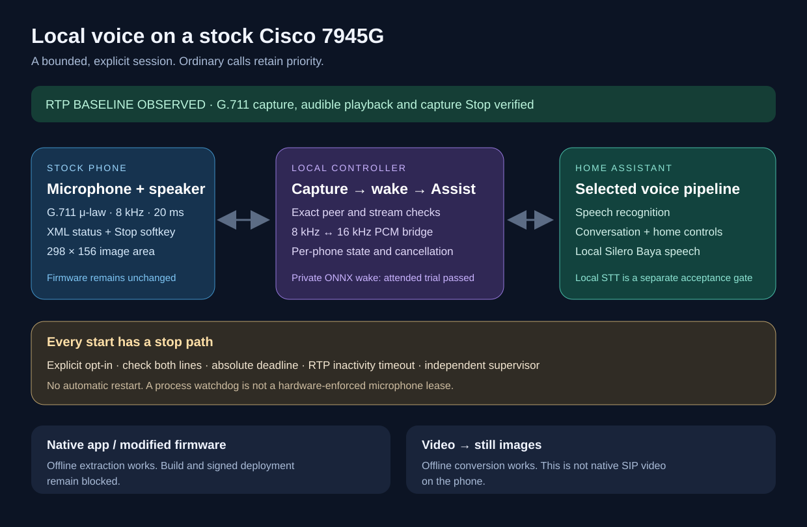
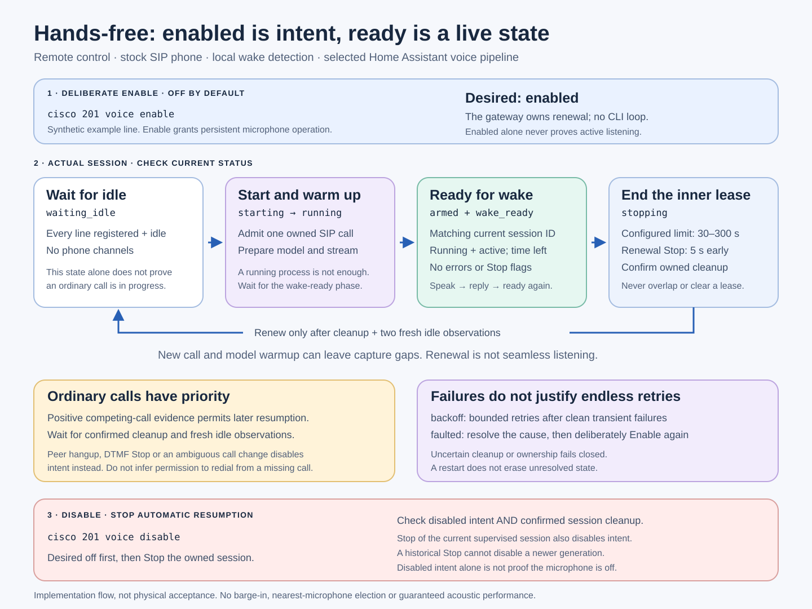

# Stock-phone voice assistant: implementation and acceptance

This implementation uses the **unmodified SIP45 firmware** on a Cisco 7945G.
The phone supplies microphone and speaker audio; a local host runs wake
detection and the Home Assistant connection. It supports explicitly started
finite sessions and an optional **hands-free policy** that supervises successive
bounded SIP speakerphone sessions. Hands-free is off by default and requires an
explicit Enable. Its persistent permission does not provide uninterrupted
capture: call setup, model preparation and renewal can leave gaps.

Use the [operator quickstart](voice-quickstart.md) for the current controls and
[the SIP transport guide](sip-voice-contingency.md) for hands-free prerequisites.
Implementation capability, installed revision and physical acceptance are
separate. The dated observations below retain their original transport and test
scope; they do not by themselves establish acceptance of a newer release.

The following diagram describes the original finite XML/RTP path. The hands-free
policy and its acceptance record are described separately below.



## Original finite XML/RTP implementation

- A source-pinned G.711 transport with sequence/timestamp checks, bounded
  reordering, explicit stream ownership and a separate cleanup supervisor.
- A controller connecting 8 kHz phone PCM to 16 kHz wake/STT input, with a
  per-phone permission check before hardware activation, call preemption,
  input inactivity timeout, explicit Stop and a configured absolute ceiling of
  at most 300 seconds. Manual mode handles one turn; a configured wake mode
  can rearm after successful replies within the original deadline.
- Manual activation and the exact frozen EchoMuse ONNX frontend. The private
  classifier, model files, phrase and manifest remain outside Git.
- Home Assistant Assist WebSocket input, conversation continuity within an
  explicitly active session, local decoding of returned speech and paced RTP
  playback. The selected HA pipeline determines whether STT/LLM/TTS is local.
- An English status display with a generated avatar, one replaceable frame,
  source-restricted HTTP routes, expiring session URLs and a Stop softkey.
- Optional session Start, status and exact-session Stop through the existing
  gateway, `cisco LINE voice`, **Home Phone Apps → Voice Assistant** and the
  companion HA action.
  See [voice control setup](voice-control.md); these require the matching
  runtime and private registry, not just an updated client.
- An offline firmware inspector and video-to-still converter. Neither changes
  phone firmware nor supplies a missing native SIP video decoder.

The layers have separate tests and clear contracts: [transport](voice-transport.md),
[voice coordinator](local-voice-assistant.md), [display](voice-display.md),
[firmware lab](firmware-lab.md) and [local STT](local-stt.md).

## Beta 12: opt-in hands-free supervision — 21 October 2026

Beta 12 adds explicit `cisco LINE voice enable` and `voice disable` controls,
with status separating persistent intent from the active session's readiness.
The compatible Home Assistant companion exposes an administrator-only
hands-free service and separate read-only desired-state and voice-status
entities. Updating a client or loading an eligible profile alone does not
activate capture.

While listening, the phone keeps an **active SIP speakerphone call** open as
the microphone and reply-audio transport. Its screen therefore continues to
show a connected Voice Assistant call between requests. This is an expected
part of this prototype, not the phone's normal idle screen. It still uses the
stock Cisco firmware; no replacement operating system is installed on the
phone. Use Disable to end the supervised listening mode and its owned call.



Hands-free requires the SIP AudioSocket transport, ONNX wake mode,
successful-turn rearming and an eligible bounded session duration. The gateway
owns renewal. It stops its current session before the inner lease expires,
confirms cleanup and obtains fresh idle observations before starting another.
This preserves bounded sessions and prevents overlapping ownership; it does
not promise seamless listening, barge-in or conversation memory across session
IDs. Only positively observed ordinary-call preemption permits automatic
resumption after the call and idle checks finish.

Disable removes persistent intent before requesting current-session cleanup.
Stopping the current supervised session also disables that intent; an old
exact-session Stop cannot disable a newer generation. Unresolved ownership,
cleanup or an unconfirmed ordinary-call dispatch can keep a fresh Enable
refused. See [pending-call recovery](voice-control.md#unconfirmed-ordinary-calls).
A clean gateway restart may retain enabled intent; an unresolved journal must
fail closed.

A readiness observation requires the same canonical phone and non-null session
ID in hands-free and finite status, enabled intent, both states running, active
media, null errors, no Stop flags, positive remaining time, and the
`armed` / `wake_ready` phase. Neither "enabled" nor "running" alone meets that
criterion. Readiness is also not proof that anyone heard a reply, and absence
of readiness is not proof that the microphone is off.

### Release and acceptance record

The hands-free implementation is pinned to
[source c8f7e83](https://github.com/4alvit/cisco-home-telephony/commit/c8f7e83ff4c2b443a7ac16b03f24895c9fbc0bec).
The paired Home Assistant component is version **0.6.0b1**,
[source 692f357](https://github.com/ha-homelab/asterisk-telephony/commit/692f357aa15d9ec1a1bbfd41753ac362cb49da60).
The integrated application suite ran 1,773 tests with four skips; the companion
completed all 92 tests on each of Home Assistant 2026.10.0 and 2026.10.2.

The [Beta 12 release record](https://github.com/4alvit/cisco-home-telephony/releases/tag/v0.1.0-beta.12)
is the canonical record for the downloadable image, checksums, installed-pilot
results and remaining physical limitations. Its build, installation and
acoustic results are separate claims; source tests alone do not establish a
working microphone, intelligible reply or acceptable range across a room.
Do not transfer the older XML/RTP measurements below to the SIP implementation.

Keep device identities, room labels, addresses, credentials, private wake
phrases and raw observations outside the public repository. Publish only the
release pins and appropriately scoped results. Software counters and read-only
status observations cannot replace a physical acoustic check.

## Physical evidence, 19 October 2026

One configured 7945G passed an initial stock-RTP test:

- A 10-second capture lease received **475 valid G.711 packets**, with no
  parser/source rejection reported. Samples were discarded, not recorded.
- The phone confirmed the transmit Stop. A new socket on the same destination
  port then observed **zero packets over two seconds**.
- A 15-second playback lease sent **689 packets**. The operator confirmed
  clearly audible sound; the phone acknowledged the receive Stop.

The first short, quiet playback trial was masked by TV/music. A louder,
longer, explicitly requested reference made the acoustic check useful.
Packet counts are not a speech-quality score or proof of room-distance wake
recognition. These results cover one phone, not every hardware revision.
Physical Mute, call coexistence and long-running acoustic behavior need their
own acceptance checks.

The exact wake frontend was also compared with its original implementation:
four deterministic PCM inputs, 32 seconds, 400 embedding rows and 340
classifier scores matched exactly. This establishes implementation parity,
not wake phrase detection in a real room.

Four existing synthetic positive clips also triggered the frozen classifier
after 8 kHz downsampling, G.711 encoding/decoding and the production 16 kHz
input conversion; peak scores were 0.9975–0.9986 against the unchanged 0.5
threshold. A subsequent 30-second physical capture delivered 1,479 frames
but produced no wake detection; the operator later confirmed missing that
window. In an attended retry, the wake detector activated after
320 valid frames (65 scored windows), with a peak score of **0.8497**. Remote
Stop was acknowledged and the supervisor finished without errors. No audio
was recorded. The operator could not confirm the on-screen outcome amid TV
and music, so this establishes a live detector activation without independent
ground-truth verification of that utterance. It does not establish acoustic
keyword accuracy, a false-accept/reject rate or acceptance across all phones.

The display now distinguishes initial model preparation from readiness. The
frozen frontend needs 1.28 seconds of incoming history before it can classify;
showing “Listening” immediately could lose a short phrase spoken at startup.

A separate compact HA conversation profile completed two synthetic requests
in **23.98 seconds** and **15.80 seconds**, including reply retrieval and
decoding. It preserves the original preferred profile and combines cloud STT
with a local conversation model and local Silero Baya speech. Its generated
1.2-second reply was sent to the physical phone in **60 RTP frames**;
the operator confirmed hearing the reply, and receive Stop and supervisor
completion were confirmed. That playback test did
not activate the microphone. These are separate wake, pipeline and output
checks; a complete spoken-command-to-answer room test remains unverified.

The later fully local candidate uses a separately qualified multilingual
small-int8 Whisper service, the compact local conversation agent and Baya.
Six synthetic full-cycle tests, covering clean PCM, PCMU and PCMA twice each,
returned correct transcripts and replies in **17.07–21.27 seconds** (median
**19.19 seconds**). A seventh test with different wording passed in
**27.10 seconds**. These timings include actual reply PCM delivered to a
silent sink at playback speed, but exclude phone transport and acoustic
latency. They do not guarantee cold-start or loaded-system performance.
The earlier base-model candidate was fast but misrecognized both codec
fixtures; its failed quality gate is retained in the
[recognition record](local-stt.md). Existing default HA pipelines were preserved.

## Finite-session acceptance still required

The updated controls expose session phase, fixed phase reason and completed-turn
count when the owning runner supplies them. `running` is not wake readiness,
and a software-completed reply is not proof of audible output. For the new
revision, record two distinct spoken requests and audible replies within one
wake session, return to readiness, measured reply latency, explicit Stop and
ordinary-call preemption. Verify the selected speech backend and voice at
deployment; a friendly pipeline name or an earlier Baya test is insufficient.
No cross-session conversation memory, barge-in, uninterrupted capture or
ten-phone acoustic acceptance is claimed. The Beta 12 record separately
tracks supervised renewal and its physical checks.

## Install and prepare

The instructions in this section describe the standalone finite XML/RTP
path. For supervised SIP hands-free operation, use the
[current quickstart](voice-quickstart.md#enable-hands-free-mode) and
[gateway setup](voice-control.md#hands-free-policy-and-status).

Use the [voice CLI installation guide](voice-cli-install.md) for a local
`cisco-voice` wrapper. For a one-shot cluster execution, use the
[suspended k3s Job guide](voice-k3s.md). The ordinary `cisco` call-control CLI
continues to work independently.

Before opening the microphone, run the [read-only pipeline preflight](voice-pipeline-preflight.md)
to check the exact configured speech services. For wake mode, the
[offline codec preparation tool](wake-qualification.md)
preserves a private corpus's labels while applying G.711 and the production
inbound converter. These checks complement the physical acceptance below;
neither activates a phone.

Keep two private configuration files. The transport file selects a provisioned
line, its hosting phone, the local bind address/ports and a finite lease. The
assistant file selects the exact HA pipeline and explicit per-phone permission.
Both example files are intentionally inert and contain synthetic values:

- [`phone-voice-transport.example.json`](../examples/phone-voice-transport.example.json)
- [`local-voice-assistant.example.json`](../examples/local-voice-assistant.example.json)

Use the **first-line phone ID** in `phones` in the assistant file. Either line
can select the same physical device in the transport file. Never infer the
mapping from odd/even numbering. HA tokens and model bundles belong under the
workspace's ignored `.local/`, with owner-only permissions.

Set the selected phone's permission to `true` in the private assistant file,
then validate without network or hardware actions. Validation itself does not
activate the microphone, even when the file permits a later live session:

```sh
cisco-voice \
  --transport-config .local/voice/transport.json \
  --voice-config .local/voice/assistant.json
```

After reviewing the selected phone and verifying that both lines are idle,
an attended session is:

```sh
cisco-voice \
  --transport-config .local/voice/transport.json \
  --voice-config .local/voice/assistant.json \
  --display-port 18110 \
  --run --attended --exclusive-media --enable-microphone
```

The host must own the transport bind address. Do not run this on a laptop
while selecting a server address. Ensure the selected phone can reach the
chosen UDP receive port and display TCP port. Permit only the intended local
source; do not publish either port to the Internet. The existing gateway
phone authentication callback must remain reachable.

The prototype uses internal transport helpers in the same repository revision.
Deploy these files together; independently upgrading one layer is unsupported.

## Stop, ownership and failure behavior

For the standalone finite XML/RTP path, use the live screen's **Stop**, or
Ctrl-C in the foreground `cisco-voice` runner. For a gateway-owned session,
`cisco LINE voice stop` reads and stops the exact current session;
`--session-id` can target a previously recorded session. Exiting the ordinary
`cisco` client does not stop a remote session. A finite session also ends on
call preemption, failed observation, inactivity, provider failure or lease
expiry. Finite mode does not automatically start another session. Optional
hands-free mode follows the separate Beta 12 renewal rules; use
`cisco LINE voice disable` to remove its persistent intent, including between
sessions, and then verify owned-session cleanup.

The original XML/RTP cleanup supervisor distinguishes a definite device
rejection from an ambiguous transport result. It cannot issue Stop while
its host is dead or the network is disconnected, and no hardware-enforced
RTP lease has been demonstrated on the phone. The SIP transport adds an
independent PBX channel deadline; that does not establish a hardware lease
for the separate XML/RTP path. An HTTP acknowledgement, channel deadline or
process exit is not a physical audio measurement. Test the selected
transport's failure and recovery cases before relying on it for persistent
operation, and retain unresolved cleanup as an error.

The display's own TTL bounds server memory and stale URLs. It does not prove
that the phone has dismissed its last rendered page or stopped audio. Stop
confirmation must come from the media controller, and a failed confirmation
must remain visible as an error.

## What remains conditional

A fully local experience needs a **working local STT provider**, a local
conversation agent, local TTS and the actual private wake classifier. A label
such as “Local” in a saved pipeline is not evidence of offline operation.
The [STT repair record](local-stt.md) separates the previously unavailable
Whisper provider from the cloud STT used by the existing profile.

Custom Java/native installation is currently blocked by the lack of a verified
compatible build and signed deployment route. The firmware lab recovered
bounded executable/archive material without executing it, changing hashes or
publishing Cisco binaries. Smooth/native incoming SIP video remains unsupported;
the separate frame converter proves offline still generation only.
