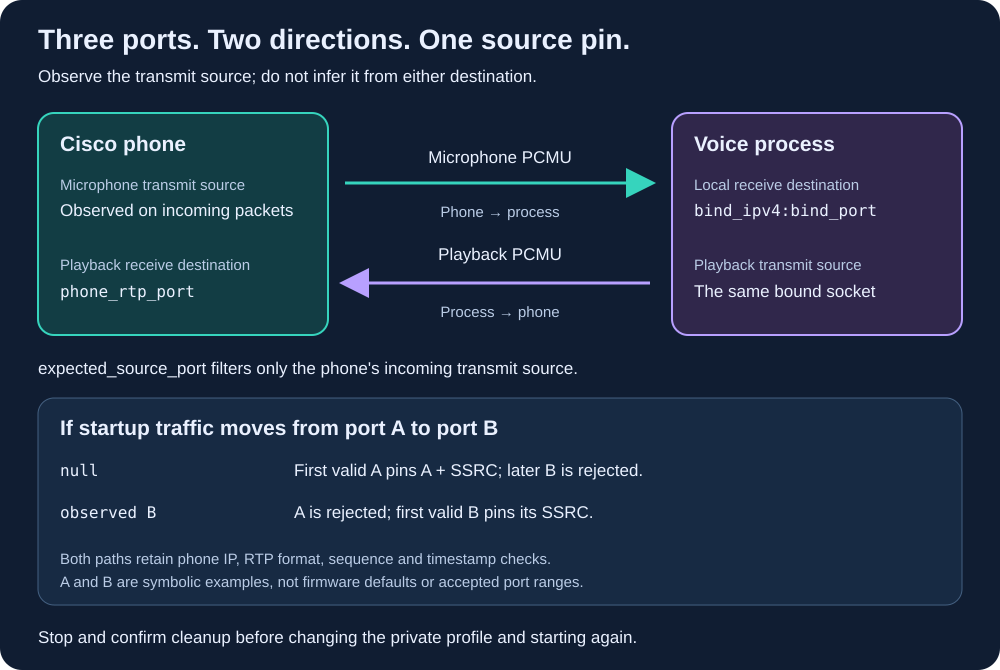

# Diagnose the phone's RTP transmit source port

If a voice session receives packets but ends with `receive_idle_timeout`, check
which packets the application accepts. A packet observed on the network is not
necessarily a valid frame delivered to the wake detector. Keep packet-source
diagnosis separate from model warmup, speech recognition and reply audibility.

## Three ports with different jobs

- **`bind_port`** is the voice process's local UDP receive port. `RTPTx` tells
  the phone to send microphone audio to `bind_ipv4:bind_port`.
- **`phone_rtp_port`** is the phone's playback destination. `RTPRx` tells the
  phone where to receive audio; the voice process sends playback there from
  its bound socket.
- **`expected_source_port`** optionally restricts the source port of incoming
  microphone packets. It describes an observed phone transmit port. It does
  not tell the phone which port to transmit from.

The phone transmit source need not equal either configured destination port.
Equal values in one observation do not establish a relationship or a firmware
default. The command ports `bind_port` and `phone_rtp_port` must be even and in
the documented Cisco range; an explicit `expected_source_port` is validated as
an integer from 1 through 65535. See the [transport contract](voice-transport.md#configure-without-starting-audio).

## What `null` actually does

With `expected_source_port: null`, the receiver first checks the selected
phone's source IP and validates the packet. The first valid RTP version 2,
payload type 0 packet with 160 bytes of PCMU audio pins **both its source port
and SSRC** for that receiver. Malformed packets and packets from another IP
cannot establish this pin.

Subsequent packets from another port increment `source_rejected`. A different
SSRC increments `ssrc_rejected` once the source check passes. Sequence and
timestamp checks still apply. There is no automatic relearning, port migration
or SSRC reset during the session.

A startup transition can therefore matter: if an early valid packet comes
from port A and the sustained stream comes from port B, a receiver initialized
with `null` remains pinned to A. Continuous sequence numbers and an unchanged
SSRC do not override that source-port check. With a verified explicit B, packets
from A are rejected before parsing; the first valid packet from B then pins
the SSRC. This is a filter for a **new session**, not a way to retarget a running
receiver or a guarantee that B will remain stable after future starts.

## Diagnose without weakening source checks

1. Identify the selected physical phone, the installed runtime and the process
   or Job that owns its voice session. Check ordinary phone status and voice
   status separately. Do not launch another receiver, media controller or
   gateway to compete for its socket or phone.
2. Inspect the owner's private final report and logs. Compare UDP `datagrams`
   with RTP `received`/`emitted`, `source_rejected`, `ssrc_rejected`, `malformed`
   and timestamp/sequence rejection counters. `source_rejected` also covers
   wrong IPs and invalid source metadata, so it alone does not prove a port
   transition. `emitted` can include silence inserted for bounded packet loss;
   it is not a count of received packets. Rejected packets do not refresh the
   receive-idle timer.
3. If another attended, bounded attempt is authorized, observe headers on the
   intended receiver's network path. Limit observation to that phone and local
   destination. Retain only the timing, source/destination tuple, RTP header
   fields and counters needed to compare startup with sustained traffic;
   discard audio payloads. Do not save a full packet capture or publish real
   addresses, ports, phone identifiers or session IDs.
4. Correlate the header observation with the application's report. Confirm
   the destination is the actual bound socket and check whether a source-port
   change precedes rejection. Wire continuity alone cannot establish delivery
   to the process, accepted PCMU frames or wake readiness. A header-only
   observation also cannot validate the audio payload.

Do not respond by accepting arbitrary source IPs, disabling SSRC/sequence/
timestamp checks, expanding the reorder window, or increasing timeouts to hide
a persistent source mismatch. If there is no supported source-port finding,
continue checking routing, firewall, socket ownership and the receiver's
reported rejection reason.

## Apply an observed port to a fresh session

First stop the exact session through its owner. For a gateway-owned session,
use [the normal status and Stop commands](voice-control.md#start-status-and-stop)
with the recorded session ID, then verify it is inactive and Stop is confirmed.
A separately launched wake Job requires its [own shutdown procedure](voice-wake-k3s.md#start-and-stop-an-attended-attempt).
If cleanup is uncertain, follow [ownership recovery](voice-control.md#deadlines-and-uncertain-cleanup)
and inspect the phone before another Start. Do not delete journals or locks,
send another controller's Stop, or restart the gateway merely to clear a refusal.

Once cleanup is established:

1. Update only `expected_source_port` in the authoritative **private transport
   configuration**, using the observed sustained source. Preserve the selected
   phone IP, `bind_port`, `phone_rtp_port` and all other checks. Do not copy the
   observed value into a public example or make it a global default.
2. Validate the configuration using the existing [transport dry run](voice-transport.md#configure-without-starting-audio).
   Validation checks the schema; it cannot prove that the phone will use the
   same source port on the next attempt.
3. Use the configuration path appropriate to the owner. A direct foreground
   runner reads its configuration on the next invocation. For the deployed
   gateway or wake Job, update and validate the private rendered revision
   through the [gateway](voice-gateway-deployment.md) or
   [wake Job](voice-wake-k3s.md) deployment procedure. Immutable Secrets and
   staged files are not edited in place. Do not edit a running session's
   snapshot or assume a changed host file has changed the active receiver.
4. Start one new, explicitly authorized finite session, with a fresh request
   key where the owner uses one. Check accepted frames and the matching
   session's [full wake-ready status](voice-quickstart.md#start-without-touching-the-handset).
   A successful configuration load or Start acknowledgement is insufficient.
5. Stop and verify cleanup again. Qualify speech pickup, audible replies and
   physical microphone closure separately. If the source changes again,
   preserve that result and investigate before another deliberate attempt;
   there is no automatic retry or relearning procedure.

## Bounded observation, not a universal firmware rule

During one beta10 diagnostic, retained header summaries showed two source
ports with continuous sequence numbers and the same SSRC. They did not retain
the chronological order of those ports. Paired with the application's accepted
packet and source-rejection counts, this supported a source-pinning mismatch.
In a subsequent bounded attempt, explicitly setting the privately observed
source port restored accepted frames in the application's final report. The
application reported `wake_ready`, and sustained traffic was observed on the
wire. The operator also confirmed normal software
Stop, an inactive session and a released ownership lock. The trial was not
loss-free. The playback destination was already configured; it was not
inferred from the transmit source or changed for this check.

This supports checking source-port pinning on that observed path. It does not
establish a universal Cisco source port, accepted-frame counts from wire
counts, usable speech, audible playback or physical microphone closure.
Repeated-session and acoustic qualification remain separate, and these
observations do not qualify a later image or release.
