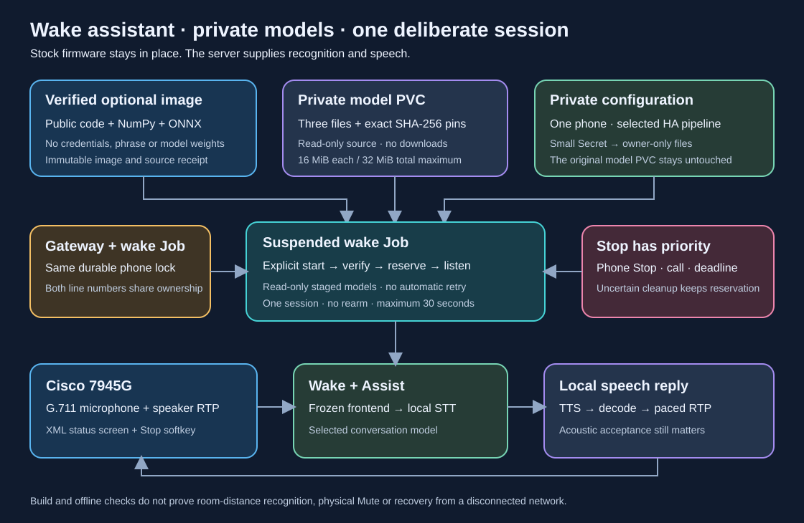

# One-shot wake assistant on k3s

This opt-in pilot connects the stock phone's microphone, a private frozen wake
model, the selected Home Assistant pipeline and RTP speech playback. It uses
the [optional wake image](voice-wake-runtime.md). It does not modify firmware.
It is not an always-on assistant: one deliberate start gives one session of
at most 30 seconds, including wake waiting and speech processing.



## Prepare the runtime

1. Build the optional image from the exact verified manual source/image pair.
   The **Optional wake image** GitHub Actions workflow builds both images,
   runs their offline smoke checks, and optionally exports one amd64 artifact
   for one day. It uses a standard public-repository runner and requires no
   paid marketplace action or external build account.
2. Import that artifact into the selected node's container runtime. Verify its
   archive checksum, source receipt, image configuration and platform. Resolve
   the imported image to an immutable `repository@sha256:...` reference.
3. Prepare an existing private PVC containing the three model files. Preserve
   the paths and SHA-256 values from the qualified bundle. The files must be
   readable by UID/GID `10001`; all path components must be real directories,
   with no symlinks. The tool does not download models or change this volume.
4. Find the **exact existing host directory** used by the gateway's voice
   controller for its `.lock` and `.json` journal files. The last component is
   `voice-control`; the directory must already be owned by UID `10001` with
   mode `0700`. Reuse it. A separate empty directory would defeat cross-process
   microphone ownership.

The renderer cannot prove that an operator-supplied host path is the gateway's
actual mount. Compare the live gateway's mount and private registry before
running a pilot. It deliberately uses `hostPath.type: Directory`, never creates
a missing directory, and does not set `fsGroup` on existing storage.

The gateway must be running the shared direct-control reservation implementation,
with voice control attached and the selected handset in its inventory. This
fences direct commands even when that handset has no manual voice profile.
Deploy the gateway using the current gateway renderer before enabling a wake
Job: its termination grace defaults to at least 180 seconds, with a larger
minimum for large inventories. An image-only update retaining an older 75-second
grace is insufficient. The gateway may retain callbacks for up to 145 seconds
while an external owner completes its full primary and uncertain-cleanup budgets,
and holds quiescent phones' locks through final listener closure.
Before releasing the suspended Job, resolve any gateway command with an unknown
outcome, including commands interrupted by a gateway crash or HTTP timeout, and
confirm the handset is idle. The temporary direct-command lock ends when its
process or request ends; it cannot exclude delayed delivery of an earlier HTTP
command. The Job does not automatically check or clear these uncertain operations.
Do not release new wake Jobs during gateway shutdown.

The model PVC is mounted read-only into a non-root init container. A separate
initializer creates the fresh private runtime directory; only that initializer
runs as root, with `CHOWN` and no access to models, credentials or host state.
Staging checks three digests and limits each model to 16 MiB, with a 32 MiB total.
It copies verified bytes to owner-only files. The running assistant receives
those files read-only and cannot access the source PVC.

## Render without activating a microphone

Keep all actual inputs under the ignored `.local` directory, with mode `0600`.
Use the existing site, transport and assistant schemas. Set `wake.mode` to
`onnx`, enable only the selected physical phone, and keep `rearm_after_turn`
false. Either phone line can select that same physical phone. Use the
[qualified local pipeline](local-stt.md) if offline processing is required.

```sh
python3 scripts/render_voice_wake_job.py \
  --site .local/site.json \
  --transport-config .local/voice/transport.json \
  --voice-config .local/voice/assistant.json \
  --bundle .local/voice/bundle.json \
  --voice-image 'registry.example/voice-wake@sha256:REPLACE_WITH_VERIFIED_DIGEST' \
  --models-claim private-wake-models \
  --state-host-path /srv/telephony/state/voice-control \
  --display-port 18110 \
  --output .local/voice/wake-job.json
```

Names and paths in this example are placeholders, not a household inventory.
The output is an exclusive, owner-only file containing a small Secret and a
**suspended** Job. It contains credentials; never commit it or attach it to a
public issue. Model bytes do not enter the Secret, repository, image or artifact.
Rendering makes no network request and does not contact a phone.

Review the exact node, phone, ports, immutable image, PVC and shared state path.
The output has no automatic retry: `backoffLimit: 0`, `restartPolicy: Never`,
one completion, `podReplacementPolicy: Failed`, and no CronJob. Kubernetes can
still create a replacement Pod in some failure cases. The renderer therefore
passes a stable attempt ID derived from this Job's revision; the runner consumes
that ID durably before starting media. Recreating the same Job or restarting its
Pod cannot replay the attempt.

After an attempt has been consumed, a new attended attempt requires rendering a
new manifest with a deliberately new `--name`, such as `phone-wake-pilot-02`.
First verify that the previous session finished and its media cleanup is
confirmed. This applies even when the previous attempt failed before a useful
answer. Never delete `wake-attempt-*.consumed` files to make an old attempt run
again. Changing configuration also changes the Job identity; it does not
authorize overlapping attempts or bypass an unresolved ownership journal.

Kubernetes can start the same Job program more than once even with one
completion and `restartPolicy: Never`. The durable attempt record is therefore
required in addition to the Job settings.
[Kubernetes Job failure handling](https://kubernetes.io/docs/concepts/workloads/controllers/job/#handling-pod-and-container-failures).

## Start and stop an attended attempt

Before unsuspending, review the selected node and the current scheduler-accounted
resource requests. The rendered worker and each sequential init container request
**20m CPU, 128 MiB memory and 128 MiB ephemeral storage**; the corresponding limits
remain **1000m CPU, 512 MiB memory and 256 MiB ephemeral storage**. Available request
headroom must cover the effective Pod request, including any admission defaults
or Pod overhead. Low current CPU usage alone does not establish scheduling
headroom. Check node readiness, pressure and scheduling restrictions, the exact
model PVC's binding/topology and read permissions, and availability of the
reviewed immutable image on that node or through its intended registry.
These observations are not an atomic reservation or a guarantee of startup.

Apply the reviewed manifest with an explicit kubeconfig and context:

```sh
kubectl --kubeconfig .local/kubeconfig --context YOUR_CONTEXT --request-timeout=10s apply \
  -f .local/voice/wake-job.json
```

The applied Job remains suspended. Read its exact name from the private
manifest; do not select a Job using an unbounded label or wildcard.

### Read-only startup and status snapshot

Use this finite snapshot before release and again when checking startup. Replace
the context, namespace and Job placeholders consistently. Each run creates a new
private directory and makes two bounded reads; it does not start or stop anything.
The Job snapshot captures its UID. The label only narrows the candidate Pod list:
the Python check accepts a Pod only when its **controller owner reference**
matches that exact Job's API version, kind, name and UID.

```sh
umask 077
wake_snapshot=$(mktemp -d .local/voice/wake-inspect.XXXXXX) || exit 1
kubectl --kubeconfig .local/kubeconfig --context YOUR_CONTEXT --request-timeout=10s \
  -n YOUR_NAMESPACE get job EXACT_JOB_NAME -o json \
  > "$wake_snapshot/job.json" || exit 1
kubectl --kubeconfig .local/kubeconfig --context YOUR_CONTEXT --request-timeout=10s \
  -n YOUR_NAMESPACE get pods -l batch.kubernetes.io/job-name=EXACT_JOB_NAME -o json \
  > "$wake_snapshot/pods.json" || exit 1
python3 - "$wake_snapshot" <<'PY'
import json
from pathlib import Path
import sys

root = Path(sys.argv[1])
job = json.loads((root / "job.json").read_text())
meta = job["metadata"]
uid = meta["uid"]
if job["apiVersion"] != "batch/v1" or job["kind"] != "Job" or not uid:
    raise SystemExit("Unexpected Job identity; stop and inspect.")
pods = json.loads((root / "pods.json").read_text())["items"]
owned = [
    pod for pod in pods
    if pod["metadata"].get("namespace") == meta["namespace"]
    and any(
        owner.get("controller") is True
        and owner.get("apiVersion") == "batch/v1"
        and owner.get("kind") == "Job"
        and owner.get("name") == meta["name"]
        and owner.get("uid") == uid
        for owner in pod["metadata"].get("ownerReferences", [])
    )
]
print(json.dumps({"job_uid": uid, "suspended": job["spec"].get("suspend", False),
                  "deleting": bool(meta.get("deletionTimestamp")),
                  "owned_pods": len(owned)}))
if len(owned) != 1:
    raise SystemExit("No single owned Pod: not ready; inspect before any further start.")
pod = owned[0]
status = pod.get("status", {})
print(json.dumps({"pod": pod["metadata"]["name"], "pod_uid": pod["metadata"]["uid"],
                  "phase": status.get("phase", "Unknown"),
                  "deleting": bool(pod["metadata"].get("deletionTimestamp"))}))
for container in status.get("initContainerStatuses", []) + status.get("containerStatuses", []):
    state = container.get("state", {})
    detail = next(iter(state.values()), {})
    print(json.dumps({"container": container["name"], "ready": container.get("ready", False),
                      "state": next(iter(state), "Unknown"),
                      "reason": detail.get("reason"),
                      "restarts": container.get("restartCount", 0)}))
PY
```

Zero Pods is expected while the Job remains suspended. After release, zero Pods
or waiting reasons require inspection; multiple owned Pods require inspection
even if only one appears active. Compare the captured Job UID with the previous
snapshot: a different UID means a replacement object and requires fresh review.
Keep these snapshots private. They are separate observations, not an atomic
ownership check. Do not use their label selector for mutations.

`Pending`, `Running`, container `ready: true`, and successful init containers
describe Kubernetes startup only. They do **not** establish microphone readiness,
wake recognition or media cleanup. A Pending Pod can start later as capacity or
storage becomes available.

### Release only while attended

When ready at the phone, start that one reviewed Job:

```sh
kubectl --kubeconfig .local/kubeconfig --context YOUR_CONTEXT --request-timeout=10s \
  -n YOUR_NAMESPACE patch job EXACT_JOB_NAME --type merge \
  -p '{"spec":{"suspend":false}}'
```

Stay at the phone until its live assistant screen shows **Listening**, or stop
the exact attempt if it cannot be observed. Do not leave an unsuspended Pending
Job to activate later without an attendant. Remain present through the turn and
confirmed cleanup; if you must leave during startup, request Stop and verify
closure first. A status snapshot or request timeout does not authorize a retry.

The frontend first needs 1.28 seconds of
actual microphone history. Say the private wake phrase, then a short question.
The display progresses through Listening, Thinking and Speaking. Use its
**Stop** softkey on that live screen to finish. **Applications → Voice Assistant**
opens the separate gateway controls; its Stop cannot signal this standalone
Job. For known external ownership, that page displays guidance instead.
If the live screen is unavailable, have the operator terminate the exact Job
as described below. The normal SIP call observer also ends capture when the
phone becomes busy, unavailable or uncertain.

For a remote stop, terminate this exact Job with its normal 120-second grace
period. This is the wake Job's own stop budget; the gateway Deployment separately
requires at least 180 seconds so its callbacks can outlive a draining Job:

```sh
kubectl --kubeconfig .local/kubeconfig --context YOUR_CONTEXT --request-timeout=10s \
  -n YOUR_NAMESPACE delete job EXACT_JOB_NAME --grace-period=120 --timeout=150s
```

The Job budget includes up to 45 seconds waiting for the child to stop,
two seconds for its report, a separate 55-second uncertain-cleanup drain, and
18 seconds of margin. A shorter grace can kill the wrapper before that drain
finishes.

Do not use force deletion or a zero grace period as a normal stop mechanism.
The process forwards shutdown to the session owner and preserves time for the
media supervisor to confirm closure. A dead host or broken network can still
prevent remote Stop; inspect the handset if confirmation is unavailable.

This standalone process shares the gateway's reservation journal, so a gateway
Start refuses concurrent ownership of the same physical phone, even through
its other line. The existing gateway cannot signal another process's child.
Its status may report `recovery_required` / `voice_owner_unavailable` while the
Job owns the device. These fields do not prove current microphone activity.
Use the live assistant screen's Stop or the exact Job's termination for this
pilot; neither the ordinary `cisco LINE voice stop` command nor the
[Applications gateway controls](voice-control.md#gateway-and-interface-integration)
owns the Job's process.

The Job has a 120-second outer deadline for startup and cleanup. This does not
extend the owner's 30-second media session. Keep the last structured result
private and check both conversation outcome and Stop confirmation. A failed or
ambiguous result retains its durable reservation; never delete a journal or
lock file to make a retry pass.

## Collect the result and remove temporary credentials

The Job and its Pods expire five minutes after completion. Refresh the
owner-checked snapshot above and use its exact Pod name and UID; do not choose a
Pod from a label alone. Capture a bounded, non-following log snapshot while that
Pod still exists, using the new private snapshot directory:

```sh
umask 077
kubectl --kubeconfig .local/kubeconfig --context YOUR_CONTEXT --request-timeout=10s \
  -n YOUR_NAMESPACE logs pod/EXACT_OWNER_CHECKED_POD_NAME -c wake-pilot \
  --tail=200 --limit-bytes=65536 > "$wake_snapshot/wake-result.log"
```

An absent or truncated final result leaves cleanup unconfirmed. Repeat an
explicit snapshot if needed while still attending the phone; do not start an
unbounded watch or treat a log timeout as proof that the Pod stopped.
If startup failed before the main container ran, inspect that same owned Pod's
`prepare-private-runtime` or `stage-pinned-models` container instead. The main
result separates two outcomes:

- `turn_success` and `success` are true only for a completed conversation turn
  with confirmed cleanup and a successful runner exit.
- `cleanup_success` reports successful release of the session's media ownership.
  It can be true after a manual Stop or an expired lease even though the
  conversation did not finish. Inspect `reason` and `voice.stop_confirmed`.

A successful init container only proves preparation. Deleting a Job during a
remote Stop can also remove its log source, so capture output before deletion
when available.

The generated Secret is a separate object and **does not expire with the Job**.
After this Job's Pods have terminated and no other pilot uses the same Secret,
read its exact name from the private manifest and remove that Secret:

```sh
kubectl --kubeconfig .local/kubeconfig --context YOUR_CONTEXT --request-timeout=10s \
  -n YOUR_NAMESPACE delete secret EXACT_SECRET_NAME_FROM_MANIFEST --timeout=30s
```

The model PVC and shared gateway reservation directory remain in place.
Deleting temporary Kubernetes objects never clears an unresolved reservation
or proves that the phone stopped sending audio. Preserve uncertain state for
inspection and confirm the physical phone's state before another attempt.

## Acceptance and limits

Offline tests cover private staging, source replacement, concurrent
initialization, malformed configuration, shared gateway/Job exclusion,
configuration changes, duration expiry, and uncertain cleanup. The optional
image smoke executes real ONNX Runtime inference on a generated weightless
graph. These checks do not establish room-distance wake accuracy.

The existing local speech pipeline took roughly 17–27 seconds in synthetic
full-cycle tests. Waiting for a wake phrase and loading the model consume part
of the same short session; a slow reply can hit the limit. A pilot may therefore
demonstrate working components without completing every spoken request.

Before unattended use could be considered, measure actual wake accuracy,
false activations, physical Mute, call preemption and recovery after network
loss. No such unattended mode is enabled here. Stock 7945G firmware still
provides XML images and RTP audio, not native incoming SIP video decoding.
See the [implementation evidence](voice-rollout.md) and
[firmware feasibility](native-app-feasibility.md).
