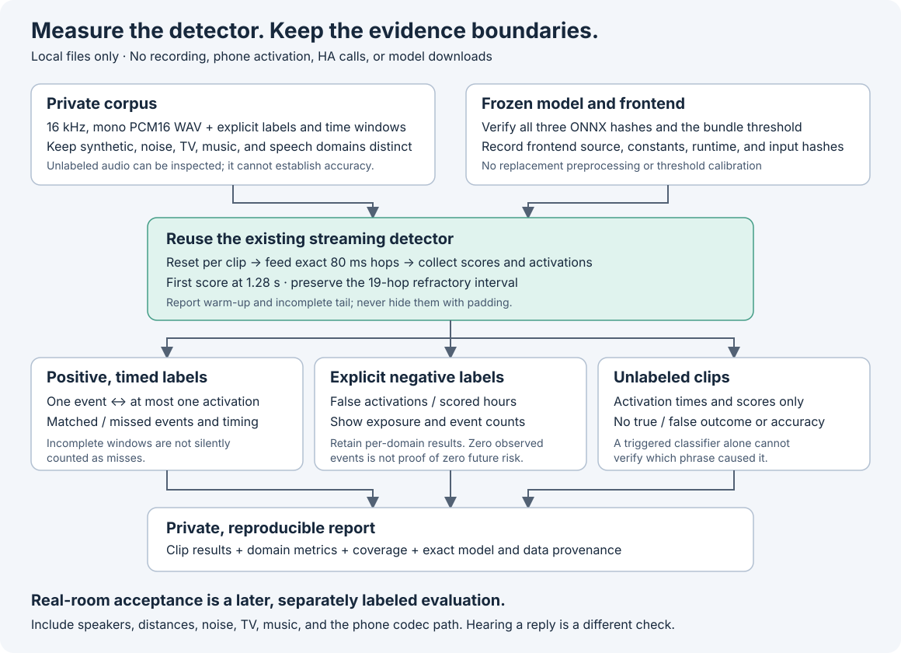

# Offline wake qualification

`scripts/wake_evaluate.py` evaluates saved audio through the existing frozen
wake detector. It never records a microphone, contacts Home Assistant, starts a
phone session, downloads a model, or changes a runtime profile. A classifier
activation is an observation. It becomes a true or false outcome only when a
clip has an explicit, usable ground-truth label.



## Evidence this workflow can produce

The evaluator reports clip-relative activation times, classifier scores,
matching results, audio coverage, processing time, and model/data provenance.
It resets the detector for each clip and uses the production
`FrozenOnnxWakeDetector` without changing its frontend or threshold.

Keep three kinds of evidence distinct:

- A scripted demo checks reporting and matching behavior. Its scores are not
  produced by the ONNX model and cannot measure model accuracy.
- Deterministic non-speech fixtures exercise the real model on a reproducible
  synthetic domain. They contain no positive wake-phrase examples and cannot
  measure recall or real-room accuracy.
- Owner-labeled WAVs can measure detection quality on the supplied corpus.
  Their labels, recording conditions, and coverage determine what the result
  supports. No recording or label is collected automatically.

The earlier attended phone trial demonstrated a detector activation, with
320 valid frames and a peak score of 0.8497. No audio recording or independent
confirmation of the spoken phrase exists for that trial. It is not a labeled
positive example. The separate confirmation of hearing a rendered reply
establishes audibility, not keyword correctness.

## Private inputs and outputs

Keep model bundles, manifests, audio, and evaluation results in the repository's
ignored `.local` tree. Use opaque clip identifiers rather than household names
or the wake phrase. Created directories use mode `0700`; generated files use
`0600`. Existing output directories are not overwritten. Do not copy private
manifests, model weights, transcripts, or audio into public examples or commits.

Use uncompressed, little-endian PCM16 WAV at exactly 16 kHz and one channel.
The evaluator rejects a different format instead of silently resampling it.
For a codec comparison, retain the original labeled corpus and create a
separate decoded round trip with the preparation command below. An upsampled
telephone recording still has telephone bandwidth.

### Prepare a reproducible PCMU comparison

[`prepare_telephony_wake.py`](../scripts/prepare_telephony_wake.py) converts a
validated private 16 kHz corpus with deterministic offline preparation:
pair-average to 8 kHz, then reuse the production G.711 mu-law encode/decode and
inbound 20 ms frame converter back to 16 kHz. It preserves clip IDs, labels,
event times, and the exact original sample count. Any final partial frame is
padded only inside the conversion, then trimmed to its original length.

```sh
python3 scripts/prepare_telephony_wake.py \
  --manifest .local/wake-evaluation/owner-corpus/manifest.json \
  --output .local/wake-evaluation/owner-corpus-pcmu \
  --late-tolerance-seconds 1

.local/voice-venv/bin/python scripts/wake_evaluate.py evaluate \
  --manifest .local/wake-evaluation/owner-corpus-pcmu/manifest.json \
  --bundle .local/voice/bundle.json \
  --output .local/wake-evaluation/owner-corpus-pcmu-results \
  --late-tolerance-seconds 1
```

Use the same bundle, threshold and late tolerance for the original-corpus run.
The preparation command validates all inputs before creating the output
directory. It writes owner-only WAV files, an evaluator-compatible
`manifest.json`, `summary.safe.json`, and `provenance.private.json`. Provenance
contains the original manifest and WAV hashes, converted WAV/PCM hashes,
encoded-stream hashes, tail padding counts, and hashes of the exact conversion
implementations. Existing output directories are not overwritten.

This is a **digital codec fixture**, not an acoustic recording. The preparation
uses a two-tap averaging filter, not a full telephone band-pass or microphone
model. This 16-to-8 kHz preparation does not reproduce the outgoing
`RtpPCMSink` resampler, which uses different interpolation. Actual microphone
RTP arrives from the phone at 8 kHz; the reusable production stages here are
G.711 and the inbound 8-to-16 kHz converter. It does not simulate room
reverberation, speakerphone processing, gain control, packet loss, or background
sound. Passing this comparison therefore
does not establish room-distance accuracy. The script never opens a socket,
microphone, phone session, or model runtime.

Annotations retain their source type: a transformed owner recording remains
`recorded`, and a transformed generated clip remains `synthetic`. Treat the
original and its transformed copy as a paired comparison, not two independent
speakers or recordings. Do not pool the copies to inflate exposure hours or
accuracy confidence.

## Run the evaluator

Run these commands from the repository root. Python 3.10 or newer is required.
Create the ignored `.local` directory first if it does not already exist.
The demo and fixture generator do not require NumPy, ONNX Runtime, or private
model files:

```sh
python3 scripts/wake_evaluate.py demo \
  --output .local/wake-evaluation/demo

python3 scripts/wake_evaluate.py fixtures \
  --output .local/wake-evaluation/fixtures
```

For real inference, use an environment already prepared with the optional
`voice_assistant/requirements-onnx.txt` dependencies and the reviewed private
bundle. The evaluator itself performs no installation or download:

```sh
.local/voice-venv/bin/python scripts/wake_evaluate.py evaluate \
  --manifest .local/wake-evaluation/fixtures/manifest.json \
  --bundle .local/voice/bundle.json \
  --output .local/wake-evaluation/model-run
```

Each output directory must be new. The command prints a safe aggregate summary
and writes `summary.safe.json`, `results.private.json`, and
`provenance.private.json`. The demo puts these reports in its `evaluation`
subdirectory. Per-clip observations and detailed provenance remain private. A completed run does not
mean that the model met an acceptance target; inspect the measured outcomes and
the kind of evidence used.

To evaluate existing owner-labeled audio, provide a version-one JSON manifest.
This example describes the schema; it needs the indicated private WAV files
before it can run:

```json
{
  "format_version": 1,
  "clips": [
    {
      "id": "target-001",
      "path": "audio/target-001.wav",
      "label": "positive",
      "domain": "speech",
      "label_source": "recorded",
      "expected_events": [{"start_seconds": 2.0, "end_seconds": 3.0}]
    },
    {
      "id": "background-001",
      "path": "audio/background-001.wav",
      "label": "negative",
      "domain": "tv",
      "label_source": "recorded",
      "expected_events": []
    },
    {
      "id": "unreviewed-001",
      "path": "audio/unreviewed-001.wav",
      "label": "unlabeled",
      "domain": "music",
      "label_source": "recorded",
      "expected_events": []
    }
  ]
}
```

Paths are relative to the manifest. `recorded` means existing owner-provided
audio, not a request to record. `synthetic` identifies generated material.
Domains are `speech`, `noise`, `tv`, `music`, `silence`, and `other`; use `other`
for mixtures that cannot be assigned one domain. Clip IDs must be unique. Keep
this manifest and its WAVs owner-only. Negative and unlabeled clips have no
expected events. Positive clips require at least one labeled occurrence.
Symlink paths and paths outside `.local` are rejected. Each run accepts at most
100 clips, 600 seconds per clip, 1,800 seconds in total, 20 MiB per WAV, and
64 MiB across WAV files. Each clip may have at most 100 expected occurrences.

The default late tolerance is one second. Use
`evaluate --late-tolerance-seconds VALUE` to declare a different allowance for
the entire run, and keep it fixed across comparisons. With the example above,
the positive matching window ends at four seconds; the WAV needs complete
scoring coverage through that endpoint.

## Labeling and event matching

A positive label needs timestamped target occurrences. Review their start and
end positions in the provided WAV; do not derive labels from the detector's
own score peaks. The matching window includes the labeled occurrence and the
declared late tolerance. One activation can match at most one occurrence, and
one occurrence can match at most one activation. Overlapping windows use a
maximum-cardinality assignment: the evaluator matches as many occurrences as
possible. When several assignments are valid, reported latency follows that
deterministic assignment; it is not a separate latency optimization.

Matched occurrences count as true positives; unmatched evaluable occurrences
count as false negatives. Extra activations in a positive clip remain separate
unmatched detections. They are not automatically false accepts: a positive clip
does not establish that every other instant contains no target phrase.

An explicit negative label asserts that the target phrase is absent throughout
the clip. Its detector activations count as false accepts. Unlabeled clips
retain observations but do not contribute to recall, miss rate, or false-accept
exposure. Missing labels must never be interpreted as negatives.

Keep the annotation rule acoustic and explicit. A target phrase spoken by a TV
is still a target occurrence when measuring keyword recognition. Whether a
voice assistant should act on TV speech is a separate source/intent policy.
Do not label that clip negative merely because the household did not intend a
command.

## Timing and duration denominators

The unchanged frontend consumes 1,280-sample hops: 80 ms at 16 kHz. Its first
score occurs at the end of hop 16, at 1.28 seconds. It uses 480 samples of left
context, 76 initial mel frames of ones, `raw_mel / 10 + 2`, an embedding input of
`[1, 76, 32, 1]`, and a classifier input of `[1, 16, 96]`. The existing 19-hop
refractory interval remains in force. No extra smoothing, sigmoid, padding,
normalization, or score-based relabeling is applied.

For `H` complete hops, there are `max(0, H - 15)` scoring opportunities. Scored
exposure is that count multiplied by 0.08 seconds. This convention counts the
first scoring opportunity as one hop of exposure; the required initial audio
context is still 1.28 seconds. Reports keep total audio duration, the unscored
warm-up, and the incomplete trailing hop separate. Refractory windows remain in
the exposure because suppression is part of the evaluated detector policy.

False accepts per scored hour are the number of activations in explicitly
negative clips divided by their scored exposure in hours. A missing or zero
denominator produces an undefined metric, not a zero rate. Positive-event recall
and miss rate use the count of evaluable labeled occurrences, not audio hours.
Do not mix these denominators or call a clip percentage an hourly rate.

Provide enough pre-roll and trailing audio to cover every positive matching
window. A window cut off by startup or end-of-file is not a fair negative result.
The evaluator rejects unusable positive windows rather than silently counting
them as misses. It also reports any unused partial hop instead of padding it.

Detection time is an audio position, not wall-clock response latency. Matching
latency is relative to the labeled phrase end and can be negative when the
detector fires during the phrase. Processing time and real-time factor describe
this offline run on this machine; they are not phone, network, or speech-reply
latencies.

## Domain separation and reproducibility

Review noise, TV, music, clean speech, mixtures, and generated synthetic material
separately. Report each domain's event counts and exposure alongside its rates.
Adding hours of easy synthetic silence must not hide poor TV or music results.
Reports separate every domain and source type. When recorded and synthetic
clips occur in one manifest, pooled accuracy metrics are undefined; use the
individual strata.
Original and codec-transformed copies of the same utterance are related samples,
not independent speakers or recording sessions.

Each real-model report records the bundle digest, all three verified ONNX
digests, the frozen threshold, frontend identity and constants, source hashes,
runtime versions, evaluation settings, and input hashes. Keep that report with
the exact manifest and audio. Compare candidate models on the same held-out
corpus and matching rules; record a changed threshold as a different experiment.
This tool does not select or deploy a threshold or model.

## Remaining real-room acceptance

Before claiming household wake quality, prepare a separately authorized and
labeled corpus covering representative speakers, intended distances, microphone
placement, quiet speech, competing speech, noise, TV, and music. Include both
target occurrences and long target-absent periods through the intended phone
codec path. Preserve enough leading context and trailing tolerance for each
target. Keep evaluation recordings separate from training and tuning material.

Agree on acceptable miss rates, false accepts per hour, and detection timing
before examining the held-out results. Report corpus size, exposure by domain,
misses, extra activations, and the limitations of the sample. Zero observed
false accepts in a short test does not establish zero future risk. The tool
does not supply a statistical confidence bound or a room-distance guarantee.

Only a later attended hardware trial can establish microphone indication,
mute/Stop behavior, call preemption, and a complete acoustic request-to-reply
turn. Running this offline evaluator does not enable an always-on listener.
